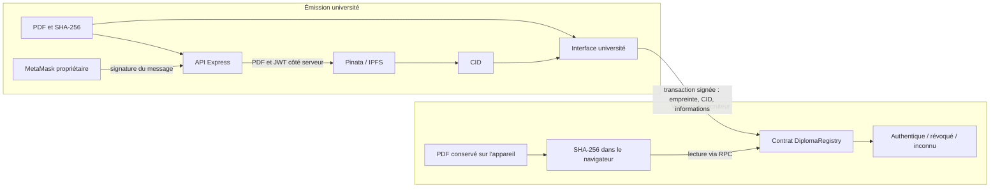

# DiplômeChain — Vérification de diplômes par blockchain

Projet pédagogique de certification et de vérification de diplômes PDF, présenté dans le contexte de l’**Université de Sousse — École Supérieure des Sciences et de la Technologie de Hammam Sousse**.

L’université enregistre l’empreinte numérique d’un diplôme dans un contrat intelligent. Un recruteur peut ensuite vérifier si le PDF qu’il reçoit correspond exactement à un diplôme enregistré et s’il a été révoqué.

**Il s’agit d’un prototype sur réseau de test. Les diplômes de démonstration n’ont pas de valeur légale. Utiliser uniquement des données fictives.** Le nom de l’établissement fournit le contexte du projet ; il ne constitue pas une preuve d’adoption officielle du service.

## Sommaire

1. [Objectif et principe](#1-objectif-et-principe)
2. [Les trois espaces et les comptes](#2-les-trois-espaces-et-les-comptes)
3. [Fonctionnement d’un diplôme](#3-fonctionnement-dun-diplôme)
4. [MetaMask et propriétaire du contrat](#4-metamask-et-propriétaire-du-contrat)
5. [Architecture et technologies](#5-architecture-et-technologies)
6. [Installation et configuration](#6-installation-et-configuration)
7. [Déploiement et contrôle du contrat](#7-déploiement-et-contrôle-du-contrat)
8. [Démonstration pour l’évaluation](#8-démonstration-pour-lévaluation)
9. [Tests et état de validation](#9-tests-et-état-de-validation)
10. [Limites et améliorations possibles](#10-limites-et-améliorations-possibles)
11. [Dépannage](#11-dépannage)
12. [Organisation du code et glossaire](#12-organisation-du-code-et-glossaire)

## 1. Objectif et principe

Un PDF peut être copié ou modifié. Le projet permet de contrôler son **intégrité**, son **enregistrement par l’émetteur configuré** et son **statut actuel**, sans se fier uniquement à son apparence ou à un cachet dessiné.

Le navigateur calcule une empreinte **SHA-256** à partir de tous les octets du fichier. Cette empreinte est représentée par `0x` suivi de 64 caractères hexadécimaux. Le contrat associe cette empreinte aux informations du diplôme.

Lors d’une vérification, le navigateur recalcule l’empreinte et interroge le registre. Une modification d’un seul octet produit, en pratique, une autre empreinte et donc aucune correspondance avec l’enregistrement d’origine. Cela vaut aussi pour une modification invisible, comme certaines métadonnées PDF.

**Ce que la preuve signifie :** les octets du fichier correspondent à un enregistrement de ce contrat, effectué par son propriétaire, et cet enregistrement est encore valide ou a été révoqué. La blockchain ne vérifie pas elle-même la réussite aux examens, l’identité réelle de l’étudiant ou l’accréditation de l’émetteur.

## 2. Les trois espaces et les comptes

| Espace | Utilisateur | Fonctionnalités | Accès |
| --- | --- | --- | --- |
| Accueil | Visiteur | Présentation du service, fonctionnement, établissement et accès aux espaces | Libre |
| Recruteur | Entreprise / recruteur | Vérifier un PDF et consulter son historique personnel | Compte recruteur ; aucun portefeuille nécessaire |
| Université | Administration | Importer ou générer un PDF, l’envoyer sur IPFS, émettre, vérifier, lister et révoquer | Compte administrateur, puis portefeuille propriétaire sur le bon réseau |

### Comptes de démonstration

| Compte | Identifiant | Mot de passe |
| --- | --- | --- |
| Recruteur — Entreprise Démo | `rec` | `rec` |
| Administrateur — Université de Sousse | `admin` | `admin` |

Ces identifiants sont volontairement simples et publics. Ils sont créés à la première connexion ou inscription dans chaque navigateur. Les anciens comptes de démonstration sont migrés en conservant leur identifiant interne et leur historique. Se déconnecter pour passer d’un espace à l’autre.

L’inscription publique crée uniquement un **recruteur** : nom d’entreprise, email valide et mot de passe d’au moins huit caractères. Les identifiants courts ci-dessus sont des exceptions réservées aux comptes de démonstration. Aucun formulaire public ne crée d’administrateur.

### Nature de l’authentification

Les comptes, la session et les 100 dernières vérifications de chaque recruteur sont enregistrés dans le `localStorage` du navigateur. Les mots de passe saisis sont stockés sous forme d’empreintes SHA-256 avec un sel aléatoire propre à chaque compte. L’historique contient le nom du fichier, le verdict et la date ; il ne conserve pas le PDF. Effacer les données du site supprime ces informations locales.

**Cette authentification est une simulation, pas une sécurité de production.** Le stockage local et les rôles peuvent être modifiés par l’utilisateur ; les identifiants de démonstration sont connus. Le compte `admin` permet d’ouvrir l’interface, mais ne donne pas le contrôle du portefeuille. Les opérations du registre restent soumises au contrôle `onlyOwner` du contrat déployé.

### Routes

Le site utilise `HashRouter` : les chemins apparaissent après `/#/` dans l’adresse.

| Route | Exemple local | Fonction |
| --- | --- | --- |
| `/` | `http://localhost:5173/#/` | Accueil |
| `/recruteur/connexion` | `http://localhost:5173/#/recruteur/connexion` | Connexion / inscription recruteur |
| `/recruteur/verifier` | `http://localhost:5173/#/recruteur/verifier` | Vérification, accessible après connexion recruteur |
| `/universite/connexion` | `http://localhost:5173/#/universite/connexion` | Connexion administrateur |
| `/universite` | `http://localhost:5173/#/universite` | Tableau de bord administrateur et contrôles du portefeuille |
| Autre chemin | — | Page introuvable |

## 3. Fonctionnement d’un diplôme

### A. Émission par l’université

1. L’administrateur se connecte et utilise le portefeuille propriétaire du contrat, sur le réseau configuré.
2. Il renseigne le nom, le prénom, la filière et l’année.
3. Il importe un PDF ou le génère depuis le formulaire. Le navigateur calcule son SHA-256.
4. Il autorise l’envoi par une **signature de message MetaMask**. Le serveur vérifie cette autorisation, puis envoie le PDF à Pinata pour son stockage sur IPFS. Pinata renvoie un **CID**.
5. Il confirme une **transaction MetaMask** appelant `emettreDiplome`. L’empreinte, le CID et les informations sont inscrits dans le registre.
6. Après confirmation, l’interface fournit un lien vers la transaction et actualise la liste des diplômes.

Conserver le **PDF exact** utilisé. Générer à nouveau un diplôme visuellement identique peut produire d’autres octets, notamment à cause de sa date de création, et donc une autre empreinte.

### B. Vérification par un recruteur

1. Le recruteur se connecte et sélectionne un PDF ou le dépose dans la zone prévue.
2. Le navigateur calcule son SHA-256 **localement**.
3. L’application appelle `verifierDiplome` en lecture via le RPC configuré.
4. Elle affiche le verdict et ajoute la vérification à l’historique de ce recruteur.

**Pendant cette vérification, le PDF n’est envoyé ni à Pinata ni au serveur.** L’empreinte est transmise au RPC. Un clic volontaire sur le lien IPFS ouvre séparément la copie publique du diplôme.

| Verdict | Signification |
| --- | --- |
| **Diplôme authentique** | L’empreinte existe et le diplôme n’est pas révoqué |
| **Diplôme révoqué** | L’empreinte existe, mais l’université a annulé sa validité |
| **Aucune correspondance** | Cette empreinte n’existe pas dans le contrat configuré : fichier modifié, jamais enregistré, ou autre registre |
| **Erreur de lecture** | Le RPC ou la configuration empêche la vérification ; ce n’est pas un verdict sur le diplôme |

Pour un diplôme connu, l’interface affiche aussi l’étudiant, la filière, l’année, la date d’émission et le lien IPFS. Vérifier ne nécessite ni MetaMask ni paiement de gas par le recruteur.

### C. Liste et révocation

La liste **Diplômes émis** est reconstruite à partir des événements `DiplomeEmis` et `DiplomeRevoque`, puis complétée avec les informations du registre. La recherche commence au bloc `VITE_DEPLOY_BLOCK`, par plages de 1 000 blocs au maximum, réduites si le RPC impose une limite plus basse. **Actualiser** relit les événements.

Le propriétaire peut révoquer en saisissant l’empreinte, en choisissant le PDF ou en sélectionnant un diplôme dans la liste. Il confirme ensuite la transaction `revoquerDiplome`.

La révocation est définitive dans ce contrat : elle change le statut, conserve l’enregistrement et émet un événement. Elle ne supprime pas le PDF d’IPFS. La même empreinte ne peut pas être réémise, même après révocation.

### Où sont les données ?

| Emplacement | Données |
| --- | --- |
| Blockchain | SHA-256, nom, prénom, filière, année, CID, date, existence et validité ; événements d’émission/révocation |
| IPFS, via Pinata | PDF public envoyé lors de l’émission |
| Navigateur | Comptes de démonstration, session et historique local de vérification |
| Serveur Express | Secret Pinata dans l’environnement ; autorisations temporaires en mémoire et PDF traité pour l’envoi |

Le **SHA-256 du PDF** et son **CID IPFS** sont deux identifiants distincts ; ils ne doivent pas être comparés comme s’il s’agissait de la même valeur.

## 4. MetaMask et propriétaire du contrat

### Comment le portefeuille devient-il propriétaire ?

Dans le contrat local, le constructeur exécute :

```solidity
constructor() {
    owner = msg.sender;
}
```

`msg.sender` est l’adresse qui déploie le contrat. Elle devient `owner`. La déclaration `address public immutable owner` rend cette adresse consultable et non modifiable après le déploiement.

Ce choix représente l’université dans le prototype : il n’existe pas de vérification automatique de son identité institutionnelle. Saisir `admin / admin` ne rend jamais un autre portefeuille propriétaire.

### Pourquoi deux confirmations MetaMask ?

| Action | Type de confirmation | Rôle | Gas |
| --- | --- | --- | --- |
| Autoriser l’envoi vers Pinata | Signature d’un message | Prouver le contrôle du portefeuille propriétaire pour utiliser le service d’envoi | Aucun |
| Émettre ou révoquer | Signature d’une transaction blockchain | Modifier le registre | Gas du réseau de test |
| Vérifier un PDF | Aucune confirmation MetaMask | Lire le registre | Aucun gas payé par le recruteur |

**Pinata n’exige pas lui-même MetaMask.** La signature est une règle de cette application, destinée à empêcher une personne non autorisée d’utiliser ses identifiants Pinata pour envoyer des fichiers.

Le serveur lit `owner()` dans le contrat, crée un message contenant l’empreinte du PDF, l’origine, un nombre aléatoire à usage unique (*nonce*) et une expiration de deux minutes. Après signature, `verifyMessage()` retrouve l’adresse du signataire. Le serveur la compare au propriétaire et recalcule l’empreinte des octets reçus avant l’envoi. Une autorisation expirée, réutilisée ou associée à un autre fichier est refusée.

Pour écrire dans le registre, le modificateur `onlyOwner` vérifie directement sur la blockchain que `msg.sender == owner`. Ce contrôle s’applique aussi à un appel effectué en dehors du site. Un PDF déposé sur IPFS par une autre personne ne devient donc pas authentique dans ce registre sans enregistrement autorisé de son empreinte.

## 5. Architecture et technologies



| Technologie | Utilisation dans le projet |
| --- | --- |
| React 18 et CSS | Interface française, responsive, formulaires et résultats accessibles |
| Vite et React Router | Développement, compilation et navigation entre les espaces |
| ethers v6 | Lecture du contrat, signatures, transactions et événements |
| Solidity 0.8.24 | Contrat intelligent de registre |
| MetaMask | Gestion du portefeuille et approbation des signatures/transactions |
| Web Crypto / SHA-256 | Empreintes des fichiers et mots de passe de démonstration |
| jsPDF | Génération d’un diplôme PDF dans l’espace université |
| Express, Multer et Pinata | API d’envoi authentifié et stockage du PDF sur IPFS |
| Hardhat, Mocha/Chai et Vitest | Tests du contrat, de l’interface, des utilitaires et de l’API |

Les pages sont chargées à la demande avec `React.lazy`. jsPDF est chargé avec l’espace université pour ne pas alourdir le parcours recruteur. Le projet possède une API d’envoi, mais aucune base de données ni authentification serveur des comptes de démonstration.

## 6. Installation et configuration

### Prérequis

- Node.js 24 et npm pour exécuter ce projet et ses outils.
- Accès Internet au RPC et aux services IPFS/Pinata.
- Pour émettre ou révoquer : MetaMask, le portefeuille propriétaire et du gas de test.
- Pour envoyer un PDF : un JWT Pinata autorisé à utiliser `pinFileToIPFS`.

Sepolia est le réseau de démonstration configuré. Le code prévoit aussi Polygon Amoy ; il faut alors un contrat déployé et une configuration cohérente sur ce réseau.

### Installer les dépendances

Depuis le dossier du projet :

```powershell
npm ci
```

Si `.env` n’existe pas encore, créer une copie du modèle :

```powershell
Copy-Item .env.example .env
```

Ne pas écraser un `.env` déjà configuré. L’installation utilise `package-lock.json` pour conserver les versions des dépendances.

### Variables d’environnement

| Variable | Valeur / rôle |
| --- | --- |
| `VITE_CONTRACT_ADDRESS` | Adresse du contrat déployé, distincte de l’adresse du portefeuille |
| `VITE_CHAIN_ID` | `11155111` pour Sepolia ou `80002` pour Polygon Amoy |
| `VITE_RPC_URL` | RPC du même réseau, capable de lire l’historique nécessaire |
| `VITE_DEPLOY_BLOCK` | Bloc de déploiement du contrat pour rechercher ses événements ; valeur par défaut `0`, à remplacer de préférence par le vrai bloc |
| `PINATA_JWT` | JWT complet, sans préfixe `Bearer`, conservé uniquement côté serveur |
| `PORT` | Port de l’API, `3001` par défaut |
| `APP_ORIGIN` | Origine de l’interface, `http://localhost:5173` par défaut |

Les variables `VITE_*` sont accessibles au navigateur : **ne jamais y placer le secret Pinata**, une clé privée ou une phrase de récupération. `.env` est ignoré par Git. Si un ancien `VITE_PINATA_JWT` a été diffusé dans un build, remplacer ce jeton et n’utiliser que `PINATA_JWT` côté serveur.

En local, `localhost` et `127.0.0.1` sont acceptés avec le même protocole et le même port. Sur un hébergement distant, l’origine autorisée doit correspondre exactement à celle du site.

### Démarrer les deux services

Terminal 1 — API d’envoi :

```powershell
npm run server
```

Terminal 2 — interface :

```powershell
npm run dev
```

Ouvrir **http://localhost:5173/#/** ou **http://127.0.0.1:5173/#/**. Garder les deux services ouverts pour la démonstration complète. Redémarrer les services après un changement de configuration.

Vite transmet les requêtes `/api` vers `http://127.0.0.1:3001`. Si `PORT` est modifié, adapter aussi cette cible dans `vite.config.js`. La vérification des diplômes ne dépend pas de l’API d’envoi ; elle dépend du RPC et du contrat.

`npm run build` crée le dossier `dist`. `npm run preview` prévisualise le site compilé, mais ne configure pas le proxy d’envoi. Un hébergement complet doit servir `dist`, garder l’API accessible via `/api` sur la même origine et utiliser HTTPS. L’API fournie écoute uniquement sur l’interface locale `127.0.0.1`.

## 7. Déploiement et contrôle du contrat

Cette étape est nécessaire pour un nouveau registre ou si le contrat déployé ne correspond pas à la source locale.

1. Ouvrir [Remix](https://remix.ethereum.org) et y placer `contracts/DiplomaRegistry.sol`.
2. Utiliser les paramètres du projet : **Solidity 0.8.24**, optimiseur activé avec **200 exécutions**, EVM **paris**.
3. Connecter Remix à MetaMask et choisir le réseau de test et le portefeuille de l’université.
4. Déployer avec une valeur envoyée de `0`. Le portefeuille de déploiement devient propriétaire ; la transaction demande du gas de test.
5. Renseigner l’adresse du contrat, le réseau, le RPC et le bloc de déploiement dans `.env`, puis redémarrer les services.
6. Exécuter :

   ```powershell
   npm run preflight
   ```

Ce contrôle compile la source, vérifie le réseau RPC, la présence du contrat, son propriétaire, la correspondance du code déployé avec la compilation locale, puis l’authentification Pinata. Les valeurs immuables sont prises en compte dans la comparaison du bytecode.

Un échec de comparaison peut signaler une autre source ou d’autres paramètres de compilation. Il faut l’expliquer ou le corriger avant de présenter le déploiement comme identique au code testé. Une authentification Pinata réussie ne prouve pas à elle seule qu’un PDF a été envoyé avec succès.

**Un redéploiement crée un nouveau registre vide.** Il ne met pas à jour l’ancien contrat et ne transfère pas ses diplômes. Les anciens fichiers restent vérifiables avec l’adresse de leur registre d’origine.

## 8. Démonstration pour l’évaluation

Prévoir un PDF fictif, les comptes ci-dessus, le portefeuille propriétaire et du gas de test. Ne jamais projeter le JWT Pinata, une clé privée ou une phrase de récupération.

| Étape | Manipulation | Résultat attendu |
| --- | --- | --- |
| 1 | Présenter l’accueil et les deux accès | Comprendre le service et les rôles |
| 2 | Ouvrir `/universite` sans session, puis essayer `rec / rec` sur la connexion université | Connexion administrateur demandée ; compte recruteur refusé |
| 3 | Se connecter avec `admin / admin`, puis choisir un portefeuille non propriétaire | Message de refus du portefeuille ; pas d’émission/révocation |
| 4 | Revenir au propriétaire, remplir le formulaire et importer ou générer un PDF | Empreinte locale et possibilité de télécharger le fichier exact |
| 5 | Envoyer sur IPFS et signer le message | CID affiché, aucune transaction blockchain pour cette autorisation |
| 6 | Émettre et confirmer la transaction | Confirmation, lien explorateur et diplôme dans la liste |
| 7 | Se déconnecter ; se connecter avec `rec / rec`, sans MetaMask si souhaité | Accès à la vérification et à l’historique recruteur |
| 8 | Vérifier le PDF exact | « Diplôme authentique », informations et lien IPFS |
| 9 | Vérifier une copie modifiée d’un octet ou un autre PDF non enregistré | « Aucune correspondance » |
| 10 | Se reconnecter comme administrateur et révoquer avec le portefeuille propriétaire | Transaction confirmée et statut révoqué |
| 11 | Revérifier le PDF d’origine comme recruteur | « Diplôme révoqué » |
| 12 | Recharger puis changer de compte recruteur | Session/historique conservés sur ce navigateur ; historique distinct pour l’autre compte |

Pour une copie modifiée, changer des octets avec un éditeur ou un script : renommer le fichier ne modifie pas son contenu et ne change donc pas son empreinte.

À conserver pour l’enseignante : adresse du contrat, réseau, bloc de déploiement, adresse publique du propriétaire, liens des transactions de déploiement/émission/révocation, empreinte du PDF, CID, captures des trois verdicts et résultats des commandes de contrôle. Aucun secret n’est nécessaire dans ces preuves.

## 9. Tests et état de validation

### Commandes

| Commande | Objet |
| --- | --- |
| `npm test` | Tous les tests du contrat et de l’application/API |
| `npm run test:contract` | Tests Solidity avec Hardhat |
| `npm run test:app` | Tests React, utilitaires et API avec Vitest |
| `npm run coverage` | Couverture du contrat ; rapport HTML dans `coverage/index.html` |
| `npm run build` | Compilation de l’interface pour la distribution |
| `npm run check` | Tests, couverture Solidity et build |
| `npm run preflight` | Vérification du déploiement configuré et des identifiants Pinata |
| `npm audit --omit=dev` | Vérification des dépendances de production ; résultat à réévaluer lors des mises à jour |

La CI GitHub exécute l’installation, `npm run check` et l’audit des dépendances de production. Elle ne signe pas de transactions MetaMask et ne réalise pas de démonstration sur le réseau public.

### Résultats et portée

État vérifié le **15 novembre 2026** :

- **25 tests du contrat réussis** : propriétaire, écritures non autorisées, données et événements, bornes des champs, doublons, révocation et cas inconnus.
- **44 tests applicatifs/API réussis** : comptes et rôles, migration des comptes, protections des routes, historique par recruteur, vérification locale et modification d’un octet, émission/révocation simulées, confirmations et erreurs, autorisations d’envoi et limites RPC.
- **Build réussi** lors de la dernière validation de l’application.
- Des contrôles dans Chrome à **375 px** ont validé les parcours de connexion, les restrictions entre rôles, la session, la déconnexion et l’affichage sans débordement horizontal. Les lectures réelles de la liste ont également été vérifiées avec un RPC conservant l’historique demandé.
- **Point restant sur le déploiement :** le contrôle `npm run preflight` du 15 novembre 2026 retrouve le contrat et son propriétaire sur Sepolia, mais **échoue à la comparaison du bytecode déployé avec la compilation locale**. Il faut analyser cet écart ou redéployer avec la source et les paramètres indiqués, puis relancer le contrôle. Les tests locaux ne prouvent donc pas que le contrat actuellement configuré possède exactement toutes les propriétés de la source locale.

Les tests automatisés ne remplacent pas une démonstration complète avec de vraies signatures MetaMask, un envoi Pinata et les transactions sur le réseau choisi. La couverture et les résultats d’audit ne constituent pas une preuve d’absence de vulnérabilités.

## 10. Limites et améliorations possibles

| Limite actuelle | Conséquence / évolution possible |
| --- | --- |
| Authentification locale de démonstration | Remplacer par un fournisseur d’authentification et des contrôles serveur ; attribuer les rôles administrateurs depuis une source de confiance |
| Un seul propriétaire immuable | Une clé perdue bloque les opérations futures ; une clé compromise permet des opérations frauduleuses. Aucune récupération ou rotation de propriétaire n’est implémentée |
| Confiance dans l’émetteur et la configuration | Le registre atteste un enregistrement par un portefeuille, pas la vérité académique ; vérifier l’identité de l’établissement et l’adresse du registre |
| Données publiques | Noms, filière et année sur la blockchain ; PDF public sur IPFS. Le hash ne chiffre pas le fichier. La révocation n’efface pas ces données |
| Cohérence PDF / formulaire / CID | Le contrat ne lit pas le texte du PDF et ne télécharge pas son CID ; l’établissement doit contrôler la cohérence des informations |
| Dépendance aux services externes | RPC, Pinata et passerelle IPFS peuvent être indisponibles ; la conservation du fichier dépend du maintien du stockage/pinning |
| Réseau de test et une confirmation attendue | Pas de valeur légale ni de garantie de finalité définitive ; retards et réorganisations possibles |
| Serveur prévu pour une démonstration locale | Autorisations et limitation des requêtes en mémoire ; un hébergement distribué nécessite notamment un état partagé et une configuration HTTPS adaptée |

Pour remplacer l’authentification, conserver l’interface d’`AuthContext` (`register`, `login`, `logout`, `currentUser`), déléguer les identifiants et sessions à Firebase Auth ou Supabase, et stocker profils/historiques dans une base avec des règles d’accès par utilisateur. Ne plus stocker les mots de passe dans le navigateur. Cette intégration n’est pas réalisée dans le prototype.

Le contrat local refuse notamment une empreinte nulle, les doublons, une année hors de 1900–2100 et les champs vides ou trop longs. Les tailles maximales sont de 128 octets UTF-8 pour chaque nom/prénom, 256 pour la filière et 128 pour le CID. Ces validations ne prouvent pas la véracité des données. Les contrôles de l’envoi imposent un PDF de 10 Mo maximum ; la vérification de son en-tête n’est pas une analyse antivirus.

## 11. Dépannage

| Message / problème | Vérification à effectuer |
| --- | --- |
| Connexion impossible avec `rec` ou `admin` | Utiliser le champ « Identifiant ou email » et le mot de passe identique à l’identifiant. Recharger la page et se déconnecter d’un autre compte si nécessaire |
| MetaMask nécessaire / mauvais réseau | Installer ou ouvrir MetaMask, connecter le portefeuille et sélectionner le réseau de `.env` |
| Portefeuille différent de l’université | Choisir le compte qui a déployé le contrat ; `admin / admin` ne remplace pas cette autorisation |
| Contrat absent / propriétaire indisponible | Vérifier adresse, réseau et RPC. Un contrat déployé uniquement dans une VM Remix n’est pas disponible sur Sepolia |
| Échec du service d’envoi / 502 | Vérifier que `npm run server` fonctionne, puis contrôler le RPC, le contrat, l’accès à Pinata et le message renvoyé |
| Origine interdite | Vérifier `APP_ORIGIN`, protocole et port ; seuls les deux alias locaux prévus sont interchangeables |
| Pinata refuse l’accès / 401 / 403 | Utiliser le JWT complet dans `PINATA_JWT`, sans `Bearer`, avec l’autorisation d’envoi, puis redémarrer l’API |
| Autorisation expirée | Relancer l’envoi pour obtenir un nouveau message ; il expire après deux minutes et ne se réutilise pas |
| `could not coalesce error` / historique RPC indisponible | Renseigner le vrai `VITE_DEPLOY_BLOCK` et utiliser un RPC conservant les événements et l’état nécessaires ; recharger après le changement |
| Transaction refusée dans MetaMask | Relancer l’action si elle est souhaitée et approuver la demande correspondante |
| Transaction en attente | Consulter son lien explorateur et le solde de gas de test ; éviter les soumissions répétées. Une annulation est traitée comme une erreur |
| PDF visuellement identique mais non reconnu | Utiliser le fichier exact émis ; une nouvelle génération ou une modification des métadonnées peut changer son SHA-256 |
| Échec de comparaison du bytecode | Vérifier source, compilateur, optimiseur, cible EVM et adresse ; suivre la section sur le déploiement |

## 12. Organisation du code et glossaire

| Dossier / fichier | Responsabilité |
| --- | --- |
| `contracts/DiplomaRegistry.sol` | Registre, propriétaire, émission, vérification, révocation et événements |
| `src/abi.js`, `src/config.js` | Interface du contrat et configuration réseau |
| `src/pages/` | Accueil, connexions, vérification recruteur, tableau de bord université et page introuvable |
| `src/components/` | Navigation, formulaires partagés, vérification PDF, émission, révocation et liste |
| `src/context/` | Authentification de démonstration, rôles et comptes par défaut |
| `src/hooks/useWallet.js` | Connexion MetaMask, réseau et comparaison au propriétaire |
| `src/utils/` | SHA-256, accès au contrat, PDF, IPFS, événements et suivi des transactions |
| `server/` | API d’autorisation et d’envoi vers Pinata ; secret conservé côté serveur |
| `test/contract/`, `test/app/` | Tests automatisés du contrat et de l’application/API |
| `scripts/preflight.js` | Contrôle du déploiement et de l’authentification Pinata |
| `docs/` | Documents complémentaires et export des fichiers modifiés |

| Terme | Définition dans ce projet |
| --- | --- |
| Blockchain | Registre partagé sur lequel sont enregistrées les transactions du contrat |
| Contrat intelligent (*smart contract*) | Programme déployé qui applique les règles du registre |
| SHA-256 / hash | Empreinte calculée à partir des octets du PDF ; pas un chiffrement |
| IPFS | Réseau de stockage et d’accès à du contenu identifié par son CID |
| Pinata | Service utilisé ici pour envoyer et conserver le PDF sur IPFS |
| CID | Identifiant IPFS du contenu ; distinct du SHA-256 brut du PDF |
| RPC | Service permettant à l’application de lire le réseau blockchain |
| Gas | Frais d’exécution d’une transaction ; des fonds de test sont utilisés ici |
| Owner | Adresse autorisée à émettre et révoquer dans le contrat |
| Nonce d’envoi | Valeur aléatoire à usage unique pour éviter de rejouer une autorisation |

Documents complémentaires : [scénario et tableau de preuves](docs/DEMO.md), [revue historique du 12 novembre 2026](docs/AUDIT.md). Cette revue décrit l’état évalué à sa date ; ses anciens nombres de tests, résultats de dépendances et descriptions d’interface ne doivent pas être présentés comme une validation actuelle. Le présent README décrit les parcours actuels et signale séparément les points restant à vérifier sur le déploiement.
