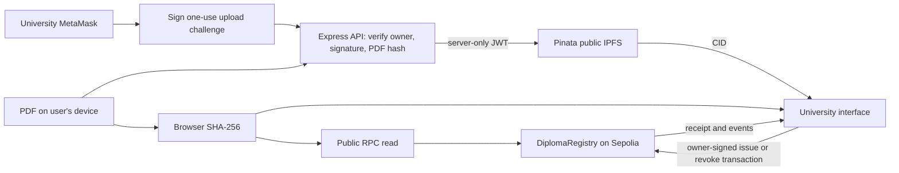

# DiplomaChain — university diploma registry

Public PDF verification and owner-only issuance/revocation on an EVM testnet. React 18, ethers 6, Solidity 0.8.24, Express upload API, Pinata public IPFS. Use fictional student data only.

## Requirements and setup

Use Node.js 24 LTS, npm, MetaMask, Sepolia test ETH, and a Pinata JWT with `pinFileToIPFS` permission. The API key displayed in the key list is not the JWT.

```powershell
npm ci
Copy-Item .env.example .env
```

Do not overwrite an existing `.env`. Configure:

| Setting | Purpose |
| --- | --- |
| `VITE_CONTRACT_ADDRESS` | Deployed registry address; not a wallet address |
| `VITE_CHAIN_ID` | `11155111` (Sepolia) or `80002` (Polygon Amoy) |
| `VITE_RPC_URL` | RPC for that same network; defaults exist in code |
| `PINATA_JWT` | Complete secret JWT, server only, without `Bearer ` |
| `PORT` | Upload API port, default `3001` |
| `APP_ORIGIN` | Exact browser origin, default `http://localhost:5173` |

**Migration:** remove `VITE_PINATA_JWT`; store its value as `PINATA_JWT`. Rotate any JWT previously shipped in a browser bundle. Never commit `.env`, wallet seed phrases, or private keys.

Run two terminals:

```powershell
npm run server
```

```powershell
npm run dev
```

Open **http://localhost:5173**. Vite proxies `/api` to the local upload server. Restart both processes after environment changes. Static hosting alone cannot perform authenticated uploads. For hosting, serve `dist` and reverse-proxy `/api` to the API over the same HTTPS origin; set `APP_ORIGIN` accordingly. The API binds to loopback intentionally. `npm run preview` is a static preview and has no upload proxy.

## Deploy the current contract

Contract edits do **not** update a deployed instance. This contract has no upgrade mechanism. Redeployment creates an empty registry; old diplomas remain in the old registry and must be verified using its original address.

1. Open [Remix](https://remix.ethereum.org) in the browser with MetaMask. Copy the current `contracts/DiplomaRegistry.sol` into Remix.
2. Compile with **Solidity 0.8.24**, optimizer **enabled, 200 runs**, EVM **paris**. These settings must match `hardhat.config.cjs` for exact bytecode verification.
3. In **Deploy & Run Transactions → Environment**, select **Browser Extension → MetaMask** (older versions: **Injected Provider – MetaMask**).
4. Select **Sepolia** in MetaMask and the university account. Deploy with value **0**. Confirm the transaction and wait for its receipt. The deploying account becomes the immutable owner.
5. Copy the deployed **contract address** into `.env`; restart both processes.
6. Run `npm run preflight`. It checks the RPC chain, deployed code, owner, exact compiled runtime bytecode (masking the immutable owner), and Pinata authentication. A compiler-setting mismatch also fails the bytecode check. Pinata authentication alone does not prove upload permission.
7. Record the contract address, owner, deployment transaction and explorer links in `docs/DEMO.md`.

No private key is required in this repository: deployment and transactions are signed in MetaMask.

## Architecture



Public verification hashes the PDF locally without uploading it or requiring a wallet. University issuance uploads the exact PDF and records its SHA-256, CID and metadata. SHA-256 identifies file bytes; an IPFS CID identifies IPFS content and is not the same value. Changing one byte changes the PDF hash.

The server issues a two-minute random challenge bound to a file hash and origin. Only a valid owner signature authorizes uploading that exact file. Nonces are single use, input is capped at 10 MiB, PDF headers are checked, and requests are rate limited. The Pinata token never enters frontend source or the Vite bundle. Challenges live in memory: restart invalidates them; multi-instance hosting needs a shared nonce/rate-limit store.

## Contract rules and security boundaries

- Only the immutable deployer can issue/revoke, enforced on chain regardless of UI checks.
- Zero hashes, duplicate hashes (including revoked diplomas), empty/oversized metadata and years outside 1900–2100 revert. Names are limited to 128 UTF-8 bytes each, course to 256 and CID to 128. UI trims fields; Solidity validates byte lengths, not the truth of the text.
- Unknown diplomas return `existe=false`. Revocation sets `valide=false`, preserves the record and cannot be repeated. Issuance and revocation emit timestamped events.
- No external calls, payable functions, delegate calls, loops over storage, or transfers of funds occur in the contract. Ordinary ETH transfers revert. This avoids the usual external-call reentrancy path; it is not a formal security proof.
- The university must check that metadata and PDF content agree. The contract cannot prove that a CID resolves to the submitted hash, that an issuer is accredited, or that diploma claims are true. Verification means a byte-identical file was registered by this configured owner.
- Owner-key compromise permits fraudulent issuance/revocation; lost keys permanently disable management. No recovery, owner transfer, multisig integration, encryption, or deletion exists. These are documented scope limits, not claimed features.
- Names, metadata and public IPFS PDFs are public. Revocation does not erase them. Use synthetic data for the demonstration. HTTPS and protected server configuration are required for hosting; PDF header checks are not malware scanning.

## Checks and automated tests

```powershell
npm test
npm run coverage
npm run build
npm audit --omit=dev
npm run preflight
```

`npm run check` combines tests, Solidity coverage and the production build. `test/contract` uses Hardhat 2, Mocha and Chai; `test/app` tests transaction states, university gates, public verdicts, PDF generation/hashing and upload authentication. Coverage HTML is at `coverage/index.html`. The compiler is pinned locally to 0.8.24. CI runs the same offline checks without deployment credentials. Test/tool dependencies remain separate from runtime dependencies; see `docs/AUDIT.md` for actual audit results and residual risks.

## Presentation and troubleshooting

Follow [the demo script](docs/DEMO.md), and review [the rubric audit](docs/AUDIT.md). Full marks are an instructor decision; automated coverage does not prove absence of vulnerabilities.

- **No contract / owner unavailable:** verify contract address, RPC and chain. A Remix VM deployment is not a Sepolia deployment. The interface now distinguishes a failed owner lookup from a wallet mismatch and offers retry.
- **Wrong wallet:** connect the deployment account displayed by `npm run preflight`.
- **Pinata 401/403:** put the complete JWT in `PINATA_JWT`, enable `pinFileToIPFS`, restart the server, and retry. Do not add `Bearer` to the setting.
- **Upload API unavailable:** start `npm run server` and open port 5173, with matching `APP_ORIGIN`.
- **Rejected MetaMask request:** retry and approve the signature or transaction. Upload authorization is a message signature, not a paid transaction.
- **Pending transaction:** use its explorer link. Do not resubmit blindly. Speed-ups are tracked through the replacement receipt; cancellation is an error, not success. One confirmation is awaited; testnet reorgs and RPC downtime remain possible.
