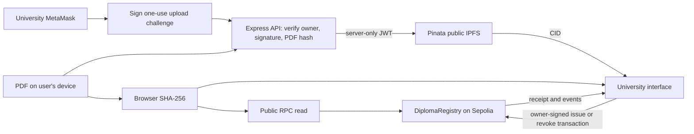

# DiplomaChain — university diploma registry

Public PDF verification and owner-only issuance/revocation on an EVM testnet. React 18, ethers 6, Solidity 0.8.24, Express upload API, Pinata public IPFS. Use fictional student data only.

## Three separate areas

The site now uses [React Router HashRouter](https://reactrouter.com/api/declarative-routers/HashRouter), with lazy-loaded pages. Open routes with `/#/` (for example `http://localhost:5173/#/universite`). Existing contract, ABI, wallet hook, configuration, hash, IPFS and PDF utilities are reused unchanged. jsPDF is loaded through the university page, outside the recruiter entry path.

| Route | Access and purpose |
| --- | --- |
| `/` | Public presentation, university information and entry buttons |
| `/recruteur/connexion` | Demo signup (company, email, password) and login |
| `/recruteur/verifier` | Recruiter session required; local PDF verification and personal history |
| `/universite/connexion` | University administrator demo login; no public administrator signup |
| `/universite` | University role, then MetaMask, correct network and contract owner required; issue, verify, list and revoke |
| Any other route | Not-found page |

Install the only added project dependency:

```powershell
npm install react-router-dom@^6.30.6
```

The dependency line is `"react-router-dom": "^6.30.6"`. The lockfile is updated; subsequent installations can use `npm ci`.

### Demo authentication

The university dashboard now requires an administrator login before the existing wallet gates. Recruiter credentials cannot enter this area; public signup always creates a recruiter. Existing accounts without a role remain recruiters. `currentUser` includes `role`; `login` accepts an optional required `role`.

Default demo accounts are provisioned at the first login/registration without resetting existing accounts or history. The previous demo email accounts are migrated to the short usernames below, preserving their IDs and verification history. Login accepts usernames or emails; public signup still requires an email and an eight-character password:

| Area | Username | Password | Company / institution |
| --- | --- | --- | --- |
| Recruiter | `rec` | `rec` | Entreprise Démo |
| University administrator | `admin` | `admin` | Université de Sousse |

These are intentionally public demo credentials defined in `src/context/demoAccounts.js`. Passwords are salted and hashed before localStorage persistence. The university login offers no public signup and does not display its default credentials. Log out to switch between accounts; reloading retains the current session. This adds a frontend demo gate only: localStorage can be edited, and these shared credentials are not real security. The contract owner's MetaMask wallet remains necessary to issue or revoke. Production roles must be assigned and checked by a trusted backend/auth provider.

`src/context/AuthContext.jsx` exposes `register({email, password, company})`, `login({email, password})`, `logout()` and `currentUser`. Registration also starts a session. Email is normalized; passwords require eight characters for signup. Each account gets a random 16-byte salt and a SHA-256 digest computed with `crypto.subtle`; plaintext passwords are never persisted. Accounts, session ID and the latest 100 completed verification results per recruiter are stored in localStorage on this browser. PDF bytes are never stored in history or uploaded for verification. RPC errors are shown separately and are not recorded as invalid diplomas.

**This is a demo mock, NOT real security.** Users can edit localStorage and bypass frontend guards; salted SHA-256 is not a production password-storage scheme. Use fictitious credentials. Clearing site data deletes accounts and history. HTTPS (or localhost) is needed for Web Crypto. University authorization remains the contract's `onlyOwner`, independently of recruiter sessions.

To replace the mock with Firebase Auth or Supabase, keep the context interface and route guard, replace registration/login/logout with provider operations, and populate `currentUser` from the provider's session subscription. Store company profiles and history under the provider user ID in a database with server-enforced per-user access rules. Remove local password records entirely; let the auth provider handle credentials, recovery and sessions. Provider SDKs and database access rules are intentionally not included in this demo.

### Configuration and IPFS compatibility

Add optional `VITE_DEPLOY_BLOCK=<registry deployment block>` to `.env`. Event reads start there (default `0`), query at most 1,000 blocks at once and split ranges further when RPC limits require it. Metadata reads are sequential at the same snapshot block. Configure the actual deployment block to avoid scanning the entire chain; use **Actualiser** to pick up transactions from other sessions.

No new backend was added. Landing, demo authentication and verification work without a backend or MetaMask. **Issuance retains the project's existing upload API through unchanged `uploadToIPFS`**; start `npm run server` for that feature. This preserves the working integration and server-only `PINATA_JWT`. The request's frontend-only `VITE_PINATA_JWT` upload would expose the credential in the browser and conflict with preserving this helper; it was deliberately not introduced. A completely static issuance deployment would require a different upload integration. All existing environment configuration remains in `.env`.

### Test the three flows

1. **Public:** start `npm run dev`, open `/#/`, inspect the presentation and both entry links. Check at 375 px and on desktop. The footer on every page identifies the test network and lack of legal value.
2. **Recruiter:** open `/#/recruteur/verifier` before login and confirm redirection. Sign up with a fictitious company/email/password, then verify the exact issued PDF without MetaMask. Check student, course, year, issue date and IPFS link. Change one byte: expect **Aucune correspondance**. Verify a revoked PDF: expect **Diplôme révoqué**. Reload to retain the session/history, log out, register a second account, and confirm that its history is empty. Failed RPC calls must display an error, not a diploma verdict.
3. **University:** open `/#/universite` and confirm redirection to `/#/universite/connexion`. Recruiter credentials must be refused there. Sign in with the default university administrator above, then test missing MetaMask, disconnected wallet, wrong network and a non-owner account. With the owner, fill in the student form, import or generate a PDF, upload it, and issue. Save the exact PDF. Check its entry in **Diplômes émis**, use **Vérifier / Révoquer**, and revoke by hash, PDF or the list's button (which selects the hash for review before signing). Follow transaction explorer links; reverify the original PDF to confirm revocation. Arrow keys, Home and End switch dashboard tabs. Logging out must return to the administrator login.

Validation completed: `npm test` passes (25 contract + 44 app tests), and `npm run build` passes. Automated tests cover owner gates, issuance/revocation wiring and receipts, local one-byte PDF mismatch, history isolation, auth sessions and RPC range splitting. A local headless Chrome smoke test at 375 px passed landing, signup, session reload, logout, protected routing, university wallet gate and 404, with no JS errors or horizontal overflow. No jsPDF request occurred before entering the university area. Live MetaMask signing, deployed-contract writes and IPFS uploads still require the configured network and owner wallet and have not been exercised by this change's checks.

## Requirements and setup

Use Node.js 24 LTS, npm, MetaMask, Sepolia test ETH, and a Pinata JWT with `pinFileToIPFS` permission. The API key displayed in the key list is not the JWT.

```powershell
npm ci
Copy-Item .env.example .env
```

Do not overwrite an existing `.env`. Configure:

| Setting | Purpose |
| --- | --- |
| `VITE_CONTRACT_ADDRESS` | Deployed registry address; not a wallet address |
| `VITE_CHAIN_ID` | `11155111` (Sepolia) or `80002` (Polygon Amoy) |
| `VITE_RPC_URL` | RPC for that same network; defaults exist in code |
| `PINATA_JWT` | Complete secret JWT, server only, without `Bearer ` |
| `PORT` | Upload API port, default `3001` |
| `APP_ORIGIN` | Browser origin, default `http://localhost:5173`; local `localhost` and `127.0.0.1` aliases are accepted with the same protocol and port. Deployed origins remain exact. |

**Migration:** remove `VITE_PINATA_JWT`; store its value as `PINATA_JWT`. Rotate any JWT previously shipped in a browser bundle. Never commit `.env`, wallet seed phrases, or private keys.

Run two terminals:

```powershell
npm run server
```

```powershell
npm run dev
```

Open **http://localhost:5173**. Vite proxies `/api` to the local upload server. Restart both processes after environment changes. Static hosting alone cannot perform authenticated uploads. For hosting, serve `dist` and reverse-proxy `/api` to the API over the same HTTPS origin; set `APP_ORIGIN` accordingly. The API binds to loopback intentionally. `npm run preview` is a static preview and has no upload proxy.

## Deploy the current contract

Contract edits do **not** update a deployed instance. This contract has no upgrade mechanism. Redeployment creates an empty registry; old diplomas remain in the old registry and must be verified using its original address.

1. Open [Remix](https://remix.ethereum.org) in the browser with MetaMask. Copy the current `contracts/DiplomaRegistry.sol` into Remix.
2. Compile with **Solidity 0.8.24**, optimizer **enabled, 200 runs**, EVM **paris**. These settings must match `hardhat.config.cjs` for exact bytecode verification.
3. In **Deploy & Run Transactions → Environment**, select **Browser Extension → MetaMask** (older versions: **Injected Provider – MetaMask**).
4. Select **Sepolia** in MetaMask and the university account. Deploy with value **0**. Confirm the transaction and wait for its receipt. The deploying account becomes the immutable owner.
5. Copy the deployed **contract address** into `.env`; restart both processes.
6. Run `npm run preflight`. It checks the RPC chain, deployed code, owner, exact compiled runtime bytecode (masking the immutable owner), and Pinata authentication. A compiler-setting mismatch also fails the bytecode check. Pinata authentication alone does not prove upload permission.
7. Record the contract address, owner, deployment transaction and explorer links in `docs/DEMO.md`.

No private key is required in this repository: deployment and transactions are signed in MetaMask.

## Architecture



Public verification hashes the PDF locally without uploading it or requiring a wallet. University issuance uploads the exact PDF and records its SHA-256, CID and metadata. SHA-256 identifies file bytes; an IPFS CID identifies IPFS content and is not the same value. Changing one byte changes the PDF hash.

The server issues a two-minute random challenge bound to a file hash and origin. Only a valid owner signature authorizes uploading that exact file. Nonces are single use, input is capped at 10 MiB, PDF headers are checked, and requests are rate limited. The Pinata token never enters frontend source or the Vite bundle. Challenges live in memory: restart invalidates them; multi-instance hosting needs a shared nonce/rate-limit store.

## Contract rules and security boundaries

- Only the immutable deployer can issue/revoke, enforced on chain regardless of UI checks.
- Zero hashes, duplicate hashes (including revoked diplomas), empty/oversized metadata and years outside 1900–2100 revert. Names are limited to 128 UTF-8 bytes each, course to 256 and CID to 128. UI trims fields; Solidity validates byte lengths, not the truth of the text.
- Unknown diplomas return `existe=false`. Revocation sets `valide=false`, preserves the record and cannot be repeated. Issuance and revocation emit timestamped events.
- No external calls, payable functions, delegate calls, loops over storage, or transfers of funds occur in the contract. Ordinary ETH transfers revert. This avoids the usual external-call reentrancy path; it is not a formal security proof.
- The university must check that metadata and PDF content agree. The contract cannot prove that a CID resolves to the submitted hash, that an issuer is accredited, or that diploma claims are true. Verification means a byte-identical file was registered by this configured owner.
- Owner-key compromise permits fraudulent issuance/revocation; lost keys permanently disable management. No recovery, owner transfer, multisig integration, encryption, or deletion exists. These are documented scope limits, not claimed features.
- Names, metadata and public IPFS PDFs are public. Revocation does not erase them. Use synthetic data for the demonstration. HTTPS and protected server configuration are required for hosting; PDF header checks are not malware scanning.

## Checks and automated tests

```powershell
npm test
npm run coverage
npm run build
npm audit --omit=dev
npm run preflight
```

`npm run check` combines tests, Solidity coverage and the production build. `test/contract` uses Hardhat 2, Mocha and Chai; `test/app` tests transaction states, university gates, public verdicts, PDF generation/hashing and upload authentication. Coverage HTML is at `coverage/index.html`. The compiler is pinned locally to 0.8.24. CI runs the same offline checks without deployment credentials. Test/tool dependencies remain separate from runtime dependencies; see `docs/AUDIT.md` for actual audit results and residual risks.

## Presentation and troubleshooting

Follow [the demo script](docs/DEMO.md), and review [the rubric audit](docs/AUDIT.md). Full marks are an instructor decision; automated coverage does not prove absence of vulnerabilities.

- **No contract / owner unavailable:** verify contract address, RPC and chain. A Remix VM deployment is not a Sepolia deployment. The interface now distinguishes a failed owner lookup from a wallet mismatch and offers retry.
- **Wrong wallet:** connect the deployment account displayed by `npm run preflight`.
- **Pinata 401/403:** put the complete JWT in `PINATA_JWT`, enable `pinFileToIPFS`, restart the server, and retry. Do not add `Bearer` to the setting.
- **Upload API unavailable:** start `npm run server` and open port 5173, with matching `APP_ORIGIN`.
- **Issued list / `could not coalesce error`:** a public RPC can reject old log queries with `pruned history unavailable`. Set `VITE_DEPLOY_BLOCK` to this contract's creation receipt block in `.env` and reload the page after Vite restarts. For a different contract deployment, update this value too. Use a provider retaining the required history if the deployment itself is older than its retention window.
- **Rejected MetaMask request:** retry and approve the signature or transaction. Upload authorization is a message signature, not a paid transaction.
- **Pending transaction:** use its explorer link. Do not resubmit blindly. Speed-ups are tracked through the replacement receipt; cancellation is an error, not success. One confirmation is awaited; testnet reorgs and RPC downtime remain possible.
