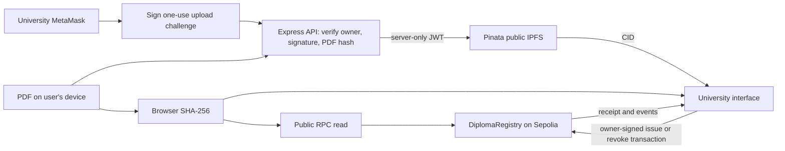

# New and modified files

File-by-file handoff. Only changed project files are included.

## C:\Users\oubey\Desktop\diplome-chain\.env.example

````dotenv
VITE_CONTRACT_ADDRESS=
VITE_CHAIN_ID=11155111
# Optional: deployment block for bounded event queries (default 0).
VITE_DEPLOY_BLOCK=0
VITE_RPC_URL=https://ethereum-sepolia-rpc.publicnode.com
# SERVER ONLY: never prefix this secret with VITE_. Copy the JWT, not the API key.
PINATA_JWT=
PORT=3001
APP_ORIGIN=http://localhost:5173

````

## C:\Users\oubey\Desktop\diplome-chain\README.md

````markdown
# DiplomaChain — university diploma registry

Public PDF verification and owner-only issuance/revocation on an EVM testnet. React 18, ethers 6, Solidity 0.8.24, Express upload API, Pinata public IPFS. Use fictional student data only.

## Three separate areas

The site now uses [React Router HashRouter](https://reactrouter.com/api/declarative-routers/HashRouter), with lazy-loaded pages. Open routes with `/#/` (for example `http://localhost:5173/#/universite`). Existing contract, ABI, wallet hook, configuration, hash, IPFS and PDF utilities are reused unchanged. jsPDF is loaded through the university page, outside the recruiter entry path.

| Route | Access and purpose |
| --- | --- |
| `/` | Public presentation, university information and entry buttons |
| `/recruteur/connexion` | Demo signup (company, email, password) and login |
| `/recruteur/verifier` | Recruiter session required; local PDF verification and personal history |
| `/universite/connexion` | University administrator demo login; no public administrator signup |
| `/universite` | University role, then MetaMask, correct network and contract owner required; issue, verify, list and revoke |
| Any other route | Not-found page |

Install the only added project dependency:

```powershell
npm install react-router-dom@^6.30.6
```

The dependency line is `"react-router-dom": "^6.30.6"`. The lockfile is updated; subsequent installations can use `npm ci`.

### Demo authentication

The university dashboard now requires an administrator login before the existing wallet gates. Recruiter credentials cannot enter this area; public signup always creates a recruiter. Existing accounts without a role remain recruiters. `currentUser` includes `role`; `login` accepts an optional required `role`.

Default demo accounts are provisioned at the first login/registration without resetting existing accounts or history. The previous demo email accounts are migrated to the short usernames below, preserving their IDs and verification history. Login accepts usernames or emails; public signup still requires an email and an eight-character password:

| Area | Username | Password | Company / institution |
| --- | --- | --- | --- |
| Recruiter | `rec` | `rec` | Entreprise Démo |
| University administrator | `admin` | `admin` | Université de Sousse |

These are intentionally public demo credentials defined in `src/context/demoAccounts.js`. Passwords are salted and hashed before localStorage persistence. The university login offers no public signup and does not display its default credentials. Log out to switch between accounts; reloading retains the current session. This adds a frontend demo gate only: localStorage can be edited, and these shared credentials are not real security. The contract owner's MetaMask wallet remains necessary to issue or revoke. Production roles must be assigned and checked by a trusted backend/auth provider.

`src/context/AuthContext.jsx` exposes `register({email, password, company})`, `login({email, password})`, `logout()` and `currentUser`. Registration also starts a session. Email is normalized; passwords require eight characters for signup. Each account gets a random 16-byte salt and a SHA-256 digest computed with `crypto.subtle`; plaintext passwords are never persisted. Accounts, session ID and the latest 100 completed verification results per recruiter are stored in localStorage on this browser. PDF bytes are never stored in history or uploaded for verification. RPC errors are shown separately and are not recorded as invalid diplomas.

**This is a demo mock, NOT real security.** Users can edit localStorage and bypass frontend guards; salted SHA-256 is not a production password-storage scheme. Use fictitious credentials. Clearing site data deletes accounts and history. HTTPS (or localhost) is needed for Web Crypto. University authorization remains the contract's `onlyOwner`, independently of recruiter sessions.

To replace the mock with Firebase Auth or Supabase, keep the context interface and route guard, replace registration/login/logout with provider operations, and populate `currentUser` from the provider's session subscription. Store company profiles and history under the provider user ID in a database with server-enforced per-user access rules. Remove local password records entirely; let the auth provider handle credentials, recovery and sessions. Provider SDKs and database access rules are intentionally not included in this demo.

### Configuration and IPFS compatibility

Add optional `VITE_DEPLOY_BLOCK=<registry deployment block>` to `.env`. Event reads start there (default `0`), query at most 1,000 blocks at once and split ranges further when RPC limits require it. Metadata reads are sequential at the same snapshot block. Configure the actual deployment block to avoid scanning the entire chain; use **Actualiser** to pick up transactions from other sessions.

No new backend was added. Landing, demo authentication and verification work without a backend or MetaMask. **Issuance retains the project's existing upload API through unchanged `uploadToIPFS`**; start `npm run server` for that feature. This preserves the working integration and server-only `PINATA_JWT`. The request's frontend-only `VITE_PINATA_JWT` upload would expose the credential in the browser and conflict with preserving this helper; it was deliberately not introduced. A completely static issuance deployment would require a different upload integration. All existing environment configuration remains in `.env`.

### Test the three flows

1. **Public:** start `npm run dev`, open `/#/`, inspect the presentation and both entry links. Check at 375 px and on desktop. The footer on every page identifies the test network and lack of legal value.
2. **Recruiter:** open `/#/recruteur/verifier` before login and confirm redirection. Sign up with a fictitious company/email/password, then verify the exact issued PDF without MetaMask. Check student, course, year, issue date and IPFS link. Change one byte: expect **Aucune correspondance**. Verify a revoked PDF: expect **Diplôme révoqué**. Reload to retain the session/history, log out, register a second account, and confirm that its history is empty. Failed RPC calls must display an error, not a diploma verdict.
3. **University:** open `/#/universite` and confirm redirection to `/#/universite/connexion`. Recruiter credentials must be refused there. Sign in with the default university administrator above, then test missing MetaMask, disconnected wallet, wrong network and a non-owner account. With the owner, fill in the student form, import or generate a PDF, upload it, and issue. Save the exact PDF. Check its entry in **Diplômes émis**, use **Vérifier / Révoquer**, and revoke by hash, PDF or the list's button (which selects the hash for review before signing). Follow transaction explorer links; reverify the original PDF to confirm revocation. Arrow keys, Home and End switch dashboard tabs. Logging out must return to the administrator login.

Validation completed: `npm test` passes (25 contract + 44 app tests), and `npm run build` passes. Automated tests cover owner gates, issuance/revocation wiring and receipts, local one-byte PDF mismatch, history isolation, auth sessions and RPC range splitting. A local headless Chrome smoke test at 375 px passed landing, signup, session reload, logout, protected routing, university wallet gate and 404, with no JS errors or horizontal overflow. No jsPDF request occurred before entering the university area. Live MetaMask signing, deployed-contract writes and IPFS uploads still require the configured network and owner wallet and have not been exercised by this change's checks.

## Requirements and setup

Use Node.js 24 LTS, npm, MetaMask, Sepolia test ETH, and a Pinata JWT with `pinFileToIPFS` permission. The API key displayed in the key list is not the JWT.

```powershell
npm ci
Copy-Item .env.example .env
```

Do not overwrite an existing `.env`. Configure:

| Setting | Purpose |
| --- | --- |
| `VITE_CONTRACT_ADDRESS` | Deployed registry address; not a wallet address |
| `VITE_CHAIN_ID` | `11155111` (Sepolia) or `80002` (Polygon Amoy) |
| `VITE_RPC_URL` | RPC for that same network; defaults exist in code |
| `PINATA_JWT` | Complete secret JWT, server only, without `Bearer ` |
| `PORT` | Upload API port, default `3001` |
| `APP_ORIGIN` | Browser origin, default `http://localhost:5173`; local `localhost` and `127.0.0.1` aliases are accepted with the same protocol and port. Deployed origins remain exact. |

**Migration:** remove `VITE_PINATA_JWT`; store its value as `PINATA_JWT`. Rotate any JWT previously shipped in a browser bundle. Never commit `.env`, wallet seed phrases, or private keys.

Run two terminals:

```powershell
npm run server
```

```powershell
npm run dev
```

Open **http://localhost:5173**. Vite proxies `/api` to the local upload server. Restart both processes after environment changes. Static hosting alone cannot perform authenticated uploads. For hosting, serve `dist` and reverse-proxy `/api` to the API over the same HTTPS origin; set `APP_ORIGIN` accordingly. The API binds to loopback intentionally. `npm run preview` is a static preview and has no upload proxy.

## Deploy the current contract

Contract edits do **not** update a deployed instance. This contract has no upgrade mechanism. Redeployment creates an empty registry; old diplomas remain in the old registry and must be verified using its original address.

1. Open [Remix](https://remix.ethereum.org) in the browser with MetaMask. Copy the current `contracts/DiplomaRegistry.sol` into Remix.
2. Compile with **Solidity 0.8.24**, optimizer **enabled, 200 runs**, EVM **paris**. These settings must match `hardhat.config.cjs` for exact bytecode verification.
3. In **Deploy & Run Transactions → Environment**, select **Browser Extension → MetaMask** (older versions: **Injected Provider – MetaMask**).
4. Select **Sepolia** in MetaMask and the university account. Deploy with value **0**. Confirm the transaction and wait for its receipt. The deploying account becomes the immutable owner.
5. Copy the deployed **contract address** into `.env`; restart both processes.
6. Run `npm run preflight`. It checks the RPC chain, deployed code, owner, exact compiled runtime bytecode (masking the immutable owner), and Pinata authentication. A compiler-setting mismatch also fails the bytecode check. Pinata authentication alone does not prove upload permission.
7. Record the contract address, owner, deployment transaction and explorer links in `docs/DEMO.md`.

No private key is required in this repository: deployment and transactions are signed in MetaMask.

## Architecture



Public verification hashes the PDF locally without uploading it or requiring a wallet. University issuance uploads the exact PDF and records its SHA-256, CID and metadata. SHA-256 identifies file bytes; an IPFS CID identifies IPFS content and is not the same value. Changing one byte changes the PDF hash.

The server issues a two-minute random challenge bound to a file hash and origin. Only a valid owner signature authorizes uploading that exact file. Nonces are single use, input is capped at 10 MiB, PDF headers are checked, and requests are rate limited. The Pinata token never enters frontend source or the Vite bundle. Challenges live in memory: restart invalidates them; multi-instance hosting needs a shared nonce/rate-limit store.

## Contract rules and security boundaries

- Only the immutable deployer can issue/revoke, enforced on chain regardless of UI checks.
- Zero hashes, duplicate hashes (including revoked diplomas), empty/oversized metadata and years outside 1900–2100 revert. Names are limited to 128 UTF-8 bytes each, course to 256 and CID to 128. UI trims fields; Solidity validates byte lengths, not the truth of the text.
- Unknown diplomas return `existe=false`. Revocation sets `valide=false`, preserves the record and cannot be repeated. Issuance and revocation emit timestamped events.
- No external calls, payable functions, delegate calls, loops over storage, or transfers of funds occur in the contract. Ordinary ETH transfers revert. This avoids the usual external-call reentrancy path; it is not a formal security proof.
- The university must check that metadata and PDF content agree. The contract cannot prove that a CID resolves to the submitted hash, that an issuer is accredited, or that diploma claims are true. Verification means a byte-identical file was registered by this configured owner.
- Owner-key compromise permits fraudulent issuance/revocation; lost keys permanently disable management. No recovery, owner transfer, multisig integration, encryption, or deletion exists. These are documented scope limits, not claimed features.
- Names, metadata and public IPFS PDFs are public. Revocation does not erase them. Use synthetic data for the demonstration. HTTPS and protected server configuration are required for hosting; PDF header checks are not malware scanning.

## Checks and automated tests

```powershell
npm test
npm run coverage
npm run build
npm audit --omit=dev
npm run preflight
```

`npm run check` combines tests, Solidity coverage and the production build. `test/contract` uses Hardhat 2, Mocha and Chai; `test/app` tests transaction states, university gates, public verdicts, PDF generation/hashing and upload authentication. Coverage HTML is at `coverage/index.html`. The compiler is pinned locally to 0.8.24. CI runs the same offline checks without deployment credentials. Test/tool dependencies remain separate from runtime dependencies; see `docs/AUDIT.md` for actual audit results and residual risks.

## Presentation and troubleshooting

Follow [the demo script](docs/DEMO.md), and review [the rubric audit](docs/AUDIT.md). Full marks are an instructor decision; automated coverage does not prove absence of vulnerabilities.

- **No contract / owner unavailable:** verify contract address, RPC and chain. A Remix VM deployment is not a Sepolia deployment. The interface now distinguishes a failed owner lookup from a wallet mismatch and offers retry.
- **Wrong wallet:** connect the deployment account displayed by `npm run preflight`.
- **Pinata 401/403:** put the complete JWT in `PINATA_JWT`, enable `pinFileToIPFS`, restart the server, and retry. Do not add `Bearer` to the setting.
- **Upload API unavailable:** start `npm run server` and open port 5173, with matching `APP_ORIGIN`.
- **Issued list / `could not coalesce error`:** a public RPC can reject old log queries with `pruned history unavailable`. Set `VITE_DEPLOY_BLOCK` to this contract's creation receipt block in `.env` and reload the page after Vite restarts. For a different contract deployment, update this value too. Use a provider retaining the required history if the deployment itself is older than its retention window.
- **Rejected MetaMask request:** retry and approve the signature or transaction. Upload authorization is a message signature, not a paid transaction.
- **Pending transaction:** use its explorer link. Do not resubmit blindly. Speed-ups are tracked through the replacement receipt; cancellation is an error, not success. One confirmation is awaited; testnet reorgs and RPC downtime remain possible.

````

## C:\Users\oubey\Desktop\diplome-chain\package-lock.json

````json
{
  "name": "diplome-chain",
  "version": "1.0.0",
  "lockfileVersion": 3,
  "requires": true,
  "packages": {
    "": {
      "name": "diplome-chain",
      "version": "1.0.0",
      "dependencies": {
        "dotenv": "^18.0.10",
        "ethers": "^6.17.0",
        "express": "^5.3.0",
        "express-rate-limit": "^8.7.4",
        "jspdf": "^4.2.1",
        "multer": "^2.5.0",
        "react": "^18.3.1",
        "react-dom": "^18.3.1",
        "react-router-dom": "^6.30.6"
      },
      "devDependencies": {
        "@nomicfoundation/hardhat-chai-matchers": "^2.1.2",
        "@nomicfoundation/hardhat-ethers": "^3.1.3",
        "@testing-library/react": "^16.3.3",
        "@vitejs/plugin-react": "^6.3.0",
        "chai": "^4.5.0",
        "hardhat": "^2.29.2",
        "jsdom": "^31.0.0",
        "solc": "0.8.24",
        "solidity-coverage": "^0.8.17",
        "supertest": "^7.3.2",
        "vite": "^8.3.8",
        "vitest": "^5.1.0"
      }
    },
    "node_modules/@adraffy/ens-normalize": {
      "version": "1.11.1",
      "resolved": "https://registry.npmjs.org/@adraffy/ens-normalize/-/ens-normalize-1.11.1.tgz",
      "integrity": "sha512-nhCBV3quEgesuf7c7KYfperqSS14T8bYuvJ8PcLJp6znkZpFc0AuW4qBtr8eKVyPPe/8RSr7sglCWPU5eaxwKQ==",
      "license": "MIT"
    },
    "node_modules/@babel/code-frame": {
      "version": "7.29.7",
      "resolved": "https://registry.npmjs.org/@babel/code-frame/-/code-frame-7.29.7.tgz",
      "integrity": "sha512-Aup7aUOfpbAUg2ROOJN6Iw5f9DMBlzu0mIkm/malLQFN/YQgO48wCj0Kxa3sEHJvPVFg7siR+qRInwXd2qhQKw==",
      "dev": true,
      "license": "MIT",
      "peer": true,
      "dependencies": {
        "@babel/helper-validator-identifier": "^7.29.7",
        "js-tokens": "^4.0.0",
        "picocolors": "^1.1.1"
      },
      "engines": {
        "node": ">=6.9.0"
      }
    },
    "node_modules/@babel/helper-validator-identifier": {
      "version": "7.29.7",
      "resolved": "https://registry.npmjs.org/@babel/helper-validator-identifier/-/helper-validator-identifier-7.29.7.tgz",
      "integrity": "sha512-qehxGkRj55h/ff8EMaJ+cYhyaKlHIxqYDn682wQD7RNp9UujOQsHog2uS0r2vzr4pW+sXf90NeeayjcNaX3fFg==",
      "dev": true,
      "license": "MIT",
      "peer": true,
      "engines": {
        "node": ">=6.9.0"
      }
    },
    "node_modules/@babel/runtime": {
      "version": "7.29.14",
      "resolved": "https://registry.npmjs.org/@babel/runtime/-/runtime-7.29.14.tgz",
      "integrity": "sha512-Y5tqevQaUAZhhj82BpYMNC1ssvLQTVAfwKdm8iy8qwmhvC2/CpcAu8OC+QEtjM7pMk7knx83u1Qj8gzkicyelw==",
      "license": "MIT",
      "engines": {
        "node": ">=6.9.0"
      }
    },
    "node_modules/@emnapi/core": {
      "version": "2.0.0-beta.2",
      "resolved": "https://registry.npmjs.org/@emnapi/core/-/core-2.0.0-beta.2.tgz",
      "integrity": "sha512-MzCVoWtcg4Pm2B3je5mMvYMvj3MmBKw+fU7vbsJc9/iT8ip6/eYIHo/Dsm/mr+wsHB6SEyJDuxB09Yy6r/8+4A==",
      "dev": true,
      "license": "MIT",
      "optional": true,
      "dependencies": {
        "@emnapi/wasi-threads": "2.2.0",
        "tslib": "^2.4.0"
      }
    },
    "node_modules/@emnapi/runtime": {
      "version": "2.0.0-beta.2",
      "resolved": "https://registry.npmjs.org/@emnapi/runtime/-/runtime-2.0.0-beta.2.tgz",
      "integrity": "sha512-JcrSPzPvZuNZvJqPTF9Fw25LbOJ8avzFVlaf2grmH4Cku0oGP47tRgqPZadcfj3YoZMHkFVnCYFbQM8I+i5QEw==",
      "dev": true,
      "license": "MIT",
      "optional": true,
      "dependencies": {
        "tslib": "^2.4.0"
      }
    },
    "node_modules/@emnapi/wasi-threads": {
      "version": "2.2.0",
      "resolved": "https://registry.npmjs.org/@emnapi/wasi-threads/-/wasi-threads-2.2.0.tgz",
      "integrity": "sha512-JP7OYH38Q7+pyTAe14raZHLQIK7BDKbdwji+Xi3pcd/6QkJYQH3SX4wu6EplGrGJWRepoNzedfm0G3B9Z4e9Rw==",
      "dev": true,
      "license": "MIT",
      "optional": true,
      "dependencies": {
        "tslib": "^2.4.0"
      }
    },
    "node_modules/@ethereumjs/rlp": {
      "version": "5.0.2",
      "resolved": "https://registry.npmjs.org/@ethereumjs/rlp/-/rlp-5.0.2.tgz",
      "integrity": "sha512-DziebCdg4JpGlEqEdGgXmjqcFoJi+JGulUXwEjsZGAscAQ7MyD/7LE/GVCP29vEQxKc7AAwjT3A2ywHp2xfoCA==",
      "dev": true,
      "license": "MPL-2.0",
      "bin": {
        "rlp": "bin/rlp.cjs"
      },
      "engines": {
        "node": ">=18"
      }
    },
    "node_modules/@ethereumjs/util": {
      "version": "9.1.0",
      "resolved": "https://registry.npmjs.org/@ethereumjs/util/-/util-9.1.0.tgz",
      "integrity": "sha512-XBEKsYqLGXLah9PNJbgdkigthkG7TAGvlD/sH12beMXEyHDyigfcbdvHhmLyDWgDyOJn4QwiQUaF7yeuhnjdog==",
      "dev": true,
      "license": "MPL-2.0",
      "dependencies": {
        "@ethereumjs/rlp": "^5.0.2",
        "ethereum-cryptography": "^2.2.1"
      },
      "engines": {
        "node": ">=18"
      }
    },
    "node_modules/@ethereumjs/util/node_modules/@noble/curves": {
      "version": "1.4.2",
      "resolved": "https://registry.npmjs.org/@noble/curves/-/curves-1.4.2.tgz",
      "integrity": "sha512-TavHr8qycMChk8UwMld0ZDRvatedkzWfH8IiaeGCfymOP5i0hSCozz9vHOL0nkwk7HRMlFnAiKpS2jrUmSybcw==",
      "dev": true,
      "license": "MIT",
      "dependencies": {
        "@noble/hashes": "1.4.0"
      },
      "funding": {
        "url": "https://paulmillr.com/funding/"
      }
    },
    "node_modules/@ethereumjs/util/node_modules/@noble/hashes": {
      "version": "1.4.0",
      "resolved": "https://registry.npmjs.org/@noble/hashes/-/hashes-1.4.0.tgz",
      "integrity": "sha512-V1JJ1WTRUqHHrOSh597hURcMqVKVGL/ea3kv0gSnEdsEZ0/+VyPghM1lMNGc00z7CIQorSvbKpuJkxvuHbvdbg==",
      "dev": true,
      "license": "MIT",
      "engines": {
        "node": ">= 16"
      },
      "funding": {
        "url": "https://paulmillr.com/funding/"
      }
    },
    "node_modules/@ethereumjs/util/node_modules/@scure/bip32": {
      "version": "1.4.0",
      "resolved": "https://registry.npmjs.org/@scure/bip32/-/bip32-1.4.0.tgz",
      "integrity": "sha512-sVUpc0Vq3tXCkDGYVWGIZTRfnvu8LoTDaev7vbwh0omSvVORONr960MQWdKqJDCReIEmTj3PAr73O3aoxz7OPg==",
      "dev": true,
      "license": "MIT",
      "dependencies": {
        "@noble/curves": "~1.4.0",
        "@noble/hashes": "~1.4.0",
        "@scure/base": "~1.1.6"
      },
      "funding": {
        "url": "https://paulmillr.com/funding/"
      }
    },
    "node_modules/@ethereumjs/util/node_modules/@scure/bip39": {
      "version": "1.3.0",
      "resolved": "https://registry.npmjs.org/@scure/bip39/-/bip39-1.3.0.tgz",
      "integrity": "sha512-disdg7gHuTDZtY+ZdkmLpPCk7fxZSu3gBiEGuoC1XYxv9cGx3Z6cpTggCgW6odSOOIXCiDjuGejW+aJKCY/pIQ==",
      "dev": true,
      "license": "MIT",
      "dependencies": {
        "@noble/hashes": "~1.4.0",
        "@scure/base": "~1.1.6"
      },
      "funding": {
        "url": "https://paulmillr.com/funding/"
      }
    },
    "node_modules/@ethereumjs/util/node_modules/ethereum-cryptography": {
      "version": "2.2.1",
      "resolved": "https://registry.npmjs.org/ethereum-cryptography/-/ethereum-cryptography-2.2.1.tgz",
      "integrity": "sha512-r/W8lkHSiTLxUxW8Rf3u4HGB0xQweG2RyETjywylKZSzLWoWAijRz8WCuOtJ6wah+avllXBqZuk29HCCvhEIRg==",
      "dev": true,
      "license": "MIT",
      "dependencies": {
        "@noble/curves": "1.4.2",
        "@noble/hashes": "1.4.0",
        "@scure/bip32": "1.4.0",
        "@scure/bip39": "1.3.0"
      }
    },
    "node_modules/@ethersproject/abi": {
      "version": "5.8.0",
      "resolved": "https://registry.npmjs.org/@ethersproject/abi/-/abi-5.8.0.tgz",
      "integrity": "sha512-b9YS/43ObplgyV6SlyQsG53/vkSal0MNA1fskSC4mbnCMi8R+NkcH8K9FPYNESf6jUefBUniE4SOKms0E/KK1Q==",
      "dev": true,
      "funding": [
        {
          "type": "individual",
          "url": "https://gitcoin.co/grants/13/ethersjs-complete-simple-and-tiny-2"
        },
        {
          "type": "individual",
          "url": "https://www.buymeacoffee.com/ricmoo"
        }
      ],
      "license": "MIT",
      "dependencies": {
        "@ethersproject/address": "^5.8.0",
        "@ethersproject/bignumber": "^5.8.0",
        "@ethersproject/bytes": "^5.8.0",
        "@ethersproject/constants": "^5.8.0",
        "@ethersproject/hash": "^5.8.0",
        "@ethersproject/keccak256": "^5.8.0",
        "@ethersproject/logger": "^5.8.0",
        "@ethersproject/properties": "^5.8.0",
        "@ethersproject/strings": "^5.8.0"
      }
    },
    "node_modules/@ethersproject/abstract-provider": {
      "version": "5.8.0",
      "resolved": "https://registry.npmjs.org/@ethersproject/abstract-provider/-/abstract-provider-5.8.0.tgz",
      "integrity": "sha512-wC9SFcmh4UK0oKuLJQItoQdzS/qZ51EJegK6EmAWlh+OptpQ/npECOR3QqECd8iGHC0RJb4WKbVdSfif4ammrg==",
      "dev": true,
      "funding": [
        {
          "type": "individual",
          "url": "https://gitcoin.co/grants/13/ethersjs-complete-simple-and-tiny-2"
        },
        {
          "type": "individual",
          "url": "https://www.buymeacoffee.com/ricmoo"
        }
      ],
      "license": "MIT",
      "dependencies": {
        "@ethersproject/bignumber": "^5.8.0",
        "@ethersproject/bytes": "^5.8.0",
        "@ethersproject/logger": "^5.8.0",
        "@ethersproject/networks": "^5.8.0",
        "@ethersproject/properties": "^5.8.0",
        "@ethersproject/transactions": "^5.8.0",
        "@ethersproject/web": "^5.8.0"
      }
    },
    "node_modules/@ethersproject/abstract-signer": {
      "version": "5.8.0",
      "resolved": "https://registry.npmjs.org/@ethersproject/abstract-signer/-/abstract-signer-5.8.0.tgz",
      "integrity": "sha512-N0XhZTswXcmIZQdYtUnd79VJzvEwXQw6PK0dTl9VoYrEBxxCPXqS0Eod7q5TNKRxe1/5WUMuR0u0nqTF/avdCA==",
      "dev": true,
      "funding": [
        {
          "type": "individual",
          "url": "https://gitcoin.co/grants/13/ethersjs-complete-simple-and-tiny-2"
        },
        {
          "type": "individual",
          "url": "https://www.buymeacoffee.com/ricmoo"
        }
      ],
      "license": "MIT",
      "dependencies": {
        "@ethersproject/abstract-provider": "^5.8.0",
        "@ethersproject/bignumber": "^5.8.0",
        "@ethersproject/bytes": "^5.8.0",
        "@ethersproject/logger": "^5.8.0",
        "@ethersproject/properties": "^5.8.0"
      }
    },
    "node_modules/@ethersproject/address": {
      "version": "5.8.0",
      "resolved": "https://registry.npmjs.org/@ethersproject/address/-/address-5.8.0.tgz",
      "integrity": "sha512-GhH/abcC46LJwshoN+uBNoKVFPxUuZm6dA257z0vZkKmU1+t8xTn8oK7B9qrj8W2rFRMch4gbJl6PmVxjxBEBA==",
      "dev": true,
      "funding": [
        {
          "type": "individual",
          "url": "https://gitcoin.co/grants/13/ethersjs-complete-simple-and-tiny-2"
        },
        {
          "type": "individual",
          "url": "https://www.buymeacoffee.com/ricmoo"
        }
      ],
      "license": "MIT",
      "dependencies": {
        "@ethersproject/bignumber": "^5.8.0",
        "@ethersproject/bytes": "^5.8.0",
        "@ethersproject/keccak256": "^5.8.0",
        "@ethersproject/logger": "^5.8.0",
        "@ethersproject/rlp": "^5.8.0"
      }
    },
    "node_modules/@ethersproject/base64": {
      "version": "5.8.0",
      "resolved": "https://registry.npmjs.org/@ethersproject/base64/-/base64-5.8.0.tgz",
      "integrity": "sha512-lN0oIwfkYj9LbPx4xEkie6rAMJtySbpOAFXSDVQaBnAzYfB4X2Qr+FXJGxMoc3Bxp2Sm8OwvzMrywxyw0gLjIQ==",
      "dev": true,
      "funding": [
        {
          "type": "individual",
          "url": "https://gitcoin.co/grants/13/ethersjs-complete-simple-and-tiny-2"
        },
        {
          "type": "individual",
          "url": "https://www.buymeacoffee.com/ricmoo"
        }
      ],
      "license": "MIT",
      "dependencies": {
        "@ethersproject/bytes": "^5.8.0"
      }
    },
    "node_modules/@ethersproject/bignumber": {
      "version": "5.8.0",
      "resolved": "https://registry.npmjs.org/@ethersproject/bignumber/-/bignumber-5.8.0.tgz",
      "integrity": "sha512-ZyaT24bHaSeJon2tGPKIiHszWjD/54Sz8t57Toch475lCLljC6MgPmxk7Gtzz+ddNN5LuHea9qhAe0x3D+uYPA==",
      "dev": true,
      "funding": [
        {
          "type": "individual",
          "url": "https://gitcoin.co/grants/13/ethersjs-complete-simple-and-tiny-2"
        },
        {
          "type": "individual",
          "url": "https://www.buymeacoffee.com/ricmoo"
        }
      ],
      "license": "MIT",
      "dependencies": {
        "@ethersproject/bytes": "^5.8.0",
        "@ethersproject/logger": "^5.8.0",
        "bn.js": "^5.2.1"
      }
    },
    "node_modules/@ethersproject/bytes": {
      "version": "5.8.0",
      "resolved": "https://registry.npmjs.org/@ethersproject/bytes/-/bytes-5.8.0.tgz",
      "integrity": "sha512-vTkeohgJVCPVHu5c25XWaWQOZ4v+DkGoC42/TS2ond+PARCxTJvgTFUNDZovyQ/uAQ4EcpqqowKydcdmRKjg7A==",
      "dev": true,
      "funding": [
        {
          "type": "individual",
          "url": "https://gitcoin.co/grants/13/ethersjs-complete-simple-and-tiny-2"
        },
        {
          "type": "individual",
          "url": "https://www.buymeacoffee.com/ricmoo"
        }
      ],
      "license": "MIT",
      "dependencies": {
        "@ethersproject/logger": "^5.8.0"
      }
    },
    "node_modules/@ethersproject/constants": {
      "version": "5.8.0",
      "resolved": "https://registry.npmjs.org/@ethersproject/constants/-/constants-5.8.0.tgz",
      "integrity": "sha512-wigX4lrf5Vu+axVTIvNsuL6YrV4O5AXl5ubcURKMEME5TnWBouUh0CDTWxZ2GpnRn1kcCgE7l8O5+VbV9QTTcg==",
      "dev": true,
      "funding": [
        {
          "type": "individual",
          "url": "https://gitcoin.co/grants/13/ethersjs-complete-simple-and-tiny-2"
        },
        {
          "type": "individual",
          "url": "https://www.buymeacoffee.com/ricmoo"
        }
      ],
      "license": "MIT",
      "dependencies": {
        "@ethersproject/bignumber": "^5.8.0"
      }
    },
    "node_modules/@ethersproject/hash": {
      "version": "5.8.0",
      "resolved": "https://registry.npmjs.org/@ethersproject/hash/-/hash-5.8.0.tgz",
      "integrity": "sha512-ac/lBcTbEWW/VGJij0CNSw/wPcw9bSRgCB0AIBz8CvED/jfvDoV9hsIIiWfvWmFEi8RcXtlNwp2jv6ozWOsooA==",
      "dev": true,
      "funding": [
        {
          "type": "individual",
          "url": "https://gitcoin.co/grants/13/ethersjs-complete-simple-and-tiny-2"
        },
        {
          "type": "individual",
          "url": "https://www.buymeacoffee.com/ricmoo"
        }
      ],
      "license": "MIT",
      "dependencies": {
        "@ethersproject/abstract-signer": "^5.8.0",
        "@ethersproject/address": "^5.8.0",
        "@ethersproject/base64": "^5.8.0",
        "@ethersproject/bignumber": "^5.8.0",
        "@ethersproject/bytes": "^5.8.0",
        "@ethersproject/keccak256": "^5.8.0",
        "@ethersproject/logger": "^5.8.0",
        "@ethersproject/properties": "^5.8.0",
        "@ethersproject/strings": "^5.8.0"
      }
    },
    "node_modules/@ethersproject/keccak256": {
      "version": "5.8.0",
      "resolved": "https://registry.npmjs.org/@ethersproject/keccak256/-/keccak256-5.8.0.tgz",
      "integrity": "sha512-A1pkKLZSz8pDaQ1ftutZoaN46I6+jvuqugx5KYNeQOPqq+JZ0Txm7dlWesCHB5cndJSu5vP2VKptKf7cksERng==",
      "dev": true,
      "funding": [
        {
          "type": "individual",
          "url": "https://gitcoin.co/grants/13/ethersjs-complete-simple-and-tiny-2"
        },
        {
          "type": "individual",
          "url": "https://www.buymeacoffee.com/ricmoo"
        }
      ],
      "license": "MIT",
      "dependencies": {
        "@ethersproject/bytes": "^5.8.0",
        "js-sha3": "0.8.0"
      }
    },
    "node_modules/@ethersproject/logger": {
      "version": "5.8.0",
      "resolved": "https://registry.npmjs.org/@ethersproject/logger/-/logger-5.8.0.tgz",
      "integrity": "sha512-Qe6knGmY+zPPWTC+wQrpitodgBfH7XoceCGL5bJVejmH+yCS3R8jJm8iiWuvWbG76RUmyEG53oqv6GMVWqunjA==",
      "dev": true,
      "funding": [
        {
          "type": "individual",
          "url": "https://gitcoin.co/grants/13/ethersjs-complete-simple-and-tiny-2"
        },
        {
          "type": "individual",
          "url": "https://www.buymeacoffee.com/ricmoo"
        }
      ],
      "license": "MIT"
    },
    "node_modules/@ethersproject/networks": {
      "version": "5.8.0",
      "resolved": "https://registry.npmjs.org/@ethersproject/networks/-/networks-5.8.0.tgz",
      "integrity": "sha512-egPJh3aPVAzbHwq8DD7Po53J4OUSsA1MjQp8Vf/OZPav5rlmWUaFLiq8cvQiGK0Z5K6LYzm29+VA/p4RL1FzNg==",
      "dev": true,
      "funding": [
        {
          "type": "individual",
          "url": "https://gitcoin.co/grants/13/ethersjs-complete-simple-and-tiny-2"
        },
        {
          "type": "individual",
          "url": "https://www.buymeacoffee.com/ricmoo"
        }
      ],
      "license": "MIT",
      "dependencies": {
        "@ethersproject/logger": "^5.8.0"
      }
    },
    "node_modules/@ethersproject/properties": {
      "version": "5.8.0",
      "resolved": "https://registry.npmjs.org/@ethersproject/properties/-/properties-5.8.0.tgz",
      "integrity": "sha512-PYuiEoQ+FMaZZNGrStmN7+lWjlsoufGIHdww7454FIaGdbe/p5rnaCXTr5MtBYl3NkeoVhHZuyzChPeGeKIpQw==",
      "dev": true,
      "funding": [
        {
          "type": "individual",
          "url": "https://gitcoin.co/grants/13/ethersjs-complete-simple-and-tiny-2"
        },
        {
          "type": "individual",
          "url": "https://www.buymeacoffee.com/ricmoo"
        }
      ],
      "license": "MIT",
      "dependencies": {
        "@ethersproject/logger": "^5.8.0"
      }
    },
    "node_modules/@ethersproject/rlp": {
      "version": "5.8.0",
      "resolved": "https://registry.npmjs.org/@ethersproject/rlp/-/rlp-5.8.0.tgz",
      "integrity": "sha512-LqZgAznqDbiEunaUvykH2JAoXTT9NV0Atqk8rQN9nx9SEgThA/WMx5DnW8a9FOufo//6FZOCHZ+XiClzgbqV9Q==",
      "dev": true,
      "funding": [
        {
          "type": "individual",
          "url": "https://gitcoin.co/grants/13/ethersjs-complete-simple-and-tiny-2"
        },
        {
          "type": "individual",
          "url": "https://www.buymeacoffee.com/ricmoo"
        }
      ],
      "license": "MIT",
      "dependencies": {
        "@ethersproject/bytes": "^5.8.0",
        "@ethersproject/logger": "^5.8.0"
      }
    },
    "node_modules/@ethersproject/signing-key": {
      "version": "5.8.0",
      "resolved": "https://registry.npmjs.org/@ethersproject/signing-key/-/signing-key-5.8.0.tgz",
      "integrity": "sha512-LrPW2ZxoigFi6U6aVkFN/fa9Yx/+4AtIUe4/HACTvKJdhm0eeb107EVCIQcrLZkxaSIgc/eCrX8Q1GtbH+9n3w==",
      "dev": true,
      "funding": [
        {
          "type": "individual",
          "url": "https://gitcoin.co/grants/13/ethersjs-complete-simple-and-tiny-2"
        },
        {
          "type": "individual",
          "url": "https://www.buymeacoffee.com/ricmoo"
        }
      ],
      "license": "MIT",
      "dependencies": {
        "@ethersproject/bytes": "^5.8.0",
        "@ethersproject/logger": "^5.8.0",
        "@ethersproject/properties": "^5.8.0",
        "bn.js": "^5.2.1",
        "elliptic": "6.6.1",
        "hash.js": "1.1.7"
      }
    },
    "node_modules/@ethersproject/strings": {
      "version": "5.8.0",
      "resolved": "https://registry.npmjs.org/@ethersproject/strings/-/strings-5.8.0.tgz",
      "integrity": "sha512-qWEAk0MAvl0LszjdfnZ2uC8xbR2wdv4cDabyHiBh3Cldq/T8dPH3V4BbBsAYJUeonwD+8afVXld274Ls+Y1xXg==",
      "dev": true,
      "funding": [
        {
          "type": "individual",
          "url": "https://gitcoin.co/grants/13/ethersjs-complete-simple-and-tiny-2"
        },
        {
          "type": "individual",
          "url": "https://www.buymeacoffee.com/ricmoo"
        }
      ],
      "license": "MIT",
      "dependencies": {
        "@ethersproject/bytes": "^5.8.0",
        "@ethersproject/constants": "^5.8.0",
        "@ethersproject/logger": "^5.8.0"
      }
    },
    "node_modules/@ethersproject/transactions": {
      "version": "5.8.0",
      "resolved": "https://registry.npmjs.org/@ethersproject/transactions/-/transactions-5.8.0.tgz",
      "integrity": "sha512-UglxSDjByHG0TuU17bDfCemZ3AnKO2vYrL5/2n2oXvKzvb7Cz+W9gOWXKARjp2URVwcWlQlPOEQyAviKwT4AHg==",
      "dev": true,
      "funding": [
        {
          "type": "individual",
          "url": "https://gitcoin.co/grants/13/ethersjs-complete-simple-and-tiny-2"
        },
        {
          "type": "individual",
          "url": "https://www.buymeacoffee.com/ricmoo"
        }
      ],
      "license": "MIT",
      "dependencies": {
        "@ethersproject/address": "^5.8.0",
        "@ethersproject/bignumber": "^5.8.0",
        "@ethersproject/bytes": "^5.8.0",
        "@ethersproject/constants": "^5.8.0",
        "@ethersproject/keccak256": "^5.8.0",
        "@ethersproject/logger": "^5.8.0",
        "@ethersproject/properties": "^5.8.0",
        "@ethersproject/rlp": "^5.8.0",
        "@ethersproject/signing-key": "^5.8.0"
      }
    },
    "node_modules/@ethersproject/web": {
      "version": "5.8.0",
      "resolved": "https://registry.npmjs.org/@ethersproject/web/-/web-5.8.0.tgz",
      "integrity": "sha512-j7+Ksi/9KfGviws6Qtf9Q7KCqRhpwrYKQPs+JBA/rKVFF/yaWLHJEH3zfVP2plVu+eys0d2DlFmhoQJayFewcw==",
      "dev": true,
      "funding": [
        {
          "type": "individual",
          "url": "https://gitcoin.co/grants/13/ethersjs-complete-simple-and-tiny-2"
        },
        {
          "type": "individual",
          "url": "https://www.buymeacoffee.com/ricmoo"
        }
      ],
      "license": "MIT",
      "dependencies": {
        "@ethersproject/base64": "^5.8.0",
        "@ethersproject/bytes": "^5.8.0",
        "@ethersproject/logger": "^5.8.0",
        "@ethersproject/properties": "^5.8.0",
        "@ethersproject/strings": "^5.8.0"
      }
    },
    "node_modules/@isaacs/nonrecursive-glob-match": {
      "version": "1.1.0",
      "resolved": "https://registry.npmjs.org/@isaacs/nonrecursive-glob-match/-/nonrecursive-glob-match-1.1.0.tgz",
      "integrity": "sha512-GPm/Dbvk5RLmhRnxXIa7nTpK0xtl4E0wj0MslsuNiJ1FIROU+2+9lgUC/dgF7Ey4QCWhfEsgxilMRMCdHPfDfw==",
      "dev": true,
      "license": "BlueOak-1.0.0"
    },
    "node_modules/@jridgewell/resolve-uri": {
      "version": "3.1.2",
      "resolved": "https://registry.npmjs.org/@jridgewell/resolve-uri/-/resolve-uri-3.1.2.tgz",
      "integrity": "sha512-bRISgCIjP20/tbWSPWMEi54QVPRZExkuD9lJL+UIxUKtwVJA8wW1Trb1jMs1RFXo1CBTNZ/5hpC9QvmKWdopKw==",
      "dev": true,
      "license": "MIT",
      "engines": {
        "node": ">=6.0.0"
      }
    },
    "node_modules/@jridgewell/sourcemap-codec": {
      "version": "1.6.0",
      "resolved": "https://registry.npmjs.org/@jridgewell/sourcemap-codec/-/sourcemap-codec-1.6.0.tgz",
      "integrity": "sha512-T7jf+5zgsZHwNJ4lvQ7/aezbyk0nNX+zJVWpmHA7VYsEx7a7qr5Rg5IbtJFqkgze5Y2sruq1RUY8Q837Od7iFw==",
      "dev": true,
      "license": "MIT"
    },
    "node_modules/@jridgewell/trace-mapping": {
      "version": "0.3.31",
      "resolved": "https://registry.npmjs.org/@jridgewell/trace-mapping/-/trace-mapping-0.3.31.tgz",
      "integrity": "sha512-zzNR+SdQSDJzc8joaeP8QQoCQr8NuYx2dIIytl1QeBEZHJ9uW6hebsrYgbz8hJwUQao3TWCMtmfV8Nu1twOLAw==",
      "dev": true,
      "license": "MIT",
      "dependencies": {
        "@jridgewell/resolve-uri": "^3.1.0",
        "@jridgewell/sourcemap-codec": "^1.4.14"
      }
    },
    "node_modules/@napi-rs/wasm-runtime": {
      "version": "1.2.6",
      "resolved": "https://registry.npmjs.org/@napi-rs/wasm-runtime/-/wasm-runtime-1.2.6.tgz",
      "integrity": "sha512-mRyDmEw9/fCDXCGfL1sbgIw/GUK0PVxRW4YwgPN61F3LQ+fSyoBFarJVzgGyhF6kRzEQZ0FejDqm4WLXSeqQmw==",
      "dev": true,
      "license": "MIT",
      "optional": true,
      "dependencies": {
        "@tybys/wasm-util": "^0.10.3"
      },
      "engines": {
        "node": "^20.19.0 || ^22.13.0 || >=23.5.0"
      },
      "funding": {
        "type": "github",
        "url": "https://github.com/sponsors/Brooooooklyn"
      },
      "peerDependencies": {
        "@emnapi/core": "^1.7.1 || 2.0.0-beta.2",
        "@emnapi/runtime": "^1.7.1 || 2.0.0-beta.2"
      }
    },
    "node_modules/@noble/curves": {
      "version": "1.2.0",
      "resolved": "https://registry.npmjs.org/@noble/curves/-/curves-1.2.0.tgz",
      "integrity": "sha512-oYclrNgRaM9SsBUBVbb8M6DTV7ZHRTKugureoYEncY5c65HOmRzvSiTE3y5CYaPYJA/GVkrhXEoF0M3Ya9PMnw==",
      "license": "MIT",
      "dependencies": {
        "@noble/hashes": "1.3.2"
      },
      "funding": {
        "url": "https://paulmillr.com/funding/"
      }
    },
    "node_modules/@noble/hashes": {
      "version": "1.3.2",
      "resolved": "https://registry.npmjs.org/@noble/hashes/-/hashes-1.3.2.tgz",
      "integrity": "sha512-MVC8EAQp7MvEcm30KWENFjgR+Mkmf+D189XJTkFIlwohU5hcBbn1ZkKq7KVTi2Hme3PMGF390DaL52beVrIihQ==",
      "license": "MIT",
      "engines": {
        "node": ">= 16"
      },
      "funding": {
        "url": "https://paulmillr.com/funding/"
      }
    },
    "node_modules/@noble/secp256k1": {
      "version": "1.7.1",
      "resolved": "https://registry.npmjs.org/@noble/secp256k1/-/secp256k1-1.7.1.tgz",
      "integrity": "sha512-hOUk6AyBFmqVrv7k5WAw/LpszxVbj9gGN4JRkIX52fdFAj1UA61KXmZDvqVEm+pOyec3+fIeZB02LYa/pWOArw==",
      "dev": true,
      "funding": [
        {
          "type": "individual",
          "url": "https://paulmillr.com/funding/"
        }
      ],
      "license": "MIT"
    },
    "node_modules/@nodelib/fs.scandir": {
      "version": "2.1.5",
      "resolved": "https://registry.npmjs.org/@nodelib/fs.scandir/-/fs.scandir-2.1.5.tgz",
      "integrity": "sha512-vq24Bq3ym5HEQm2NKCr3yXDwjc7vTsEThRDnkp2DK9p1uqLR+DHurm/NOTo0KG7HYHU7eppKZj3MyqYuMBf62g==",
      "dev": true,
      "license": "MIT",
      "dependencies": {
        "@nodelib/fs.stat": "2.0.5",
        "run-parallel": "^1.1.9"
      },
      "engines": {
        "node": ">= 8"
      }
    },
    "node_modules/@nodelib/fs.stat": {
      "version": "2.0.5",
      "resolved": "https://registry.npmjs.org/@nodelib/fs.stat/-/fs.stat-2.0.5.tgz",
      "integrity": "sha512-RkhPPp2zrqDAQA/2jNhnztcPAlv64XdhIp7a7454A5ovI7Bukxgt7MX7udwAu3zg1DcpPU0rz3VV1SeaqvY4+A==",
      "dev": true,
      "license": "MIT",
      "engines": {
        "node": ">= 8"
      }
    },
    "node_modules/@nodelib/fs.walk": {
      "version": "1.2.8",
      "resolved": "https://registry.npmjs.org/@nodelib/fs.walk/-/fs.walk-1.2.8.tgz",
      "integrity": "sha512-oGB+UxlgWcgQkgwo8GcEGwemoTFt3FIO9ababBmaGwXIoBKZ+GTy0pP185beGg7Llih/NSHSV2XAs1lnznocSg==",
      "dev": true,
      "license": "MIT",
      "dependencies": {
        "@nodelib/fs.scandir": "2.1.5",
        "fastq": "^1.6.0"
      },
      "engines": {
        "node": ">= 8"
      }
    },
    "node_modules/@nomicfoundation/edr": {
      "version": "0.12.0-next.23",
      "resolved": "https://registry.npmjs.org/@nomicfoundation/edr/-/edr-0.12.0-next.23.tgz",
      "integrity": "sha512-F2/6HZh8Q9RsgkOIkRrckldbhPjIZY7d4mT9LYuW68miwGQ5l7CkAgcz9fRRiurA0+YJhtsbx/EyrD9DmX9BOw==",
      "dev": true,
      "license": "MIT",
      "dependencies": {
        "@nomicfoundation/edr-darwin-arm64": "0.12.0-next.23",
        "@nomicfoundation/edr-darwin-x64": "0.12.0-next.23",
        "@nomicfoundation/edr-linux-arm64-gnu": "0.12.0-next.23",
        "@nomicfoundation/edr-linux-arm64-musl": "0.12.0-next.23",
        "@nomicfoundation/edr-linux-x64-gnu": "0.12.0-next.23",
        "@nomicfoundation/edr-linux-x64-musl": "0.12.0-next.23",
        "@nomicfoundation/edr-win32-x64-msvc": "0.12.0-next.23"
      },
      "engines": {
        "node": ">= 20"
      }
    },
    "node_modules/@nomicfoundation/edr-darwin-arm64": {
      "version": "0.12.0-next.23",
      "resolved": "https://registry.npmjs.org/@nomicfoundation/edr-darwin-arm64/-/edr-darwin-arm64-0.12.0-next.23.tgz",
      "integrity": "sha512-Amh7mRoDzZyJJ4efqoePqdoZOzharmSOttZuJDlVE5yy07BoE8hL6ZRpa5fNYn0LCqn/KoWs8OHANWxhKDGhvQ==",
      "dev": true,
      "license": "MIT",
      "engines": {
        "node": ">= 20"
      }
    },
    "node_modules/@nomicfoundation/edr-darwin-x64": {
      "version": "0.12.0-next.23",
      "resolved": "https://registry.npmjs.org/@nomicfoundation/edr-darwin-x64/-/edr-darwin-x64-0.12.0-next.23.tgz",
      "integrity": "sha512-9wn489FIQm7m0UCD+HhktjWx6vskZzeZD9oDc2k9ZvbBzdXwPp5tiDqUBJ+eQpByAzCDfteAJwRn2lQCE0U+Iw==",
      "dev": true,
      "license": "MIT",
      "engines": {
        "node": ">= 20"
      }
    },
    "node_modules/@nomicfoundation/edr-linux-arm64-gnu": {
      "version": "0.12.0-next.23",
      "resolved": "https://registry.npmjs.org/@nomicfoundation/edr-linux-arm64-gnu/-/edr-linux-arm64-gnu-0.12.0-next.23.tgz",
      "integrity": "sha512-nlk5EejSzEUfEngv0Jkhqq3/wINIfF2ED9wAofc22w/V1DV99ASh9l3/e/MIHOQFecIZ9MDqt0Em9/oDyB1Uew==",
      "dev": true,
      "license": "MIT",
      "engines": {
        "node": ">= 20"
      }
    },
    "node_modules/@nomicfoundation/edr-linux-arm64-musl": {
      "version": "0.12.0-next.23",
      "resolved": "https://registry.npmjs.org/@nomicfoundation/edr-linux-arm64-musl/-/edr-linux-arm64-musl-0.12.0-next.23.tgz",
      "integrity": "sha512-SJuPBp3Rc6vM92UtVTUxZQ/QlLhLfwTftt2XUiYohmGKB3RjGzpgduEFMCA0LEnucUckU6UHrJNFHiDm77C4PQ==",
      "dev": true,
      "license": "MIT",
      "engines": {
        "node": ">= 20"
      }
    },
    "node_modules/@nomicfoundation/edr-linux-x64-gnu": {
      "version": "0.12.0-next.23",
      "resolved": "https://registry.npmjs.org/@nomicfoundation/edr-linux-x64-gnu/-/edr-linux-x64-gnu-0.12.0-next.23.tgz",
      "integrity": "sha512-NU+Qs3u7Qt6t3bJFdmmjd5CsvgI2bPPzO31KifM2Ez96/jsXYho5debtTQnimlb5NAqiHTSlxjh/F8ROcptmeQ==",
      "dev": true,
      "license": "MIT",
      "engines": {
        "node": ">= 20"
      }
    },
    "node_modules/@nomicfoundation/edr-linux-x64-musl": {
      "version": "0.12.0-next.23",
      "resolved": "https://registry.npmjs.org/@nomicfoundation/edr-linux-x64-musl/-/edr-linux-x64-musl-0.12.0-next.23.tgz",
      "integrity": "sha512-F78fZA2h6/ssiCSZOovlgIu0dUeI7ItKPsDDF3UUlIibef052GCXmliMinC90jVPbrjUADMd1BUwjfI0Z8OllQ==",
      "dev": true,
      "license": "MIT",
      "engines": {
        "node": ">= 20"
      }
    },
    "node_modules/@nomicfoundation/edr-win32-x64-msvc": {
      "version": "0.12.0-next.23",
      "resolved": "https://registry.npmjs.org/@nomicfoundation/edr-win32-x64-msvc/-/edr-win32-x64-msvc-0.12.0-next.23.tgz",
      "integrity": "sha512-IfJZQJn7d/YyqhmguBIGoCKjE9dKjbu6V6iNEPApfwf5JyyjHYyyfkLU4rf7hygj57bfH4sl1jtQ6r8HnT62lw==",
      "dev": true,
      "license": "MIT",
      "engines": {
        "node": ">= 20"
      }
    },
    "node_modules/@nomicfoundation/hardhat-chai-matchers": {
      "version": "2.1.2",
      "resolved": "https://registry.npmjs.org/@nomicfoundation/hardhat-chai-matchers/-/hardhat-chai-matchers-2.1.2.tgz",
      "integrity": "sha512-NlUlde/ycXw2bLzA2gWjjbxQaD9xIRbAF30nsoEprAWzH8dXEI1ILZUKZMyux9n9iygEXTzN0SDVjE6zWDZi9g==",
      "dev": true,
      "license": "MIT",
      "dependencies": {
        "@types/chai-as-promised": "^7.1.3",
        "chai-as-promised": "^7.1.1",
        "deep-eql": "^4.0.1",
        "ordinal": "^1.0.3"
      },
      "peerDependencies": {
        "@nomicfoundation/hardhat-ethers": "^3.1.0",
        "chai": "^4.2.0",
        "ethers": "^6.14.0",
        "hardhat": "^2.26.0"
      }
    },
    "node_modules/@nomicfoundation/hardhat-ethers": {
      "version": "3.1.3",
      "resolved": "https://registry.npmjs.org/@nomicfoundation/hardhat-ethers/-/hardhat-ethers-3.1.3.tgz",
      "integrity": "sha512-208JcDeVIl+7Wu3MhFUUtiA8TJ7r2Rn3Wr+lSx9PfsDTKkbsAsWPY6N6wQ4mtzDv0/pB9nIbJhkjoHe1EsgNsA==",
      "dev": true,
      "license": "MIT",
      "dependencies": {
        "debug": "^4.1.1",
        "lodash.isequal": "^4.5.0"
      },
      "peerDependencies": {
        "ethers": "^6.14.0",
        "hardhat": "^2.28.0"
      }
    },
    "node_modules/@nomicfoundation/solidity-analyzer": {
      "version": "0.1.2",
      "resolved": "https://registry.npmjs.org/@nomicfoundation/solidity-analyzer/-/solidity-analyzer-0.1.2.tgz",
      "integrity": "sha512-q4n32/FNKIhQ3zQGGw5CvPF6GTvDCpYwIf7bEY/dZTZbgfDsHyjJwURxUJf3VQuuJj+fDIFl4+KkBVbw4Ef6jA==",
      "dev": true,
      "license": "MIT",
      "engines": {
        "node": ">= 12"
      },
      "optionalDependencies": {
        "@nomicfoundation/solidity-analyzer-darwin-arm64": "0.1.2",
        "@nomicfoundation/solidity-analyzer-darwin-x64": "0.1.2",
        "@nomicfoundation/solidity-analyzer-linux-arm64-gnu": "0.1.2",
        "@nomicfoundation/solidity-analyzer-linux-arm64-musl": "0.1.2",
        "@nomicfoundation/solidity-analyzer-linux-x64-gnu": "0.1.2",
        "@nomicfoundation/solidity-analyzer-linux-x64-musl": "0.1.2",
        "@nomicfoundation/solidity-analyzer-win32-x64-msvc": "0.1.2"
      }
    },
    "node_modules/@nomicfoundation/solidity-analyzer-darwin-arm64": {
      "version": "0.1.2",
      "resolved": "https://registry.npmjs.org/@nomicfoundation/solidity-analyzer-darwin-arm64/-/solidity-analyzer-darwin-arm64-0.1.2.tgz",
      "integrity": "sha512-JaqcWPDZENCvm++lFFGjrDd8mxtf+CtLd2MiXvMNTBD33dContTZ9TWETwNFwg7JTJT5Q9HEecH7FA+HTSsIUw==",
      "dev": true,
      "license": "MIT",
      "optional": true,
      "engines": {
        "node": ">= 12"
      }
    },
    "node_modules/@nomicfoundation/solidity-analyzer-darwin-x64": {
      "version": "0.1.2",
      "resolved": "https://registry.npmjs.org/@nomicfoundation/solidity-analyzer-darwin-x64/-/solidity-analyzer-darwin-x64-0.1.2.tgz",
      "integrity": "sha512-fZNmVztrSXC03e9RONBT+CiksSeYcxI1wlzqyr0L7hsQlK1fzV+f04g2JtQ1c/Fe74ZwdV6aQBdd6Uwl1052sw==",
      "dev": true,
      "license": "MIT",
      "optional": true,
      "engines": {
        "node": ">= 12"
      }
    },
    "node_modules/@nomicfoundation/solidity-analyzer-linux-arm64-gnu": {
      "version": "0.1.2",
      "resolved": "https://registry.npmjs.org/@nomicfoundation/solidity-analyzer-linux-arm64-gnu/-/solidity-analyzer-linux-arm64-gnu-0.1.2.tgz",
      "integrity": "sha512-3d54oc+9ZVBuB6nbp8wHylk4xh0N0Gc+bk+/uJae+rUgbOBwQSfuGIbAZt1wBXs5REkSmynEGcqx6DutoK0tPA==",
      "dev": true,
      "license": "MIT",
      "optional": true,
      "engines": {
        "node": ">= 12"
      }
    },
    "node_modules/@nomicfoundation/solidity-analyzer-linux-arm64-musl": {
      "version": "0.1.2",
      "resolved": "https://registry.npmjs.org/@nomicfoundation/solidity-analyzer-linux-arm64-musl/-/solidity-analyzer-linux-arm64-musl-0.1.2.tgz",
      "integrity": "sha512-iDJfR2qf55vgsg7BtJa7iPiFAsYf2d0Tv/0B+vhtnI16+wfQeTbP7teookbGvAo0eJo7aLLm0xfS/GTkvHIucA==",
      "dev": true,
      "license": "MIT",
      "optional": true,
      "engines": {
        "node": ">= 12"
      }
    },
    "node_modules/@nomicfoundation/solidity-analyzer-linux-x64-gnu": {
      "version": "0.1.2",
      "resolved": "https://registry.npmjs.org/@nomicfoundation/solidity-analyzer-linux-x64-gnu/-/solidity-analyzer-linux-x64-gnu-0.1.2.tgz",
      "integrity": "sha512-9dlHMAt5/2cpWyuJ9fQNOUXFB/vgSFORg1jpjX1Mh9hJ/MfZXlDdHQ+DpFCs32Zk5pxRBb07yGvSHk9/fezL+g==",
      "dev": true,
      "license": "MIT",
      "optional": true,
      "engines": {
        "node": ">= 12"
      }
    },
    "node_modules/@nomicfoundation/solidity-analyzer-linux-x64-musl": {
      "version": "0.1.2",
      "resolved": "https://registry.npmjs.org/@nomicfoundation/solidity-analyzer-linux-x64-musl/-/solidity-analyzer-linux-x64-musl-0.1.2.tgz",
      "integrity": "sha512-GzzVeeJob3lfrSlDKQw2bRJ8rBf6mEYaWY+gW0JnTDHINA0s2gPR4km5RLIj1xeZZOYz4zRw+AEeYgLRqB2NXg==",
      "dev": true,
      "license": "MIT",
      "optional": true,
      "engines": {
        "node": ">= 12"
      }
    },
    "node_modules/@nomicfoundation/solidity-analyzer-win32-x64-msvc": {
      "version": "0.1.2",
      "resolved": "https://registry.npmjs.org/@nomicfoundation/solidity-analyzer-win32-x64-msvc/-/solidity-analyzer-win32-x64-msvc-0.1.2.tgz",
      "integrity": "sha512-Fdjli4DCcFHb4Zgsz0uEJXZ2K7VEO+w5KVv7HmT7WO10iODdU9csC2az4jrhEsRtiR9Gfd74FlG0NYlw1BMdyA==",
      "dev": true,
      "license": "MIT",
      "optional": true,
      "engines": {
        "node": ">= 12"
      }
    },
    "node_modules/@oxc-project/types": {
      "version": "0.156.0",
      "resolved": "https://registry.npmjs.org/@oxc-project/types/-/types-0.156.0.tgz",
      "integrity": "sha512-1Duyg48TdJNdyhEB8Xn1L36bT9Pv6GUtlKjHxOys8xkaF/rQq3XJE+bAurSK/AgIz5mGFsb77cn9Pb20+WCScw==",
      "dev": true,
      "license": "MIT",
      "funding": {
        "url": "https://github.com/sponsors/oxc-project"
      }
    },
    "node_modules/@paralleldrive/cuid2": {
      "version": "2.3.1",
      "resolved": "https://registry.npmjs.org/@paralleldrive/cuid2/-/cuid2-2.3.1.tgz",
      "integrity": "sha512-XO7cAxhnTZl0Yggq6jOgjiOHhbgcO4NqFqwSmQpjK3b6TEE6Uj/jfSk6wzYyemh3+I0sHirKSetjQwn5cZktFw==",
      "dev": true,
      "license": "MIT",
      "dependencies": {
        "@noble/hashes": "^1.1.5"
      }
    },
    "node_modules/@remix-run/router": {
      "version": "1.23.4",
      "resolved": "https://registry.npmjs.org/@remix-run/router/-/router-1.23.4.tgz",
      "integrity": "sha512-q7j5geK7xs3UJSdm9/iytUNclBnLmYx1EnSeCFXHPeutdqgIMeFeHtUZgS3EhlKxdBEAu8OwtJCwmLrEzpSs7Q==",
      "license": "MIT",
      "engines": {
        "node": ">=14.0.0"
      }
    },
    "node_modules/@rolldown/binding-android-arm-eabi": {
      "version": "1.2.19",
      "resolved": "https://registry.npmjs.org/@rolldown/binding-android-arm-eabi/-/binding-android-arm-eabi-1.2.19.tgz",
      "integrity": "sha512-e+Ebe0WT+9tbXmNKPIiC8YrWAHYwug3m6i4p3rZGGulfZri1jtI4HslT+OZnFf/OIHowWF71DTlHwXBP2SiA7A==",
      "cpu": [
        "arm"
      ],
      "dev": true,
      "license": "MIT",
      "optional": true,
      "os": [
        "android"
      ],
      "engines": {
        "node": "^20.19.0 || >=22.12.0"
      }
    },
    "node_modules/@rolldown/binding-android-arm64": {
      "version": "1.2.19",
      "resolved": "https://registry.npmjs.org/@rolldown/binding-android-arm64/-/binding-android-arm64-1.2.19.tgz",
      "integrity": "sha512-hOombrTJ+szt2ciEzS7oCA78lMPBgF5UMQWCJIyNfnrI7GLl8HYoFqCnpL2gcPOaXMqryGCU5ExdQKyDDcC+yA==",
      "cpu": [
        "arm64"
      ],
      "dev": true,
      "license": "MIT",
      "optional": true,
      "os": [
        "android"
      ],
      "engines": {
        "node": "^20.19.0 || >=22.12.0"
      }
    },
    "node_modules/@rolldown/binding-darwin-arm64": {
      "version": "1.2.19",
      "resolved": "https://registry.npmjs.org/@rolldown/binding-darwin-arm64/-/binding-darwin-arm64-1.2.19.tgz",
      "integrity": "sha512-XoMA2pwCKGTQzUjPgtRwkedH4WmXhdIPKT6l6oOxd1PUbNodGI6DcBekgN7EC//+x3pfBYX/qL1gNmZAqivw5g==",
      "cpu": [
        "arm64"
      ],
      "dev": true,
      "license": "MIT",
      "optional": true,
      "os": [
        "darwin"
      ],
      "engines": {
        "node": "^20.19.0 || >=22.12.0"
      }
    },
    "node_modules/@rolldown/binding-darwin-x64": {
      "version": "1.2.19",
      "resolved": "https://registry.npmjs.org/@rolldown/binding-darwin-x64/-/binding-darwin-x64-1.2.19.tgz",
      "integrity": "sha512-zo8EsSSwMZCY/e+fRnGaX02YGgvJD0yvhNi/9hpGPA2MJ9ZF8dPCw75UGfpI6OpQ/myR/dIYmogRvqiZD0TrXg==",
      "cpu": [
        "x64"
      ],
      "dev": true,
      "license": "MIT",
      "optional": true,
      "os": [
        "darwin"
      ],
      "engines": {
        "node": "^20.19.0 || >=22.12.0"
      }
    },
    "node_modules/@rolldown/binding-freebsd-x64": {
      "version": "1.2.19",
      "resolved": "https://registry.npmjs.org/@rolldown/binding-freebsd-x64/-/binding-freebsd-x64-1.2.19.tgz",
      "integrity": "sha512-O8ISAOfI1nj7AuBPd30FSF47z7f7lzlk5poQVGgiikvQuGEBFYvW8ki+UEnT+YJPnNGjQzn304klt4O9FUE7mA==",
      "cpu": [
        "x64"
      ],
      "dev": true,
      "license": "MIT",
      "optional": true,
      "os": [
        "freebsd"
      ],
      "engines": {
        "node": "^20.19.0 || >=22.12.0"
      }
    },
    "node_modules/@rolldown/binding-linux-arm-gnueabihf": {
      "version": "1.2.19",
      "resolved": "https://registry.npmjs.org/@rolldown/binding-linux-arm-gnueabihf/-/binding-linux-arm-gnueabihf-1.2.19.tgz",
      "integrity": "sha512-/lYCba5NO0yq4S0jGMH8QTBtkvQxoXjoQWzF5BcWp9MjB9jxVRD1GQDNofkVjcOj30DWyhLIN/4Oe60JKzaONw==",
      "cpu": [
        "arm"
      ],
      "dev": true,
      "license": "MIT",
      "optional": true,
      "os": [
        "linux"
      ],
      "engines": {
        "node": "^20.19.0 || >=22.12.0"
      }
    },
    "node_modules/@rolldown/binding-linux-arm64-gnu": {
      "version": "1.2.19",
      "resolved": "https://registry.npmjs.org/@rolldown/binding-linux-arm64-gnu/-/binding-linux-arm64-gnu-1.2.19.tgz",
      "integrity": "sha512-pm/apFMBnSbFb3O6nG5pHO1iqHhZrjGDFEjSm+ot9J17XXPvH9L90y5h+jgfHCE+Qdlsvy8qKEcU4VKxgjD+vA==",
      "cpu": [
        "arm64"
      ],
      "dev": true,
      "libc": [
        "glibc"
      ],
      "license": "MIT",
      "optional": true,
      "os": [
        "linux"
      ],
      "engines": {
        "node": "^20.19.0 || >=22.12.0"
      }
    },
    "node_modules/@rolldown/binding-linux-arm64-musl": {
      "version": "1.2.19",
      "resolved": "https://registry.npmjs.org/@rolldown/binding-linux-arm64-musl/-/binding-linux-arm64-musl-1.2.19.tgz",
      "integrity": "sha512-K1SmQp3FFichn8oqrNIwvFoZ5wcvjC7goBzpaMNvLf9FZc+QB/QvLmnpJZgAAGHiD980tP8FZZnXk2K94rvlxg==",
      "cpu": [
        "arm64"
      ],
      "dev": true,
      "libc": [
        "musl"
      ],
      "license": "MIT",
      "optional": true,
      "os": [
        "linux"
      ],
      "engines": {
        "node": "^20.19.0 || >=22.12.0"
      }
    },
    "node_modules/@rolldown/binding-linux-ppc64-gnu": {
      "version": "1.2.19",
      "resolved": "https://registry.npmjs.org/@rolldown/binding-linux-ppc64-gnu/-/binding-linux-ppc64-gnu-1.2.19.tgz",
      "integrity": "sha512-I0xwD57jP/3A7+5UPZin2w8Y7XHEmEM5zqpYZOcQ45MlNW6tUJUziymV3yRr7rL4vwyfEcRsRksC4a7Kc08p5Q==",
      "cpu": [
        "ppc64"
      ],
      "dev": true,
      "libc": [
        "glibc"
      ],
      "license": "MIT",
      "optional": true,
      "os": [
        "linux"
      ],
      "engines": {
        "node": "^20.19.0 || >=22.12.0"
      }
    },
    "node_modules/@rolldown/binding-linux-s390x-gnu": {
      "version": "1.2.19",
      "resolved": "https://registry.npmjs.org/@rolldown/binding-linux-s390x-gnu/-/binding-linux-s390x-gnu-1.2.19.tgz",
      "integrity": "sha512-BrtEHT24SNXj9HiXqy+s/kXiSiQGt6EKCPUlRirAoIioVxKGnbXBUEkbZASAei7iZJB0/Ynm+0JP00Ipx7AnSw==",
      "cpu": [
        "s390x"
      ],
      "dev": true,
      "libc": [
        "glibc"
      ],
      "license": "MIT",
      "optional": true,
      "os": [
        "linux"
      ],
      "engines": {
        "node": "^20.19.0 || >=22.12.0"
      }
    },
    "node_modules/@rolldown/binding-linux-x64-gnu": {
      "version": "1.2.19",
      "resolved": "https://registry.npmjs.org/@rolldown/binding-linux-x64-gnu/-/binding-linux-x64-gnu-1.2.19.tgz",
      "integrity": "sha512-rm75/9DkHKeU2WnA8w4X94WGYgLlDCFCfkQC+4bguVJmC/jvDRv2B+2wLOYhyE0fVuv7//Ckk39OoOufyCu76Q==",
      "cpu": [
        "x64"
      ],
      "dev": true,
      "libc": [
        "glibc"
      ],
      "license": "MIT",
      "optional": true,
      "os": [
        "linux"
      ],
      "engines": {
        "node": "^20.19.0 || >=22.12.0"
      }
    },
    "node_modules/@rolldown/binding-linux-x64-musl": {
      "version": "1.2.19",
      "resolved": "https://registry.npmjs.org/@rolldown/binding-linux-x64-musl/-/binding-linux-x64-musl-1.2.19.tgz",
      "integrity": "sha512-irh/4+iYFM4GAzpluDErgjz89bj6NDtqqMAG/6O1LG38Ed3NpyebzCpcVNkFW8uhy+/3/BocUvnXDR33CXWe9A==",
      "cpu": [
        "x64"
      ],
      "dev": true,
      "libc": [
        "musl"
      ],
      "license": "MIT",
      "optional": true,
      "os": [
        "linux"
      ],
      "engines": {
        "node": "^20.19.0 || >=22.12.0"
      }
    },
    "node_modules/@rolldown/binding-openharmony-arm64": {
      "version": "1.2.19",
      "resolved": "https://registry.npmjs.org/@rolldown/binding-openharmony-arm64/-/binding-openharmony-arm64-1.2.19.tgz",
      "integrity": "sha512-+KWTWNoPt+CfSq94CiceWu3yPE+QzkaG+phPyz9G60tmZLwfQkcA4AeksafzvJAw4pvg1mcd5a1TkUqVv0s4JA==",
      "cpu": [
        "arm64"
      ],
      "dev": true,
      "license": "MIT",
      "optional": true,
      "os": [
        "openharmony"
      ],
      "engines": {
        "node": "^20.19.0 || >=22.12.0"
      }
    },
    "node_modules/@rolldown/binding-wasm32-wasi": {
      "version": "1.2.19",
      "resolved": "https://registry.npmjs.org/@rolldown/binding-wasm32-wasi/-/binding-wasm32-wasi-1.2.19.tgz",
      "integrity": "sha512-7EH+skOsl5qpWnK0vzamgJFhOv1cwxQpsxm8tI883K9fur5c27p8q87fzEO6BbBPabA2/+s/zR63/pLc137iOg==",
      "cpu": [
        "wasm32"
      ],
      "dev": true,
      "license": "MIT",
      "optional": true,
      "dependencies": {
        "@emnapi/core": "2.0.0-beta.2",
        "@emnapi/runtime": "2.0.0-beta.2",
        "@napi-rs/wasm-runtime": "1.2.6"
      },
      "engines": {
        "node": "^20.19.0 || ^22.13.0 || >=23.5.0"
      }
    },
    "node_modules/@rolldown/binding-win32-arm64-msvc": {
      "version": "1.2.19",
      "resolved": "https://registry.npmjs.org/@rolldown/binding-win32-arm64-msvc/-/binding-win32-arm64-msvc-1.2.19.tgz",
      "integrity": "sha512-3Q1Yg1Q7tEvBWoZf5rFvG/GKZQPgwfru+p4wBajDfJFBs0SHCpL++dfTjW9gyAKd1T7ZpIYvdaUax7Pa/IhFVQ==",
      "cpu": [
        "arm64"
      ],
      "dev": true,
      "license": "MIT",
      "optional": true,
      "os": [
        "win32"
      ],
      "engines": {
        "node": "^20.19.0 || >=22.12.0"
      }
    },
    "node_modules/@rolldown/binding-win32-x64-msvc": {
      "version": "1.2.19",
      "resolved": "https://registry.npmjs.org/@rolldown/binding-win32-x64-msvc/-/binding-win32-x64-msvc-1.2.19.tgz",
      "integrity": "sha512-y/sqRRc6d7hECzOFc5n3LSeqctmIp9mMjY1Kq4s14uLPd/LZ4z7i1zrW6fMtp2mPeuQIC4e6ULMcwQzMomqQag==",
      "cpu": [
        "x64"
      ],
      "dev": true,
      "license": "MIT",
      "optional": true,
      "os": [
        "win32"
      ],
      "engines": {
        "node": "^20.19.0 || >=22.12.0"
      }
    },
    "node_modules/@rolldown/pluginutils": {
      "version": "1.1.0",
      "resolved": "https://registry.npmjs.org/@rolldown/pluginutils/-/pluginutils-1.1.0.tgz",
      "integrity": "sha512-K+NU2HDCEem4sClgHH4ZZXwdJeNFkJo+hRk479DIwdIviAPN2hFJH1KHHwg8CxHQXvi0M5XY4deTXINfIiSG6w==",
      "dev": true,
      "license": "MIT"
    },
    "node_modules/@scure/base": {
      "version": "1.1.9",
      "resolved": "https://registry.npmjs.org/@scure/base/-/base-1.1.9.tgz",
      "integrity": "sha512-8YKhl8GHiNI/pU2VMaofa2Tor7PJRAjwQLBBuilkJ9L5+13yVbC7JO/wS7piioAvPSwR3JKM1IJ/u4xQzbcXKg==",
      "dev": true,
      "license": "MIT",
      "funding": {
        "url": "https://paulmillr.com/funding/"
      }
    },
    "node_modules/@scure/bip32": {
      "version": "1.1.5",
      "resolved": "https://registry.npmjs.org/@scure/bip32/-/bip32-1.1.5.tgz",
      "integrity": "sha512-XyNh1rB0SkEqd3tXcXMi+Xe1fvg+kUIcoRIEujP1Jgv7DqW2r9lg3Ah0NkFaCs9sTkQAQA8kw7xiRXzENi9Rtw==",
      "dev": true,
      "funding": [
        {
          "type": "individual",
          "url": "https://paulmillr.com/funding/"
        }
      ],
      "license": "MIT",
      "dependencies": {
        "@noble/hashes": "~1.2.0",
        "@noble/secp256k1": "~1.7.0",
        "@scure/base": "~1.1.0"
      }
    },
    "node_modules/@scure/bip32/node_modules/@noble/hashes": {
      "version": "1.2.0",
      "resolved": "https://registry.npmjs.org/@noble/hashes/-/hashes-1.2.0.tgz",
      "integrity": "sha512-FZfhjEDbT5GRswV3C6uvLPHMiVD6lQBmpoX5+eSiPaMTXte/IKqI5dykDxzZB/WBeK/CDuQRBWarPdi3FNY2zQ==",
      "dev": true,
      "funding": [
        {
          "type": "individual",
          "url": "https://paulmillr.com/funding/"
        }
      ],
      "license": "MIT"
    },
    "node_modules/@scure/bip39": {
      "version": "1.1.1",
      "resolved": "https://registry.npmjs.org/@scure/bip39/-/bip39-1.1.1.tgz",
      "integrity": "sha512-t+wDck2rVkh65Hmv280fYdVdY25J9YeEUIgn2LG1WM6gxFkGzcksoDiUkWVpVp3Oex9xGC68JU2dSbUfwZ2jPg==",
      "dev": true,
      "funding": [
        {
          "type": "individual",
          "url": "https://paulmillr.com/funding/"
        }
      ],
      "license": "MIT",
      "dependencies": {
        "@noble/hashes": "~1.2.0",
        "@scure/base": "~1.1.0"
      }
    },
    "node_modules/@scure/bip39/node_modules/@noble/hashes": {
      "version": "1.2.0",
      "resolved": "https://registry.npmjs.org/@noble/hashes/-/hashes-1.2.0.tgz",
      "integrity": "sha512-FZfhjEDbT5GRswV3C6uvLPHMiVD6lQBmpoX5+eSiPaMTXte/IKqI5dykDxzZB/WBeK/CDuQRBWarPdi3FNY2zQ==",
      "dev": true,
      "funding": [
        {
          "type": "individual",
          "url": "https://paulmillr.com/funding/"
        }
      ],
      "license": "MIT"
    },
    "node_modules/@sentry/core": {
      "version": "5.30.0",
      "resolved": "https://registry.npmjs.org/@sentry/core/-/core-5.30.0.tgz",
      "integrity": "sha512-TmfrII8w1PQZSZgPpUESqjB+jC6MvZJZdLtE/0hZ+SrnKhW3x5WlYLvTXZpcWePYBku7rl2wn1RZu6uT0qCTeg==",
      "dev": true,
      "license": "BSD-3-Clause",
      "dependencies": {
        "@sentry/hub": "5.30.0",
        "@sentry/minimal": "5.30.0",
        "@sentry/types": "5.30.0",
        "@sentry/utils": "5.30.0",
        "tslib": "^1.9.3"
      },
      "engines": {
        "node": ">=6"
      }
    },
    "node_modules/@sentry/core/node_modules/tslib": {
      "version": "1.14.1",
      "resolved": "https://registry.npmjs.org/tslib/-/tslib-1.14.1.tgz",
      "integrity": "sha512-Xni35NKzjgMrwevysHTCArtLDpPvye8zV/0E4EyYn43P7/7qvQwPh9BGkHewbMulVntbigmcT7rdX3BNo9wRJg==",
      "dev": true,
      "license": "0BSD"
    },
    "node_modules/@sentry/hub": {
      "version": "5.30.0",
      "resolved": "https://registry.npmjs.org/@sentry/hub/-/hub-5.30.0.tgz",
      "integrity": "sha512-2tYrGnzb1gKz2EkMDQcfLrDTvmGcQPuWxLnJKXJvYTQDGLlEvi2tWz1VIHjunmOvJrB5aIQLhm+dcMRwFZDCqQ==",
      "dev": true,
      "license": "BSD-3-Clause",
      "dependencies": {
        "@sentry/types": "5.30.0",
        "@sentry/utils": "5.30.0",
        "tslib": "^1.9.3"
      },
      "engines": {
        "node": ">=6"
      }
    },
    "node_modules/@sentry/hub/node_modules/tslib": {
      "version": "1.14.1",
      "resolved": "https://registry.npmjs.org/tslib/-/tslib-1.14.1.tgz",
      "integrity": "sha512-Xni35NKzjgMrwevysHTCArtLDpPvye8zV/0E4EyYn43P7/7qvQwPh9BGkHewbMulVntbigmcT7rdX3BNo9wRJg==",
      "dev": true,
      "license": "0BSD"
    },
    "node_modules/@sentry/minimal": {
      "version": "5.30.0",
      "resolved": "https://registry.npmjs.org/@sentry/minimal/-/minimal-5.30.0.tgz",
      "integrity": "sha512-BwWb/owZKtkDX+Sc4zCSTNcvZUq7YcH3uAVlmh/gtR9rmUvbzAA3ewLuB3myi4wWRAMEtny6+J/FN/x+2wn9Xw==",
      "dev": true,
      "license": "BSD-3-Clause",
      "dependencies": {
        "@sentry/hub": "5.30.0",
        "@sentry/types": "5.30.0",
        "tslib": "^1.9.3"
      },
      "engines": {
        "node": ">=6"
      }
    },
    "node_modules/@sentry/minimal/node_modules/tslib": {
      "version": "1.14.1",
      "resolved": "https://registry.npmjs.org/tslib/-/tslib-1.14.1.tgz",
      "integrity": "sha512-Xni35NKzjgMrwevysHTCArtLDpPvye8zV/0E4EyYn43P7/7qvQwPh9BGkHewbMulVntbigmcT7rdX3BNo9wRJg==",
      "dev": true,
      "license": "0BSD"
    },
    "node_modules/@sentry/node": {
      "version": "5.30.0",
      "resolved": "https://registry.npmjs.org/@sentry/node/-/node-5.30.0.tgz",
      "integrity": "sha512-Br5oyVBF0fZo6ZS9bxbJZG4ApAjRqAnqFFurMVJJdunNb80brh7a5Qva2kjhm+U6r9NJAB5OmDyPkA1Qnt+QVg==",
      "dev": true,
      "license": "BSD-3-Clause",
      "dependencies": {
        "@sentry/core": "5.30.0",
        "@sentry/hub": "5.30.0",
        "@sentry/tracing": "5.30.0",
        "@sentry/types": "5.30.0",
        "@sentry/utils": "5.30.0",
        "cookie": "^0.4.1",
        "https-proxy-agent": "^5.0.0",
        "lru_map": "^0.3.3",
        "tslib": "^1.9.3"
      },
      "engines": {
        "node": ">=6"
      }
    },
    "node_modules/@sentry/node/node_modules/tslib": {
      "version": "1.14.1",
      "resolved": "https://registry.npmjs.org/tslib/-/tslib-1.14.1.tgz",
      "integrity": "sha512-Xni35NKzjgMrwevysHTCArtLDpPvye8zV/0E4EyYn43P7/7qvQwPh9BGkHewbMulVntbigmcT7rdX3BNo9wRJg==",
      "dev": true,
      "license": "0BSD"
    },
    "node_modules/@sentry/tracing": {
      "version": "5.30.0",
      "resolved": "https://registry.npmjs.org/@sentry/tracing/-/tracing-5.30.0.tgz",
      "integrity": "sha512-dUFowCr0AIMwiLD7Fs314Mdzcug+gBVo/+NCMyDw8tFxJkwWAKl7Qa2OZxLQ0ZHjakcj1hNKfCQJ9rhyfOl4Aw==",
      "dev": true,
      "license": "MIT",
      "dependencies": {
        "@sentry/hub": "5.30.0",
        "@sentry/minimal": "5.30.0",
        "@sentry/types": "5.30.0",
        "@sentry/utils": "5.30.0",
        "tslib": "^1.9.3"
      },
      "engines": {
        "node": ">=6"
      }
    },
    "node_modules/@sentry/tracing/node_modules/tslib": {
      "version": "1.14.1",
      "resolved": "https://registry.npmjs.org/tslib/-/tslib-1.14.1.tgz",
      "integrity": "sha512-Xni35NKzjgMrwevysHTCArtLDpPvye8zV/0E4EyYn43P7/7qvQwPh9BGkHewbMulVntbigmcT7rdX3BNo9wRJg==",
      "dev": true,
      "license": "0BSD"
    },
    "node_modules/@sentry/types": {
      "version": "5.30.0",
      "resolved": "https://registry.npmjs.org/@sentry/types/-/types-5.30.0.tgz",
      "integrity": "sha512-R8xOqlSTZ+htqrfteCWU5Nk0CDN5ApUTvrlvBuiH1DyP6czDZ4ktbZB0hAgBlVcK0U+qpD3ag3Tqqpa5Q67rPw==",
      "dev": true,
      "license": "BSD-3-Clause",
      "engines": {
        "node": ">=6"
      }
    },
    "node_modules/@sentry/utils": {
      "version": "5.30.0",
      "resolved": "https://registry.npmjs.org/@sentry/utils/-/utils-5.30.0.tgz",
      "integrity": "sha512-zaYmoH0NWWtvnJjC9/CBseXMtKHm/tm40sz3YfJRxeQjyzRqNQPgivpd9R/oDJCYj999mzdW382p/qi2ypjLww==",
      "dev": true,
      "license": "BSD-3-Clause",
      "dependencies": {
        "@sentry/types": "5.30.0",
        "tslib": "^1.9.3"
      },
      "engines": {
        "node": ">=6"
      }
    },
    "node_modules/@sentry/utils/node_modules/tslib": {
      "version": "1.14.1",
      "resolved": "https://registry.npmjs.org/tslib/-/tslib-1.14.1.tgz",
      "integrity": "sha512-Xni35NKzjgMrwevysHTCArtLDpPvye8zV/0E4EyYn43P7/7qvQwPh9BGkHewbMulVntbigmcT7rdX3BNo9wRJg==",
      "dev": true,
      "license": "0BSD"
    },
    "node_modules/@solidity-parser/parser": {
      "version": "0.20.2",
      "resolved": "https://registry.npmjs.org/@solidity-parser/parser/-/parser-0.20.2.tgz",
      "integrity": "sha512-rbu0bzwNvMcwAjH86hiEAcOeRI2EeK8zCkHDrFykh/Al8mvJeFmjy3UrE7GYQjNwOgbGUUtCn5/k8CB8zIu7QA==",
      "dev": true,
      "license": "MIT"
    },
    "node_modules/@testing-library/dom": {
      "version": "10.4.2",
      "resolved": "https://registry.npmjs.org/@testing-library/dom/-/dom-10.4.2.tgz",
      "integrity": "sha512-yzr2S9HyAIdhz2/6qHgbs665Q7PKVcDF05vsOlHPxG1mo36gKVesdYVeDLnXgfjJ03CrKRk08knc6+E/9m8v2Q==",
      "dev": true,
      "license": "MIT",
      "peer": true,
      "dependencies": {
        "@babel/code-frame": "^7.10.4",
        "@babel/runtime": "^7.12.5",
        "@types/aria-query": "^5.0.1",
        "aria-query": "5.3.0",
        "dom-accessibility-api": "^0.5.9",
        "lz-string": "^1.5.0",
        "picocolors": "1.1.1",
        "pretty-format": "^27.0.2"
      },
      "engines": {
        "node": ">=18"
      }
    },
    "node_modules/@testing-library/react": {
      "version": "16.3.3",
      "resolved": "https://registry.npmjs.org/@testing-library/react/-/react-16.3.3.tgz",
      "integrity": "sha512-Uo193NgQbPMz6lrrhtRQQFcMC6Re/ELLFbbuVL30WDlZxlpZf9/lMHTAVxPRLw1q1iu9OJmR1c2BLiENRstdBg==",
      "dev": true,
      "license": "MIT",
      "dependencies": {
        "@babel/runtime": "^7.12.5"
      },
      "engines": {
        "node": ">=18"
      },
      "peerDependencies": {
        "@testing-library/dom": "^10.0.0",
        "@types/react": "^18.0.0 || ^19.0.0",
        "@types/react-dom": "^18.0.0 || ^19.0.0",
        "react": "^18.0.0 || ^19.0.0",
        "react-dom": "^18.0.0 || ^19.0.0"
      },
      "peerDependenciesMeta": {
        "@types/react": {
          "optional": true
        },
        "@types/react-dom": {
          "optional": true
        }
      }
    },
    "node_modules/@tybys/wasm-util": {
      "version": "0.10.4",
      "resolved": "https://registry.npmjs.org/@tybys/wasm-util/-/wasm-util-0.10.4.tgz",
      "integrity": "sha512-W3c4gRigFS0T/Ma4qIYF3GDAc5AQdHb1yL5znJT1Zv1YaD9Kitx656wBjvr19qbiosmZT8lWDM5BEMynUqX65A==",
      "dev": true,
      "license": "MIT",
      "optional": true,
      "dependencies": {
        "tslib": "^2.4.0"
      }
    },
    "node_modules/@types/aria-query": {
      "version": "5.0.4",
      "resolved": "https://registry.npmjs.org/@types/aria-query/-/aria-query-5.0.4.tgz",
      "integrity": "sha512-rfT93uj5s0PRL7EzccGMs3brplhcrghnDoV26NqKhCAS1hVo+WdNsPvE/yb6ilfr5hi2MEk6d5EWJTKdxg8jVw==",
      "dev": true,
      "license": "MIT",
      "peer": true
    },
    "node_modules/@types/chai": {
      "version": "5.2.3",
      "resolved": "https://registry.npmjs.org/@types/chai/-/chai-5.2.3.tgz",
      "integrity": "sha512-Mw558oeA9fFbv65/y4mHtXDs9bPnFMZAL/jxdPFUpOHHIXX91mcgEHbS5Lahr+pwZFR8A7GQleRWeI6cGFC2UA==",
      "dev": true,
      "license": "MIT",
      "dependencies": {
        "@types/deep-eql": "*",
        "assertion-error": "^2.0.1"
      }
    },
    "node_modules/@types/chai-as-promised": {
      "version": "7.1.8",
      "resolved": "https://registry.npmjs.org/@types/chai-as-promised/-/chai-as-promised-7.1.8.tgz",
      "integrity": "sha512-ThlRVIJhr69FLlh6IctTXFkmhtP3NpMZ2QGq69StYLyKZFp/HOp1VdKZj7RvfNWYYcJ1xlbLGLLWj1UvP5u/Gw==",
      "dev": true,
      "license": "MIT",
      "dependencies": {
        "@types/chai": "*"
      }
    },
    "node_modules/@types/deep-eql": {
      "version": "4.0.2",
      "resolved": "https://registry.npmjs.org/@types/deep-eql/-/deep-eql-4.0.2.tgz",
      "integrity": "sha512-c9h9dVVMigMPc4bwTvC5dxqtqJZwQPePsWjPlpSOnojbor6pGqdk541lfA7AqFQr5pB1BRdq0juY9db81BwyFw==",
      "dev": true,
      "license": "MIT"
    },
    "node_modules/@types/estree": {
      "version": "1.0.10",
      "resolved": "https://registry.npmjs.org/@types/estree/-/estree-1.0.10.tgz",
      "integrity": "sha512-lTyOMnOcmRBzdCv6/4zUZCrEhV0xrqQiUZBZtVcbmLHBXKLnN8q89v/wKRF/Q0HbwVsqbIG3o5HDoFl9sduM+g==",
      "dev": true,
      "license": "MIT"
    },
    "node_modules/@types/glob": {
      "version": "7.2.0",
      "resolved": "https://registry.npmjs.org/@types/glob/-/glob-7.2.0.tgz",
      "integrity": "sha512-ZUxbzKl0IfJILTS6t7ip5fQQM/J3TJYubDm3nMbgubNNYS62eXeUpoLUC8/7fJNiFYHTrGPQn7hspDUzIHX3UA==",
      "dev": true,
      "license": "MIT",
      "dependencies": {
        "@types/minimatch": "*",
        "@types/node": "*"
      }
    },
    "node_modules/@types/minimatch": {
      "version": "5.1.2",
      "resolved": "https://registry.npmjs.org/@types/minimatch/-/minimatch-5.1.2.tgz",
      "integrity": "sha512-K0VQKziLUWkVKiRVrx4a40iPaxTUefQmjtkQofBkYRcoaaL/8rhwDWww9qWbrgicNOgnpIsMxyNIUM4+n6dUIA==",
      "dev": true,
      "license": "MIT"
    },
    "node_modules/@types/node": {
      "version": "26.6.6",
      "resolved": "https://registry.npmjs.org/@types/node/-/node-26.6.6.tgz",
      "integrity": "sha512-MzQj+8Kx3XI40OmUAE6Qoh58ZMNstNNMwn2nfd3qWsfe7nDNSqJNzes4njhz6AHwrSHOffSLwXU6yb474Q4aog==",
      "dev": true,
      "license": "MIT",
      "dependencies": {
        "undici-types": "~8.9.0"
      }
    },
    "node_modules/@types/pako": {
      "version": "2.0.4",
      "resolved": "https://registry.npmjs.org/@types/pako/-/pako-2.0.4.tgz",
      "integrity": "sha512-VWDCbrLeVXJM9fihYodcLiIv0ku+AlOa/TQ1SvYOaBuyrSKgEcro95LJyIsJ4vSo6BXIxOKxiJAat04CmST9Fw==",
      "license": "MIT"
    },
    "node_modules/@types/raf": {
      "version": "3.4.3",
      "resolved": "https://registry.npmjs.org/@types/raf/-/raf-3.4.3.tgz",
      "integrity": "sha512-c4YAvMedbPZ5tEyxzQdMoOhhJ4RD3rngZIdwC2/qDN3d7JpEhB6fiBRKVY1lg5B7Wk+uPBjn5f39j1/2MY1oOw==",
      "license": "MIT",
      "optional": true
    },
    "node_modules/@types/trusted-types": {
      "version": "2.0.7",
      "resolved": "https://registry.npmjs.org/@types/trusted-types/-/trusted-types-2.0.7.tgz",
      "integrity": "sha512-ScaPdn1dQczgbl0QFTeTOmVHFULt394XJgOQNoyVhZ6r2vLnMLJfBPd53SB52T/3G36VI1/g2MZaX0cwDuXsfw==",
      "license": "MIT",
      "optional": true
    },
    "node_modules/@vitejs/plugin-react": {
      "version": "6.3.0",
      "resolved": "https://registry.npmjs.org/@vitejs/plugin-react/-/plugin-react-6.3.0.tgz",
      "integrity": "sha512-H9E955aVvD2F4zNHCw4eIZbIfF6xKldlh7MNu+hSU7xwQzh65lI/N+CJWqmfhi0PEjDXIt/H7T7J/4wU63KJiw==",
      "dev": true,
      "license": "MIT",
      "dependencies": {
        "@rolldown/pluginutils": "^1.0.1"
      },
      "engines": {
        "node": "^20.19.0 || >=22.12.0"
      },
      "peerDependencies": {
        "@rolldown/plugin-babel": "^0.1.7 || ^0.2.0 || ^0.3.0",
        "babel-plugin-react-compiler": "^1.0.0",
        "oxc-transform-react": ">=0.152.0 <0.157.0",
        "vite": "^8.0.0"
      },
      "peerDependenciesMeta": {
        "@rolldown/plugin-babel": {
          "optional": true
        },
        "babel-plugin-react-compiler": {
          "optional": true
        },
        "oxc-transform-react": {
          "optional": true
        }
      }
    },
    "node_modules/@vitest/mocker": {
      "version": "5.1.0",
      "resolved": "https://registry.npmjs.org/@vitest/mocker/-/mocker-5.1.0.tgz",
      "integrity": "sha512-5umB9/jlWcqVS6fsrFmv5Gdnpu6wAUio/lEOwAmvB7v+lFo/IW2B9FhAD0p19GCULTgMzLCdUmuCDCnAzWgppQ==",
      "dev": true,
      "license": "MIT",
      "dependencies": {
        "@jridgewell/trace-mapping": "0.3.31",
        "@vitest/spy": "5.1.0",
        "estree-walker": "^3.0.3",
        "magic-string": "^1.4.3"
      },
      "funding": {
        "url": "https://opencollective.com/vitest"
      },
      "peerDependencies": {
        "msw": "^2.4.9 || ^3.0.0",
        "vite": "^6.0.0 || ^7.0.0 || ^8.0.0"
      },
      "peerDependenciesMeta": {
        "msw": {
          "optional": true
        },
        "vite": {
          "optional": true
        }
      }
    },
    "node_modules/@vitest/spy": {
      "version": "5.1.0",
      "resolved": "https://registry.npmjs.org/@vitest/spy/-/spy-5.1.0.tgz",
      "integrity": "sha512-2DPO5OMHWKrBngC+fCmTQqemNF0gidRhp3lxbBmRhW+M1XJrfgPpqNqWVevXtn2f2ufD5ZaR1B6B641aAlcX5A==",
      "dev": true,
      "license": "MIT",
      "funding": {
        "url": "https://opencollective.com/vitest"
      }
    },
    "node_modules/abbrev": {
      "version": "1.0.9",
      "resolved": "https://registry.npmjs.org/abbrev/-/abbrev-1.0.9.tgz",
      "integrity": "sha512-LEyx4aLEC3x6T0UguF6YILf+ntvmOaWsVfENmIW0E9H09vKlLDGelMjjSm0jkDHALj8A8quZ/HapKNigzwge+Q==",
      "dev": true,
      "license": "ISC"
    },
    "node_modules/accepts": {
      "version": "2.0.0",
      "resolved": "https://registry.npmjs.org/accepts/-/accepts-2.0.0.tgz",
      "integrity": "sha512-5cvg6CtKwfgdmVqY1WIiXKc3Q1bkRqGLi+2W/6ao+6Y7gu/RCwRuAhGEzh5B4KlszSuTLgZYuqFqo5bImjNKng==",
      "license": "MIT",
      "dependencies": {
        "mime-types": "^3.0.0",
        "negotiator": "^1.0.0"
      },
      "engines": {
        "node": ">= 0.6"
      }
    },
    "node_modules/adm-zip": {
      "version": "0.6.1",
      "resolved": "https://registry.npmjs.org/adm-zip/-/adm-zip-0.6.1.tgz",
      "integrity": "sha512-Xwrja8nx9e5o2N1my4DsKCeKpdrnACyr1wtbPxBDgGzKzKyE9kRtBFA8mWldI+RVlD7CBZNWY/wQ2+ydwOR6kQ==",
      "dev": true,
      "license": "MIT",
      "engines": {
        "node": ">=14.0"
      }
    },
    "node_modules/aes-js": {
      "version": "4.0.0-beta.5",
      "resolved": "https://registry.npmjs.org/aes-js/-/aes-js-4.0.0-beta.5.tgz",
      "integrity": "sha512-G965FqalsNyrPqgEGON7nIx1e/OVENSgiEIzyC63haUMuvNnwIgIjMs52hlTCKhkBny7A2ORNlfY9Zu+jmGk1Q==",
      "license": "MIT"
    },
    "node_modules/agent-base": {
      "version": "6.0.2",
      "resolved": "https://registry.npmjs.org/agent-base/-/agent-base-6.0.2.tgz",
      "integrity": "sha512-RZNwNclF7+MS/8bDg70amg32dyeZGZxiDuQmZxKLAlQjr3jGyLx+4Kkk58UO7D2QdgFIQCovuSuZESne6RG6XQ==",
      "dev": true,
      "license": "MIT",
      "dependencies": {
        "debug": "4"
      },
      "engines": {
        "node": ">= 6.0.0"
      }
    },
    "node_modules/aggregate-error": {
      "version": "3.1.0",
      "resolved": "https://registry.npmjs.org/aggregate-error/-/aggregate-error-3.1.0.tgz",
      "integrity": "sha512-4I7Td01quW/RpocfNayFdFVk1qSuoh0E7JrbRJ16nH01HhKFQ88INq9Sd+nd72zqRySlr9BmDA8xlEJ6vJMrYA==",
      "dev": true,
      "license": "MIT",
      "dependencies": {
        "clean-stack": "^2.0.0",
        "indent-string": "^4.0.0"
      },
      "engines": {
        "node": ">=8"
      }
    },
    "node_modules/amdefine": {
      "version": "1.0.1",
      "resolved": "https://registry.npmjs.org/amdefine/-/amdefine-1.0.1.tgz",
      "integrity": "sha512-S2Hw0TtNkMJhIabBwIojKL9YHO5T0n5eNqWJ7Lrlel/zDbftQpxpapi8tZs3X1HWa+u+QeydGmzzNU0m09+Rcg==",
      "dev": true,
      "license": "BSD-3-Clause OR MIT",
      "optional": true,
      "engines": {
        "node": ">=0.4.2"
      }
    },
    "node_modules/ansi-align": {
      "version": "3.0.1",
      "resolved": "https://registry.npmjs.org/ansi-align/-/ansi-align-3.0.1.tgz",
      "integrity": "sha512-IOfwwBF5iczOjp/WeY4YxyjqAFMQoZufdQWDd19SEExbVLNXqvpzSJ/M7Za4/sCPmQ0+GRquoA7bGcINcxew6w==",
      "dev": true,
      "license": "ISC",
      "dependencies": {
        "string-width": "^4.1.0"
      }
    },
    "node_modules/ansi-colors": {
      "version": "4.1.3",
      "resolved": "https://registry.npmjs.org/ansi-colors/-/ansi-colors-4.1.3.tgz",
      "integrity": "sha512-/6w/C21Pm1A7aZitlI5Ni/2J6FFQN8i1Cvz3kHABAAbw93v/NlvKdVOqz7CCWz/3iv/JplRSEEZ83XION15ovw==",
      "dev": true,
      "license": "MIT",
      "engines": {
        "node": ">=6"
      }
    },
    "node_modules/ansi-escapes": {
      "version": "4.3.2",
      "resolved": "https://registry.npmjs.org/ansi-escapes/-/ansi-escapes-4.3.2.tgz",
      "integrity": "sha512-gKXj5ALrKWQLsYG9jlTRmR/xKluxHV+Z9QEwNIgCfM1/uwPMCuzVVnh5mwTd+OuBZcwSIMbqssNWRm1lE51QaQ==",
      "dev": true,
      "license": "MIT",
      "dependencies": {
        "type-fest": "^0.21.3"
      },
      "engines": {
        "node": ">=8"
      },
      "funding": {
        "url": "https://github.com/sponsors/sindresorhus"
      }
    },
    "node_modules/ansi-regex": {
      "version": "5.0.1",
      "resolved": "https://registry.npmjs.org/ansi-regex/-/ansi-regex-5.0.1.tgz",
      "integrity": "sha512-quJQXlTSUGL2LH9SUXo8VwsY4soanhgo6LNSm84E1LBcE8s3O0wpdiRzyR9z/ZZJMlMWv37qOOb9pdJlMUEKFQ==",
      "dev": true,
      "license": "MIT",
      "engines": {
        "node": ">=8"
      }
    },
    "node_modules/ansi-styles": {
      "version": "4.3.0",
      "resolved": "https://registry.npmjs.org/ansi-styles/-/ansi-styles-4.3.0.tgz",
      "integrity": "sha512-zbB9rCJAT1rbjiVDb2hqKFHNYLxgtk8NURxZ3IZwD3F6NtxbXZQCnnSi1Lkx+IDohdPlFp222wVALIheZJQSEg==",
      "dev": true,
      "license": "MIT",
      "dependencies": {
        "color-convert": "^2.0.1"
      },
      "engines": {
        "node": ">=8"
      },
      "funding": {
        "url": "https://github.com/chalk/ansi-styles?sponsor=1"
      }
    },
    "node_modules/anymatch": {
      "version": "3.1.3",
      "resolved": "https://registry.npmjs.org/anymatch/-/anymatch-3.1.3.tgz",
      "integrity": "sha512-KMReFUr0B4t+D+OBkjR3KYqvocp2XaSzO55UcB6mgQMd3KbcE+mWTyvVV7D/zsdEbNnV6acZUutkiHQXvTr1Rw==",
      "dev": true,
      "license": "ISC",
      "dependencies": {
        "normalize-path": "^3.0.0",
        "picomatch": "^2.0.4"
      },
      "engines": {
        "node": ">= 8"
      }
    },
    "node_modules/append-field": {
      "version": "1.0.0",
      "resolved": "https://registry.npmjs.org/append-field/-/append-field-1.0.0.tgz",
      "integrity": "sha512-klpgFSWLW1ZEs8svjfb7g4qWY0YS5imI82dTg+QahUvJ8YqAY0P10Uk8tTyh9ZGuYEZEMaeJYCF5BFuX552hsw==",
      "license": "MIT"
    },
    "node_modules/argparse": {
      "version": "2.0.1",
      "resolved": "https://registry.npmjs.org/argparse/-/argparse-2.0.1.tgz",
      "integrity": "sha512-8+9WqebbFzpX9OR+Wa6O29asIogeRMzcGtAINdpMHHyAg10f05aSFVBbcEqGf/PXw1EjAZ+q2/bEBg3DvurK3Q==",
      "dev": true,
      "license": "Python-2.0"
    },
    "node_modules/aria-query": {
      "version": "5.3.0",
      "resolved": "https://registry.npmjs.org/aria-query/-/aria-query-5.3.0.tgz",
      "integrity": "sha512-b0P0sZPKtyu8HkeRAfCq0IfURZK+SuwMjY1UXGBU27wpAiTwQAIlq56IbIO+ytk/JjS1fMR14ee5WBBfKi5J6A==",
      "dev": true,
      "license": "Apache-2.0",
      "peer": true,
      "dependencies": {
        "dequal": "^2.0.3"
      }
    },
    "node_modules/array-union": {
      "version": "2.1.0",
      "resolved": "https://registry.npmjs.org/array-union/-/array-union-2.1.0.tgz",
      "integrity": "sha512-HGyxoOTYUyCM6stUe6EJgnd4EoewAI7zMdfqO+kGjnlZmBDz/cR5pf8r/cR4Wq60sL/p0IkcjUEEPwS3GFrIyw==",
      "dev": true,
      "license": "MIT",
      "engines": {
        "node": ">=8"
      }
    },
    "node_modules/asap": {
      "version": "2.0.6",
      "resolved": "https://registry.npmjs.org/asap/-/asap-2.0.6.tgz",
      "integrity": "sha512-BSHWgDSAiKs50o2Re8ppvp3seVHXSRM44cdSsT9FfNEUUZLOGWVCsiWaRPWM1Znn+mqZ1OfVZ3z3DWEzSp7hRA==",
      "dev": true,
      "license": "MIT"
    },
    "node_modules/assertion-error": {
      "version": "2.0.1",
      "resolved": "https://registry.npmjs.org/assertion-error/-/assertion-error-2.0.1.tgz",
      "integrity": "sha512-Izi8RQcffqCeNVgFigKli1ssklIbpHnCYc6AknXGYoB6grJqyeby7jv12JUQgmTAnIDnbck1uxksT4dzN3PWBA==",
      "dev": true,
      "license": "MIT",
      "engines": {
        "node": ">=12"
      }
    },
    "node_modules/async": {
      "version": "1.5.2",
      "resolved": "https://registry.npmjs.org/async/-/async-1.5.2.tgz",
      "integrity": "sha512-nSVgobk4rv61R9PUSDtYt7mPVB2olxNR5RWJcAsH676/ef11bUZwvu7+RGYrYauVdDPcO519v68wRhXQtxsV9w==",
      "dev": true,
      "license": "MIT"
    },
    "node_modules/asynckit": {
      "version": "0.4.0",
      "resolved": "https://registry.npmjs.org/asynckit/-/asynckit-0.4.0.tgz",
      "integrity": "sha512-Oei9OH4tRh0YqU3GxhX79dM/mwVgvbZJaSNaRk+bshkj0S5cfHcgYakreBjrHwatXKbz+IoIdYLxrKim2MjW0Q==",
      "dev": true,
      "license": "MIT"
    },
    "node_modules/balanced-match": {
      "version": "1.0.2",
      "resolved": "https://registry.npmjs.org/balanced-match/-/balanced-match-1.0.2.tgz",
      "integrity": "sha512-3oSeUO0TMV67hN1AmbXsK4yaqU7tjiHlbxRDZOpH0KW9+CeX4bRAaX0Anxt0tx2MrpRpWwQaPwIlISEJhYU5Pw==",
      "dev": true,
      "license": "MIT"
    },
    "node_modules/base64-arraybuffer": {
      "version": "1.0.2",
      "resolved": "https://registry.npmjs.org/base64-arraybuffer/-/base64-arraybuffer-1.0.2.tgz",
      "integrity": "sha512-I3yl4r9QB5ZRY3XuJVEPfc2XhZO6YweFPI+UovAzn+8/hb3oJ6lnysaFcjVpkCPfVWFUDvoZ8kmVDP7WyRtYtQ==",
      "license": "MIT",
      "optional": true,
      "engines": {
        "node": ">= 0.6.0"
      }
    },
    "node_modules/bcp-47": {
      "version": "2.1.2",
      "resolved": "https://registry.npmjs.org/bcp-47/-/bcp-47-2.1.2.tgz",
      "integrity": "sha512-wsv86UuNFuPnVieKLyECTT+CP1WSAHeoIg5P3xu2kA9Z+7fVPoKt7dxzSeEhtJel0AI+NW3fIW3KtTKQKUCngg==",
      "dev": true,
      "license": "MIT",
      "dependencies": {
        "is-alphabetical": "^2.0.0",
        "is-alphanumerical": "^2.0.0",
        "is-decimal": "^2.0.0"
      },
      "funding": {
        "type": "github",
        "url": "https://github.com/sponsors/wooorm"
      }
    },
    "node_modules/bcp-47-match": {
      "version": "2.0.3",
      "resolved": "https://registry.npmjs.org/bcp-47-match/-/bcp-47-match-2.0.3.tgz",
      "integrity": "sha512-JtTezzbAibu8G0R9op9zb3vcWZd9JF6M0xOYGPn0fNCd7wOpRB1mU2mH9T8gaBGbAAyIIVgB2G7xG0GP98zMAQ==",
      "dev": true,
      "license": "MIT",
      "funding": {
        "type": "github",
        "url": "https://github.com/sponsors/wooorm"
      }
    },
    "node_modules/binary-extensions": {
      "version": "2.3.0",
      "resolved": "https://registry.npmjs.org/binary-extensions/-/binary-extensions-2.3.0.tgz",
      "integrity": "sha512-Ceh+7ox5qe7LJuLHoY0feh3pHuUDHAcRUeyL2VYghZwfpkNIy/+8Ocg0a3UuSoYzavmylwuLWQOf3hl0jjMMIw==",
      "dev": true,
      "license": "MIT",
      "engines": {
        "node": ">=8"
      },
      "funding": {
        "url": "https://github.com/sponsors/sindresorhus"
      }
    },
    "node_modules/bn.js": {
      "version": "5.2.5",
      "resolved": "https://registry.npmjs.org/bn.js/-/bn.js-5.2.5.tgz",
      "integrity": "sha512-Vq886eXykuP5E6HcKSSStP3bJgrE6In5WKxVUvJ8XGpWWYs2xZHWqUwzCtGgEtBcxyd57KBFDPFoUfNzdaHCNg==",
      "dev": true,
      "license": "MIT"
    },
    "node_modules/body-parser": {
      "version": "2.4.0",
      "resolved": "https://registry.npmjs.org/body-parser/-/body-parser-2.4.0.tgz",
      "integrity": "sha512-Ifk1KcLrxaGt1occQagQNFNNOqRt1LFuehEnHHzB8Z6cRgIxRU1TBaiIsUiCdA+gy5PL7Y1IX31DNKkRmxtXjQ==",
      "license": "MIT",
      "dependencies": {
        "bytes": "^3.1.2",
        "content-type": "^2.1.0",
        "debug": "^4.4.3",
        "http-errors": "^2.0.1",
        "iconv-lite": "^0.7.3",
        "on-finished": "^2.4.1",
        "qs": "^6.16.1",
        "raw-body": "^3.0.2",
        "type-is": "^2.1.0"
      },
      "engines": {
        "node": ">=18"
      },
      "funding": {
        "type": "opencollective",
        "url": "https://opencollective.com/express"
      }
    },
    "node_modules/boxen": {
      "version": "5.1.2",
      "resolved": "https://registry.npmjs.org/boxen/-/boxen-5.1.2.tgz",
      "integrity": "sha512-9gYgQKXx+1nP8mP7CzFyaUARhg7D3n1dF/FnErWmu9l6JvGpNUN278h0aSb+QjoiKSWG+iZ3uHrcqk0qrY9RQQ==",
      "dev": true,
      "license": "MIT",
      "dependencies": {
        "ansi-align": "^3.0.0",
        "camelcase": "^6.2.0",
        "chalk": "^4.1.0",
        "cli-boxes": "^2.2.1",
        "string-width": "^4.2.2",
        "type-fest": "^0.20.2",
        "widest-line": "^3.1.0",
        "wrap-ansi": "^7.0.0"
      },
      "engines": {
        "node": ">=10"
      },
      "funding": {
        "url": "https://github.com/sponsors/sindresorhus"
      }
    },
    "node_modules/boxen/node_modules/type-fest": {
      "version": "0.20.2",
      "resolved": "https://registry.npmjs.org/type-fest/-/type-fest-0.20.2.tgz",
      "integrity": "sha512-Ne+eE4r0/iWnpAxD852z3A+N0Bt5RN//NjJwRd2VFHEmrywxf5vsZlh4R6lixl6B+wz/8d+maTSAkN1FIkI3LQ==",
      "dev": true,
      "license": "(MIT OR CC0-1.0)",
      "engines": {
        "node": ">=10"
      },
      "funding": {
        "url": "https://github.com/sponsors/sindresorhus"
      }
    },
    "node_modules/brace-expansion": {
      "version": "2.1.8",
      "resolved": "https://registry.npmjs.org/brace-expansion/-/brace-expansion-2.1.8.tgz",
      "integrity": "sha512-BnlDzDYQoplTsZSvPi86CNzmbcb07X8ufR8fk1zivaiEJlXJkiq1MQyDCVmlWcsWbj6aWXqHnrwwevbrm/Saig==",
      "dev": true,
      "license": "MIT",
      "dependencies": {
        "balanced-match": "^1.0.0"
      }
    },
    "node_modules/braces": {
      "version": "3.0.3",
      "resolved": "https://registry.npmjs.org/braces/-/braces-3.0.3.tgz",
      "integrity": "sha512-yQbXgO/OSZVD2IsiLlro+7Hf6Q18EJrKSEsdoMzKePKXct3gvD8oLcOQdIzGupr5Fj+EDe8gO/lxc1BzfMpxvA==",
      "dev": true,
      "license": "MIT",
      "dependencies": {
        "fill-range": "^7.1.1"
      },
      "engines": {
        "node": ">=8"
      }
    },
    "node_modules/brorand": {
      "version": "1.1.0",
      "resolved": "https://registry.npmjs.org/brorand/-/brorand-1.1.0.tgz",
      "integrity": "sha512-cKV8tMCEpQs4hK/ik71d6LrPOnpkpGBR0wzxqr68g2m/LB2GxVYQroAjMJZRVM1Y4BCjCKc3vAamxSzOY2RP+w==",
      "dev": true,
      "license": "MIT"
    },
    "node_modules/browser-stdout": {
      "version": "1.3.1",
      "resolved": "https://registry.npmjs.org/browser-stdout/-/browser-stdout-1.3.1.tgz",
      "integrity": "sha512-qhAVI1+Av2X7qelOfAIYwXONood6XlZE/fXaBSmW/T5SzLAmCgzi+eiWE7fUvbHaeNBQH13UftjpXxsfLkMpgw==",
      "dev": true,
      "license": "ISC"
    },
    "node_modules/buffer-from": {
      "version": "1.1.2",
      "resolved": "https://registry.npmjs.org/buffer-from/-/buffer-from-1.1.2.tgz",
      "integrity": "sha512-E+XQCRwSbaaiChtv6k6Dwgc+bx+Bs6vuKJHHl5kox/BaKbhiXzqQOwK4cO22yElGp2OCmjwVhT3HmxgyPGnJfQ==",
      "dev": true,
      "license": "MIT"
    },
    "node_modules/busboy": {
      "version": "1.6.0",
      "resolved": "https://registry.npmjs.org/busboy/-/busboy-1.6.0.tgz",
      "integrity": "sha512-8SFQbg/0hQ9xy3UNTB0YEnsNBbWfhf7RtnzpL7TkBiTBRfrQ9Fxcnz7VJsleJpyp6rVLvXiuORqjlHi5q+PYuA==",
      "dependencies": {
        "streamsearch": "^1.1.0"
      },
      "engines": {
        "node": ">=10.16.0"
      }
    },
    "node_modules/bytes": {
      "version": "3.1.2",
      "resolved": "https://registry.npmjs.org/bytes/-/bytes-3.1.2.tgz",
      "integrity": "sha512-/Nf7TyzTx6S3yRJObOAV7956r8cr2+Oj8AC5dt8wSP3BQAoeX58NoHyCU8P8zGkNXStjTSi6fzO6F0pBdcYbEg==",
      "license": "MIT",
      "engines": {
        "node": ">= 0.8"
      }
    },
    "node_modules/call-bind-apply-helpers": {
      "version": "1.0.2",
      "resolved": "https://registry.npmjs.org/call-bind-apply-helpers/-/call-bind-apply-helpers-1.0.2.tgz",
      "integrity": "sha512-Sp1ablJ0ivDkSzjcaJdxEunN5/XvksFJ2sMBFfq6x0ryhQV/2b/KwFe21cMpmHtPOSij8K99/wSfoEuTObmuMQ==",
      "license": "MIT",
      "dependencies": {
        "es-errors": "^1.3.0",
        "function-bind": "^1.1.2"
      },
      "engines": {
        "node": ">= 0.4"
      }
    },
    "node_modules/call-bound": {
      "version": "1.0.4",
      "resolved": "https://registry.npmjs.org/call-bound/-/call-bound-1.0.4.tgz",
      "integrity": "sha512-+ys997U96po4Kx/ABpBCqhA9EuxJaQWDQg7295H4hBphv3IZg0boBKuwYpt4YXp6MZ5AmZQnU/tyMTlRpaSejg==",
      "license": "MIT",
      "dependencies": {
        "call-bind-apply-helpers": "^1.0.2",
        "get-intrinsic": "^1.3.0"
      },
      "engines": {
        "node": ">= 0.4"
      },
      "funding": {
        "url": "https://github.com/sponsors/ljharb"
      }
    },
    "node_modules/camelcase": {
      "version": "6.3.0",
      "resolved": "https://registry.npmjs.org/camelcase/-/camelcase-6.3.0.tgz",
      "integrity": "sha512-Gmy6FhYlCY7uOElZUSbxo2UCDH8owEk996gkbrpsgGtrJLM3J7jGxl9Ic7Qwwj4ivOE5AWZWRMecDdF7hqGjFA==",
      "dev": true,
      "license": "MIT",
      "engines": {
        "node": ">=10"
      },
      "funding": {
        "url": "https://github.com/sponsors/sindresorhus"
      }
    },
    "node_modules/canvg": {
      "version": "3.0.11",
      "resolved": "https://registry.npmjs.org/canvg/-/canvg-3.0.11.tgz",
      "integrity": "sha512-5ON+q7jCTgMp9cjpu4Jo6XbvfYwSB2Ow3kzHKfIyJfaCAOHLbdKPQqGKgfED/R5B+3TFFfe8pegYA+b423SRyA==",
      "license": "MIT",
      "optional": true,
      "dependencies": {
        "@babel/runtime": "^7.12.5",
        "@types/raf": "^3.4.0",
        "core-js": "^3.8.3",
        "raf": "^3.4.1",
        "regenerator-runtime": "^0.13.7",
        "rgbcolor": "^1.0.1",
        "stackblur-canvas": "^2.0.0",
        "svg-pathdata": "^6.0.3"
      },
      "engines": {
        "node": ">=10.0.0"
      }
    },
    "node_modules/chai": {
      "version": "4.5.0",
      "resolved": "https://registry.npmjs.org/chai/-/chai-4.5.0.tgz",
      "integrity": "sha512-RITGBfijLkBddZvnn8jdqoTypxvqbOLYQkGGxXzeFjVHvudaPw0HNFD9x928/eUwYWd2dPCugVqspGALTZZQKw==",
      "dev": true,
      "license": "MIT",
      "dependencies": {
        "assertion-error": "^1.1.0",
        "check-error": "^1.0.3",
        "deep-eql": "^4.1.3",
        "get-func-name": "^2.0.2",
        "loupe": "^2.3.6",
        "pathval": "^1.1.1",
        "type-detect": "^4.1.0"
      },
      "engines": {
        "node": ">=4"
      }
    },
    "node_modules/chai-as-promised": {
      "version": "7.1.2",
      "resolved": "https://registry.npmjs.org/chai-as-promised/-/chai-as-promised-7.1.2.tgz",
      "integrity": "sha512-aBDHZxRzYnUYuIAIPBH2s511DjlKPzXNlXSGFC8CwmroWQLfrW0LtE1nK3MAwwNhJPa9raEjNCmRoFpG0Hurdw==",
      "dev": true,
      "license": "WTFPL",
      "dependencies": {
        "check-error": "^1.0.2"
      },
      "peerDependencies": {
        "chai": ">= 2.1.2 < 6"
      }
    },
    "node_modules/chai/node_modules/assertion-error": {
      "version": "1.1.0",
      "resolved": "https://registry.npmjs.org/assertion-error/-/assertion-error-1.1.0.tgz",
      "integrity": "sha512-jgsaNduz+ndvGyFt3uSuWqvy4lCnIJiovtouQN5JZHOKCS2QuhEdbcQHFhVksz2N2U9hXJo8odG7ETyWlEeuDw==",
      "dev": true,
      "license": "MIT",
      "engines": {
        "node": "*"
      }
    },
    "node_modules/chalk": {
      "version": "4.1.2",
      "resolved": "https://registry.npmjs.org/chalk/-/chalk-4.1.2.tgz",
      "integrity": "sha512-oKnbhFyRIXpUuez8iBMmyEa4nbj4IOQyuhc/wy9kY7/WVPcwIO9VA668Pu8RkO7+0G76SLROeyw9CpQ061i4mA==",
      "dev": true,
      "license": "MIT",
      "dependencies": {
        "ansi-styles": "^4.1.0",
        "supports-color": "^7.1.0"
      },
      "engines": {
        "node": ">=10"
      },
      "funding": {
        "url": "https://github.com/chalk/chalk?sponsor=1"
      }
    },
    "node_modules/check-error": {
      "version": "1.0.3",
      "resolved": "https://registry.npmjs.org/check-error/-/check-error-1.0.3.tgz",
      "integrity": "sha512-iKEoDYaRmd1mxM90a2OEfWhjsjPpYPuQ+lMYsoxB126+t8fw7ySEO48nmDg5COTjxDI65/Y2OWpeEHk3ZOe8zg==",
      "dev": true,
      "license": "MIT",
      "dependencies": {
        "get-func-name": "^2.0.2"
      },
      "engines": {
        "node": "*"
      }
    },
    "node_modules/chokidar": {
      "version": "4.0.3",
      "resolved": "https://registry.npmjs.org/chokidar/-/chokidar-4.0.3.tgz",
      "integrity": "sha512-Qgzu8kfBvo+cA4962jnP1KkS6Dop5NS6g7R5LFYJr4b8Ub94PPQXUksCw9PvXoeXPRRddRNC5C1JQUR2SMGtnA==",
      "dev": true,
      "license": "MIT",
      "dependencies": {
        "readdirp": "^4.0.1"
      },
      "engines": {
        "node": ">= 14.16.0"
      },
      "funding": {
        "url": "https://paulmillr.com/funding/"
      }
    },
    "node_modules/ci-info": {
      "version": "2.0.0",
      "resolved": "https://registry.npmjs.org/ci-info/-/ci-info-2.0.0.tgz",
      "integrity": "sha512-5tK7EtrZ0N+OLFMthtqOj4fI2Jeb88C4CAZPu25LDVUgXJ0A3Js4PMGqrn0JU1W0Mh1/Z8wZzYPxqUrXeBboCQ==",
      "dev": true,
      "license": "MIT"
    },
    "node_modules/clean-stack": {
      "version": "2.2.0",
      "resolved": "https://registry.npmjs.org/clean-stack/-/clean-stack-2.2.0.tgz",
      "integrity": "sha512-4diC9HaTE+KRAMWhDhrGOECgWZxoevMc5TlkObMqNSsVU62PYzXZ/SMTjzyGAFF1YusgxGcSWTEXBhp0CPwQ1A==",
      "dev": true,
      "license": "MIT",
      "engines": {
        "node": ">=6"
      }
    },
    "node_modules/cli-boxes": {
      "version": "2.2.1",
      "resolved": "https://registry.npmjs.org/cli-boxes/-/cli-boxes-2.2.1.tgz",
      "integrity": "sha512-y4coMcylgSCdVinjiDBuR8PCC2bLjyGTwEmPb9NHR/QaNU6EUOXcTY/s6VjGMD6ENSEaeQYHCY0GNGS5jfMwPw==",
      "dev": true,
      "license": "MIT",
      "engines": {
        "node": ">=6"
      },
      "funding": {
        "url": "https://github.com/sponsors/sindresorhus"
      }
    },
    "node_modules/cliui": {
      "version": "8.0.1",
      "resolved": "https://registry.npmjs.org/cliui/-/cliui-8.0.1.tgz",
      "integrity": "sha512-BSeNnyus75C4//NQ9gQt1/csTXyo/8Sb+afLAkzAptFuMsod9HFokGNudZpi/oQV73hnVK+sR+5PVRMd+Dr7YQ==",
      "dev": true,
      "license": "ISC",
      "dependencies": {
        "string-width": "^4.2.0",
        "strip-ansi": "^6.0.1",
        "wrap-ansi": "^7.0.0"
      },
      "engines": {
        "node": ">=12"
      }
    },
    "node_modules/color-convert": {
      "version": "2.0.1",
      "resolved": "https://registry.npmjs.org/color-convert/-/color-convert-2.0.1.tgz",
      "integrity": "sha512-RRECPsj7iu/xb5oKYcsFHSppFNnsj/52OVTRKb4zP5onXwVF3zVmmToNcOfGC+CRDpfK/U584fMg38ZHCaElKQ==",
      "dev": true,
      "license": "MIT",
      "dependencies": {
        "color-name": "~1.1.4"
      },
      "engines": {
        "node": ">=7.0.0"
      }
    },
    "node_modules/color-name": {
      "version": "1.1.4",
      "resolved": "https://registry.npmjs.org/color-name/-/color-name-1.1.4.tgz",
      "integrity": "sha512-dOy+3AuW3a2wNbZHIuMZpTcgjGuLU/uBL/ubcZF9OXbDo8ff4O8yVp5Bf0efS8uEoYo5q4Fx7dY9OgQGXgAsQA==",
      "dev": true,
      "license": "MIT"
    },
    "node_modules/combined-stream": {
      "version": "1.0.8",
      "resolved": "https://registry.npmjs.org/combined-stream/-/combined-stream-1.0.8.tgz",
      "integrity": "sha512-FQN4MRfuJeHf7cBbBMJFXhKSDq+2kAArBlmRBvcvFE5BB1HZKXtSFASDhdlz9zOYwxh8lDdnvmMOe/+5cdoEdg==",
      "dev": true,
      "license": "MIT",
      "dependencies": {
        "delayed-stream": "~1.0.0"
      },
      "engines": {
        "node": ">= 0.8"
      }
    },
    "node_modules/command-exists": {
      "version": "1.2.9",
      "resolved": "https://registry.npmjs.org/command-exists/-/command-exists-1.2.9.tgz",
      "integrity": "sha512-LTQ/SGc+s0Xc0Fu5WaKnR0YiygZkm9eKFvyS+fRsU7/ZWFF8ykFM6Pc9aCVf1+xasOOZpO3BAVgVrKvsqKHV7w==",
      "dev": true,
      "license": "MIT"
    },
    "node_modules/commander": {
      "version": "8.3.0",
      "resolved": "https://registry.npmjs.org/commander/-/commander-8.3.0.tgz",
      "integrity": "sha512-OkTL9umf+He2DZkUq8f8J9of7yL6RJKI24dVITBmNfZBmri9zYZQrKkuXiKhyfPSu8tUhnVBB1iKXevvnlR4Ww==",
      "dev": true,
      "license": "MIT",
      "engines": {
        "node": ">= 12"
      }
    },
    "node_modules/component-emitter": {
      "version": "1.3.1",
      "resolved": "https://registry.npmjs.org/component-emitter/-/component-emitter-1.3.1.tgz",
      "integrity": "sha512-T0+barUSQRTUQASh8bx02dl+DhF54GtIDY13Y3m9oWTklKbb3Wv974meRpeZ3lp1JpLVECWWNHC4vaG2XHXouQ==",
      "dev": true,
      "license": "MIT",
      "funding": {
        "url": "https://github.com/sponsors/sindresorhus"
      }
    },
    "node_modules/concat-map": {
      "version": "0.0.1",
      "resolved": "https://registry.npmjs.org/concat-map/-/concat-map-0.0.1.tgz",
      "integrity": "sha512-/Srv4dswyQNBfohGpz9o6Yb3Gz3SrUDqBH5rTuhGR7ahtlbYKnVxw2bCFMRljaA7EXHaXZ8wsHdodFvbkhKmqg==",
      "dev": true,
      "license": "MIT"
    },
    "node_modules/content-disposition": {
      "version": "2.0.1",
      "resolved": "https://registry.npmjs.org/content-disposition/-/content-disposition-2.0.1.tgz",
      "integrity": "sha512-e+H0ZXHSWYrENhQzw1LPuP4oF5MzVKmDU6d3hxlvaPEYLLg62MxtQNPRx4SYSuYJSBUgnQIG4HIN2tEtNv7Dog==",
      "license": "MIT",
      "engines": {
        "node": ">=18"
      },
      "funding": {
        "type": "opencollective",
        "url": "https://opencollective.com/express"
      }
    },
    "node_modules/content-type": {
      "version": "2.1.0",
      "resolved": "https://registry.npmjs.org/content-type/-/content-type-2.1.0.tgz",
      "integrity": "sha512-mj7UPXE0jaqaOsukNZRUEfEi2AcL7C/vwmwcHV0O97eO1E1pxBZuyjlZrx5seTaNBg1U6+o35wpa35Qfcc+7ag==",
      "license": "MIT",
      "engines": {
        "node": ">=18"
      },
      "funding": {
        "type": "opencollective",
        "url": "https://opencollective.com/express"
      }
    },
    "node_modules/cookie": {
      "version": "0.7.2",
      "resolved": "https://registry.npmjs.org/cookie/-/cookie-0.7.2.tgz",
      "integrity": "sha512-yki5XnKuf750l50uGTllt6kKILY4nQ1eNIQatoXEByZ5dWgnKqbnqmTrBE5B4N7lrMJKQ2ytWMiTO2o0v6Ew/w==",
      "license": "MIT",
      "engines": {
        "node": ">= 0.6"
      }
    },
    "node_modules/cookie-signature": {
      "version": "1.2.2",
      "resolved": "https://registry.npmjs.org/cookie-signature/-/cookie-signature-1.2.2.tgz",
      "integrity": "sha512-D76uU73ulSXrD1UXF4KE2TMxVVwhsnCgfAyTg9k8P6KGZjlXKrOLe4dJQKI3Bxi5wjesZoFXJWElNWBjPZMbhg==",
      "license": "MIT",
      "engines": {
        "node": ">=6.6.0"
      }
    },
    "node_modules/cookiejar": {
      "version": "2.1.4",
      "resolved": "https://registry.npmjs.org/cookiejar/-/cookiejar-2.1.4.tgz",
      "integrity": "sha512-LDx6oHrK+PhzLKJU9j5S7/Y3jM/mUHvD/DeI1WQmJn652iPC5Y4TBzC9l+5OMOXlyTTA+SmVUPm0HQUwpD5Jqw==",
      "dev": true,
      "license": "MIT"
    },
    "node_modules/core-js": {
      "version": "3.51.0",
      "resolved": "https://registry.npmjs.org/core-js/-/core-js-3.51.0.tgz",
      "integrity": "sha512-7bDKx/5jm5MxzsXxc93g6Z2+4ZsuT/MddrfRmTDJNAkWsYWHU8EVNEsBiIEWnMAMCHMmRfUEjkuo3jeNBOIHRw==",
      "hasInstallScript": true,
      "license": "MIT",
      "optional": true,
      "engines": {
        "node": "*"
      },
      "funding": {
        "type": "opencollective",
        "url": "https://opencollective.com/core-js"
      }
    },
    "node_modules/css-line-break": {
      "version": "2.1.0",
      "resolved": "https://registry.npmjs.org/css-line-break/-/css-line-break-2.1.0.tgz",
      "integrity": "sha512-FHcKFCZcAha3LwfVBhCQbW2nCNbkZXn7KVUJcsT5/P8YmfsVja0FMPJr0B903j/E69HUphKiV9iQArX8SDYA4w==",
      "license": "MIT",
      "optional": true,
      "dependencies": {
        "utrie": "^1.0.2"
      }
    },
    "node_modules/data-urls": {
      "version": "8.0.0",
      "resolved": "https://registry.npmjs.org/data-urls/-/data-urls-8.0.0.tgz",
      "integrity": "sha512-JQUCCK+/CAGbGGx618PlFZMXH81Jtj7t73CHv9dd/zVWvxgGT2zLFRjnKb+Ng46GIwcy+f7f88qd4duqllK+WQ==",
      "dev": true,
      "license": "MIT",
      "dependencies": {
        "whatwg-mimetype": "^5.0.0",
        "whatwg-url": "^17.1.2"
      },
      "engines": {
        "node": "^22.14.0 || >=24.0.0"
      }
    },
    "node_modules/death": {
      "version": "1.1.0",
      "resolved": "https://registry.npmjs.org/death/-/death-1.1.0.tgz",
      "integrity": "sha512-vsV6S4KVHvTGxbEcij7hkWRv0It+sGGWVOM67dQde/o5Xjnr+KmLjxWJii2uEObIrt1CcM9w0Yaovx+iOlIL+w==",
      "dev": true
    },
    "node_modules/debug": {
      "version": "4.4.3",
      "resolved": "https://registry.npmjs.org/debug/-/debug-4.4.3.tgz",
      "integrity": "sha512-RGwwWnwQvkVfavKVt22FGLw+xYSdzARwm0ru6DhTVA3umU5hZc28V3kO4stgYryrTlLpuvgI9GiijltAjNbcqA==",
      "license": "MIT",
      "dependencies": {
        "ms": "^2.1.3"
      },
      "engines": {
        "node": ">=6.0"
      },
      "peerDependenciesMeta": {
        "supports-color": {
          "optional": true
        }
      }
    },
    "node_modules/decamelize": {
      "version": "4.0.0",
      "resolved": "https://registry.npmjs.org/decamelize/-/decamelize-4.0.0.tgz",
      "integrity": "sha512-9iE1PgSik9HeIIw2JO94IidnE3eBoQrFJ3w7sFuzSX4DpmZ3v5sZpUiV5Swcf6mQEF+Y0ru8Neo+p+nyh2J+hQ==",
      "dev": true,
      "license": "MIT",
      "engines": {
        "node": ">=10"
      },
      "funding": {
        "url": "https://github.com/sponsors/sindresorhus"
      }
    },
    "node_modules/decimal.js": {
      "version": "10.6.0",
      "resolved": "https://registry.npmjs.org/decimal.js/-/decimal.js-10.6.0.tgz",
      "integrity": "sha512-YpgQiITW3JXGntzdUmyUR1V812Hn8T1YVXhCu+wO3OpS4eU9l4YdD3qjyiKdV6mvV29zapkMeD390UVEf2lkUg==",
      "dev": true,
      "license": "MIT"
    },
    "node_modules/deep-eql": {
      "version": "4.1.4",
      "resolved": "https://registry.npmjs.org/deep-eql/-/deep-eql-4.1.4.tgz",
      "integrity": "sha512-SUwdGfqdKOwxCPeVYjwSyRpJ7Z+fhpwIAtmCUdZIWZ/YP5R9WAsyuSgpLVDi9bjWoN2LXHNss/dk3urXtdQxGg==",
      "dev": true,
      "license": "MIT",
      "dependencies": {
        "type-detect": "^4.0.0"
      },
      "engines": {
        "node": ">=6"
      }
    },
    "node_modules/deep-is": {
      "version": "0.1.4",
      "resolved": "https://registry.npmjs.org/deep-is/-/deep-is-0.1.4.tgz",
      "integrity": "sha512-oIPzksmTg4/MriiaYGO+okXDT7ztn/w3Eptv/+gSIdMdKsJo0u4CfYNFJPy+4SKMuCqGw2wxnA+URMg3t8a/bQ==",
      "dev": true,
      "license": "MIT"
    },
    "node_modules/delayed-stream": {
      "version": "1.0.0",
      "resolved": "https://registry.npmjs.org/delayed-stream/-/delayed-stream-1.0.0.tgz",
      "integrity": "sha512-ZySD7Nf91aLB0RxL4KGrKHBXl7Eds1DAmEdcoVawXnLD7SDhpNgtuII2aAkg7a7QS41jxPSZ17p4VdGnMHk3MQ==",
      "dev": true,
      "license": "MIT",
      "engines": {
        "node": ">=0.4.0"
      }
    },
    "node_modules/depd": {
      "version": "2.0.0",
      "resolved": "https://registry.npmjs.org/depd/-/depd-2.0.0.tgz",
      "integrity": "sha512-g7nH6P6dyDioJogAAGprGpCtVImJhpPk/roCzdb3fIh61/s/nPsfR6onyMwkCAR/OlC3yBC0lESvUoQEAssIrw==",
      "license": "MIT",
      "engines": {
        "node": ">= 0.8"
      }
    },
    "node_modules/dequal": {
      "version": "2.0.3",
      "resolved": "https://registry.npmjs.org/dequal/-/dequal-2.0.3.tgz",
      "integrity": "sha512-0je+qPKHEMohvfRTCEo3CrPG6cAzAYgmzKyxRiYSSDkS6eGJdyVJm7WaYA5ECaAD9wLB2T4EEeymA5aFVcYXCA==",
      "dev": true,
      "license": "MIT",
      "peer": true,
      "engines": {
        "node": ">=6"
      }
    },
    "node_modules/detect-libc": {
      "version": "2.1.2",
      "resolved": "https://registry.npmjs.org/detect-libc/-/detect-libc-2.1.2.tgz",
      "integrity": "sha512-Btj2BOOO83o3WyH59e8MgXsxEQVcarkUOpEYrubB0urwnN10yQ364rsiByU11nZlqWYZm05i/of7io4mzihBtQ==",
      "dev": true,
      "license": "Apache-2.0",
      "engines": {
        "node": ">=8"
      }
    },
    "node_modules/dezalgo": {
      "version": "1.0.4",
      "resolved": "https://registry.npmjs.org/dezalgo/-/dezalgo-1.0.4.tgz",
      "integrity": "sha512-rXSP0bf+5n0Qonsb+SVVfNfIsimO4HEtmnIpPHY8Q1UCzKlQrDMfdobr8nJOOsRgWCyMRqeSBQzmWUMq7zvVig==",
      "dev": true,
      "license": "ISC",
      "dependencies": {
        "asap": "^2.0.0",
        "wrappy": "1"
      }
    },
    "node_modules/diff": {
      "version": "9.0.0",
      "resolved": "https://registry.npmjs.org/diff/-/diff-9.0.0.tgz",
      "integrity": "sha512-svtcdpS8CgJyqAjEQIXdb3OjhFVVYjzGAPO8WGCmRbrml64SPw/jJD4GoE98aR7r25A0XcgrK3F02yw9R/vhQw==",
      "dev": true,
      "license": "BSD-3-Clause",
      "engines": {
        "node": ">=0.3.1"
      }
    },
    "node_modules/difflib": {
      "version": "0.2.4",
      "resolved": "https://registry.npmjs.org/difflib/-/difflib-0.2.4.tgz",
      "integrity": "sha512-9YVwmMb0wQHQNr5J9m6BSj6fk4pfGITGQOOs+D9Fl+INODWFOfvhIU1hNv6GgR1RBoC/9NJcwu77zShxV0kT7w==",
      "dev": true,
      "dependencies": {
        "heap": ">= 0.2.0"
      },
      "engines": {
        "node": "*"
      }
    },
    "node_modules/dir-glob": {
      "version": "3.0.1",
      "resolved": "https://registry.npmjs.org/dir-glob/-/dir-glob-3.0.1.tgz",
      "integrity": "sha512-WkrWp9GR4KXfKGYzOLmTuGVi1UWFfws377n9cc55/tb6DuqyF6pcQ5AbiHEshaDpY9v6oaSr2XCDidGmMwdzIA==",
      "dev": true,
      "license": "MIT",
      "dependencies": {
        "path-type": "^4.0.0"
      },
      "engines": {
        "node": ">=8"
      }
    },
    "node_modules/dom-accessibility-api": {
      "version": "0.5.16",
      "resolved": "https://registry.npmjs.org/dom-accessibility-api/-/dom-accessibility-api-0.5.16.tgz",
      "integrity": "sha512-X7BJ2yElsnOJ30pZF4uIIDfBEVgF4XEBxL9Bxhy6dnrm5hkzqmsWHGTiHqRiITNhMyFLyAiWndIJP7Z1NTteDg==",
      "dev": true,
      "license": "MIT",
      "peer": true
    },
    "node_modules/dompurify": {
      "version": "3.4.17",
      "resolved": "https://registry.npmjs.org/dompurify/-/dompurify-3.4.17.tgz",
      "integrity": "sha512-B/pSlYVHQ58kqISD/yDjuJ1yfzI34m1gF4lAod2bwSRhiN4K5Cl3H8Af7hqB2PmTL911tdEudnnXn5FnhRoz0w==",
      "license": "(MPL-2.0 OR Apache-2.0)",
      "optional": true,
      "optionalDependencies": {
        "@types/trusted-types": "^2.0.7"
      }
    },
    "node_modules/dotenv": {
      "version": "18.0.10",
      "resolved": "https://registry.npmjs.org/dotenv/-/dotenv-18.0.10.tgz",
      "integrity": "sha512-89FAA1xchzK2mxVWdr5F/0rldwiueXs6zJM86rO66EzekR1iBdiXRthyG+m5GvkJaFH3C2LESzamTkgndmLT2A==",
      "license": "BSD-2-Clause",
      "bin": {
        "dotenv": "dist/cli.cjs"
      },
      "engines": {
        "node": ">=12"
      },
      "funding": {
        "url": "https://dotenvx.com"
      }
    },
    "node_modules/dunder-proto": {
      "version": "1.0.1",
      "resolved": "https://registry.npmjs.org/dunder-proto/-/dunder-proto-1.0.1.tgz",
      "integrity": "sha512-KIN/nDJBQRcXw0MLVhZE9iQHmG68qAVIBg9CqmUYjmQIhgij9U5MFvrqkUL5FbtyyzZuOeOt0zdeRe4UY7ct+A==",
      "license": "MIT",
      "dependencies": {
        "call-bind-apply-helpers": "^1.0.1",
        "es-errors": "^1.3.0",
        "gopd": "^1.2.0"
      },
      "engines": {
        "node": ">= 0.4"
      }
    },
    "node_modules/ee-first": {
      "version": "1.1.1",
      "resolved": "https://registry.npmjs.org/ee-first/-/ee-first-1.1.1.tgz",
      "integrity": "sha512-WMwm9LhRUo+WUaRN+vRuETqG89IgZphVSNkdFgeb6sS/E4OrDIN7t48CAewSHXc6C8lefD8KKfr5vY61brQlow==",
      "license": "MIT"
    },
    "node_modules/elliptic": {
      "version": "6.6.1",
      "resolved": "https://registry.npmjs.org/elliptic/-/elliptic-6.6.1.tgz",
      "integrity": "sha512-RaddvvMatK2LJHqFJ+YA4WysVN5Ita9E35botqIYspQ4TkRAlCicdzKOjlyv/1Za5RyTNn7di//eEV0uTAfe3g==",
      "dev": true,
      "license": "MIT",
      "dependencies": {
        "bn.js": "^4.11.9",
        "brorand": "^1.1.0",
        "hash.js": "^1.0.0",
        "hmac-drbg": "^1.0.1",
        "inherits": "^2.0.4",
        "minimalistic-assert": "^1.0.1",
        "minimalistic-crypto-utils": "^1.0.1"
      }
    },
    "node_modules/elliptic/node_modules/bn.js": {
      "version": "4.12.5",
      "resolved": "https://registry.npmjs.org/bn.js/-/bn.js-4.12.5.tgz",
      "integrity": "sha512-3aRg6/JxfffFD+OlOjOFR3Vo79l39ooBTFucxx+MT3dhCtzn3EmiUPQo+6/OZuI2jbXi3YKgmiTFBgChQMwIRQ==",
      "dev": true,
      "license": "MIT"
    },
    "node_modules/emoji-regex": {
      "version": "8.0.0",
      "resolved": "https://registry.npmjs.org/emoji-regex/-/emoji-regex-8.0.0.tgz",
      "integrity": "sha512-MSjYzcWNOA0ewAHpz0MxpYFvwg6yjy1NG3xteoqz644VCo/RPgnr1/GGt+ic3iJTzQ8Eu3TdM14SawnVUmGE6A==",
      "dev": true,
      "license": "MIT"
    },
    "node_modules/encodeurl": {
      "version": "2.0.2",
      "resolved": "https://registry.npmjs.org/encodeurl/-/encodeurl-2.0.2.tgz",
      "integrity": "sha512-ddmxiyS6ETq/v5/+mdA4fykK7JgEmqcShrGmQFTaKf5o43tL8XLuMzNLLsspuIC3/qGupS7Ci2TF+feJRkYY0w==",
      "license": "MIT",
      "engines": {
        "node": ">= 0.8"
      },
      "funding": {
        "type": "opencollective",
        "url": "https://opencollective.com/express"
      }
    },
    "node_modules/enquirer": {
      "version": "2.4.1",
      "resolved": "https://registry.npmjs.org/enquirer/-/enquirer-2.4.1.tgz",
      "integrity": "sha512-rRqJg/6gd538VHvR3PSrdRBb/1Vy2YfzHqzvbhGIQpDRKIa4FgV/54b5Q1xYSxOOwKvjXweS26E0Q+nAMwp2pQ==",
      "dev": true,
      "license": "MIT",
      "dependencies": {
        "ansi-colors": "^4.1.1",
        "strip-ansi": "^6.0.1"
      },
      "engines": {
        "node": ">=8.6"
      }
    },
    "node_modules/entities": {
      "version": "9.0.0",
      "resolved": "https://registry.npmjs.org/entities/-/entities-9.0.0.tgz",
      "integrity": "sha512-oJFNDJg3kTPwAD1cNn2+WmUq4wFoo09npc3Ydf1D7ED4smRiWrsKnaLxykrTWgyGEcusc87P5dxlAleol9kpkg==",
      "dev": true,
      "license": "BSD-2-Clause",
      "engines": {
        "node": ">=20.19.0"
      },
      "funding": {
        "url": "https://github.com/fb55/entities?sponsor=1"
      }
    },
    "node_modules/env-paths": {
      "version": "2.2.1",
      "resolved": "https://registry.npmjs.org/env-paths/-/env-paths-2.2.1.tgz",
      "integrity": "sha512-+h1lkLKhZMTYjog1VEpJNG7NZJWcuc2DDk/qsqSTRRCOXiLjeQ1d1/udrUGhqMxUgAlwKNZ0cf2uqan5GLuS2A==",
      "dev": true,
      "license": "MIT",
      "engines": {
        "node": ">=6"
      }
    },
    "node_modules/es-define-property": {
      "version": "1.0.1",
      "resolved": "https://registry.npmjs.org/es-define-property/-/es-define-property-1.0.1.tgz",
      "integrity": "sha512-e3nRfgfUZ4rNGL232gUgX06QNyyez04KdjFrF+LTRoOXmrOgFKDg4BCdsjW8EnT69eqdYGmRpJwiPVYNrCaW3g==",
      "license": "MIT",
      "engines": {
        "node": ">= 0.4"
      }
    },
    "node_modules/es-errors": {
      "version": "1.3.0",
      "resolved": "https://registry.npmjs.org/es-errors/-/es-errors-1.3.0.tgz",
      "integrity": "sha512-Zf5H2Kxt2xjTvbJvP2ZWLEICxA6j+hAmMzIlypy4xcBg1vKVnx89Wy0GbS+kf5cwCVFFzdCFh2XSCFNULS6csw==",
      "license": "MIT",
      "engines": {
        "node": ">= 0.4"
      }
    },
    "node_modules/es-module-lexer": {
      "version": "2.3.2",
      "resolved": "https://registry.npmjs.org/es-module-lexer/-/es-module-lexer-2.3.2.tgz",
      "integrity": "sha512-poHGpORABojJJucnV9KbOavETW8lBVnphkW77ER5/BQ5Fz7oXSoCNek7IH3vR5nRjdsEz926ibFYX8KtLQmdyw==",
      "dev": true,
      "license": "MIT"
    },
    "node_modules/es-object-atoms": {
      "version": "1.1.2",
      "resolved": "https://registry.npmjs.org/es-object-atoms/-/es-object-atoms-1.1.2.tgz",
      "integrity": "sha512-HWcBoN6NileqtSydK2FqHbS/LoDd2pqrnQHLyJzBj4kOp/ky2MWMN694xOfkK8/SnUsW2DH7EfyVlydKCsm1Zw==",
      "license": "MIT",
      "dependencies": {
        "es-errors": "^1.3.0"
      },
      "engines": {
        "node": ">= 0.4"
      }
    },
    "node_modules/es-set-tostringtag": {
      "version": "2.1.0",
      "resolved": "https://registry.npmjs.org/es-set-tostringtag/-/es-set-tostringtag-2.1.0.tgz",
      "integrity": "sha512-j6vWzfrGVfyXxge+O0x5sh6cvxAog0a/4Rdd2K36zCMV5eJ+/+tOAngRO8cODMNWbVRdVlmGZQL2YS3yR8bIUA==",
      "dev": true,
      "license": "MIT",
      "dependencies": {
        "es-errors": "^1.3.0",
        "get-intrinsic": "^1.2.6",
        "has-tostringtag": "^1.0.2",
        "hasown": "^2.0.2"
      },
      "engines": {
        "node": ">= 0.4"
      }
    },
    "node_modules/escalade": {
      "version": "3.2.0",
      "resolved": "https://registry.npmjs.org/escalade/-/escalade-3.2.0.tgz",
      "integrity": "sha512-WUj2qlxaQtO4g6Pq5c29GTcWGDyd8itL8zTlipgECz3JesAiiOKotd8JU6otB3PACgG6xkJUyVhboMS+bje/jA==",
      "dev": true,
      "license": "MIT",
      "engines": {
        "node": ">=6"
      }
    },
    "node_modules/escape-html": {
      "version": "1.0.3",
      "resolved": "https://registry.npmjs.org/escape-html/-/escape-html-1.0.3.tgz",
      "integrity": "sha512-NiSupZ4OeuGwr68lGIeym/ksIZMJodUGOSCZ/FSnTxcrekbvqrgdUxlJOMpijaKZVjAJrWrGs/6Jy8OMuyj9ow==",
      "license": "MIT"
    },
    "node_modules/escape-string-regexp": {
      "version": "4.0.0",
      "resolved": "https://registry.npmjs.org/escape-string-regexp/-/escape-string-regexp-4.0.0.tgz",
      "integrity": "sha512-TtpcNJ3XAzx3Gq8sWRzJaVajRs0uVxA2YAkdb1jm2YkPz4G6egUFAyA3n5vtEIZefPk5Wa4UXbKuS5fKkJWdgA==",
      "dev": true,
      "license": "MIT",
      "engines": {
        "node": ">=10"
      },
      "funding": {
        "url": "https://github.com/sponsors/sindresorhus"
      }
    },
    "node_modules/escodegen": {
      "version": "1.8.1",
      "resolved": "https://registry.npmjs.org/escodegen/-/escodegen-1.8.1.tgz",
      "integrity": "sha512-yhi5S+mNTOuRvyW4gWlg5W1byMaQGWWSYHXsuFZ7GBo7tpyOwi2EdzMP/QWxh9hwkD2m+wDVHJsxhRIj+v/b/A==",
      "dev": true,
      "license": "BSD-2-Clause",
      "dependencies": {
        "esprima": "^2.7.1",
        "estraverse": "^1.9.1",
        "esutils": "^2.0.2",
        "optionator": "^0.8.1"
      },
      "bin": {
        "escodegen": "bin/escodegen.js",
        "esgenerate": "bin/esgenerate.js"
      },
      "engines": {
        "node": ">=0.12.0"
      },
      "optionalDependencies": {
        "source-map": "~0.2.0"
      }
    },
    "node_modules/esprima": {
      "version": "2.7.3",
      "resolved": "https://registry.npmjs.org/esprima/-/esprima-2.7.3.tgz",
      "integrity": "sha512-OarPfz0lFCiW4/AV2Oy1Rp9qu0iusTKqykwTspGCZtPxmF81JR4MmIebvF1F9+UOKth2ZubLQ4XGGaU+hSn99A==",
      "dev": true,
      "license": "BSD-2-Clause",
      "bin": {
        "esparse": "bin/esparse.js",
        "esvalidate": "bin/esvalidate.js"
      },
      "engines": {
        "node": ">=0.10.0"
      }
    },
    "node_modules/estraverse": {
      "version": "1.9.3",
      "resolved": "https://registry.npmjs.org/estraverse/-/estraverse-1.9.3.tgz",
      "integrity": "sha512-25w1fMXQrGdoquWnScXZGckOv+Wes+JDnuN/+7ex3SauFRS72r2lFDec0EKPt2YD1wUJ/IrfEex+9yp4hfSOJA==",
      "dev": true,
      "engines": {
        "node": ">=0.10.0"
      }
    },
    "node_modules/estree-walker": {
      "version": "3.0.3",
      "resolved": "https://registry.npmjs.org/estree-walker/-/estree-walker-3.0.3.tgz",
      "integrity": "sha512-7RUKfXgSMMkzt6ZuXmqapOurLGPPfgj6l9uRZ7lRGolvk0y2yocc35LdcxKC5PQZdn2DMqioAQ2NoWcrTKmm6g==",
      "dev": true,
      "license": "MIT",
      "dependencies": {
        "@types/estree": "^1.0.0"
      }
    },
    "node_modules/esutils": {
      "version": "2.0.3",
      "resolved": "https://registry.npmjs.org/esutils/-/esutils-2.0.3.tgz",
      "integrity": "sha512-kVscqXk4OCp68SZ0dkgEKVi6/8ij300KBWTJq32P/dYeWTSwK41WyTxalN1eRmA5Z9UU/LX9D7FWSmV9SAYx6g==",
      "dev": true,
      "license": "BSD-2-Clause",
      "engines": {
        "node": ">=0.10.0"
      }
    },
    "node_modules/etag": {
      "version": "1.8.1",
      "resolved": "https://registry.npmjs.org/etag/-/etag-1.8.1.tgz",
      "integrity": "sha512-aIL5Fx7mawVa300al2BnEE4iNvo1qETxLrPI/o05L7z6go7fCw1J6EQmbK4FmJ2AS7kgVF/KEZWufBfdClMcPg==",
      "license": "MIT",
      "engines": {
        "node": ">= 0.6"
      }
    },
    "node_modules/ethereum-bloom-filters": {
      "version": "1.2.0",
      "resolved": "https://registry.npmjs.org/ethereum-bloom-filters/-/ethereum-bloom-filters-1.2.0.tgz",
      "integrity": "sha512-28hyiE7HVsWubqhpVLVmZXFd4ITeHi+BUu05o9isf0GUpMtzBUi+8/gFrGaGYzvGAJQmJ3JKj77Mk9G98T84rA==",
      "dev": true,
      "license": "MIT",
      "dependencies": {
        "@noble/hashes": "^1.4.0"
      }
    },
    "node_modules/ethereum-bloom-filters/node_modules/@noble/hashes": {
      "version": "1.8.0",
      "resolved": "https://registry.npmjs.org/@noble/hashes/-/hashes-1.8.0.tgz",
      "integrity": "sha512-jCs9ldd7NwzpgXDIf6P3+NrHh9/sD6CQdxHyjQI+h/6rDNo88ypBxxz45UDuZHz9r3tNz7N/VInSVoVdtXEI4A==",
      "dev": true,
      "license": "MIT",
      "engines": {
        "node": "^14.21.3 || >=16"
      },
      "funding": {
        "url": "https://paulmillr.com/funding/"
      }
    },
    "node_modules/ethereum-cryptography": {
      "version": "1.2.0",
      "resolved": "https://registry.npmjs.org/ethereum-cryptography/-/ethereum-cryptography-1.2.0.tgz",
      "integrity": "sha512-6yFQC9b5ug6/17CQpCyE3k9eKBMdhyVjzUy1WkiuY/E4vj/SXDBbCw8QEIaXqf0Mf2SnY6RmpDcwlUmBSS0EJw==",
      "dev": true,
      "license": "MIT",
      "dependencies": {
        "@noble/hashes": "1.2.0",
        "@noble/secp256k1": "1.7.1",
        "@scure/bip32": "1.1.5",
        "@scure/bip39": "1.1.1"
      }
    },
    "node_modules/ethereum-cryptography/node_modules/@noble/hashes": {
      "version": "1.2.0",
      "resolved": "https://registry.npmjs.org/@noble/hashes/-/hashes-1.2.0.tgz",
      "integrity": "sha512-FZfhjEDbT5GRswV3C6uvLPHMiVD6lQBmpoX5+eSiPaMTXte/IKqI5dykDxzZB/WBeK/CDuQRBWarPdi3FNY2zQ==",
      "dev": true,
      "funding": [
        {
          "type": "individual",
          "url": "https://paulmillr.com/funding/"
        }
      ],
      "license": "MIT"
    },
    "node_modules/ethers": {
      "version": "6.17.0",
      "resolved": "https://registry.npmjs.org/ethers/-/ethers-6.17.0.tgz",
      "integrity": "sha512-BpyrpIPJ3ydEVow8zGaz1DuPS7YU8DcWxuBnY9a0UA/lvAPwrMr+EPXsfrul628SRaekPNeIM4UFh/91GWZang==",
      "funding": [
        {
          "type": "individual",
          "url": "https://github.com/sponsors/ethers-io/"
        },
        {
          "type": "individual",
          "url": "https://www.buymeacoffee.com/ricmoo"
        }
      ],
      "license": "MIT",
      "dependencies": {
        "@adraffy/ens-normalize": "1.11.1",
        "@noble/curves": "1.2.0",
        "@noble/hashes": "1.3.2",
        "@types/node": "22.7.5",
        "aes-js": "4.0.0-beta.5",
        "tslib": "2.7.0",
        "ws": "8.21.0"
      },
      "engines": {
        "node": ">=14.0.0"
      }
    },
    "node_modules/ethers/node_modules/@types/node": {
      "version": "22.7.5",
      "resolved": "https://registry.npmjs.org/@types/node/-/node-22.7.5.tgz",
      "integrity": "sha512-jML7s2NAzMWc//QSJ1a3prpk78cOPchGvXJsC3C6R6PSMoooztvRVQEz89gmBTBY1SPMaqo5teB4uNHPdetShQ==",
      "license": "MIT",
      "dependencies": {
        "undici-types": "~6.19.2"
      }
    },
    "node_modules/ethers/node_modules/undici-types": {
      "version": "6.19.8",
      "resolved": "https://registry.npmjs.org/undici-types/-/undici-types-6.19.8.tgz",
      "integrity": "sha512-ve2KP6f/JnbPBFyobGHuerC9g1FYGn/F8n1LWTwNxCEzd6IfqTwUQcNXgEtmmQ6DlRrC1hrSrBnCZPokRrDHjw==",
      "license": "MIT"
    },
    "node_modules/ethjs-unit": {
      "version": "0.1.6",
      "resolved": "https://registry.npmjs.org/ethjs-unit/-/ethjs-unit-0.1.6.tgz",
      "integrity": "sha512-/Sn9Y0oKl0uqQuvgFk/zQgR7aw1g36qX/jzSQ5lSwlO0GigPymk4eGQfeNTD03w1dPOqfz8V77Cy43jH56pagw==",
      "dev": true,
      "license": "MIT",
      "dependencies": {
        "bn.js": "4.11.6",
        "number-to-bn": "1.7.0"
      },
      "engines": {
        "node": ">=6.5.0",
        "npm": ">=3"
      }
    },
    "node_modules/ethjs-unit/node_modules/bn.js": {
      "version": "4.12.5",
      "resolved": "https://registry.npmjs.org/bn.js/-/bn.js-4.12.5.tgz",
      "integrity": "sha512-3aRg6/JxfffFD+OlOjOFR3Vo79l39ooBTFucxx+MT3dhCtzn3EmiUPQo+6/OZuI2jbXi3YKgmiTFBgChQMwIRQ==",
      "dev": true,
      "license": "MIT"
    },
    "node_modules/expect-type": {
      "version": "1.4.0",
      "resolved": "https://registry.npmjs.org/expect-type/-/expect-type-1.4.0.tgz",
      "integrity": "sha512-KfYbmpRm0VbLjEvVa9yGwCi9GI34xvi7A/HXYWQO65CSD2u3MczUJSuwXKFIxlGsgBQizV9q5J9NHj4VG0n+pA==",
      "dev": true,
      "license": "Apache-2.0",
      "engines": {
        "node": ">=12.0.0"
      }
    },
    "node_modules/express": {
      "version": "5.3.0",
      "resolved": "https://registry.npmjs.org/express/-/express-5.3.0.tgz",
      "integrity": "sha512-qCqy1xSoaugxOD4IVHb1ZWdkvCF2W3aE2okKouWj8VwJ+ztskSiXoBnCSJqfKT+cVPJhuJqe9YLbY425+Zh00g==",
      "license": "MIT",
      "dependencies": {
        "accepts": "^2.0.0",
        "body-parser": "^2.3.0",
        "content-disposition": "^2.0.1",
        "content-type": "^2.0.0",
        "cookie": "^0.7.1",
        "cookie-signature": "^1.2.1",
        "debug": "^4.4.0",
        "depd": "^2.0.0",
        "encodeurl": "^2.0.0",
        "escape-html": "^1.0.3",
        "etag": "^1.8.1",
        "finalhandler": "^2.1.0",
        "fresh": "^2.0.0",
        "http-errors": "^2.0.0",
        "merge-descriptors": "^2.0.0",
        "mime-types": "^3.0.0",
        "on-finished": "^2.4.1",
        "once": "^1.4.0",
        "parseurl": "^1.3.3",
        "proxy-addr": "^2.0.8",
        "qs": "^6.16.0",
        "range-parser": "^1.2.1",
        "router": "^2.2.0",
        "send": "^1.1.0",
        "serve-static": "^2.2.0",
        "statuses": "^2.0.1",
        "type-is": "^2.1.0",
        "vary": "^1.1.2"
      },
      "engines": {
        "node": ">= 18"
      },
      "funding": {
        "type": "opencollective",
        "url": "https://opencollective.com/express"
      }
    },
    "node_modules/express-rate-limit": {
      "version": "8.7.4",
      "resolved": "https://registry.npmjs.org/express-rate-limit/-/express-rate-limit-8.7.4.tgz",
      "integrity": "sha512-LKBXzX700wz3zAGNNmVnjRI5mEbYkLv7UbMI4+9Xa+JPcg2UZh6AgY/2CZh9RrJjFM5ttC/N1lD+KzyFoZITCw==",
      "license": "MIT",
      "dependencies": {
        "debug": "^4.4.3",
        "ip-address": "^10.2.0"
      },
      "engines": {
        "node": ">= 16"
      },
      "funding": {
        "url": "https://github.com/sponsors/express-rate-limit"
      },
      "peerDependencies": {
        "express": ">= 4.11"
      }
    },
    "node_modules/fast-glob": {
      "version": "3.3.3",
      "resolved": "https://registry.npmjs.org/fast-glob/-/fast-glob-3.3.3.tgz",
      "integrity": "sha512-7MptL8U0cqcFdzIzwOTHoilX9x5BrNqye7Z/LuC7kCMRio1EMSyqRK3BEAUD7sXRq4iT4AzTVuZdhgQ2TCvYLg==",
      "dev": true,
      "license": "MIT",
      "dependencies": {
        "@nodelib/fs.stat": "^2.0.2",
        "@nodelib/fs.walk": "^1.2.3",
        "glob-parent": "^5.1.2",
        "merge2": "^1.3.0",
        "micromatch": "^4.0.8"
      },
      "engines": {
        "node": ">=8.6.0"
      }
    },
    "node_modules/fast-levenshtein": {
      "version": "2.0.6",
      "resolved": "https://registry.npmjs.org/fast-levenshtein/-/fast-levenshtein-2.0.6.tgz",
      "integrity": "sha512-DCXu6Ifhqcks7TZKY3Hxp3y6qphY5SJZmrWMDrKcERSOXWQdMhU9Ig/PYrzyw/ul9jOIyh0N4M0tbC5hodg8dw==",
      "dev": true,
      "license": "MIT"
    },
    "node_modules/fast-png": {
      "version": "6.4.0",
      "resolved": "https://registry.npmjs.org/fast-png/-/fast-png-6.4.0.tgz",
      "integrity": "sha512-kAqZq1TlgBjZcLr5mcN6NP5Rv4V2f22z00c3g8vRrwkcqjerx7BEhPbOnWCPqaHUl2XWQBJQvOT/FQhdMT7X/Q==",
      "license": "MIT",
      "dependencies": {
        "@types/pako": "^2.0.3",
        "iobuffer": "^5.3.2",
        "pako": "^2.1.0"
      }
    },
    "node_modules/fast-safe-stringify": {
      "version": "2.1.1",
      "resolved": "https://registry.npmjs.org/fast-safe-stringify/-/fast-safe-stringify-2.1.1.tgz",
      "integrity": "sha512-W+KJc2dmILlPplD/H4K9l9LcAHAfPtP6BY84uVLXQ6Evcz9Lcg33Y2z1IVblT6xdY54PXYVHEv+0Wpq8Io6zkA==",
      "dev": true,
      "license": "MIT"
    },
    "node_modules/fastq": {
      "version": "1.20.3",
      "resolved": "https://registry.npmjs.org/fastq/-/fastq-1.20.3.tgz",
      "integrity": "sha512-XKv5nnLs6nLF71NgiKJLIZFLkPyIEuOselLG7ujZnGrRfQK8HpvY+WqKhAJUAdLomwVHErVS4LfxFlPq0/FTAw==",
      "dev": true,
      "license": "ISC",
      "dependencies": {
        "reusify": "^1.0.4"
      }
    },
    "node_modules/fflate": {
      "version": "0.8.3",
      "resolved": "https://registry.npmjs.org/fflate/-/fflate-0.8.3.tgz",
      "integrity": "sha512-tbZNuJrLwGUp3zshBtdy4W+ORxZuIh8a5ilyIEQDC5rY1f3U20JMry0Ll3WBzU58EZKsEuJFXhb5gwv8CsPvgA==",
      "license": "MIT"
    },
    "node_modules/fill-range": {
      "version": "7.1.1",
      "resolved": "https://registry.npmjs.org/fill-range/-/fill-range-7.1.1.tgz",
      "integrity": "sha512-YsGpe3WHLK8ZYi4tWDg2Jy3ebRz2rXowDxnld4bkQB00cc/1Zw9AWnC0i9ztDJitivtQvaI9KaLyKrc+hBW0yg==",
      "dev": true,
      "license": "MIT",
      "dependencies": {
        "to-regex-range": "^5.0.1"
      },
      "engines": {
        "node": ">=8"
      }
    },
    "node_modules/finalhandler": {
      "version": "2.1.1",
      "resolved": "https://registry.npmjs.org/finalhandler/-/finalhandler-2.1.1.tgz",
      "integrity": "sha512-S8KoZgRZN+a5rNwqTxlZZePjT/4cnm0ROV70LedRHZ0p8u9fRID0hJUZQpkKLzro8LfmC8sx23bY6tVNxv8pQA==",
      "license": "MIT",
      "dependencies": {
        "debug": "^4.4.0",
        "encodeurl": "^2.0.0",
        "escape-html": "^1.0.3",
        "on-finished": "^2.4.1",
        "parseurl": "^1.3.3",
        "statuses": "^2.0.1"
      },
      "engines": {
        "node": ">= 18.0.0"
      },
      "funding": {
        "type": "opencollective",
        "url": "https://opencollective.com/express"
      }
    },
    "node_modules/find-up": {
      "version": "5.0.0",
      "resolved": "https://registry.npmjs.org/find-up/-/find-up-5.0.0.tgz",
      "integrity": "sha512-78/PXT1wlLLDgTzDs7sjq9hzz0vXD+zn+7wypEe4fXQxCmdmqfGsEPQxmiCSQI3ajFV91bVSsvNtrJRiW6nGng==",
      "dev": true,
      "license": "MIT",
      "dependencies": {
        "locate-path": "^6.0.0",
        "path-exists": "^4.0.0"
      },
      "engines": {
        "node": ">=10"
      },
      "funding": {
        "url": "https://github.com/sponsors/sindresorhus"
      }
    },
    "node_modules/flat": {
      "version": "5.0.2",
      "resolved": "https://registry.npmjs.org/flat/-/flat-5.0.2.tgz",
      "integrity": "sha512-b6suED+5/3rTpUBdG1gupIl8MPFCAMA0QXwmljLhvCUKcUvdE4gWky9zpuGCcXHOsz4J9wPGNWq6OKpmIzz3hQ==",
      "dev": true,
      "license": "BSD-3-Clause",
      "bin": {
        "flat": "cli.js"
      }
    },
    "node_modules/follow-redirects": {
      "version": "1.16.3",
      "resolved": "https://registry.npmjs.org/follow-redirects/-/follow-redirects-1.16.3.tgz",
      "integrity": "sha512-toOSoqN6d51Wjf1aOFJYcoVv1aND9rj/CwjLU0Vz40oDuSpWDayCeKe4JpL5NL0WdFvoOOCI3BRo69HahjbR1A==",
      "dev": true,
      "funding": [
        {
          "type": "individual",
          "url": "https://github.com/sponsors/RubenVerborgh"
        }
      ],
      "license": "MIT",
      "engines": {
        "node": ">=4.0"
      },
      "peerDependenciesMeta": {
        "debug": {
          "optional": true
        }
      }
    },
    "node_modules/form-data": {
      "version": "4.0.6",
      "resolved": "https://registry.npmjs.org/form-data/-/form-data-4.0.6.tgz",
      "integrity": "sha512-vKatAh4SlVfgbv+YtmhiRjhEMJsYpsG1Y2rMQtR+SVSbytsSD1YGzDIcrAJmdFec88u/+VoGmxnl+80gL1tRCQ==",
      "dev": true,
      "license": "MIT",
      "dependencies": {
        "asynckit": "^0.4.0",
        "combined-stream": "^1.0.8",
        "es-set-tostringtag": "^2.1.0",
        "hasown": "^2.0.4",
        "mime-types": "^2.1.35"
      },
      "engines": {
        "node": ">= 6"
      }
    },
    "node_modules/form-data/node_modules/mime-db": {
      "version": "1.52.0",
      "resolved": "https://registry.npmjs.org/mime-db/-/mime-db-1.52.0.tgz",
      "integrity": "sha512-sPU4uV7dYlvtWJxwwxHD0PuihVNiE7TyAbQ5SWxDCB9mUYvOgroQOwYQQOKPJ8CIbE+1ETVlOoK1UC2nU3gYvg==",
      "dev": true,
      "license": "MIT",
      "engines": {
        "node": ">= 0.6"
      }
    },
    "node_modules/form-data/node_modules/mime-types": {
      "version": "2.1.35",
      "resolved": "https://registry.npmjs.org/mime-types/-/mime-types-2.1.35.tgz",
      "integrity": "sha512-ZDY+bPm5zTTF+YpCrAU9nK0UgICYPT0QtT1NZWFv4s++TNkcgVaT0g6+4R2uI4MjQjzysHB1zxuWL50hzaeXiw==",
      "dev": true,
      "license": "MIT",
      "dependencies": {
        "mime-db": "1.52.0"
      },
      "engines": {
        "node": ">= 0.6"
      }
    },
    "node_modules/formidable": {
      "version": "3.5.4",
      "resolved": "https://registry.npmjs.org/formidable/-/formidable-3.5.4.tgz",
      "integrity": "sha512-YikH+7CUTOtP44ZTnUhR7Ic2UASBPOqmaRkRKxRbywPTe5VxF7RRCck4af9wutiZ/QKM5nME9Bie2fFaPz5Gug==",
      "dev": true,
      "license": "MIT",
      "dependencies": {
        "@paralleldrive/cuid2": "^2.2.2",
        "dezalgo": "^1.0.4",
        "once": "^1.4.0"
      },
      "engines": {
        "node": ">=14.0.0"
      },
      "funding": {
        "url": "https://ko-fi.com/tunnckoCore/commissions"
      }
    },
    "node_modules/forwarded": {
      "version": "0.2.0",
      "resolved": "https://registry.npmjs.org/forwarded/-/forwarded-0.2.0.tgz",
      "integrity": "sha512-buRG0fpBtRHSTCOASe6hD258tEubFoRLb4ZNA6NxMVHNw2gOcwHo9wyablzMzOA5z9xA9L1KNjk/Nt6MT9aYow==",
      "license": "MIT",
      "engines": {
        "node": ">= 0.6"
      }
    },
    "node_modules/fp-ts": {
      "version": "1.19.3",
      "resolved": "https://registry.npmjs.org/fp-ts/-/fp-ts-1.19.3.tgz",
      "integrity": "sha512-H5KQDspykdHuztLTg+ajGN0Z2qUjcEf3Ybxc6hLt0k7/zPkn29XnKnxlBPyW2XIddWrGaJBzBl4VLYOtk39yZg==",
      "dev": true,
      "license": "MIT"
    },
    "node_modules/fresh": {
      "version": "2.0.0",
      "resolved": "https://registry.npmjs.org/fresh/-/fresh-2.0.0.tgz",
      "integrity": "sha512-Rx/WycZ60HOaqLKAi6cHRKKI7zxWbJ31MhntmtwMoaTeF7XFH9hhBp8vITaMidfljRQ6eYWCKkaTK+ykVJHP2A==",
      "license": "MIT",
      "engines": {
        "node": ">= 0.8"
      }
    },
    "node_modules/fs-extra": {
      "version": "7.0.1",
      "resolved": "https://registry.npmjs.org/fs-extra/-/fs-extra-7.0.1.tgz",
      "integrity": "sha512-YJDaCJZEnBmcbw13fvdAM9AwNOJwOzrE4pqMqBq5nFiEqXUqHwlK4B+3pUw6JNvfSPtX05xFHtYy/1ni01eGCw==",
      "dev": true,
      "license": "MIT",
      "dependencies": {
        "graceful-fs": "^4.1.2",
        "jsonfile": "^4.0.0",
        "universalify": "^0.1.0"
      },
      "engines": {
        "node": ">=6 <7 || >=8"
      }
    },
    "node_modules/fs.realpath": {
      "version": "1.0.0",
      "resolved": "https://registry.npmjs.org/fs.realpath/-/fs.realpath-1.0.0.tgz",
      "integrity": "sha512-OO0pH2lK6a0hZnAdau5ItzHPI6pUlvI7jMVnxUQRtw4owF2wk8lOSabtGDCTP4Ggrg2MbGnWO9X8K1t4+fGMDw==",
      "dev": true,
      "license": "ISC"
    },
    "node_modules/fsevents": {
      "version": "2.3.3",
      "resolved": "https://registry.npmjs.org/fsevents/-/fsevents-2.3.3.tgz",
      "integrity": "sha512-5xoDfX+fL7faATnagmWPpbFtwh/R77WmMMqqHGS65C3vvB0YHrgF+B1YmZ3441tMj5n63k0212XNoJwzlhffQw==",
      "dev": true,
      "hasInstallScript": true,
      "license": "MIT",
      "optional": true,
      "os": [
        "darwin"
      ],
      "engines": {
        "node": "^8.16.0 || ^10.6.0 || >=11.0.0"
      }
    },
    "node_modules/function-bind": {
      "version": "1.1.2",
      "resolved": "https://registry.npmjs.org/function-bind/-/function-bind-1.1.2.tgz",
      "integrity": "sha512-7XHNxH7qX9xG5mIwxkhumTox/MIRNcOgDrxWsMt2pAr23WHp6MrRlN7FBSFpCpr+oVO0F744iUgR82nJMfG2SA==",
      "license": "MIT",
      "funding": {
        "url": "https://github.com/sponsors/ljharb"
      }
    },
    "node_modules/get-caller-file": {
      "version": "2.0.5",
      "resolved": "https://registry.npmjs.org/get-caller-file/-/get-caller-file-2.0.5.tgz",
      "integrity": "sha512-DyFP3BM/3YHTQOCUL/w0OZHR0lpKeGrxotcHWcqNEdnltqFwXVfhEBQ94eIo34AfQpo0rGki4cyIiftY06h2Fg==",
      "dev": true,
      "license": "ISC",
      "engines": {
        "node": "6.* || 8.* || >= 10.*"
      }
    },
    "node_modules/get-func-name": {
      "version": "2.0.2",
      "resolved": "https://registry.npmjs.org/get-func-name/-/get-func-name-2.0.2.tgz",
      "integrity": "sha512-8vXOvuE167CtIc3OyItco7N/dpRtBbYOsPsXCz7X/PMnlGjYjSGuZJgM1Y7mmew7BKf9BqvLX2tnOVy1BBUsxQ==",
      "dev": true,
      "license": "MIT",
      "engines": {
        "node": "*"
      }
    },
    "node_modules/get-intrinsic": {
      "version": "1.3.0",
      "resolved": "https://registry.npmjs.org/get-intrinsic/-/get-intrinsic-1.3.0.tgz",
      "integrity": "sha512-9fSjSaos/fRIVIp+xSJlE6lfwhES7LNtKaCBIamHsjr2na1BiABJPo0mOjjz8GJDURarmCPGqaiVg5mfjb98CQ==",
      "license": "MIT",
      "dependencies": {
        "call-bind-apply-helpers": "^1.0.2",
        "es-define-property": "^1.0.1",
        "es-errors": "^1.3.0",
        "es-object-atoms": "^1.1.1",
        "function-bind": "^1.1.2",
        "get-proto": "^1.0.1",
        "gopd": "^1.2.0",
        "has-symbols": "^1.1.0",
        "hasown": "^2.0.2",
        "math-intrinsics": "^1.1.0"
      },
      "engines": {
        "node": ">= 0.4"
      },
      "funding": {
        "url": "https://github.com/sponsors/ljharb"
      }
    },
    "node_modules/get-proto": {
      "version": "1.0.1",
      "resolved": "https://registry.npmjs.org/get-proto/-/get-proto-1.0.1.tgz",
      "integrity": "sha512-sTSfBjoXBp89JvIKIefqw7U2CCebsc74kiY6awiGogKtoSGbgjYE/G/+l9sF3MWFPNc9IcoOC4ODfKHfxFmp0g==",
      "license": "MIT",
      "dependencies": {
        "dunder-proto": "^1.0.1",
        "es-object-atoms": "^1.0.0"
      },
      "engines": {
        "node": ">= 0.4"
      }
    },
    "node_modules/ghost-testrpc": {
      "version": "0.0.2",
      "resolved": "https://registry.npmjs.org/ghost-testrpc/-/ghost-testrpc-0.0.2.tgz",
      "integrity": "sha512-i08dAEgJ2g8z5buJIrCTduwPIhih3DP+hOCTyyryikfV8T0bNvHnGXO67i0DD1H4GBDETTclPy9njZbfluQYrQ==",
      "dev": true,
      "license": "ISC",
      "dependencies": {
        "chalk": "^2.4.2",
        "node-emoji": "^1.10.0"
      },
      "bin": {
        "testrpc-sc": "index.js"
      }
    },
    "node_modules/ghost-testrpc/node_modules/ansi-styles": {
      "version": "3.2.1",
      "resolved": "https://registry.npmjs.org/ansi-styles/-/ansi-styles-3.2.1.tgz",
      "integrity": "sha512-VT0ZI6kZRdTh8YyJw3SMbYm/u+NqfsAxEpWO0Pf9sq8/e94WxxOpPKx9FR1FlyCtOVDNOQ+8ntlqFxiRc+r5qA==",
      "dev": true,
      "license": "MIT",
      "dependencies": {
        "color-convert": "^1.9.0"
      },
      "engines": {
        "node": ">=4"
      }
    },
    "node_modules/ghost-testrpc/node_modules/chalk": {
      "version": "2.4.2",
      "resolved": "https://registry.npmjs.org/chalk/-/chalk-2.4.2.tgz",
      "integrity": "sha512-Mti+f9lpJNcwF4tWV8/OrTTtF1gZi+f8FqlyAdouralcFWFQWF2+NgCHShjkCb+IFBLq9buZwE1xckQU4peSuQ==",
      "dev": true,
      "license": "MIT",
      "dependencies": {
        "ansi-styles": "^3.2.1",
        "escape-string-regexp": "^1.0.5",
        "supports-color": "^5.3.0"
      },
      "engines": {
        "node": ">=4"
      }
    },
    "node_modules/ghost-testrpc/node_modules/color-convert": {
      "version": "1.9.3",
      "resolved": "https://registry.npmjs.org/color-convert/-/color-convert-1.9.3.tgz",
      "integrity": "sha512-QfAUtd+vFdAtFQcC8CCyYt1fYWxSqAiK2cSD6zDB8N3cpsEBAvRxp9zOGg6G/SHHJYAT88/az/IuDGALsNVbGg==",
      "dev": true,
      "license": "MIT",
      "dependencies": {
        "color-name": "1.1.3"
      }
    },
    "node_modules/ghost-testrpc/node_modules/color-name": {
      "version": "1.1.3",
      "resolved": "https://registry.npmjs.org/color-name/-/color-name-1.1.3.tgz",
      "integrity": "sha512-72fSenhMw2HZMTVHeCA9KCmpEIbzWiQsjN+BHcBbS9vr1mtt+vJjPdksIBNUmKAW8TFUDPJK5SUU3QhE9NEXDw==",
      "dev": true,
      "license": "MIT"
    },
    "node_modules/ghost-testrpc/node_modules/escape-string-regexp": {
      "version": "1.0.5",
      "resolved": "https://registry.npmjs.org/escape-string-regexp/-/escape-string-regexp-1.0.5.tgz",
      "integrity": "sha512-vbRorB5FUQWvla16U8R/qgaFIya2qGzwDrNmCZuYKrbdSUMG6I1ZCGQRefkRVhuOkIGVne7BQ35DSfo1qvJqFg==",
      "dev": true,
      "license": "MIT",
      "engines": {
        "node": ">=0.8.0"
      }
    },
    "node_modules/ghost-testrpc/node_modules/has-flag": {
      "version": "3.0.0",
      "resolved": "https://registry.npmjs.org/has-flag/-/has-flag-3.0.0.tgz",
      "integrity": "sha512-sKJf1+ceQBr4SMkvQnBDNDtf4TXpVhVGateu0t918bl30FnbE2m4vNLX+VWe/dpjlb+HugGYzW7uQXH98HPEYw==",
      "dev": true,
      "license": "MIT",
      "engines": {
        "node": ">=4"
      }
    },
    "node_modules/ghost-testrpc/node_modules/supports-color": {
      "version": "5.5.0",
      "resolved": "https://registry.npmjs.org/supports-color/-/supports-color-5.5.0.tgz",
      "integrity": "sha512-QjVjwdXIt408MIiAqCX4oUKsgU2EqAGzs2Ppkm4aQYbjm+ZEWEcW4SfFNTr4uMNZma0ey4f5lgLrkB0aX0QMow==",
      "dev": true,
      "license": "MIT",
      "dependencies": {
        "has-flag": "^3.0.0"
      },
      "engines": {
        "node": ">=4"
      }
    },
    "node_modules/glob": {
      "version": "14.0.6",
      "resolved": "https://registry.npmjs.org/glob/-/glob-14.0.6.tgz",
      "integrity": "sha512-OwXjVP2svY5EyLY75Vek96C8qK43gqrt4xsZ+qSILdnaEiJPXkd62mcfUSNx/TQErQRdu5uM5kF67sfONragKw==",
      "dev": true,
      "license": "BlueOak-1.0.0",
      "dependencies": {
        "minimatch": "^11.0.5",
        "minipass": "^7.1.3",
        "path-scurry": "^3.0.0"
      },
      "engines": {
        "node": "18 || 20 || >=22"
      },
      "funding": {
        "url": "https://github.com/sponsors/isaacs"
      }
    },
    "node_modules/glob-parent": {
      "version": "5.1.2",
      "resolved": "https://registry.npmjs.org/glob-parent/-/glob-parent-5.1.2.tgz",
      "integrity": "sha512-AOIgSQCepiJYwP3ARnGx+5VnTu2HBYdzbGP45eLw1vr3zB3vZLeyed1sC9hnbcOc9/SrMyM5RPQrkGz4aS9Zow==",
      "dev": true,
      "license": "ISC",
      "dependencies": {
        "is-glob": "^4.0.1"
      },
      "engines": {
        "node": ">= 6"
      }
    },
    "node_modules/global-modules": {
      "version": "2.0.0",
      "resolved": "https://registry.npmjs.org/global-modules/-/global-modules-2.0.0.tgz",
      "integrity": "sha512-NGbfmJBp9x8IxyJSd1P+otYK8vonoJactOogrVfFRIAEY1ukil8RSKDz2Yo7wh1oihl51l/r6W4epkeKJHqL8A==",
      "dev": true,
      "license": "MIT",
      "dependencies": {
        "global-prefix": "^3.0.0"
      },
      "engines": {
        "node": ">=6"
      }
    },
    "node_modules/global-prefix": {
      "version": "3.0.0",
      "resolved": "https://registry.npmjs.org/global-prefix/-/global-prefix-3.0.0.tgz",
      "integrity": "sha512-awConJSVCHVGND6x3tmMaKcQvwXLhjdkmomy2W+Goaui8YPgYgXJZewhg3fWC+DlfqqQuWg8AwqjGTD2nAPVWg==",
      "dev": true,
      "license": "MIT",
      "dependencies": {
        "ini": "^1.3.5",
        "kind-of": "^6.0.2",
        "which": "^1.3.1"
      },
      "engines": {
        "node": ">=6"
      }
    },
    "node_modules/global-prefix/node_modules/which": {
      "version": "1.3.1",
      "resolved": "https://registry.npmjs.org/which/-/which-1.3.1.tgz",
      "integrity": "sha512-HxJdYWq1MTIQbJ3nw0cqssHoTNU267KlrDuGZ1WYlxDStUtKUhOaJmh112/TZmHxxUfuJqPXSOm7tDyas0OSIQ==",
      "dev": true,
      "license": "ISC",
      "dependencies": {
        "isexe": "^2.0.0"
      },
      "bin": {
        "which": "bin/which"
      }
    },
    "node_modules/globby": {
      "version": "10.0.2",
      "resolved": "https://registry.npmjs.org/globby/-/globby-10.0.2.tgz",
      "integrity": "sha512-7dUi7RvCoT/xast/o/dLN53oqND4yk0nsHkhRgn9w65C4PofCLOoJ39iSOg+qVDdWQPIEj+eszMHQ+aLVwwQSg==",
      "dev": true,
      "license": "MIT",
      "dependencies": {
        "@types/glob": "^7.1.1",
        "array-union": "^2.1.0",
        "dir-glob": "^3.0.1",
        "fast-glob": "^3.0.3",
        "glob": "^7.1.3",
        "ignore": "^5.1.1",
        "merge2": "^1.2.3",
        "slash": "^3.0.0"
      },
      "engines": {
        "node": ">=8"
      }
    },
    "node_modules/globby/node_modules/brace-expansion": {
      "version": "1.1.22",
      "resolved": "https://registry.npmjs.org/brace-expansion/-/brace-expansion-1.1.22.tgz",
      "integrity": "sha512-CKLDTuSsN0+r1ThM0WkzzBI7dnPI6xEGfa/JnVYIK9JNBA1N1NyPwXVHor//NKD/y3sDxp764sZdLhFK7pH8XQ==",
      "dev": true,
      "license": "MIT",
      "dependencies": {
        "balanced-match": "^1.0.0",
        "concat-map": "0.0.1"
      }
    },
    "node_modules/globby/node_modules/glob": {
      "version": "7.2.3",
      "resolved": "https://registry.npmjs.org/glob/-/glob-7.2.3.tgz",
      "integrity": "sha512-nFR0zLpU2YCaRxwoCJvL6UvCH2JFyFVIvwTLsIf21AuHlMskA1hhTdk+LlYJtOlYt9v6dvszD2BGRqBL+iQK9Q==",
      "deprecated": "Old versions of glob are not supported, and contain widely publicized security vulnerabilities, which have been fixed in the current version. Please update. Support for old versions may be purchased (at exorbitant rates) by contacting i@izs.me",
      "dev": true,
      "license": "ISC",
      "dependencies": {
        "fs.realpath": "^1.0.0",
        "inflight": "^1.0.4",
        "inherits": "2",
        "minimatch": "^3.1.1",
        "once": "^1.3.0",
        "path-is-absolute": "^1.0.0"
      },
      "engines": {
        "node": "*"
      },
      "funding": {
        "url": "https://github.com/sponsors/isaacs"
      }
    },
    "node_modules/globby/node_modules/minimatch": {
      "version": "3.1.5",
      "resolved": "https://registry.npmjs.org/minimatch/-/minimatch-3.1.5.tgz",
      "integrity": "sha512-VgjWUsnnT6n+NUk6eZq77zeFdpW2LWDzP6zFGrCbHXiYNul5Dzqk2HHQ5uFH2DNW5Xbp8+jVzaeNt94ssEEl4w==",
      "dev": true,
      "license": "ISC",
      "dependencies": {
        "brace-expansion": "^1.1.7"
      },
      "engines": {
        "node": "*"
      }
    },
    "node_modules/gopd": {
      "version": "1.2.0",
      "resolved": "https://registry.npmjs.org/gopd/-/gopd-1.2.0.tgz",
      "integrity": "sha512-ZUKRh6/kUFoAiTAtTYPZJ3hw9wNxx+BIBOijnlG9PnrJsCcSjs1wyyD6vJpaYtgnzDrKYRSqf3OO6Rfa93xsRg==",
      "license": "MIT",
      "engines": {
        "node": ">= 0.4"
      },
      "funding": {
        "url": "https://github.com/sponsors/ljharb"
      }
    },
    "node_modules/graceful-fs": {
      "version": "4.2.12",
      "resolved": "https://registry.npmjs.org/graceful-fs/-/graceful-fs-4.2.12.tgz",
      "integrity": "sha512-iuyGF2E4oafQfPsRrG2wtY2ILupMhvtdrhzrxB+0VcjsPpSPttpfYdjnGFGsTi5MaJFjI1jOKHPQ6UTbTj9TAw==",
      "dev": true,
      "license": "BlueOak-1.0.0"
    },
    "node_modules/handlebars": {
      "version": "4.7.10",
      "resolved": "https://registry.npmjs.org/handlebars/-/handlebars-4.7.10.tgz",
      "integrity": "sha512-P5VJMVM7qgBn6vjXMw8WG9uVI+ncf2pi72j4de4yz5ZULLj2RGqLYaKOYGsgyrViQ0tePOVlN1tDCCXXtFqXKg==",
      "dev": true,
      "license": "MIT",
      "dependencies": {
        "minimist": "^1.2.8",
        "neo-async": "^2.6.2",
        "source-map": "^0.6.1",
        "wordwrap": "^1.0.0"
      },
      "bin": {
        "handlebars": "bin/handlebars"
      },
      "engines": {
        "node": ">=0.4.7"
      },
      "optionalDependencies": {
        "uglify-js": "^3.1.4"
      }
    },
    "node_modules/handlebars/node_modules/source-map": {
      "version": "0.6.1",
      "resolved": "https://registry.npmjs.org/source-map/-/source-map-0.6.1.tgz",
      "integrity": "sha512-UjgapumWlbMhkBgzT7Ykc5YXUT46F0iKu8SGXq0bcwP5dz/h0Plj6enJqjz1Zbq2l5WaqYnrVbwWOWMyF3F47g==",
      "dev": true,
      "license": "BSD-3-Clause",
      "engines": {
        "node": ">=0.10.0"
      }
    },
    "node_modules/hardhat": {
      "version": "2.29.2",
      "resolved": "https://registry.npmjs.org/hardhat/-/hardhat-2.29.2.tgz",
      "integrity": "sha512-PCRtmT0C1B1EmOH0KFMtQZtyhhCi+AoE64u5M//9BYvTrBvJetoy1X7eMS6rZX6vPFNuctp9DM14VgI61rYTYQ==",
      "dev": true,
      "license": "MIT",
      "dependencies": {
        "@ethereumjs/util": "^9.1.0",
        "@ethersproject/abi": "^5.1.2",
        "@nomicfoundation/edr": "0.12.0-next.23",
        "@nomicfoundation/solidity-analyzer": "^0.1.0",
        "@sentry/node": "^5.18.1",
        "adm-zip": "^0.6.0",
        "aggregate-error": "^3.0.0",
        "ansi-escapes": "^4.3.0",
        "boxen": "^5.1.2",
        "chokidar": "^4.0.0",
        "ci-info": "^2.0.0",
        "debug": "^4.1.1",
        "enquirer": "^2.3.0",
        "env-paths": "^2.2.0",
        "ethereum-cryptography": "^1.0.3",
        "find-up": "^5.0.0",
        "fp-ts": "1.19.3",
        "fs-extra": "^7.0.1",
        "immutable": "^4.0.0-rc.12",
        "io-ts": "1.10.4",
        "json-stream-stringify": "^3.1.4",
        "keccak": "^3.0.2",
        "lodash": "^4.17.11",
        "micro-eth-signer": "^0.14.0",
        "mnemonist": "^0.38.0",
        "mocha": "^11.1.0",
        "p-map": "^4.0.0",
        "picocolors": "^1.1.0",
        "raw-body": "^2.4.1",
        "resolve": "1.17.0",
        "semver": "^6.3.0",
        "solc": "0.8.26",
        "source-map-support": "^0.5.13",
        "stacktrace-parser": "^0.1.10",
        "tinyglobby": "^0.2.6",
        "tsort": "0.0.1",
        "undici": "^6.28.0",
        "ws": "^7.4.6"
      },
      "bin": {
        "hardhat": "internal/cli/bootstrap.js"
      },
      "peerDependencies": {
        "ts-node": "*",
        "typescript": "*"
      },
      "peerDependenciesMeta": {
        "ts-node": {
          "optional": true
        },
        "typescript": {
          "optional": true
        }
      }
    },
    "node_modules/hardhat/node_modules/iconv-lite": {
      "version": "0.4.24",
      "resolved": "https://registry.npmjs.org/iconv-lite/-/iconv-lite-0.4.24.tgz",
      "integrity": "sha512-v3MXnZAcvnywkTUEZomIActle7RXXeedOR31wwl7VlyoXO4Qi9arvSenNQWne1TcRwhCL1HwLI21bEqdpj8/rA==",
      "dev": true,
      "license": "MIT",
      "dependencies": {
        "safer-buffer": ">= 2.1.2 < 3"
      },
      "engines": {
        "node": ">=0.10.0"
      }
    },
    "node_modules/hardhat/node_modules/raw-body": {
      "version": "2.5.3",
      "resolved": "https://registry.npmjs.org/raw-body/-/raw-body-2.5.3.tgz",
      "integrity": "sha512-s4VSOf6yN0rvbRZGxs8Om5CWj6seneMwK3oDb4lWDH0UPhWcxwOWw5+qk24bxq87szX1ydrwylIOp2uG1ojUpA==",
      "dev": true,
      "license": "MIT",
      "dependencies": {
        "bytes": "~3.1.2",
        "http-errors": "~2.0.1",
        "iconv-lite": "~0.4.24",
        "unpipe": "~1.0.0"
      },
      "engines": {
        "node": ">= 0.8"
      }
    },
    "node_modules/hardhat/node_modules/solc": {
      "version": "0.8.26",
      "resolved": "https://registry.npmjs.org/solc/-/solc-0.8.26.tgz",
      "integrity": "sha512-yiPQNVf5rBFHwN6SIf3TUUvVAFKcQqmSUFeq+fb6pNRCo0ZCgpYOZDi3BVoezCPIAcKrVYd/qXlBLUP9wVrZ9g==",
      "dev": true,
      "license": "MIT",
      "dependencies": {
        "command-exists": "^1.2.8",
        "commander": "^8.1.0",
        "follow-redirects": "^1.12.1",
        "js-sha3": "0.8.0",
        "memorystream": "^0.3.1",
        "semver": "^5.5.0",
        "tmp": "0.0.33"
      },
      "bin": {
        "solcjs": "solc.js"
      },
      "engines": {
        "node": ">=10.0.0"
      }
    },
    "node_modules/hardhat/node_modules/solc/node_modules/semver": {
      "version": "5.7.3",
      "resolved": "https://registry.npmjs.org/semver/-/semver-5.7.3.tgz",
      "integrity": "sha512-kM18BPOqTi0+TB68703/GJRpAML5Me+IDQsR1J26YB3EFKKNEyHIVZuWDX7+WKQB3tHwDwgk24BfhdpWUbytvQ==",
      "dev": true,
      "license": "ISC",
      "bin": {
        "semver": "bin/semver"
      }
    },
    "node_modules/hardhat/node_modules/ws": {
      "version": "7.5.13",
      "resolved": "https://registry.npmjs.org/ws/-/ws-7.5.13.tgz",
      "integrity": "sha512-rsKI6xDBFVf4r/x8XyChGK04QR/XHroxs/jUcoWvtEZM8TPU/X/uIY9B1CsSzYws9ZJb/6bbBu7dPhFW00CAoA==",
      "dev": true,
      "license": "MIT",
      "engines": {
        "node": ">=8.3.0"
      },
      "peerDependencies": {
        "bufferutil": "^4.0.1",
        "utf-8-validate": "^5.0.2"
      },
      "peerDependenciesMeta": {
        "bufferutil": {
          "optional": true
        },
        "utf-8-validate": {
          "optional": true
        }
      }
    },
    "node_modules/has-flag": {
      "version": "4.0.0",
      "resolved": "https://registry.npmjs.org/has-flag/-/has-flag-4.0.0.tgz",
      "integrity": "sha512-EykJT/Q1KjTWctppgIAgfSO0tKVuZUjhgMr17kqTumMl6Afv3EISleU7qZUzoXDFTAHTDC4NOoG/ZxU3EvlMPQ==",
      "dev": true,
      "license": "MIT",
      "engines": {
        "node": ">=8"
      }
    },
    "node_modules/has-symbols": {
      "version": "1.1.0",
      "resolved": "https://registry.npmjs.org/has-symbols/-/has-symbols-1.1.0.tgz",
      "integrity": "sha512-1cDNdwJ2Jaohmb3sg4OmKaMBwuC48sYni5HUw2DvsC8LjGTLK9h+eb1X6RyuOHe4hT0ULCW68iomhjUoKUqlPQ==",
      "license": "MIT",
      "engines": {
        "node": ">= 0.4"
      },
      "funding": {
        "url": "https://github.com/sponsors/ljharb"
      }
    },
    "node_modules/has-tostringtag": {
      "version": "1.0.2",
      "resolved": "https://registry.npmjs.org/has-tostringtag/-/has-tostringtag-1.0.2.tgz",
      "integrity": "sha512-NqADB8VjPFLM2V0VvHUewwwsw0ZWBaIdgo+ieHtK3hasLz4qeCRjYcqfB6AQrBggRKppKF8L52/VqdVsO47Dlw==",
      "dev": true,
      "license": "MIT",
      "dependencies": {
        "has-symbols": "^1.0.3"
      },
      "engines": {
        "node": ">= 0.4"
      },
      "funding": {
        "url": "https://github.com/sponsors/ljharb"
      }
    },
    "node_modules/hash.js": {
      "version": "1.1.7",
      "resolved": "https://registry.npmjs.org/hash.js/-/hash.js-1.1.7.tgz",
      "integrity": "sha512-taOaskGt4z4SOANNseOviYDvjEJinIkRgmp7LbKP2YTTmVxWBl87s/uzK9r+44BclBSp2X7K1hqeNfz9JbBeXA==",
      "dev": true,
      "license": "MIT",
      "dependencies": {
        "inherits": "^2.0.3",
        "minimalistic-assert": "^1.0.1"
      }
    },
    "node_modules/hasown": {
      "version": "2.0.4",
      "resolved": "https://registry.npmjs.org/hasown/-/hasown-2.0.4.tgz",
      "integrity": "sha512-T2UbfbBEF32wiepXIsMlTW9+dDYC6wMh/t/vYA4tuOMKqWz/n3vr1NFSxQiyP+zk2mXsoMA/i/7qV6LKut1t1A==",
      "license": "MIT",
      "dependencies": {
        "function-bind": "^1.1.2"
      },
      "engines": {
        "node": ">= 0.4"
      }
    },
    "node_modules/he": {
      "version": "1.2.0",
      "resolved": "https://registry.npmjs.org/he/-/he-1.2.0.tgz",
      "integrity": "sha512-F/1DnUGPopORZi0ni+CvrCgHQ5FyEAHRLSApuYWMmrbSwoN2Mn/7k+Gl38gJnR7yyDZk6WLXwiGod1JOWNDKGw==",
      "dev": true,
      "license": "MIT",
      "bin": {
        "he": "bin/he"
      }
    },
    "node_modules/heap": {
      "version": "0.2.7",
      "resolved": "https://registry.npmjs.org/heap/-/heap-0.2.7.tgz",
      "integrity": "sha512-2bsegYkkHO+h/9MGbn6KWcE45cHZgPANo5LXF7EvWdT0yT2EguSVO1nDgU5c8+ZOPwp2vMNa7YFsJhVcDR9Sdg==",
      "dev": true,
      "license": "MIT"
    },
    "node_modules/hmac-drbg": {
      "version": "1.0.1",
      "resolved": "https://registry.npmjs.org/hmac-drbg/-/hmac-drbg-1.0.1.tgz",
      "integrity": "sha512-Tti3gMqLdZfhOQY1Mzf/AanLiqh1WTiJgEj26ZuYQ9fbkLomzGchCws4FyrSd4VkpBfiNhaE1On+lOz894jvXg==",
      "dev": true,
      "license": "MIT",
      "dependencies": {
        "hash.js": "^1.0.3",
        "minimalistic-assert": "^1.0.0",
        "minimalistic-crypto-utils": "^1.0.1"
      }
    },
    "node_modules/html-encoding-sniffer": {
      "version": "7.0.0",
      "resolved": "https://registry.npmjs.org/html-encoding-sniffer/-/html-encoding-sniffer-7.0.0.tgz",
      "integrity": "sha512-UikN5yr7xsCDAq87Or5or0PAlD3HJJOKVzM05az588WnpDJ4Ux7a2A53Qi6gofGg2/EtvF/H4hCi/TXfCW4Y6w==",
      "dev": true,
      "license": "MIT",
      "dependencies": {
        "@exodus/bytes": "^1.15.1"
      },
      "engines": {
        "node": "^22.13.0 || >=24.0.0"
      }
    },
    "node_modules/html-encoding-sniffer/node_modules/@exodus/bytes": {
      "version": "1.16.0",
      "resolved": "https://registry.npmjs.org/@exodus/bytes/-/bytes-1.16.0.tgz",
      "integrity": "sha512-IcpW84uEn3N7ETtNZMlxKhfl6Pec8rUNGOTBtWbK1FKhJxIFAptZyVrvVRVBimAJxJCgc3PxepxkdWWG4DVzfA==",
      "dev": true,
      "license": "MIT",
      "engines": {
        "node": "^20.19.0 || ^22.12.0 || >=24.0.0"
      },
      "peerDependencies": {
        "@noble/hashes": "^1.8.0 || ^2.0.0"
      },
      "peerDependenciesMeta": {
        "@noble/hashes": {
          "optional": true
        }
      }
    },
    "node_modules/html2canvas": {
      "version": "1.4.1",
      "resolved": "https://registry.npmjs.org/html2canvas/-/html2canvas-1.4.1.tgz",
      "integrity": "sha512-fPU6BHNpsyIhr8yyMpTLLxAbkaK8ArIBcmZIRiBLiDhjeqvXolaEmDGmELFuX9I4xDcaKKcJl+TKZLqruBbmWA==",
      "license": "MIT",
      "optional": true,
      "dependencies": {
        "css-line-break": "^2.1.0",
        "text-segmentation": "^1.0.3"
      },
      "engines": {
        "node": ">=8.0.0"
      }
    },
    "node_modules/http-errors": {
      "version": "2.0.1",
      "resolved": "https://registry.npmjs.org/http-errors/-/http-errors-2.0.1.tgz",
      "integrity": "sha512-4FbRdAX+bSdmo4AUFuS0WNiPz8NgFt+r8ThgNWmlrjQjt1Q7ZR9+zTlce2859x4KSXrwIsaeTqDoKQmtP8pLmQ==",
      "license": "MIT",
      "dependencies": {
        "depd": "~2.0.0",
        "inherits": "~2.0.4",
        "setprototypeof": "~1.2.0",
        "statuses": "~2.0.2",
        "toidentifier": "~1.0.1"
      },
      "engines": {
        "node": ">= 0.8"
      },
      "funding": {
        "type": "opencollective",
        "url": "https://opencollective.com/express"
      }
    },
    "node_modules/https-proxy-agent": {
      "version": "5.0.1",
      "resolved": "https://registry.npmjs.org/https-proxy-agent/-/https-proxy-agent-5.0.1.tgz",
      "integrity": "sha512-dFcAjpTQFgoLMzC2VwU+C/CbS7uRL0lWmxDITmqm7C+7F0Odmj6s9l6alZc6AELXhrnggM2CeWSXHGOdX2YtwA==",
      "dev": true,
      "license": "MIT",
      "dependencies": {
        "agent-base": "6",
        "debug": "4"
      },
      "engines": {
        "node": ">= 6"
      }
    },
    "node_modules/iconv-lite": {
      "version": "0.7.3",
      "resolved": "https://registry.npmjs.org/iconv-lite/-/iconv-lite-0.7.3.tgz",
      "integrity": "sha512-IKXpvIzjnC9XTAUbVBcMfGS0EPaIXtW6v+zr+RRp+hqULEpo0owZax6wyRwPOJbWbzjYspQwusTsfVr0ifh4uQ==",
      "license": "MIT",
      "dependencies": {
        "safer-buffer": ">= 2.1.2 < 3.0.0"
      },
      "engines": {
        "node": ">=0.10.0"
      },
      "funding": {
        "type": "opencollective",
        "url": "https://opencollective.com/express"
      }
    },
    "node_modules/ignore": {
      "version": "5.3.2",
      "resolved": "https://registry.npmjs.org/ignore/-/ignore-5.3.2.tgz",
      "integrity": "sha512-hsBTNUqQTDwkWtcdYI2i06Y/nUBEsNEDJKjWdigLvegy8kDuJAS8uRlpkkcQpyEXL0Z/pjDy5HBmMjRCJ2gq+g==",
      "dev": true,
      "license": "MIT",
      "engines": {
        "node": ">= 4"
      }
    },
    "node_modules/immutable": {
      "version": "4.3.9",
      "resolved": "https://registry.npmjs.org/immutable/-/immutable-4.3.9.tgz",
      "integrity": "sha512-ObHy4YN7ycwZOUCLI1/6svfyAFu7vL8RhAvVu/bh/RZW9EPlOyDaQ9jDQWCtdqzaXUjgXZCW1migtHE7YI7UGQ==",
      "dev": true,
      "license": "MIT"
    },
    "node_modules/indent-string": {
      "version": "4.0.0",
      "resolved": "https://registry.npmjs.org/indent-string/-/indent-string-4.0.0.tgz",
      "integrity": "sha512-EdDDZu4A2OyIK7Lr/2zG+w5jmbuk1DVBnEwREQvBzspBJkCEbRa8GxU1lghYcaGJCnRWibjDXlq779X1/y5xwg==",
      "dev": true,
      "license": "MIT",
      "engines": {
        "node": ">=8"
      }
    },
    "node_modules/inflight": {
      "version": "1.0.6",
      "resolved": "https://registry.npmjs.org/inflight/-/inflight-1.0.6.tgz",
      "integrity": "sha512-k92I/b08q4wvFscXCLvqfsHCrjrF7yiXsQuIVvVE7N82W3+aqpzuUdBbfhWcy/FZR3/4IgflMgKLOsvPDrGCJA==",
      "deprecated": "This module is not supported, and leaks memory. Do not use it. Check out lru-cache if you want a good and tested way to coalesce async requests by a key value, which is much more comprehensive and powerful.",
      "dev": true,
      "license": "ISC",
      "dependencies": {
        "once": "^1.3.0",
        "wrappy": "1"
      }
    },
    "node_modules/inherits": {
      "version": "2.0.4",
      "resolved": "https://registry.npmjs.org/inherits/-/inherits-2.0.4.tgz",
      "integrity": "sha512-k/vGaX4/Yla3WzyMCvTQOXYeIHvqOKtnqBduzTHpzpQZzAskKMhZ2K+EnBiSM9zGSoIFeMpXKxa4dYeZIQqewQ==",
      "license": "ISC"
    },
    "node_modules/ini": {
      "version": "1.3.8",
      "resolved": "https://registry.npmjs.org/ini/-/ini-1.3.8.tgz",
      "integrity": "sha512-JV/yugV2uzW5iMRSiZAyDtQd+nxtUnjeLt0acNdw98kKLrvuRVyB80tsREOE7yvGVgalhZ6RNXCmEHkUKBKxew==",
      "dev": true,
      "license": "ISC"
    },
    "node_modules/interpret": {
      "version": "1.4.0",
      "resolved": "https://registry.npmjs.org/interpret/-/interpret-1.4.0.tgz",
      "integrity": "sha512-agE4QfB2Lkp9uICn7BAqoscw4SZP9kTE2hxiFI3jBPmXJfdqiahTbUuKGsMoN2GtqL9AxhYioAcVvgsb1HvRbA==",
      "dev": true,
      "license": "MIT",
      "engines": {
        "node": ">= 0.10"
      }
    },
    "node_modules/io-ts": {
      "version": "1.10.4",
      "resolved": "https://registry.npmjs.org/io-ts/-/io-ts-1.10.4.tgz",
      "integrity": "sha512-b23PteSnYXSONJ6JQXRAlvJhuw8KOtkqa87W4wDtvMrud/DTJd5X+NpOOI+O/zZwVq6v0VLAaJ+1EDViKEuN9g==",
      "dev": true,
      "license": "MIT",
      "dependencies": {
        "fp-ts": "^1.0.0"
      }
    },
    "node_modules/iobuffer": {
      "version": "5.4.0",
      "resolved": "https://registry.npmjs.org/iobuffer/-/iobuffer-5.4.0.tgz",
      "integrity": "sha512-DRebOWuqDvxunfkNJAlc3IzWIPD5xVxwUNbHr7xKB8E6aLJxIPfNX3CoMJghcFjpv6RWQsrcJbghtEwSPoJqMA==",
      "license": "MIT"
    },
    "node_modules/ip-address": {
      "version": "10.7.6",
      "resolved": "https://registry.npmjs.org/ip-address/-/ip-address-10.7.6.tgz",
      "integrity": "sha512-00LYkM6byILa9eQIx6qoaXCM40xTLd56AZ4vyaPW3YTyb49VZYPo5xsiAq4tuQ54GH4R7gVdYScJ1B7B77PuTg==",
      "license": "MIT",
      "engines": {
        "node": ">= 12"
      }
    },
    "node_modules/ipaddr.js": {
      "version": "1.9.1",
      "resolved": "https://registry.npmjs.org/ipaddr.js/-/ipaddr.js-1.9.1.tgz",
      "integrity": "sha512-0KI/607xoxSToH7GjN1FfSbLoU0+btTicjsQSWQlh/hZykN8KpmMf7uYwPW3R+akZ6R/w18ZlXSHBYXiYUPO3g==",
      "license": "MIT",
      "engines": {
        "node": ">= 0.10"
      }
    },
    "node_modules/is-alphabetical": {
      "version": "2.0.1",
      "resolved": "https://registry.npmjs.org/is-alphabetical/-/is-alphabetical-2.0.1.tgz",
      "integrity": "sha512-FWyyY60MeTNyeSRpkM2Iry0G9hpr7/9kD40mD/cGQEuilcZYS4okz8SN2Q6rLCJ8gbCt6fN+rC+6tMGS99LaxQ==",
      "dev": true,
      "license": "MIT",
      "funding": {
        "type": "github",
        "url": "https://github.com/sponsors/wooorm"
      }
    },
    "node_modules/is-alphanumerical": {
      "version": "2.0.1",
      "resolved": "https://registry.npmjs.org/is-alphanumerical/-/is-alphanumerical-2.0.1.tgz",
      "integrity": "sha512-hmbYhX/9MUMF5uh7tOXyK/n0ZvWpad5caBA17GsC6vyuCqaWliRG5K1qS9inmUhEMaOBIW7/whAnSwveW/LtZw==",
      "dev": true,
      "license": "MIT",
      "dependencies": {
        "is-alphabetical": "^2.0.0",
        "is-decimal": "^2.0.0"
      },
      "funding": {
        "type": "github",
        "url": "https://github.com/sponsors/wooorm"
      }
    },
    "node_modules/is-binary-path": {
      "version": "2.1.0",
      "resolved": "https://registry.npmjs.org/is-binary-path/-/is-binary-path-2.1.0.tgz",
      "integrity": "sha512-ZMERYes6pDydyuGidse7OsHxtbI7WVeUEozgR/g7rd0xUimYNlvZRE/K2MgZTjWy725IfelLeVcEM97mmtRGXw==",
      "dev": true,
      "license": "MIT",
      "dependencies": {
        "binary-extensions": "^2.0.0"
      },
      "engines": {
        "node": ">=8"
      }
    },
    "node_modules/is-decimal": {
      "version": "2.0.1",
      "resolved": "https://registry.npmjs.org/is-decimal/-/is-decimal-2.0.1.tgz",
      "integrity": "sha512-AAB9hiomQs5DXWcRB1rqsxGUstbRroFOPPVAomNk/3XHR5JyEZChOyTWe2oayKnsSsr/kcGqF+z6yuH6HHpN0A==",
      "dev": true,
      "license": "MIT",
      "funding": {
        "type": "github",
        "url": "https://github.com/sponsors/wooorm"
      }
    },
    "node_modules/is-extglob": {
      "version": "2.1.1",
      "resolved": "https://registry.npmjs.org/is-extglob/-/is-extglob-2.1.1.tgz",
      "integrity": "sha512-SbKbANkN603Vi4jEZv49LeVJMn4yGwsbzZworEoyEiutsN3nJYdbO36zfhGJ6QEDpOZIFkDtnq5JRxmvl3jsoQ==",
      "dev": true,
      "license": "MIT",
      "engines": {
        "node": ">=0.10.0"
      }
    },
    "node_modules/is-fullwidth-code-point": {
      "version": "3.0.0",
      "resolved": "https://registry.npmjs.org/is-fullwidth-code-point/-/is-fullwidth-code-point-3.0.0.tgz",
      "integrity": "sha512-zymm5+u+sCsSWyD9qNaejV3DFvhCKclKdizYaJUuHA83RLjb7nSuGnddCHGv0hk+KY7BMAlsWeK4Ueg6EV6XQg==",
      "dev": true,
      "license": "MIT",
      "engines": {
        "node": ">=8"
      }
    },
    "node_modules/is-glob": {
      "version": "4.0.3",
      "resolved": "https://registry.npmjs.org/is-glob/-/is-glob-4.0.3.tgz",
      "integrity": "sha512-xelSayHH36ZgE7ZWhli7pW34hNbNl8Ojv5KVmkJD4hBdD3th8Tfk9vYasLM+mXWOZhFkgZfxhLSnrwRr4elSSg==",
      "dev": true,
      "license": "MIT",
      "dependencies": {
        "is-extglob": "^2.1.1"
      },
      "engines": {
        "node": ">=0.10.0"
      }
    },
    "node_modules/is-hex-prefixed": {
      "version": "1.0.0",
      "resolved": "https://registry.npmjs.org/is-hex-prefixed/-/is-hex-prefixed-1.0.0.tgz",
      "integrity": "sha512-WvtOiug1VFrE9v1Cydwm+FnXd3+w9GaeVUss5W4v/SLy3UW00vP+6iNF2SdnfiBoLy4bTqVdkftNGTUeOFVsbA==",
      "dev": true,
      "license": "MIT",
      "engines": {
        "node": ">=6.5.0",
        "npm": ">=3"
      }
    },
    "node_modules/is-number": {
      "version": "7.0.0",
      "resolved": "https://registry.npmjs.org/is-number/-/is-number-7.0.0.tgz",
      "integrity": "sha512-41Cifkg6e8TylSpdtTpeLVMqvSBEVzTttHvERD741+pnZ8ANv0004MRL43QKPDlK9cGvNp6NZWZUBlbGXYxxng==",
      "dev": true,
      "license": "MIT",
      "engines": {
        "node": ">=0.12.0"
      }
    },
    "node_modules/is-path-inside": {
      "version": "3.0.3",
      "resolved": "https://registry.npmjs.org/is-path-inside/-/is-path-inside-3.0.3.tgz",
      "integrity": "sha512-Fd4gABb+ycGAmKou8eMftCupSir5lRxqf4aD/vd0cD2qc4HL07OjCeuHMr8Ro4CoMaeCKDB0/ECBOVWjTwUvPQ==",
      "dev": true,
      "license": "MIT",
      "engines": {
        "node": ">=8"
      }
    },
    "node_modules/is-plain-obj": {
      "version": "2.1.0",
      "resolved": "https://registry.npmjs.org/is-plain-obj/-/is-plain-obj-2.1.0.tgz",
      "integrity": "sha512-YWnfyRwxL/+SsrWYfOpUtz5b3YD+nyfkHvjbcanzk8zgyO4ASD67uVMRt8k5bM4lLMDnXfriRhOpemw+NfT1eA==",
      "dev": true,
      "license": "MIT",
      "engines": {
        "node": ">=8"
      }
    },
    "node_modules/is-potential-custom-element-name": {
      "version": "1.0.1",
      "resolved": "https://registry.npmjs.org/is-potential-custom-element-name/-/is-potential-custom-element-name-1.0.1.tgz",
      "integrity": "sha512-bCYeRA2rVibKZd+s2625gGnGF/t7DSqDs4dP7CrLA1m7jKWz6pps0LpYLJN8Q64HtmPKJ1hrN3nzPNKFEKOUiQ==",
      "dev": true,
      "license": "MIT"
    },
    "node_modules/is-promise": {
      "version": "4.0.0",
      "resolved": "https://registry.npmjs.org/is-promise/-/is-promise-4.0.0.tgz",
      "integrity": "sha512-hvpoI6korhJMnej285dSg6nu1+e6uxs7zG3BYAm5byqDsgJNWwxzM6z6iZiAgQR4TJ30JmBTOwqZUw3WlyH3AQ==",
      "license": "MIT"
    },
    "node_modules/is-unicode-supported": {
      "version": "0.1.0",
      "resolved": "https://registry.npmjs.org/is-unicode-supported/-/is-unicode-supported-0.1.0.tgz",
      "integrity": "sha512-knxG2q4UC3u8stRGyAVJCOdxFmv5DZiRcdlIaAQXAbSfJya+OhopNotLQrstBhququ4ZpuKbDc/8S6mgXgPFPw==",
      "dev": true,
      "license": "MIT",
      "engines": {
        "node": ">=10"
      },
      "funding": {
        "url": "https://github.com/sponsors/sindresorhus"
      }
    },
    "node_modules/isexe": {
      "version": "2.0.0",
      "resolved": "https://registry.npmjs.org/isexe/-/isexe-2.0.0.tgz",
      "integrity": "sha512-RHxMLp9lnKHGHRng9QFhRCMbYAcVpn69smSGcq3f36xjgVVWThj4qqLbTLlq7Ssj8B+fIQ1EuCEGI2lKsyQeIw==",
      "dev": true,
      "license": "ISC"
    },
    "node_modules/js-sha3": {
      "version": "0.8.0",
      "resolved": "https://registry.npmjs.org/js-sha3/-/js-sha3-0.8.0.tgz",
      "integrity": "sha512-gF1cRrHhIzNfToc802P800N8PpXS+evLLXfsVpowqmAFR9uwbi89WvXg2QspOmXL8QL86J4T1EpFu+yUkwJY3Q==",
      "dev": true,
      "license": "MIT"
    },
    "node_modules/js-tokens": {
      "version": "4.0.0",
      "resolved": "https://registry.npmjs.org/js-tokens/-/js-tokens-4.0.0.tgz",
      "integrity": "sha512-RdJUflcE3cUzKiMqQgsCu06FPu9UdIJO0beYbPhHN4k6apgJtifcoCtT9bcxOpYBtpD2kCM6Sbzg4CausW/PKQ==",
      "license": "MIT"
    },
    "node_modules/js-yaml": {
      "version": "4.3.2",
      "resolved": "https://registry.npmjs.org/js-yaml/-/js-yaml-4.3.2.tgz",
      "integrity": "sha512-SFNOvSJ+Dgf/9An904Yx+CgSlIPCkIpao4qo51lpee25TIRejdH3rhR4EZMGoNx3/TP3O+wzWuiTFl4sqbltzA==",
      "dev": true,
      "funding": [
        {
          "type": "github",
          "url": "https://github.com/sponsors/puzrin"
        },
        {
          "type": "github",
          "url": "https://github.com/sponsors/nodeca"
        }
      ],
      "license": "MIT",
      "dependencies": {
        "argparse": "^2.0.1"
      },
      "bin": {
        "js-yaml": "bin/js-yaml.js"
      }
    },
    "node_modules/jsdom": {
      "version": "31.0.0",
      "resolved": "https://registry.npmjs.org/jsdom/-/jsdom-31.0.0.tgz",
      "integrity": "sha512-xAkhD9z1eyFC5+QUi9K24CaZJgdCQ2GOGLW1GdVDoQvkp/AxEH9TQ0pAplPOlIiV92hfcgnFOADZypbjgbBT6Q==",
      "dev": true,
      "license": "MIT",
      "dependencies": {
        "@exodus/bytes": "^1.16.0",
        "bcp-47": "^2.1.2",
        "bcp-47-match": "^2.0.3",
        "data-urls": "^8.0.0",
        "decimal.js": "^10.6.0",
        "html-encoding-sniffer": "^7.0.0",
        "is-potential-custom-element-name": "^1.0.1",
        "lru-cache": "^11.5.3",
        "parse5": "^8.1.0",
        "parse5-parser-stream": "^8.1.0",
        "saxes": "^6.0.0",
        "tough-cookie": "^6.0.2",
        "undici": "^8.12.3",
        "w3c-xmlserializer": "^6.0.0",
        "webidl-conversions": "^8.0.1",
        "whatwg-mimetype": "^5.0.0",
        "whatwg-url": "^17.3.0",
        "xml-name-validator": "^5.0.0"
      },
      "engines": {
        "node": "^22.22.2 || ^24.15.0 || >=26.0.0"
      },
      "peerDependencies": {
        "@napi-rs/canvas": "^1.0.13"
      },
      "peerDependenciesMeta": {
        "@napi-rs/canvas": {
          "optional": true
        }
      }
    },
    "node_modules/jsdom/node_modules/@exodus/bytes": {
      "version": "1.16.0",
      "resolved": "https://registry.npmjs.org/@exodus/bytes/-/bytes-1.16.0.tgz",
      "integrity": "sha512-IcpW84uEn3N7ETtNZMlxKhfl6Pec8rUNGOTBtWbK1FKhJxIFAptZyVrvVRVBimAJxJCgc3PxepxkdWWG4DVzfA==",
      "dev": true,
      "license": "MIT",
      "engines": {
        "node": "^20.19.0 || ^22.12.0 || >=24.0.0"
      },
      "peerDependencies": {
        "@noble/hashes": "^1.8.0 || ^2.0.0"
      },
      "peerDependenciesMeta": {
        "@noble/hashes": {
          "optional": true
        }
      }
    },
    "node_modules/jsdom/node_modules/undici": {
      "version": "8.12.4",
      "resolved": "https://registry.npmjs.org/undici/-/undici-8.12.4.tgz",
      "integrity": "sha512-8Mx+uNKKER2bA4AdtedkqRbwUCIJFr2nJckXRe5yrDqzePqwLP7VNcctN8/XdmDSbF7mS+jJKIszlL+vbam1VA==",
      "dev": true,
      "license": "MIT",
      "engines": {
        "node": ">=22.19.0"
      }
    },
    "node_modules/json-stream-stringify": {
      "version": "3.1.7",
      "resolved": "https://registry.npmjs.org/json-stream-stringify/-/json-stream-stringify-3.1.7.tgz",
      "integrity": "sha512-F4MWetLtY42YMaAKw5cV4e47zMD5aOT+tjjQWjX18ACtdkQ5Y/vrcfbcQ107Rh+MXjOCIx4KhW0wPmOvG8iQ5w==",
      "dev": true,
      "license": "MIT",
      "engines": {
        "node": ">=7.10.1"
      }
    },
    "node_modules/jsonfile": {
      "version": "4.0.0",
      "resolved": "https://registry.npmjs.org/jsonfile/-/jsonfile-4.0.0.tgz",
      "integrity": "sha512-m6F1R3z8jjlf2imQHS2Qez5sjKWQzbuuhuJ/FKYFRZvPE3PuHcSMVZzfsLhGVOkfd20obL5SWEBew5ShlquNxg==",
      "dev": true,
      "license": "MIT",
      "optionalDependencies": {
        "graceful-fs": "^4.1.6"
      }
    },
    "node_modules/jsonschema": {
      "version": "1.5.0",
      "resolved": "https://registry.npmjs.org/jsonschema/-/jsonschema-1.5.0.tgz",
      "integrity": "sha512-K+A9hhqbn0f3pJX17Q/7H6yQfD/5OXgdrR5UE12gMXCiN9D5Xq2o5mddV2QEcX/bjla99ASsAAQUyMCCRWAEhw==",
      "dev": true,
      "license": "MIT",
      "engines": {
        "node": "*"
      }
    },
    "node_modules/jspdf": {
      "version": "4.2.1",
      "resolved": "https://registry.npmjs.org/jspdf/-/jspdf-4.2.1.tgz",
      "integrity": "sha512-YyAXyvnmjTbR4bHQRLzex3CuINCDlQnBqoSYyjJwTP2x9jDLuKDzy7aKUl0hgx3uhcl7xzg32agn5vlie6HIlQ==",
      "license": "MIT",
      "dependencies": {
        "@babel/runtime": "^7.28.6",
        "fast-png": "^6.2.0",
        "fflate": "^0.8.1"
      },
      "optionalDependencies": {
        "canvg": "^3.0.11",
        "core-js": "^3.6.0",
        "dompurify": "^3.3.1",
        "html2canvas": "^1.0.0-rc.5"
      }
    },
    "node_modules/keccak": {
      "version": "3.0.4",
      "resolved": "https://registry.npmjs.org/keccak/-/keccak-3.0.4.tgz",
      "integrity": "sha512-3vKuW0jV8J3XNTzvfyicFR5qvxrSAGl7KIhvgOu5cmWwM7tZRj3fMbj/pfIf4be7aznbc+prBWGjywox/g2Y6Q==",
      "dev": true,
      "hasInstallScript": true,
      "license": "MIT",
      "dependencies": {
        "node-addon-api": "^2.0.0",
        "node-gyp-build": "^4.2.0",
        "readable-stream": "^3.6.0"
      },
      "engines": {
        "node": ">=10.0.0"
      }
    },
    "node_modules/kind-of": {
      "version": "6.0.3",
      "resolved": "https://registry.npmjs.org/kind-of/-/kind-of-6.0.3.tgz",
      "integrity": "sha512-dcS1ul+9tmeD95T+x28/ehLgd9mENa3LsvDTtzm3vyBEO7RPptvAD+t44WVXaUjTBRcrpFeFlC8WCruUR456hw==",
      "dev": true,
      "license": "MIT",
      "engines": {
        "node": ">=0.10.0"
      }
    },
    "node_modules/levn": {
      "version": "0.3.0",
      "resolved": "https://registry.npmjs.org/levn/-/levn-0.3.0.tgz",
      "integrity": "sha512-0OO4y2iOHix2W6ujICbKIaEQXvFQHue65vUG3pb5EUomzPI90z9hsA1VsO/dbIIpC53J8gxM9Q4Oho0jrCM/yA==",
      "dev": true,
      "license": "MIT",
      "dependencies": {
        "prelude-ls": "~1.1.2",
        "type-check": "~0.3.2"
      },
      "engines": {
        "node": ">= 0.8.0"
      }
    },
    "node_modules/lightningcss": {
      "version": "1.33.0",
      "resolved": "https://registry.npmjs.org/lightningcss/-/lightningcss-1.33.0.tgz",
      "integrity": "sha512-WkUDrojuJs0xkgGf2udWxa3yGBRxPtxUkB79i6aCZLRgc7PM8fZe9TosfPDcvEpQZbuFASnHYmRLBLUbmLOIIA==",
      "dev": true,
      "license": "MPL-2.0",
      "dependencies": {
        "detect-libc": "^2.0.3"
      },
      "engines": {
        "node": ">= 12.0.0"
      },
      "funding": {
        "type": "opencollective",
        "url": "https://opencollective.com/parcel"
      },
      "optionalDependencies": {
        "lightningcss-android-arm64": "1.33.0",
        "lightningcss-darwin-arm64": "1.33.0",
        "lightningcss-darwin-x64": "1.33.0",
        "lightningcss-freebsd-x64": "1.33.0",
        "lightningcss-linux-arm-gnueabihf": "1.33.0",
        "lightningcss-linux-arm64-gnu": "1.33.0",
        "lightningcss-linux-arm64-musl": "1.33.0",
        "lightningcss-linux-x64-gnu": "1.33.0",
        "lightningcss-linux-x64-musl": "1.33.0",
        "lightningcss-win32-arm64-msvc": "1.33.0",
        "lightningcss-win32-x64-msvc": "1.33.0"
      }
    },
    "node_modules/lightningcss-android-arm64": {
      "version": "1.33.0",
      "resolved": "https://registry.npmjs.org/lightningcss-android-arm64/-/lightningcss-android-arm64-1.33.0.tgz",
      "integrity": "sha512-gEpRTalKdosp4Bb8qWtc2iOgE5SeIHlpS1up9bFq2wAyYhl1UdTObYiHe98zEM9SQvSoqQZ1IQD0JNpg3Ml5pg==",
      "cpu": [
        "arm64"
      ],
      "dev": true,
      "license": "MPL-2.0",
      "optional": true,
      "os": [
        "android"
      ],
      "engines": {
        "node": ">= 12.0.0"
      },
      "funding": {
        "type": "opencollective",
        "url": "https://opencollective.com/parcel"
      }
    },
    "node_modules/lightningcss-darwin-arm64": {
      "version": "1.33.0",
      "resolved": "https://registry.npmjs.org/lightningcss-darwin-arm64/-/lightningcss-darwin-arm64-1.33.0.tgz",
      "integrity": "sha512-Sciaz8eenNTKn9b3t7+xr0ipTp9YxKQY4npwQ3mrRuL0BAVHBLyZxofhaKBAVtzmtRZ/zTyo0/to4B1uWG/Djg==",
      "cpu": [
        "arm64"
      ],
      "dev": true,
      "license": "MPL-2.0",
      "optional": true,
      "os": [
        "darwin"
      ],
      "engines": {
        "node": ">= 12.0.0"
      },
      "funding": {
        "type": "opencollective",
        "url": "https://opencollective.com/parcel"
      }
    },
    "node_modules/lightningcss-darwin-x64": {
      "version": "1.33.0",
      "resolved": "https://registry.npmjs.org/lightningcss-darwin-x64/-/lightningcss-darwin-x64-1.33.0.tgz",
      "integrity": "sha512-Z5UPAxzrjlWNNyGy6i65cJzzvgJ5D3T6wMvs+gWpY9d7qRhANrxqAp6LhxIgZhWEw18RfJTGcRxjuLIBr+m8XQ==",
      "cpu": [
        "x64"
      ],
      "dev": true,
      "license": "MPL-2.0",
      "optional": true,
      "os": [
        "darwin"
      ],
      "engines": {
        "node": ">= 12.0.0"
      },
      "funding": {
        "type": "opencollective",
        "url": "https://opencollective.com/parcel"
      }
    },
    "node_modules/lightningcss-freebsd-x64": {
      "version": "1.33.0",
      "resolved": "https://registry.npmjs.org/lightningcss-freebsd-x64/-/lightningcss-freebsd-x64-1.33.0.tgz",
      "integrity": "sha512-QQM/Ti/hQajJwCY+RiWuCZ9sdtI/XQk7nDK5vC8kkdwixezOlDgvDx7+RT+QjK6FcFT4MpsuoBnHIo/O3StRRg==",
      "cpu": [
        "x64"
      ],
      "dev": true,
      "license": "MPL-2.0",
      "optional": true,
      "os": [
        "freebsd"
      ],
      "engines": {
        "node": ">= 12.0.0"
      },
      "funding": {
        "type": "opencollective",
        "url": "https://opencollective.com/parcel"
      }
    },
    "node_modules/lightningcss-linux-arm-gnueabihf": {
      "version": "1.33.0",
      "resolved": "https://registry.npmjs.org/lightningcss-linux-arm-gnueabihf/-/lightningcss-linux-arm-gnueabihf-1.33.0.tgz",
      "integrity": "sha512-N7FVBe6iS24MlM6R/4RBTxGhQheZGs7tiQ9U32UtF75NzP5Q7xWPRqLBCKxlRQRk3rY1jCIPLzx7WzOhuUIRLQ==",
      "cpu": [
        "arm"
      ],
      "dev": true,
      "license": "MPL-2.0",
      "optional": true,
      "os": [
        "linux"
      ],
      "engines": {
        "node": ">= 12.0.0"
      },
      "funding": {
        "type": "opencollective",
        "url": "https://opencollective.com/parcel"
      }
    },
    "node_modules/lightningcss-linux-arm64-gnu": {
      "version": "1.33.0",
      "resolved": "https://registry.npmjs.org/lightningcss-linux-arm64-gnu/-/lightningcss-linux-arm64-gnu-1.33.0.tgz",
      "integrity": "sha512-j2v/itmy4HlNxlc6voKXYgBqNi0Ng2LShg4z7GufpEgs05P+2suBVyi9I6YHq5uoVFx9ETin3eCEhLVyXGQnKg==",
      "cpu": [
        "arm64"
      ],
      "dev": true,
      "libc": [
        "glibc"
      ],
      "license": "MPL-2.0",
      "optional": true,
      "os": [
        "linux"
      ],
      "engines": {
        "node": ">= 12.0.0"
      },
      "funding": {
        "type": "opencollective",
        "url": "https://opencollective.com/parcel"
      }
    },
    "node_modules/lightningcss-linux-arm64-musl": {
      "version": "1.33.0",
      "resolved": "https://registry.npmjs.org/lightningcss-linux-arm64-musl/-/lightningcss-linux-arm64-musl-1.33.0.tgz",
      "integrity": "sha512-yiO5ROMuYQgXbC60yjZU5CYSFZGKXL0HFATXt9mHJn1+zW55oCtMI9NfcVhYLMFDL7gV7oBPon/EmMMGg2OvtQ==",
      "cpu": [
        "arm64"
      ],
      "dev": true,
      "libc": [
        "musl"
      ],
      "license": "MPL-2.0",
      "optional": true,
      "os": [
        "linux"
      ],
      "engines": {
        "node": ">= 12.0.0"
      },
      "funding": {
        "type": "opencollective",
        "url": "https://opencollective.com/parcel"
      }
    },
    "node_modules/lightningcss-linux-x64-gnu": {
      "version": "1.33.0",
      "resolved": "https://registry.npmjs.org/lightningcss-linux-x64-gnu/-/lightningcss-linux-x64-gnu-1.33.0.tgz",
      "integrity": "sha512-ar+Ju7LmcN0Jo4FpL4hpFybwNG9/3A/Br5KW2n2jyODg3MEZXaDYADdemoNS+BDNfMgKvylJLj4S5tyRActuAg==",
      "cpu": [
        "x64"
      ],
      "dev": true,
      "libc": [
        "glibc"
      ],
      "license": "MPL-2.0",
      "optional": true,
      "os": [
        "linux"
      ],
      "engines": {
        "node": ">= 12.0.0"
      },
      "funding": {
        "type": "opencollective",
        "url": "https://opencollective.com/parcel"
      }
    },
    "node_modules/lightningcss-linux-x64-musl": {
      "version": "1.33.0",
      "resolved": "https://registry.npmjs.org/lightningcss-linux-x64-musl/-/lightningcss-linux-x64-musl-1.33.0.tgz",
      "integrity": "sha512-RYiYbkokw0trfKqqzfF55lginwEPrD3OJDfTuJzFs1MK6iFnDenaz1fqLLtX4ITG3OktJQXOeTaw1awrBAlZPw==",
      "cpu": [
        "x64"
      ],
      "dev": true,
      "libc": [
        "musl"
      ],
      "license": "MPL-2.0",
      "optional": true,
      "os": [
        "linux"
      ],
      "engines": {
        "node": ">= 12.0.0"
      },
      "funding": {
        "type": "opencollective",
        "url": "https://opencollective.com/parcel"
      }
    },
    "node_modules/lightningcss-win32-arm64-msvc": {
      "version": "1.33.0",
      "resolved": "https://registry.npmjs.org/lightningcss-win32-arm64-msvc/-/lightningcss-win32-arm64-msvc-1.33.0.tgz",
      "integrity": "sha512-1K+MPfLSFVpphzpdbfkhlWk6wBrTObBzS2T6db10PNOZgR9GoVsAWzwNyuhUYYbTp23j+4RrncfujZ4uAzXvwA==",
      "cpu": [
        "arm64"
      ],
      "dev": true,
      "license": "MPL-2.0",
      "optional": true,
      "os": [
        "win32"
      ],
      "engines": {
        "node": ">= 12.0.0"
      },
      "funding": {
        "type": "opencollective",
        "url": "https://opencollective.com/parcel"
      }
    },
    "node_modules/lightningcss-win32-x64-msvc": {
      "version": "1.33.0",
      "resolved": "https://registry.npmjs.org/lightningcss-win32-x64-msvc/-/lightningcss-win32-x64-msvc-1.33.0.tgz",
      "integrity": "sha512-OlEICDx/Xl0FqSp4bry8zFnCvGpig3Gl4gCquvYwHuqJKEC1+n9NgDniFvqHGmMv1ZkqDJrDqKKSykTDX+ehuA==",
      "cpu": [
        "x64"
      ],
      "dev": true,
      "license": "MPL-2.0",
      "optional": true,
      "os": [
        "win32"
      ],
      "engines": {
        "node": ">= 12.0.0"
      },
      "funding": {
        "type": "opencollective",
        "url": "https://opencollective.com/parcel"
      }
    },
    "node_modules/locate-path": {
      "version": "6.0.0",
      "resolved": "https://registry.npmjs.org/locate-path/-/locate-path-6.0.0.tgz",
      "integrity": "sha512-iPZK6eYjbxRu3uB4/WZ3EsEIMJFMqAoopl3R+zuq0UjcAm/MO6KCweDgPfP3elTztoKP3KtnVHxTn2NHBSDVUw==",
      "dev": true,
      "license": "MIT",
      "dependencies": {
        "p-locate": "^5.0.0"
      },
      "engines": {
        "node": ">=10"
      },
      "funding": {
        "url": "https://github.com/sponsors/sindresorhus"
      }
    },
    "node_modules/lodash": {
      "version": "4.18.1",
      "resolved": "https://registry.npmjs.org/lodash/-/lodash-4.18.1.tgz",
      "integrity": "sha512-dMInicTPVE8d1e5otfwmmjlxkZoUpiVLwyeTdUsi/Caj/gfzzblBcCE5sRHV/AsjuCmxWrte2TNGSYuCeCq+0Q==",
      "dev": true,
      "license": "MIT"
    },
    "node_modules/lodash.isequal": {
      "version": "4.5.0",
      "resolved": "https://registry.npmjs.org/lodash.isequal/-/lodash.isequal-4.5.0.tgz",
      "integrity": "sha512-pDo3lu8Jhfjqls6GkMgpahsF9kCyayhgykjyLMNFTKWrpVdAQtYyB4muAMWozBB4ig/dtWAmsMxLEI8wuz+DYQ==",
      "deprecated": "This package is deprecated. Use require('node:util').isDeepStrictEqual instead.",
      "dev": true,
      "license": "MIT"
    },
    "node_modules/log-symbols": {
      "version": "4.1.0",
      "resolved": "https://registry.npmjs.org/log-symbols/-/log-symbols-4.1.0.tgz",
      "integrity": "sha512-8XPvpAA8uyhfteu8pIvQxpJZ7SYYdpUivZpGy6sFsBuKRY/7rQGavedeB8aK+Zkyq6upMFVL/9AW6vOYzfRyLg==",
      "dev": true,
      "license": "MIT",
      "dependencies": {
        "chalk": "^4.1.0",
        "is-unicode-supported": "^0.1.0"
      },
      "engines": {
        "node": ">=10"
      },
      "funding": {
        "url": "https://github.com/sponsors/sindresorhus"
      }
    },
    "node_modules/loose-envify": {
      "version": "1.4.0",
      "resolved": "https://registry.npmjs.org/loose-envify/-/loose-envify-1.4.0.tgz",
      "integrity": "sha512-lyuxPGr/Wfhrlem2CL/UcnUc1zcqKAImBDzukY7Y5F/yQiNdko6+fRLevlw1HgMySw7f611UIY408EtxRSoK3Q==",
      "license": "MIT",
      "dependencies": {
        "js-tokens": "^3.0.0 || ^4.0.0"
      },
      "bin": {
        "loose-envify": "cli.js"
      }
    },
    "node_modules/loupe": {
      "version": "2.3.7",
      "resolved": "https://registry.npmjs.org/loupe/-/loupe-2.3.7.tgz",
      "integrity": "sha512-zSMINGVYkdpYSOBmLi0D1Uo7JU9nVdQKrHxC8eYlV+9YKK9WePqAlL7lSlorG/U2Fw1w0hTBmaa/jrQ3UbPHtA==",
      "dev": true,
      "license": "MIT",
      "dependencies": {
        "get-func-name": "^2.0.1"
      }
    },
    "node_modules/lru_map": {
      "version": "0.3.3",
      "resolved": "https://registry.npmjs.org/lru_map/-/lru_map-0.3.3.tgz",
      "integrity": "sha512-Pn9cox5CsMYngeDbmChANltQl+5pi6XmTrraMSzhPmMBbmgcxmqWry0U3PGapCU1yB4/LqCcom7qhHZiF/jGfQ==",
      "dev": true,
      "license": "MIT"
    },
    "node_modules/lru-cache": {
      "version": "11.5.3",
      "resolved": "https://registry.npmjs.org/lru-cache/-/lru-cache-11.5.3.tgz",
      "integrity": "sha512-U4N8FgzmWxc8k1VH8Kr6lQg18U7Fjvby6wXHVRX/ZZ7IwWbRMgrRbP0Wrb5q5NVinryp4SQampHKdvtecItxUg==",
      "dev": true,
      "license": "BlueOak-1.0.0",
      "engines": {
        "node": "20 || >=22"
      }
    },
    "node_modules/lz-string": {
      "version": "1.5.0",
      "resolved": "https://registry.npmjs.org/lz-string/-/lz-string-1.5.0.tgz",
      "integrity": "sha512-h5bgJWpxJNswbU7qCrV0tIKQCaS3blPDrqKWx+QxzuzL1zGUzij9XCWLrSLsJPu5t+eWA/ycetzYAO5IOMcWAQ==",
      "dev": true,
      "license": "MIT",
      "peer": true,
      "bin": {
        "lz-string": "bin/bin.js"
      }
    },
    "node_modules/magic-string": {
      "version": "1.4.5",
      "resolved": "https://registry.npmjs.org/magic-string/-/magic-string-1.4.5.tgz",
      "integrity": "sha512-oLLC2+YvQUfAa+vxoufE/yc1icb87M9iXIRqAoR/2EhE/8cb3SF/+Gi0c2By1B+5Vz2e2vQtUvHiu1+63Znh+w==",
      "dev": true,
      "license": "MIT",
      "dependencies": {
        "@jridgewell/sourcemap-codec": "^1.6.0"
      }
    },
    "node_modules/math-intrinsics": {
      "version": "1.1.0",
      "resolved": "https://registry.npmjs.org/math-intrinsics/-/math-intrinsics-1.1.0.tgz",
      "integrity": "sha512-/IXtbwEk5HTPyEwyKX6hGkYXxM9nbj64B+ilVJnC/R6B0pH5G4V3b0pVbL7DBj4tkhBAppbQUlf6F6Xl9LHu1g==",
      "license": "MIT",
      "engines": {
        "node": ">= 0.4"
      }
    },
    "node_modules/media-typer": {
      "version": "1.1.1",
      "resolved": "https://registry.npmjs.org/media-typer/-/media-typer-1.1.1.tgz",
      "integrity": "sha512-yz3xRaG20c6/BOzvYoDaGtPmGscs7YivItZEEqe6GbwNfHuxu9YNmvnEkMzKldAGY4/80pRcQRZSEnhquk9XuQ==",
      "license": "MIT",
      "engines": {
        "node": ">= 0.8"
      },
      "funding": {
        "type": "opencollective",
        "url": "https://opencollective.com/express"
      }
    },
    "node_modules/memorystream": {
      "version": "0.3.1",
      "resolved": "https://registry.npmjs.org/memorystream/-/memorystream-0.3.1.tgz",
      "integrity": "sha512-S3UwM3yj5mtUSEfP41UZmt/0SCoVYUcU1rkXv+BQ5Ig8ndL4sPoJNBUJERafdPb5jjHJGuMgytgKvKIf58XNBw==",
      "dev": true,
      "engines": {
        "node": ">= 0.10.0"
      }
    },
    "node_modules/merge-descriptors": {
      "version": "2.0.0",
      "resolved": "https://registry.npmjs.org/merge-descriptors/-/merge-descriptors-2.0.0.tgz",
      "integrity": "sha512-Snk314V5ayFLhp3fkUREub6WtjBfPdCPY1Ln8/8munuLuiYhsABgBVWsozAG+MWMbVEvcdcpbi9R7ww22l9Q3g==",
      "license": "MIT",
      "engines": {
        "node": ">=18"
      },
      "funding": {
        "url": "https://github.com/sponsors/sindresorhus"
      }
    },
    "node_modules/merge2": {
      "version": "1.4.1",
      "resolved": "https://registry.npmjs.org/merge2/-/merge2-1.4.1.tgz",
      "integrity": "sha512-8q7VEgMJW4J8tcfVPy8g09NcQwZdbwFEqhe/WZkoIzjn/3TGDwtOCYtXGxA3O8tPzpczCCDgv+P2P5y00ZJOOg==",
      "dev": true,
      "license": "MIT",
      "engines": {
        "node": ">= 8"
      }
    },
    "node_modules/methods": {
      "version": "1.1.2",
      "resolved": "https://registry.npmjs.org/methods/-/methods-1.1.2.tgz",
      "integrity": "sha512-iclAHeNqNm68zFtnZ0e+1L2yUIdvzNoauKU4WBA3VvH/vPFieF7qfRlwUZU+DA9P9bPXIS90ulxoUoCH23sV2w==",
      "dev": true,
      "license": "MIT",
      "engines": {
        "node": ">= 0.6"
      }
    },
    "node_modules/micro-eth-signer": {
      "version": "0.14.0",
      "resolved": "https://registry.npmjs.org/micro-eth-signer/-/micro-eth-signer-0.14.0.tgz",
      "integrity": "sha512-5PLLzHiVYPWClEvZIXXFu5yutzpadb73rnQCpUqIHu3No3coFuWQNfE5tkBQJ7djuLYl6aRLaS0MgWJYGoqiBw==",
      "dev": true,
      "license": "MIT",
      "dependencies": {
        "@noble/curves": "~1.8.1",
        "@noble/hashes": "~1.7.1",
        "micro-packed": "~0.7.2"
      }
    },
    "node_modules/micro-eth-signer/node_modules/@noble/curves": {
      "version": "1.8.2",
      "resolved": "https://registry.npmjs.org/@noble/curves/-/curves-1.8.2.tgz",
      "integrity": "sha512-vnI7V6lFNe0tLAuJMu+2sX+FcL14TaCWy1qiczg1VwRmPrpQCdq5ESXQMqUc2tluRNf6irBXrWbl1mGN8uaU/g==",
      "dev": true,
      "license": "MIT",
      "dependencies": {
        "@noble/hashes": "1.7.2"
      },
      "engines": {
        "node": "^14.21.3 || >=16"
      },
      "funding": {
        "url": "https://paulmillr.com/funding/"
      }
    },
    "node_modules/micro-eth-signer/node_modules/@noble/hashes": {
      "version": "1.7.2",
      "resolved": "https://registry.npmjs.org/@noble/hashes/-/hashes-1.7.2.tgz",
      "integrity": "sha512-biZ0NUSxyjLLqo6KxEJ1b+C2NAx0wtDoFvCaXHGgUkeHzf3Xc1xKumFKREuT7f7DARNZ/slvYUwFG6B0f2b6hQ==",
      "dev": true,
      "license": "MIT",
      "engines": {
        "node": "^14.21.3 || >=16"
      },
      "funding": {
        "url": "https://paulmillr.com/funding/"
      }
    },
    "node_modules/micro-ftch": {
      "version": "0.3.1",
      "resolved": "https://registry.npmjs.org/micro-ftch/-/micro-ftch-0.3.1.tgz",
      "integrity": "sha512-/0LLxhzP0tfiR5hcQebtudP56gUurs2CLkGarnCiB/OqEyUFQ6U3paQi/tgLv0hBJYt2rnr9MNpxz4fiiugstg==",
      "dev": true,
      "license": "MIT"
    },
    "node_modules/micro-packed": {
      "version": "0.7.3",
      "resolved": "https://registry.npmjs.org/micro-packed/-/micro-packed-0.7.3.tgz",
      "integrity": "sha512-2Milxs+WNC00TRlem41oRswvw31146GiSaoCT7s3Xi2gMUglW5QBeqlQaZeHr5tJx9nm3i57LNXPqxOOaWtTYg==",
      "dev": true,
      "license": "MIT",
      "dependencies": {
        "@scure/base": "~1.2.5"
      },
      "funding": {
        "url": "https://paulmillr.com/funding/"
      }
    },
    "node_modules/micro-packed/node_modules/@scure/base": {
      "version": "1.2.6",
      "resolved": "https://registry.npmjs.org/@scure/base/-/base-1.2.6.tgz",
      "integrity": "sha512-g/nm5FgUa//MCj1gV09zTJTaM6KBAHqLN907YVQqf7zC49+DcO4B1so4ZX07Ef10Twr6nuqYEH9GEggFXA4Fmg==",
      "dev": true,
      "license": "MIT",
      "funding": {
        "url": "https://paulmillr.com/funding/"
      }
    },
    "node_modules/micromatch": {
      "version": "4.0.8",
      "resolved": "https://registry.npmjs.org/micromatch/-/micromatch-4.0.8.tgz",
      "integrity": "sha512-PXwfBhYu0hBCPw8Dn0E+WDYb7af3dSLVWKi3HGv84IdF4TyFoC0ysxFd0Goxw7nSv4T/PzEJQxsYsEiFCKo2BA==",
      "dev": true,
      "license": "MIT",
      "dependencies": {
        "braces": "^3.0.3",
        "picomatch": "^2.3.1"
      },
      "engines": {
        "node": ">=8.6"
      }
    },
    "node_modules/mime": {
      "version": "2.6.0",
      "resolved": "https://registry.npmjs.org/mime/-/mime-2.6.0.tgz",
      "integrity": "sha512-USPkMeET31rOMiarsBNIHZKLGgvKc/LrjofAnBlOttf5ajRvqiRA8QsenbcooctK6d6Ts6aqZXBA+XbkKthiQg==",
      "dev": true,
      "license": "MIT",
      "bin": {
        "mime": "cli.js"
      },
      "engines": {
        "node": ">=4.0.0"
      }
    },
    "node_modules/mime-db": {
      "version": "1.54.0",
      "resolved": "https://registry.npmjs.org/mime-db/-/mime-db-1.54.0.tgz",
      "integrity": "sha512-aU5EJuIN2WDemCcAp2vFBfp/m4EAhWJnUNSSw0ixs7/kXbd6Pg64EmwJkNdFhB8aWt1sH2CTXrLxo/iAGV3oPQ==",
      "license": "MIT",
      "engines": {
        "node": ">= 0.6"
      }
    },
    "node_modules/mime-types": {
      "version": "3.0.2",
      "resolved": "https://registry.npmjs.org/mime-types/-/mime-types-3.0.2.tgz",
      "integrity": "sha512-Lbgzdk0h4juoQ9fCKXW4by0UJqj+nOOrI9MJ1sSj4nI8aI2eo1qmvQEie4VD1glsS250n15LsWsYtCugiStS5A==",
      "license": "MIT",
      "dependencies": {
        "mime-db": "^1.54.0"
      },
      "engines": {
        "node": ">=18"
      },
      "funding": {
        "type": "opencollective",
        "url": "https://opencollective.com/express"
      }
    },
    "node_modules/minimalistic-assert": {
      "version": "1.0.1",
      "resolved": "https://registry.npmjs.org/minimalistic-assert/-/minimalistic-assert-1.0.1.tgz",
      "integrity": "sha512-UtJcAD4yEaGtjPezWuO9wC4nwUnVH/8/Im3yEHQP4b67cXlD/Qr9hdITCU1xDbSEXg2XKNaP8jsReV7vQd00/A==",
      "dev": true,
      "license": "ISC"
    },
    "node_modules/minimalistic-crypto-utils": {
      "version": "1.0.1",
      "resolved": "https://registry.npmjs.org/minimalistic-crypto-utils/-/minimalistic-crypto-utils-1.0.1.tgz",
      "integrity": "sha512-JIYlbt6g8i5jKfJ3xz7rF0LXmv2TkDxBLUkiBeZ7bAx4GnnNMr8xFpGnOxn6GhTEHx3SjRrZEoU+j04prX1ktg==",
      "dev": true,
      "license": "MIT"
    },
    "node_modules/minimatch": {
      "version": "11.0.8",
      "resolved": "https://registry.npmjs.org/minimatch/-/minimatch-11.0.8.tgz",
      "integrity": "sha512-nFQuYSTVrGvysVBps5Ih+0BdnYFN/Cj3C816r6+p7yK+FHrVLGE4O4N9AFwykrlNlvM2HYt+Rad1Uiro6h88Ig==",
      "dev": true,
      "license": "BlueOak-1.0.0",
      "dependencies": {
        "@isaacs/nonrecursive-glob-match": "^1.1.0",
        "brace-expansion": "^5.0.12"
      },
      "engines": {
        "node": "20 || >=22"
      },
      "funding": {
        "url": "https://github.com/sponsors/isaacs"
      }
    },
    "node_modules/minimatch/node_modules/balanced-match": {
      "version": "4.0.4",
      "resolved": "https://registry.npmjs.org/balanced-match/-/balanced-match-4.0.4.tgz",
      "integrity": "sha512-BLrgEcRTwX2o6gGxGOCNyMvGSp35YofuYzw9h1IMTRmKqttAZZVU67bdb9Pr2vUHA8+j3i2tJfjO6C6+4myGTA==",
      "dev": true,
      "license": "MIT",
      "engines": {
        "node": "18 || 20 || >=22"
      }
    },
    "node_modules/minimatch/node_modules/brace-expansion": {
      "version": "5.0.13",
      "resolved": "https://registry.npmjs.org/brace-expansion/-/brace-expansion-5.0.13.tgz",
      "integrity": "sha512-Vh3dmFbc4wZeox7M9I/0L9GfFd83Su4+yCck/OF9Gi/P/dAHn0RT7X4K9R7gMNMhDck3DvhR6QXsnQdjjgwNvQ==",
      "dev": true,
      "license": "MIT",
      "dependencies": {
        "balanced-match": "^4.0.2"
      },
      "engines": {
        "node": "20 || >=22"
      }
    },
    "node_modules/minimist": {
      "version": "1.2.8",
      "resolved": "https://registry.npmjs.org/minimist/-/minimist-1.2.8.tgz",
      "integrity": "sha512-2yyAR8qBkN3YuheJanUpWC5U3bb5osDywNB8RzDVlDwDHbocAJveqqj1u8+SVD7jkWT4yvsHCpWqqWqAxb0zCA==",
      "dev": true,
      "license": "MIT",
      "funding": {
        "url": "https://github.com/sponsors/ljharb"
      }
    },
    "node_modules/minipass": {
      "version": "7.1.3",
      "resolved": "https://registry.npmjs.org/minipass/-/minipass-7.1.3.tgz",
      "integrity": "sha512-tEBHqDnIoM/1rXME1zgka9g6Q2lcoCkxHLuc7ODJ5BxbP5d4c2Z5cGgtXAku59200Cx7diuHTOYfSBD8n6mm8A==",
      "dev": true,
      "license": "BlueOak-1.0.0",
      "engines": {
        "node": ">=16 || 14 >=14.17"
      }
    },
    "node_modules/mkdirp": {
      "version": "0.5.6",
      "resolved": "https://registry.npmjs.org/mkdirp/-/mkdirp-0.5.6.tgz",
      "integrity": "sha512-FP+p8RB8OWpF3YZBCrP5gtADmtXApB5AMLn+vdyA+PyxCjrCs00mjyUozssO33cwDeT3wNGdLxJ5M//YqtHAJw==",
      "dev": true,
      "license": "MIT",
      "dependencies": {
        "minimist": "^1.2.6"
      },
      "bin": {
        "mkdirp": "bin/cmd.js"
      }
    },
    "node_modules/mnemonist": {
      "version": "0.38.5",
      "resolved": "https://registry.npmjs.org/mnemonist/-/mnemonist-0.38.5.tgz",
      "integrity": "sha512-bZTFT5rrPKtPJxj8KSV0WkPyNxl72vQepqqVUAW2ARUpUSF2qXMB6jZj7hW5/k7C1rtpzqbD/IIbJwLXUjCHeg==",
      "dev": true,
      "license": "MIT",
      "dependencies": {
        "obliterator": "^2.0.0"
      }
    },
    "node_modules/mocha": {
      "version": "11.8.0",
      "resolved": "https://registry.npmjs.org/mocha/-/mocha-11.8.0.tgz",
      "integrity": "sha512-VyCeUdGN3A9lmCTTgG4yuvY9ixxaDk+xt2R/7/+1AP6EqNG+G9OKkzBwhVtVYoNX8YsxNSgAl8mOv3IAeOpFbw==",
      "dev": true,
      "license": "MIT",
      "dependencies": {
        "browser-stdout": "^1.3.1",
        "chokidar": "^4.0.1",
        "debug": "^4.3.5",
        "diff": "^7.0.0",
        "escape-string-regexp": "^4.0.0",
        "find-up": "^5.0.0",
        "glob": "^10.4.5",
        "he": "^1.2.0",
        "is-path-inside": "^3.0.3",
        "js-yaml": "^4.1.0",
        "log-symbols": "^4.1.0",
        "minimatch": "^9.0.5",
        "ms": "^2.1.3",
        "picocolors": "^1.1.1",
        "serialize-javascript": "^6.0.2",
        "strip-json-comments": "^3.1.1",
        "supports-color": "^8.1.1",
        "workerpool": "^9.2.0",
        "yargs": "^17.7.2",
        "yargs-parser": "^21.1.1",
        "yargs-unparser": "^2.0.0"
      },
      "bin": {
        "_mocha": "bin/_mocha",
        "mocha": "bin/mocha.js"
      },
      "engines": {
        "node": "^18.18.0 || ^20.9.0 || >=21.1.0"
      }
    },
    "node_modules/mocha/node_modules/supports-color": {
      "version": "8.1.1",
      "resolved": "https://registry.npmjs.org/supports-color/-/supports-color-8.1.1.tgz",
      "integrity": "sha512-MpUEN2OodtUzxvKQl72cUF7RQ5EiHsGvSsVG0ia9c5RbWGL2CI4C7EpPS8UTBIplnlzZiNuV56w+FuNxy3ty2Q==",
      "dev": true,
      "license": "MIT",
      "dependencies": {
        "has-flag": "^4.0.0"
      },
      "engines": {
        "node": ">=10"
      },
      "funding": {
        "url": "https://github.com/chalk/supports-color?sponsor=1"
      }
    },
    "node_modules/ms": {
      "version": "2.1.3",
      "resolved": "https://registry.npmjs.org/ms/-/ms-2.1.3.tgz",
      "integrity": "sha512-6FlzubTLZG3J2a/NVCAleEhjzq5oxgHyaCU9yYXvcLsvoVaHJq/s5xXI6/XXP6tz7R9xAOtHnSO/tXtF3WRTlA==",
      "license": "MIT"
    },
    "node_modules/multer": {
      "version": "2.5.0",
      "resolved": "https://registry.npmjs.org/multer/-/multer-2.5.0.tgz",
      "integrity": "sha512-BsqOzYGVq49JcW2IzoSAxeKYRevb+dGGPPWleOR8Lrlk4igwxu1/9pwSXlByhCb7MVZDrNJFC0IBP5/O5nLYRw==",
      "license": "MIT",
      "dependencies": {
        "append-field": "^1.0.0",
        "busboy": "^1.6.0",
        "type-is": "^1.6.18"
      },
      "engines": {
        "node": ">= 10.16.0"
      },
      "funding": {
        "type": "opencollective",
        "url": "https://opencollective.com/express"
      }
    },
    "node_modules/multer/node_modules/media-typer": {
      "version": "0.3.0",
      "resolved": "https://registry.npmjs.org/media-typer/-/media-typer-0.3.0.tgz",
      "integrity": "sha512-dq+qelQ9akHpcOl/gUVRTxVIOkAJ1wR3QAvb4RsVjS8oVoFjDGTc679wJYmUmknUF5HwMLOgb5O+a3KxfWapPQ==",
      "license": "MIT",
      "engines": {
        "node": ">= 0.6"
      }
    },
    "node_modules/multer/node_modules/mime-db": {
      "version": "1.52.0",
      "resolved": "https://registry.npmjs.org/mime-db/-/mime-db-1.52.0.tgz",
      "integrity": "sha512-sPU4uV7dYlvtWJxwwxHD0PuihVNiE7TyAbQ5SWxDCB9mUYvOgroQOwYQQOKPJ8CIbE+1ETVlOoK1UC2nU3gYvg==",
      "license": "MIT",
      "engines": {
        "node": ">= 0.6"
      }
    },
    "node_modules/multer/node_modules/mime-types": {
      "version": "2.1.35",
      "resolved": "https://registry.npmjs.org/mime-types/-/mime-types-2.1.35.tgz",
      "integrity": "sha512-ZDY+bPm5zTTF+YpCrAU9nK0UgICYPT0QtT1NZWFv4s++TNkcgVaT0g6+4R2uI4MjQjzysHB1zxuWL50hzaeXiw==",
      "license": "MIT",
      "dependencies": {
        "mime-db": "1.52.0"
      },
      "engines": {
        "node": ">= 0.6"
      }
    },
    "node_modules/multer/node_modules/type-is": {
      "version": "1.6.18",
      "resolved": "https://registry.npmjs.org/type-is/-/type-is-1.6.18.tgz",
      "integrity": "sha512-TkRKr9sUTxEH8MdfuCSP7VizJyzRNMjj2J2do2Jr3Kym598JVdEksuzPQCnlFPW4ky9Q+iA+ma9BGm06XQBy8g==",
      "license": "MIT",
      "dependencies": {
        "media-typer": "0.3.0",
        "mime-types": "~2.1.24"
      },
      "engines": {
        "node": ">= 0.6"
      }
    },
    "node_modules/nanoid": {
      "version": "3.3.20",
      "resolved": "https://registry.npmjs.org/nanoid/-/nanoid-3.3.20.tgz",
      "integrity": "sha512-uKdg2G3GNCKQn9byYOpxbGqrT2fGO5KRt5J/8b3pok8rT6qxGWF6hxMyJiEYtAf+FVyYuD9hRaDqX5uPFYJ4ZQ==",
      "dev": true,
      "funding": [
        {
          "type": "github",
          "url": "https://github.com/sponsors/ai"
        }
      ],
      "license": "MIT",
      "bin": {
        "nanoid": "bin/nanoid.cjs"
      },
      "engines": {
        "node": "^10 || ^12 || ^13.7 || ^14 || >=15.0.1"
      }
    },
    "node_modules/negotiator": {
      "version": "1.1.0",
      "resolved": "https://registry.npmjs.org/negotiator/-/negotiator-1.1.0.tgz",
      "integrity": "sha512-NMPBRMJgiQHjbd8phG3Vebdx4kZ1H121rbl5IkMqeOsahptB9BKo/d7oJ3zTXqTgagn2bWlNSXkh0QUGM31RYg==",
      "license": "MIT",
      "dependencies": {
        "content-type": "^2.1.0"
      },
      "engines": {
        "node": ">=18"
      },
      "funding": {
        "type": "opencollective",
        "url": "https://opencollective.com/express"
      }
    },
    "node_modules/neo-async": {
      "version": "2.6.2",
      "resolved": "https://registry.npmjs.org/neo-async/-/neo-async-2.6.2.tgz",
      "integrity": "sha512-Yd3UES5mWCSqR+qNT93S3UoYUkqAZ9lLg8a7g9rimsWmYGK8cVToA4/sF3RrshdyV3sAGMXVUmpMYOw+dLpOuw==",
      "dev": true,
      "license": "MIT"
    },
    "node_modules/node-addon-api": {
      "version": "2.0.2",
      "resolved": "https://registry.npmjs.org/node-addon-api/-/node-addon-api-2.0.2.tgz",
      "integrity": "sha512-Ntyt4AIXyaLIuMHF6IOoTakB3K+RWxwtsHNRxllEoA6vPwP9o4866g6YWDLUdnucilZhmkxiHwHr11gAENw+QA==",
      "dev": true,
      "license": "MIT"
    },
    "node_modules/node-emoji": {
      "version": "1.11.0",
      "resolved": "https://registry.npmjs.org/node-emoji/-/node-emoji-1.11.0.tgz",
      "integrity": "sha512-wo2DpQkQp7Sjm2A0cq+sN7EHKO6Sl0ctXeBdFZrL9T9+UywORbufTcTZxom8YqpLQt/FqNMUkOpkZrJVYSKD3A==",
      "dev": true,
      "license": "MIT",
      "dependencies": {
        "lodash": "^4.17.21"
      }
    },
    "node_modules/node-gyp-build": {
      "version": "4.8.4",
      "resolved": "https://registry.npmjs.org/node-gyp-build/-/node-gyp-build-4.8.4.tgz",
      "integrity": "sha512-LA4ZjwlnUblHVgq0oBF3Jl/6h/Nvs5fzBLwdEF4nuxnFdsfajde4WfxtJr3CaiH+F6ewcIB/q4jQ4UzPyid+CQ==",
      "dev": true,
      "license": "MIT",
      "bin": {
        "node-gyp-build": "bin.js",
        "node-gyp-build-optional": "optional.js",
        "node-gyp-build-test": "build-test.js"
      }
    },
    "node_modules/nopt": {
      "version": "3.0.6",
      "resolved": "https://registry.npmjs.org/nopt/-/nopt-3.0.6.tgz",
      "integrity": "sha512-4GUt3kSEYmk4ITxzB/b9vaIDfUVWN/Ml1Fwl11IlnIG2iaJ9O6WXZ9SrYM9NLI8OCBieN2Y8SWC2oJV0RQ7qYg==",
      "dev": true,
      "license": "ISC",
      "dependencies": {
        "abbrev": "1"
      },
      "bin": {
        "nopt": "bin/nopt.js"
      }
    },
    "node_modules/normalize-path": {
      "version": "3.0.0",
      "resolved": "https://registry.npmjs.org/normalize-path/-/normalize-path-3.0.0.tgz",
      "integrity": "sha512-6eZs5Ls3WtCisHWp9S2GUy8dqkpGi4BVSz3GaqiE6ezub0512ESztXUwUB6C6IKbQkY2Pnb/mD4WYojCRwcwLA==",
      "dev": true,
      "license": "MIT",
      "engines": {
        "node": ">=0.10.0"
      }
    },
    "node_modules/number-to-bn": {
      "version": "1.7.0",
      "resolved": "https://registry.npmjs.org/number-to-bn/-/number-to-bn-1.7.0.tgz",
      "integrity": "sha512-wsJ9gfSz1/s4ZsJN01lyonwuxA1tml6X1yBDnfpMglypcBRFZZkus26EdPSlqS5GJfYddVZa22p3VNb3z5m5Ig==",
      "dev": true,
      "license": "MIT",
      "dependencies": {
        "bn.js": "4.11.6",
        "strip-hex-prefix": "1.0.0"
      },
      "engines": {
        "node": ">=6.5.0",
        "npm": ">=3"
      }
    },
    "node_modules/number-to-bn/node_modules/bn.js": {
      "version": "4.12.5",
      "resolved": "https://registry.npmjs.org/bn.js/-/bn.js-4.12.5.tgz",
      "integrity": "sha512-3aRg6/JxfffFD+OlOjOFR3Vo79l39ooBTFucxx+MT3dhCtzn3EmiUPQo+6/OZuI2jbXi3YKgmiTFBgChQMwIRQ==",
      "dev": true,
      "license": "MIT"
    },
    "node_modules/object-inspect": {
      "version": "1.13.4",
      "resolved": "https://registry.npmjs.org/object-inspect/-/object-inspect-1.13.4.tgz",
      "integrity": "sha512-W67iLl4J2EXEGTbfeHCffrjDfitvLANg0UlX3wFUUSTx92KXRFegMHUVgSqE+wvhAbi4WqjGg9czysTV2Epbew==",
      "license": "MIT",
      "engines": {
        "node": ">= 0.4"
      },
      "funding": {
        "url": "https://github.com/sponsors/ljharb"
      }
    },
    "node_modules/obliterator": {
      "version": "2.0.5",
      "resolved": "https://registry.npmjs.org/obliterator/-/obliterator-2.0.5.tgz",
      "integrity": "sha512-42CPE9AhahZRsMNslczq0ctAEtqk8Eka26QofnqC346BZdHDySk3LWka23LI7ULIw11NmltpiLagIq8gBozxTw==",
      "dev": true,
      "license": "MIT"
    },
    "node_modules/obug": {
      "version": "3.0.0",
      "resolved": "https://registry.npmjs.org/obug/-/obug-3.0.0.tgz",
      "integrity": "sha512-5vvB5+W7ePv+p3uqxi+RcW1XAzLW0/hxt3/4X4Lc4qHudzOhmBiBwOY6DRob4WnanAEGvNcLjF+KNOufrUoEQw==",
      "dev": true,
      "funding": [
        "https://github.com/sponsors/sxzz",
        "https://opencollective.com/debug"
      ],
      "license": "MIT",
      "engines": {
        "node": ">=12.20.0"
      }
    },
    "node_modules/on-finished": {
      "version": "2.4.2",
      "resolved": "https://registry.npmjs.org/on-finished/-/on-finished-2.4.2.tgz",
      "integrity": "sha512-ATWUv387i+nLD49EiDoOft5scf32Vsdz3ktrQJG9bi7jRFmaXTssvyvj1EmeKVVgvesbqUtvQQvaS2TpTukAZQ==",
      "license": "MIT",
      "dependencies": {
        "ee-first": "1.1.1"
      },
      "engines": {
        "node": ">= 0.8"
      },
      "funding": {
        "type": "opencollective",
        "url": "https://opencollective.com/express"
      }
    },
    "node_modules/once": {
      "version": "1.4.0",
      "resolved": "https://registry.npmjs.org/once/-/once-1.4.0.tgz",
      "integrity": "sha512-lNaJgI+2Q5URQBkccEKHTQOPaXdUxnZZElQTZY0MFUAuaEqe1E+Nyvgdz/aIyNi6Z9MzO5dv1H8n58/GELp3+w==",
      "license": "ISC",
      "dependencies": {
        "wrappy": "1"
      }
    },
    "node_modules/optionator": {
      "version": "0.8.3",
      "resolved": "https://registry.npmjs.org/optionator/-/optionator-0.8.3.tgz",
      "integrity": "sha512-+IW9pACdk3XWmmTXG8m3upGUJst5XRGzxMRjXzAuJ1XnIFNvfhjjIuYkDvysnPQ7qzqVzLt78BCruntqRhWQbA==",
      "dev": true,
      "license": "MIT",
      "dependencies": {
        "deep-is": "~0.1.3",
        "fast-levenshtein": "~2.0.6",
        "levn": "~0.3.0",
        "prelude-ls": "~1.1.2",
        "type-check": "~0.3.2",
        "word-wrap": "~1.2.3"
      },
      "engines": {
        "node": ">= 0.8.0"
      }
    },
    "node_modules/ordinal": {
      "version": "1.0.3",
      "resolved": "https://registry.npmjs.org/ordinal/-/ordinal-1.0.3.tgz",
      "integrity": "sha512-cMddMgb2QElm8G7vdaa02jhUNbTSrhsgAGUz1OokD83uJTwSUn+nKoNoKVVaRa08yF6sgfO7Maou1+bgLd9rdQ==",
      "dev": true,
      "license": "MIT"
    },
    "node_modules/p-limit": {
      "version": "3.1.0",
      "resolved": "https://registry.npmjs.org/p-limit/-/p-limit-3.1.0.tgz",
      "integrity": "sha512-TYOanM3wGwNGsZN2cVTYPArw454xnXj5qmWF1bEoAc4+cU/ol7GVh7odevjp1FNHduHc3KZMcFduxU5Xc6uJRQ==",
      "dev": true,
      "license": "MIT",
      "dependencies": {
        "yocto-queue": "^0.1.0"
      },
      "engines": {
        "node": ">=10"
      },
      "funding": {
        "url": "https://github.com/sponsors/sindresorhus"
      }
    },
    "node_modules/p-locate": {
      "version": "5.0.0",
      "resolved": "https://registry.npmjs.org/p-locate/-/p-locate-5.0.0.tgz",
      "integrity": "sha512-LaNjtRWUBY++zB5nE/NwcaoMylSPk+S+ZHNB1TzdbMJMny6dynpAGt7X/tl/QYq3TIeE6nxHppbo2LGymrG5Pw==",
      "dev": true,
      "license": "MIT",
      "dependencies": {
        "p-limit": "^3.0.2"
      },
      "engines": {
        "node": ">=10"
      },
      "funding": {
        "url": "https://github.com/sponsors/sindresorhus"
      }
    },
    "node_modules/p-map": {
      "version": "4.0.0",
      "resolved": "https://registry.npmjs.org/p-map/-/p-map-4.0.0.tgz",
      "integrity": "sha512-/bjOqmgETBYB5BoEeGVea8dmvHb2m9GLy1E9W43yeyfP6QQCZGFNa+XRceJEuDB6zqr+gKpIAmlLebMpykw/MQ==",
      "dev": true,
      "license": "MIT",
      "dependencies": {
        "aggregate-error": "^3.0.0"
      },
      "engines": {
        "node": ">=10"
      },
      "funding": {
        "url": "https://github.com/sponsors/sindresorhus"
      }
    },
    "node_modules/pako": {
      "version": "2.2.0",
      "resolved": "https://registry.npmjs.org/pako/-/pako-2.2.0.tgz",
      "integrity": "sha512-zJq6RP/5q+TO2OpFV3FHzlPnFjmkb7Nc99a5SNjJE+uu/PkpChs+NIZSSzbBoD+6kjiISXjfYdwj1ZRQ81dz/w==",
      "funding": [
        {
          "type": "github",
          "url": "https://github.com/sponsors/puzrin"
        },
        {
          "type": "github",
          "url": "https://github.com/sponsors/nodeca"
        }
      ],
      "license": "(MIT AND Zlib)"
    },
    "node_modules/parse5": {
      "version": "8.1.1",
      "resolved": "https://registry.npmjs.org/parse5/-/parse5-8.1.1.tgz",
      "integrity": "sha512-EcR/6WDcU7b2N3vQSxKALCk9lXGtUMQxXio008OEMBE0kavu/7JLfBEeFPzi43nMqVDSbEn3QCK+BMCc9zO//w==",
      "dev": true,
      "license": "MIT",
      "dependencies": {
        "entities": "^9.0.0"
      },
      "funding": {
        "url": "https://github.com/inikulin/parse5?sponsor=1"
      }
    },
    "node_modules/parse5-parser-stream": {
      "version": "8.1.1",
      "resolved": "https://registry.npmjs.org/parse5-parser-stream/-/parse5-parser-stream-8.1.1.tgz",
      "integrity": "sha512-hMcVbbUJcQmP8rURWUdYrT1flRiBiBVjq/RYGguJpDUgIXSqdYKlE0CxthmdMWoSlBAuL5bUBa73g0pttSy7Hw==",
      "dev": true,
      "license": "MIT",
      "dependencies": {
        "parse5": "^8.1.1"
      },
      "funding": {
        "url": "https://github.com/inikulin/parse5?sponsor=1"
      }
    },
    "node_modules/parseurl": {
      "version": "1.3.3",
      "resolved": "https://registry.npmjs.org/parseurl/-/parseurl-1.3.3.tgz",
      "integrity": "sha512-CiyeOxFT/JZyN5m0z9PfXw4SCBJ6Sygz1Dpl0wqjlhDEGGBP1GnsUVEL0p63hoG1fcj3fHynXi9NYO4nWOL+qQ==",
      "license": "MIT",
      "engines": {
        "node": ">= 0.8"
      }
    },
    "node_modules/path-exists": {
      "version": "4.0.0",
      "resolved": "https://registry.npmjs.org/path-exists/-/path-exists-4.0.0.tgz",
      "integrity": "sha512-ak9Qy5Q7jYb2Wwcey5Fpvg2KoAc/ZIhLSLOSBmRmygPsGwkVVt0fZa0qrtMz+m6tJTAHfZQ8FnmB4MG4LWy7/w==",
      "dev": true,
      "license": "MIT",
      "engines": {
        "node": ">=8"
      }
    },
    "node_modules/path-is-absolute": {
      "version": "1.0.1",
      "resolved": "https://registry.npmjs.org/path-is-absolute/-/path-is-absolute-1.0.1.tgz",
      "integrity": "sha512-AVbw3UJ2e9bq64vSaS9Am0fje1Pa8pbGqTTsmXfaIiMpnr5DlDhfJOuLj9Sf95ZPVDAUerDfEk88MPmPe7UCQg==",
      "dev": true,
      "license": "MIT",
      "engines": {
        "node": ">=0.10.0"
      }
    },
    "node_modules/path-parse": {
      "version": "1.0.7",
      "resolved": "https://registry.npmjs.org/path-parse/-/path-parse-1.0.7.tgz",
      "integrity": "sha512-LDJzPVEEEPR+y48z93A0Ed0yXb8pAByGWo/k5YYdYgpY2/2EsOsksJrq7lOHxryrVOn1ejG6oAp8ahvOIQD8sw==",
      "dev": true,
      "license": "MIT"
    },
    "node_modules/path-scurry": {
      "version": "3.0.0",
      "resolved": "https://registry.npmjs.org/path-scurry/-/path-scurry-3.0.0.tgz",
      "integrity": "sha512-1pTbQqH1wIwMi/eleQ5leFTTCkzFsPcgXNjwOA8YGGW/W4/kHT3dssE7Z6NH+zuqNLOzOB0uaD61yl7cAcVhgg==",
      "dev": true,
      "license": "BlueOak-1.0.0",
      "dependencies": {
        "lru-cache": "^11.0.0",
        "minipass": "^7.1.2"
      },
      "engines": {
        "node": "18 || 20 || >=22"
      },
      "funding": {
        "url": "https://github.com/sponsors/isaacs"
      }
    },
    "node_modules/path-to-regexp": {
      "version": "8.4.2",
      "resolved": "https://registry.npmjs.org/path-to-regexp/-/path-to-regexp-8.4.2.tgz",
      "integrity": "sha512-qRcuIdP69NPm4qbACK+aDogI5CBDMi1jKe0ry5rSQJz8JVLsC7jV8XpiJjGRLLol3N+R5ihGYcrPLTno6pAdBA==",
      "license": "MIT",
      "funding": {
        "type": "opencollective",
        "url": "https://opencollective.com/express"
      }
    },
    "node_modules/path-type": {
      "version": "4.0.0",
      "resolved": "https://registry.npmjs.org/path-type/-/path-type-4.0.0.tgz",
      "integrity": "sha512-gDKb8aZMDeD/tZWs9P6+q0J9Mwkdl6xMV8TjnGP3qJVJ06bdMgkbBlLU8IdfOsIsFz2BW1rNVT3XuNEl8zPAvw==",
      "dev": true,
      "license": "MIT",
      "engines": {
        "node": ">=8"
      }
    },
    "node_modules/pathval": {
      "version": "1.1.1",
      "resolved": "https://registry.npmjs.org/pathval/-/pathval-1.1.1.tgz",
      "integrity": "sha512-Dp6zGqpTdETdR63lehJYPeIOqpiNBNtc7BpWSLrOje7UaIsE5aY92r/AunQA7rsXvet3lrJ3JnZX29UPTKXyKQ==",
      "dev": true,
      "license": "MIT",
      "engines": {
        "node": "*"
      }
    },
    "node_modules/performance-now": {
      "version": "2.1.0",
      "resolved": "https://registry.npmjs.org/performance-now/-/performance-now-2.1.0.tgz",
      "integrity": "sha512-7EAHlyLHI56VEIdK57uwHdHKIaAGbnXPiw0yWbarQZOKaKpvUIgW0jWRVLiatnM+XXlSwsanIBH/hzGMJulMow==",
      "license": "MIT",
      "optional": true
    },
    "node_modules/picocolors": {
      "version": "1.1.1",
      "resolved": "https://registry.npmjs.org/picocolors/-/picocolors-1.1.1.tgz",
      "integrity": "sha512-xceH2snhtb5M9liqDsmEw56le376mTZkEX/jEb/RxNFyegNul7eNslCXP9FDj/Lcu0X8KEyMceP2ntpaHrDEVA==",
      "dev": true,
      "license": "ISC"
    },
    "node_modules/picomatch": {
      "version": "2.3.2",
      "resolved": "https://registry.npmjs.org/picomatch/-/picomatch-2.3.2.tgz",
      "integrity": "sha512-V7+vQEJ06Z+c5tSye8S+nHUfI51xoXIXjHQ99cQtKUkQqqO1kO/KCJUfZXuB47h/YBlDhah2H3hdUGXn8ie0oA==",
      "dev": true,
      "license": "MIT",
      "engines": {
        "node": ">=8.6"
      },
      "funding": {
        "url": "https://github.com/sponsors/jonschlinkert"
      }
    },
    "node_modules/pify": {
      "version": "4.0.1",
      "resolved": "https://registry.npmjs.org/pify/-/pify-4.0.1.tgz",
      "integrity": "sha512-uB80kBFb/tfd68bVleG9T5GGsGPjJrLAUpR5PZIrhBnIaRTQRjqdJSsIKkOP6OAIFbj7GOrcudc5pNjZ+geV2g==",
      "dev": true,
      "license": "MIT",
      "engines": {
        "node": ">=6"
      }
    },
    "node_modules/postcss": {
      "version": "8.5.32",
      "resolved": "https://registry.npmjs.org/postcss/-/postcss-8.5.32.tgz",
      "integrity": "sha512-LJlKCCAUFKOuZxipUdYw1NzIITEsPcgyOG9LkvRJvuKj/bRzbuRY0ARXvL0pWGpsZvn8jku+LMep2eU0seHp8g==",
      "dev": true,
      "funding": [
        {
          "type": "opencollective",
          "url": "https://opencollective.com/postcss/"
        },
        {
          "type": "tidelift",
          "url": "https://tidelift.com/funding/github/npm/postcss"
        },
        {
          "type": "github",
          "url": "https://github.com/sponsors/ai"
        }
      ],
      "license": "MIT",
      "dependencies": {
        "nanoid": "^3.3.20",
        "picocolors": "^1.1.1",
        "source-map-js": "^1.2.2"
      },
      "engines": {
        "node": "^10 || ^12 || >=14"
      }
    },
    "node_modules/prelude-ls": {
      "version": "1.1.2",
      "resolved": "https://registry.npmjs.org/prelude-ls/-/prelude-ls-1.1.2.tgz",
      "integrity": "sha512-ESF23V4SKG6lVSGZgYNpbsiaAkdab6ZgOxe52p7+Kid3W3u3bxR4Vfd/o21dmN7jSt0IwgZ4v5MUd26FEtXE9w==",
      "dev": true,
      "engines": {
        "node": ">= 0.8.0"
      }
    },
    "node_modules/pretty-format": {
      "version": "27.5.1",
      "resolved": "https://registry.npmjs.org/pretty-format/-/pretty-format-27.5.1.tgz",
      "integrity": "sha512-Qb1gy5OrP5+zDf2Bvnzdl3jsTf1qXVMazbvCoKhtKqVs4/YK4ozX4gKQJJVyNe+cajNPn0KoC0MC3FUmaHWEmQ==",
      "dev": true,
      "license": "MIT",
      "peer": true,
      "dependencies": {
        "ansi-regex": "^5.0.1",
        "ansi-styles": "^5.0.0",
        "react-is": "^17.0.1"
      },
      "engines": {
        "node": "^10.13.0 || ^12.13.0 || ^14.15.0 || >=15.0.0"
      }
    },
    "node_modules/pretty-format/node_modules/ansi-styles": {
      "version": "5.2.0",
      "resolved": "https://registry.npmjs.org/ansi-styles/-/ansi-styles-5.2.0.tgz",
      "integrity": "sha512-Cxwpt2SfTzTtXcfOlzGEee8O+c+MmUgGrNiBcXnuWxuFJHe6a5Hz7qwhwe5OgaSYI0IJvkLqWX1ASG+cJOkEiA==",
      "dev": true,
      "license": "MIT",
      "peer": true,
      "engines": {
        "node": ">=10"
      },
      "funding": {
        "url": "https://github.com/chalk/ansi-styles?sponsor=1"
      }
    },
    "node_modules/proxy-addr": {
      "version": "2.0.8",
      "resolved": "https://registry.npmjs.org/proxy-addr/-/proxy-addr-2.0.8.tgz",
      "integrity": "sha512-5nnx0yGyVUcY6t9RnWcARWtwT9F1D8O9rt08htPvnd49W1IgZtmLkhu9WfMzQj1cFxjHIO6connUNVW5k7AVyQ==",
      "license": "MIT",
      "dependencies": {
        "forwarded": "0.2.0",
        "ipaddr.js": "1.9.1"
      },
      "engines": {
        "node": ">= 0.10"
      },
      "funding": {
        "type": "opencollective",
        "url": "https://opencollective.com/express"
      }
    },
    "node_modules/punycode": {
      "version": "2.3.1",
      "resolved": "https://registry.npmjs.org/punycode/-/punycode-2.3.1.tgz",
      "integrity": "sha512-vYt7UD1U9Wg6138shLtLOvdAu+8DsC/ilFtEVHcH+wydcSpNE20AfSOduf6MkRFahL5FY7X1oU7nKVZFtfq8Fg==",
      "dev": true,
      "license": "MIT",
      "engines": {
        "node": ">=6"
      }
    },
    "node_modules/qs": {
      "version": "6.17.1",
      "resolved": "https://registry.npmjs.org/qs/-/qs-6.17.1.tgz",
      "integrity": "sha512-jd3COkaKVgGUW+ZHyEHCG9bH7RoaaiWuMgzsIBjUMVjLAaWGWpoUAVwljVvBHxRu/2qEHnadLGZrkutYUBPQJA==",
      "license": "BSD-3-Clause",
      "dependencies": {
        "es-define-property": "^1.0.1",
        "side-channel": "^1.1.1"
      },
      "engines": {
        "node": ">=0.6"
      },
      "funding": {
        "url": "https://github.com/sponsors/ljharb"
      }
    },
    "node_modules/queue-microtask": {
      "version": "1.2.3",
      "resolved": "https://registry.npmjs.org/queue-microtask/-/queue-microtask-1.2.3.tgz",
      "integrity": "sha512-NuaNSa6flKT5JaSYQzJok04JzTL1CA6aGhv5rfLW3PgqA+M2ChpZQnAC8h8i4ZFkBS8X5RqkDBHA7r4hej3K9A==",
      "dev": true,
      "funding": [
        {
          "type": "github",
          "url": "https://github.com/sponsors/feross"
        },
        {
          "type": "patreon",
          "url": "https://www.patreon.com/feross"
        },
        {
          "type": "consulting",
          "url": "https://feross.org/support"
        }
      ],
      "license": "MIT"
    },
    "node_modules/raf": {
      "version": "3.4.1",
      "resolved": "https://registry.npmjs.org/raf/-/raf-3.4.1.tgz",
      "integrity": "sha512-Sq4CW4QhwOHE8ucn6J34MqtZCeWFP2aQSmrlroYgqAV1PjStIhJXxYuTgUIfkEk7zTLjmIjLmU5q+fbD1NnOJA==",
      "license": "MIT",
      "optional": true,
      "dependencies": {
        "performance-now": "^2.1.0"
      }
    },
    "node_modules/randombytes": {
      "version": "2.1.0",
      "resolved": "https://registry.npmjs.org/randombytes/-/randombytes-2.1.0.tgz",
      "integrity": "sha512-vYl3iOX+4CKUWuxGi9Ukhie6fsqXqS9FE2Zaic4tNFD2N2QQaXOMFbuKK4QmDHC0JO6B1Zp41J0LpT0oR68amQ==",
      "dev": true,
      "license": "MIT",
      "dependencies": {
        "safe-buffer": "^5.1.0"
      }
    },
    "node_modules/range-parser": {
      "version": "1.3.0",
      "resolved": "https://registry.npmjs.org/range-parser/-/range-parser-1.3.0.tgz",
      "integrity": "sha512-hek2mFQpPuI4E1BBKrSto+BU3e3x4xuarsbiwr3+lf7p44juvFMV0XFWQAP3xUyqXA4RrXLIoaSUGbSt056ZMw==",
      "license": "MIT",
      "engines": {
        "node": ">= 0.6"
      },
      "funding": {
        "type": "opencollective",
        "url": "https://opencollective.com/express"
      }
    },
    "node_modules/raw-body": {
      "version": "3.0.2",
      "resolved": "https://registry.npmjs.org/raw-body/-/raw-body-3.0.2.tgz",
      "integrity": "sha512-K5zQjDllxWkf7Z5xJdV0/B0WTNqx6vxG70zJE4N0kBs4LovmEYWJzQGxC9bS9RAKu3bgM40lrd5zoLJ12MQ5BA==",
      "license": "MIT",
      "dependencies": {
        "bytes": "~3.1.2",
        "http-errors": "~2.0.1",
        "iconv-lite": "~0.7.0",
        "unpipe": "~1.0.0"
      },
      "engines": {
        "node": ">= 0.10"
      }
    },
    "node_modules/react": {
      "version": "18.3.1",
      "resolved": "https://registry.npmjs.org/react/-/react-18.3.1.tgz",
      "integrity": "sha512-wS+hAgJShR0KhEvPJArfuPVN1+Hz1t0Y6n5jLrGQbkb4urgPE/0Rve+1kMB1v/oWgHgm4WIcV+i7F2pTVj+2iQ==",
      "license": "MIT",
      "dependencies": {
        "loose-envify": "^1.1.0"
      },
      "engines": {
        "node": ">=0.10.0"
      }
    },
    "node_modules/react-dom": {
      "version": "18.3.1",
      "resolved": "https://registry.npmjs.org/react-dom/-/react-dom-18.3.1.tgz",
      "integrity": "sha512-5m4nQKp+rZRb09LNH59GM4BxTh9251/ylbKIbpe7TpGxfJ+9kv6BLkLBXIjjspbgbnIBNqlI23tRnTWT0snUIw==",
      "license": "MIT",
      "dependencies": {
        "loose-envify": "^1.1.0",
        "scheduler": "^0.23.2"
      },
      "peerDependencies": {
        "react": "^18.3.1"
      }
    },
    "node_modules/react-is": {
      "version": "17.0.2",
      "resolved": "https://registry.npmjs.org/react-is/-/react-is-17.0.2.tgz",
      "integrity": "sha512-w2GsyukL62IJnlaff/nRegPQR94C/XXamvMWmSHRJ4y7Ts/4ocGRmTHvOs8PSE6pB3dWOrD/nueuU5sduBsQ4w==",
      "dev": true,
      "license": "MIT",
      "peer": true
    },
    "node_modules/react-router": {
      "version": "6.30.6",
      "resolved": "https://registry.npmjs.org/react-router/-/react-router-6.30.6.tgz",
      "integrity": "sha512-5HfK7k5im7LTOB0EqCQmfvy4C13G92Ssj1VTmouTK3AJvyjKTnFuCV0vcMAD/JS+JC4DvDIBRrlAeJIFjh5VWg==",
      "license": "MIT",
      "dependencies": {
        "@remix-run/router": "1.23.4"
      },
      "engines": {
        "node": ">=14.0.0"
      },
      "peerDependencies": {
        "react": ">=16.8"
      }
    },
    "node_modules/react-router-dom": {
      "version": "6.30.6",
      "resolved": "https://registry.npmjs.org/react-router-dom/-/react-router-dom-6.30.6.tgz",
      "integrity": "sha512-0RHKZz7wwffvkU+2MFVT2NnjK44ssLEV+m0CAJaS2Ksmorrwj7WxH00jO0SOCW26/tINUnJHToXblDs33I38YQ==",
      "license": "MIT",
      "dependencies": {
        "@remix-run/router": "1.23.4",
        "react-router": "6.30.6"
      },
      "engines": {
        "node": ">=14.0.0"
      },
      "peerDependencies": {
        "react": ">=16.8",
        "react-dom": ">=16.8"
      }
    },
    "node_modules/readable-stream": {
      "version": "3.6.2",
      "resolved": "https://registry.npmjs.org/readable-stream/-/readable-stream-3.6.2.tgz",
      "integrity": "sha512-9u/sniCrY3D5WdsERHzHE4G2YCXqoG5FTHUiCC4SIbr6XcLZBY05ya9EKjYek9O5xOAwjGq+1JdGBAS7Q9ScoA==",
      "dev": true,
      "license": "MIT",
      "dependencies": {
        "inherits": "^2.0.3",
        "string_decoder": "^1.1.1",
        "util-deprecate": "^1.0.1"
      },
      "engines": {
        "node": ">= 6"
      }
    },
    "node_modules/readdirp": {
      "version": "4.1.2",
      "resolved": "https://registry.npmjs.org/readdirp/-/readdirp-4.1.2.tgz",
      "integrity": "sha512-GDhwkLfywWL2s6vEjyhri+eXmfH6j1L7JE27WhqLeYzoh/A3DBaYGEj2H/HFZCn/kMfim73FXxEJTw06WtxQwg==",
      "dev": true,
      "license": "MIT",
      "engines": {
        "node": ">= 14.18.0"
      },
      "funding": {
        "type": "individual",
        "url": "https://paulmillr.com/funding/"
      }
    },
    "node_modules/rechoir": {
      "version": "0.6.2",
      "resolved": "https://registry.npmjs.org/rechoir/-/rechoir-0.6.2.tgz",
      "integrity": "sha512-HFM8rkZ+i3zrV+4LQjwQ0W+ez98pApMGM3HUrN04j3CqzPOzl9nmP15Y8YXNm8QHGv/eacOVEjqhmWpkRV0NAw==",
      "dev": true,
      "dependencies": {
        "resolve": "^1.1.6"
      },
      "engines": {
        "node": ">= 0.10"
      }
    },
    "node_modules/recursive-readdir": {
      "version": "2.2.3",
      "resolved": "https://registry.npmjs.org/recursive-readdir/-/recursive-readdir-2.2.3.tgz",
      "integrity": "sha512-8HrF5ZsXk5FAH9dgsx3BlUer73nIhuj+9OrQwEbLTPOBzGkL1lsFCR01am+v+0m2Cmbs1nP12hLDl5FA7EszKA==",
      "dev": true,
      "license": "MIT",
      "dependencies": {
        "minimatch": "^3.0.5"
      },
      "engines": {
        "node": ">=6.0.0"
      }
    },
    "node_modules/recursive-readdir/node_modules/brace-expansion": {
      "version": "1.1.22",
      "resolved": "https://registry.npmjs.org/brace-expansion/-/brace-expansion-1.1.22.tgz",
      "integrity": "sha512-CKLDTuSsN0+r1ThM0WkzzBI7dnPI6xEGfa/JnVYIK9JNBA1N1NyPwXVHor//NKD/y3sDxp764sZdLhFK7pH8XQ==",
      "dev": true,
      "license": "MIT",
      "dependencies": {
        "balanced-match": "^1.0.0",
        "concat-map": "0.0.1"
      }
    },
    "node_modules/recursive-readdir/node_modules/minimatch": {
      "version": "3.1.5",
      "resolved": "https://registry.npmjs.org/minimatch/-/minimatch-3.1.5.tgz",
      "integrity": "sha512-VgjWUsnnT6n+NUk6eZq77zeFdpW2LWDzP6zFGrCbHXiYNul5Dzqk2HHQ5uFH2DNW5Xbp8+jVzaeNt94ssEEl4w==",
      "dev": true,
      "license": "ISC",
      "dependencies": {
        "brace-expansion": "^1.1.7"
      },
      "engines": {
        "node": "*"
      }
    },
    "node_modules/regenerator-runtime": {
      "version": "0.13.11",
      "resolved": "https://registry.npmjs.org/regenerator-runtime/-/regenerator-runtime-0.13.11.tgz",
      "integrity": "sha512-kY1AZVr2Ra+t+piVaJ4gxaFaReZVH40AKNo7UCX6W+dEwBo/2oZJzqfuN1qLq1oL45o56cPaTXELwrTh8Fpggg==",
      "license": "MIT",
      "optional": true
    },
    "node_modules/require-directory": {
      "version": "2.1.1",
      "resolved": "https://registry.npmjs.org/require-directory/-/require-directory-2.1.1.tgz",
      "integrity": "sha512-fGxEI7+wsG9xrvdjsrlmL22OMTTiHRwAMroiEeMgq8gzoLC/PQr7RsRDSTLUg/bZAZtF+TVIkHc6/4RIKrui+Q==",
      "dev": true,
      "license": "MIT",
      "engines": {
        "node": ">=0.10.0"
      }
    },
    "node_modules/resolve": {
      "version": "1.17.0",
      "resolved": "https://registry.npmjs.org/resolve/-/resolve-1.17.0.tgz",
      "integrity": "sha512-ic+7JYiV8Vi2yzQGFWOkiZD5Z9z7O2Zhm9XMaTxdJExKasieFCr+yXZ/WmXsckHiKl12ar0y6XiXDx3m4RHn1w==",
      "dev": true,
      "license": "MIT",
      "dependencies": {
        "path-parse": "^1.0.6"
      },
      "funding": {
        "url": "https://github.com/sponsors/ljharb"
      }
    },
    "node_modules/reusify": {
      "version": "1.1.0",
      "resolved": "https://registry.npmjs.org/reusify/-/reusify-1.1.0.tgz",
      "integrity": "sha512-g6QUff04oZpHs0eG5p83rFLhHeV00ug/Yf9nZM6fLeUrPguBTkTQOdpAWWspMh55TZfVQDPaN3NQJfbVRAxdIw==",
      "dev": true,
      "license": "MIT",
      "engines": {
        "iojs": ">=1.0.0",
        "node": ">=0.10.0"
      }
    },
    "node_modules/rgbcolor": {
      "version": "1.0.1",
      "resolved": "https://registry.npmjs.org/rgbcolor/-/rgbcolor-1.0.1.tgz",
      "integrity": "sha512-9aZLIrhRaD97sgVhtJOW6ckOEh6/GnvQtdVNfdZ6s67+3/XwLS9lBcQYzEEhYVeUowN7pRzMLsyGhK2i/xvWbw==",
      "license": "MIT OR SEE LICENSE IN FEEL-FREE.md",
      "optional": true,
      "engines": {
        "node": ">= 0.8.15"
      }
    },
    "node_modules/rolldown": {
      "version": "1.2.19",
      "resolved": "https://registry.npmjs.org/rolldown/-/rolldown-1.2.19.tgz",
      "integrity": "sha512-QIiV1J9d0pzN4jeeTH4sjPy0AZ6cAy2cG0ExeoE1+U8Rvj+hR3gYkokx0YbeUNGlZqiQJJ2utcETe0oKXwzsuA==",
      "dev": true,
      "license": "MIT",
      "dependencies": {
        "@oxc-project/types": "=0.156.0",
        "@rolldown/pluginutils": "^1.0.0"
      },
      "bin": {
        "rolldown": "bin/cli.mjs"
      },
      "engines": {
        "node": "^20.19.0 || >=22.12.0"
      },
      "optionalDependencies": {
        "@rolldown/binding-android-arm-eabi": "1.2.19",
        "@rolldown/binding-android-arm64": "1.2.19",
        "@rolldown/binding-darwin-arm64": "1.2.19",
        "@rolldown/binding-darwin-x64": "1.2.19",
        "@rolldown/binding-freebsd-x64": "1.2.19",
        "@rolldown/binding-linux-arm-gnueabihf": "1.2.19",
        "@rolldown/binding-linux-arm64-gnu": "1.2.19",
        "@rolldown/binding-linux-arm64-musl": "1.2.19",
        "@rolldown/binding-linux-ppc64-gnu": "1.2.19",
        "@rolldown/binding-linux-s390x-gnu": "1.2.19",
        "@rolldown/binding-linux-x64-gnu": "1.2.19",
        "@rolldown/binding-linux-x64-musl": "1.2.19",
        "@rolldown/binding-openharmony-arm64": "1.2.19",
        "@rolldown/binding-wasm32-wasi": "1.2.19",
        "@rolldown/binding-win32-arm64-msvc": "1.2.19",
        "@rolldown/binding-win32-x64-msvc": "1.2.19"
      }
    },
    "node_modules/router": {
      "version": "2.2.0",
      "resolved": "https://registry.npmjs.org/router/-/router-2.2.0.tgz",
      "integrity": "sha512-nLTrUKm2UyiL7rlhapu/Zl45FwNgkZGaCpZbIHajDYgwlJCOzLSk+cIPAnsEqV955GjILJnKbdQC1nVPz+gAYQ==",
      "license": "MIT",
      "dependencies": {
        "debug": "^4.4.0",
        "depd": "^2.0.0",
        "is-promise": "^4.0.0",
        "parseurl": "^1.3.3",
        "path-to-regexp": "^8.0.0"
      },
      "engines": {
        "node": ">= 18"
      }
    },
    "node_modules/run-parallel": {
      "version": "1.2.0",
      "resolved": "https://registry.npmjs.org/run-parallel/-/run-parallel-1.2.0.tgz",
      "integrity": "sha512-5l4VyZR86LZ/lDxZTR6jqL8AFE2S0IFLMP26AbjsLVADxHdhB/c0GUsH+y39UfCi3dzz8OlQuPmnaJOMoDHQBA==",
      "dev": true,
      "funding": [
        {
          "type": "github",
          "url": "https://github.com/sponsors/feross"
        },
        {
          "type": "patreon",
          "url": "https://www.patreon.com/feross"
        },
        {
          "type": "consulting",
          "url": "https://feross.org/support"
        }
      ],
      "license": "MIT",
      "dependencies": {
        "queue-microtask": "^1.2.2"
      }
    },
    "node_modules/safe-buffer": {
      "version": "5.2.1",
      "resolved": "https://registry.npmjs.org/safe-buffer/-/safe-buffer-5.2.1.tgz",
      "integrity": "sha512-rp3So07KcdmmKbGvgaNxQSJr7bGVSVk5S9Eq1F+ppbRo70+YeaDxkw5Dd8NPN+GD6bjnYm2VuPuCXmpuYvmCXQ==",
      "dev": true,
      "funding": [
        {
          "type": "github",
          "url": "https://github.com/sponsors/feross"
        },
        {
          "type": "patreon",
          "url": "https://www.patreon.com/feross"
        },
        {
          "type": "consulting",
          "url": "https://feross.org/support"
        }
      ],
      "license": "MIT"
    },
    "node_modules/safer-buffer": {
      "version": "2.1.2",
      "resolved": "https://registry.npmjs.org/safer-buffer/-/safer-buffer-2.1.2.tgz",
      "integrity": "sha512-YZo3K82SD7Riyi0E1EQPojLz7kpepnSQI9IyPbHHg1XXXevb5dJI7tpyN2ADxGcQbHG7vcyRHk0cbwqcQriUtg==",
      "license": "MIT"
    },
    "node_modules/saxes": {
      "version": "6.0.0",
      "resolved": "https://registry.npmjs.org/saxes/-/saxes-6.0.0.tgz",
      "integrity": "sha512-xAg7SOnEhrm5zI3puOOKyy1OMcMlIJZYNJY7xLBwSze0UjhPLnWfj2GF2EpT0jmzaJKIWKHLsaSSajf35bcYnA==",
      "dev": true,
      "license": "ISC",
      "dependencies": {
        "xmlchars": "^2.2.0"
      },
      "engines": {
        "node": ">=v12.22.7"
      }
    },
    "node_modules/sc-istanbul": {
      "version": "0.4.6",
      "resolved": "https://registry.npmjs.org/sc-istanbul/-/sc-istanbul-0.4.6.tgz",
      "integrity": "sha512-qJFF/8tW/zJsbyfh/iT/ZM5QNHE3CXxtLJbZsL+CzdJLBsPD7SedJZoUA4d8iAcN2IoMp/Dx80shOOd2x96X/g==",
      "dev": true,
      "license": "BSD-3-Clause",
      "dependencies": {
        "abbrev": "1.0.x",
        "async": "1.x",
        "escodegen": "1.8.x",
        "esprima": "2.7.x",
        "glob": "^5.0.15",
        "handlebars": "^4.0.1",
        "js-yaml": "3.x",
        "mkdirp": "0.5.x",
        "nopt": "3.x",
        "once": "1.x",
        "resolve": "1.1.x",
        "supports-color": "^3.1.0",
        "which": "^1.1.1",
        "wordwrap": "^1.0.0"
      },
      "bin": {
        "istanbul": "lib/cli.js"
      }
    },
    "node_modules/sc-istanbul/node_modules/argparse": {
      "version": "1.0.10",
      "resolved": "https://registry.npmjs.org/argparse/-/argparse-1.0.10.tgz",
      "integrity": "sha512-o5Roy6tNG4SL/FOkCAN6RzjiakZS25RLYFrcMttJqbdd8BWrnA+fGz57iN5Pb06pvBGvl5gQ0B48dJlslXvoTg==",
      "dev": true,
      "license": "MIT",
      "dependencies": {
        "sprintf-js": "~1.0.2"
      }
    },
    "node_modules/sc-istanbul/node_modules/brace-expansion": {
      "version": "1.1.22",
      "resolved": "https://registry.npmjs.org/brace-expansion/-/brace-expansion-1.1.22.tgz",
      "integrity": "sha512-CKLDTuSsN0+r1ThM0WkzzBI7dnPI6xEGfa/JnVYIK9JNBA1N1NyPwXVHor//NKD/y3sDxp764sZdLhFK7pH8XQ==",
      "dev": true,
      "license": "MIT",
      "dependencies": {
        "balanced-match": "^1.0.0",
        "concat-map": "0.0.1"
      }
    },
    "node_modules/sc-istanbul/node_modules/glob": {
      "version": "5.0.15",
      "resolved": "https://registry.npmjs.org/glob/-/glob-5.0.15.tgz",
      "integrity": "sha512-c9IPMazfRITpmAAKi22dK1VKxGDX9ehhqfABDriL/lzO92xcUKEJPQHrVA/2YHSNFB4iFlykVmWvwo48nr3OxA==",
      "deprecated": "Old versions of glob are not supported, and contain widely publicized security vulnerabilities, which have been fixed in the current version. Please update. Support for old versions may be purchased (at exorbitant rates) by contacting i@izs.me",
      "dev": true,
      "license": "ISC",
      "dependencies": {
        "inflight": "^1.0.4",
        "inherits": "2",
        "minimatch": "2 || 3",
        "once": "^1.3.0",
        "path-is-absolute": "^1.0.0"
      },
      "engines": {
        "node": "*"
      }
    },
    "node_modules/sc-istanbul/node_modules/has-flag": {
      "version": "1.0.0",
      "resolved": "https://registry.npmjs.org/has-flag/-/has-flag-1.0.0.tgz",
      "integrity": "sha512-DyYHfIYwAJmjAjSSPKANxI8bFY9YtFrgkAfinBojQ8YJTOuOuav64tMUJv584SES4xl74PmuaevIyaLESHdTAA==",
      "dev": true,
      "license": "MIT",
      "engines": {
        "node": ">=0.10.0"
      }
    },
    "node_modules/sc-istanbul/node_modules/js-yaml": {
      "version": "3.15.2",
      "resolved": "https://registry.npmjs.org/js-yaml/-/js-yaml-3.15.2.tgz",
      "integrity": "sha512-6EuL879VkRA+1Cz578mKMiKvjPNEuk6+r1JaFzoSWejZmtf7xWbIyw1e3KkxlkzTIt9Taw6JBhEppG7utc1P+w==",
      "dev": true,
      "license": "MIT",
      "dependencies": {
        "argparse": "^1.0.7",
        "esprima": "^4.0.0"
      },
      "bin": {
        "js-yaml": "bin/js-yaml.js"
      }
    },
    "node_modules/sc-istanbul/node_modules/js-yaml/node_modules/esprima": {
      "version": "4.0.1",
      "resolved": "https://registry.npmjs.org/esprima/-/esprima-4.0.1.tgz",
      "integrity": "sha512-eGuFFw7Upda+g4p+QHvnW0RyTX/SVeJBDM/gCtMARO0cLuT2HcEKnTPvhjV6aGeqrCB/sbNop0Kszm0jsaWU4A==",
      "dev": true,
      "license": "BSD-2-Clause",
      "bin": {
        "esparse": "bin/esparse.js",
        "esvalidate": "bin/esvalidate.js"
      },
      "engines": {
        "node": ">=4"
      }
    },
    "node_modules/sc-istanbul/node_modules/minimatch": {
      "version": "3.1.5",
      "resolved": "https://registry.npmjs.org/minimatch/-/minimatch-3.1.5.tgz",
      "integrity": "sha512-VgjWUsnnT6n+NUk6eZq77zeFdpW2LWDzP6zFGrCbHXiYNul5Dzqk2HHQ5uFH2DNW5Xbp8+jVzaeNt94ssEEl4w==",
      "dev": true,
      "license": "ISC",
      "dependencies": {
        "brace-expansion": "^1.1.7"
      },
      "engines": {
        "node": "*"
      }
    },
    "node_modules/sc-istanbul/node_modules/resolve": {
      "version": "1.1.7",
      "resolved": "https://registry.npmjs.org/resolve/-/resolve-1.1.7.tgz",
      "integrity": "sha512-9znBF0vBcaSN3W2j7wKvdERPwqTxSpCq+if5C0WoTCyV9n24rua28jeuQ2pL/HOf+yUe/Mef+H/5p60K0Id3bg==",
      "dev": true,
      "license": "MIT"
    },
    "node_modules/sc-istanbul/node_modules/supports-color": {
      "version": "3.2.3",
      "resolved": "https://registry.npmjs.org/supports-color/-/supports-color-3.2.3.tgz",
      "integrity": "sha512-Jds2VIYDrlp5ui7t8abHN2bjAu4LV/q4N2KivFPpGH0lrka0BMq/33AmECUXlKPcHigkNaqfXRENFju+rlcy+A==",
      "dev": true,
      "license": "MIT",
      "dependencies": {
        "has-flag": "^1.0.0"
      },
      "engines": {
        "node": ">=0.8.0"
      }
    },
    "node_modules/sc-istanbul/node_modules/which": {
      "version": "1.3.1",
      "resolved": "https://registry.npmjs.org/which/-/which-1.3.1.tgz",
      "integrity": "sha512-HxJdYWq1MTIQbJ3nw0cqssHoTNU267KlrDuGZ1WYlxDStUtKUhOaJmh112/TZmHxxUfuJqPXSOm7tDyas0OSIQ==",
      "dev": true,
      "license": "ISC",
      "dependencies": {
        "isexe": "^2.0.0"
      },
      "bin": {
        "which": "bin/which"
      }
    },
    "node_modules/scheduler": {
      "version": "0.23.2",
      "resolved": "https://registry.npmjs.org/scheduler/-/scheduler-0.23.2.tgz",
      "integrity": "sha512-UOShsPwz7NrMUqhR6t0hWjFduvOzbtv7toDH1/hIrfRNIDBnnBWd0CwJTGvTpngVlmwGCdP9/Zl/tVrDqcuYzQ==",
      "license": "MIT",
      "dependencies": {
        "loose-envify": "^1.1.0"
      }
    },
    "node_modules/semver": {
      "version": "6.3.2",
      "resolved": "https://registry.npmjs.org/semver/-/semver-6.3.2.tgz",
      "integrity": "sha512-GYrCADwpu6yV5OAvchkQ27Z5wwMxWAEMg5NNWjyHh/5DboFFqbdbvYNIvZouQpxXyeMPoTOh0vdPYKlf0ZswdQ==",
      "dev": true,
      "license": "ISC",
      "bin": {
        "semver": "bin/semver.js"
      }
    },
    "node_modules/send": {
      "version": "1.2.1",
      "resolved": "https://registry.npmjs.org/send/-/send-1.2.1.tgz",
      "integrity": "sha512-1gnZf7DFcoIcajTjTwjwuDjzuz4PPcY2StKPlsGAQ1+YH20IRVrBaXSWmdjowTJ6u8Rc01PoYOGHXfP1mYcZNQ==",
      "license": "MIT",
      "dependencies": {
        "debug": "^4.4.3",
        "encodeurl": "^2.0.0",
        "escape-html": "^1.0.3",
        "etag": "^1.8.1",
        "fresh": "^2.0.0",
        "http-errors": "^2.0.1",
        "mime-types": "^3.0.2",
        "ms": "^2.1.3",
        "on-finished": "^2.4.1",
        "range-parser": "^1.2.1",
        "statuses": "^2.0.2"
      },
      "engines": {
        "node": ">= 18"
      },
      "funding": {
        "type": "opencollective",
        "url": "https://opencollective.com/express"
      }
    },
    "node_modules/serialize-javascript": {
      "version": "7.1.4",
      "resolved": "https://registry.npmjs.org/serialize-javascript/-/serialize-javascript-7.1.4.tgz",
      "integrity": "sha512-FqlEuoTq/zRmA4Lg6aOqyH3lCHbUtCB0bmHCeFniX2GBdDqMJM3FwdvEhlE5Pim1dlt2FfBdVPmUNNiGhhKqpw==",
      "dev": true,
      "license": "BSD-3-Clause",
      "engines": {
        "node": ">=20.0.0"
      }
    },
    "node_modules/serve-static": {
      "version": "2.2.1",
      "resolved": "https://registry.npmjs.org/serve-static/-/serve-static-2.2.1.tgz",
      "integrity": "sha512-xRXBn0pPqQTVQiC8wyQrKs2MOlX24zQ0POGaj0kultvoOCstBQM5yvOhAVSUwOMjQtTvsPWoNCHfPGwaaQJhTw==",
      "license": "MIT",
      "dependencies": {
        "encodeurl": "^2.0.0",
        "escape-html": "^1.0.3",
        "parseurl": "^1.3.3",
        "send": "^1.2.0"
      },
      "engines": {
        "node": ">= 18"
      },
      "funding": {
        "type": "opencollective",
        "url": "https://opencollective.com/express"
      }
    },
    "node_modules/setprototypeof": {
      "version": "1.2.0",
      "resolved": "https://registry.npmjs.org/setprototypeof/-/setprototypeof-1.2.0.tgz",
      "integrity": "sha512-E5LDX7Wrp85Kil5bhZv46j8jOeboKq5JMmYM3gVGdGH8xFpPWXUMsNrlODCrkoxMEeNi/XZIwuRvY4XNwYMJpw==",
      "license": "ISC"
    },
    "node_modules/shelljs": {
      "version": "0.8.5",
      "resolved": "https://registry.npmjs.org/shelljs/-/shelljs-0.8.5.tgz",
      "integrity": "sha512-TiwcRcrkhHvbrZbnRcFYMLl30Dfov3HKqzp5tO5b4pt6G/SezKcYhmDg15zXVBswHmctSAQKznqNW2LO5tTDow==",
      "dev": true,
      "license": "BSD-3-Clause",
      "dependencies": {
        "glob": "^7.0.0",
        "interpret": "^1.0.0",
        "rechoir": "^0.6.2"
      },
      "bin": {
        "shjs": "bin/shjs"
      },
      "engines": {
        "node": ">=4"
      }
    },
    "node_modules/shelljs/node_modules/brace-expansion": {
      "version": "1.1.22",
      "resolved": "https://registry.npmjs.org/brace-expansion/-/brace-expansion-1.1.22.tgz",
      "integrity": "sha512-CKLDTuSsN0+r1ThM0WkzzBI7dnPI6xEGfa/JnVYIK9JNBA1N1NyPwXVHor//NKD/y3sDxp764sZdLhFK7pH8XQ==",
      "dev": true,
      "license": "MIT",
      "dependencies": {
        "balanced-match": "^1.0.0",
        "concat-map": "0.0.1"
      }
    },
    "node_modules/shelljs/node_modules/glob": {
      "version": "7.2.3",
      "resolved": "https://registry.npmjs.org/glob/-/glob-7.2.3.tgz",
      "integrity": "sha512-nFR0zLpU2YCaRxwoCJvL6UvCH2JFyFVIvwTLsIf21AuHlMskA1hhTdk+LlYJtOlYt9v6dvszD2BGRqBL+iQK9Q==",
      "deprecated": "Old versions of glob are not supported, and contain widely publicized security vulnerabilities, which have been fixed in the current version. Please update. Support for old versions may be purchased (at exorbitant rates) by contacting i@izs.me",
      "dev": true,
      "license": "ISC",
      "dependencies": {
        "fs.realpath": "^1.0.0",
        "inflight": "^1.0.4",
        "inherits": "2",
        "minimatch": "^3.1.1",
        "once": "^1.3.0",
        "path-is-absolute": "^1.0.0"
      },
      "engines": {
        "node": "*"
      },
      "funding": {
        "url": "https://github.com/sponsors/isaacs"
      }
    },
    "node_modules/shelljs/node_modules/minimatch": {
      "version": "3.1.5",
      "resolved": "https://registry.npmjs.org/minimatch/-/minimatch-3.1.5.tgz",
      "integrity": "sha512-VgjWUsnnT6n+NUk6eZq77zeFdpW2LWDzP6zFGrCbHXiYNul5Dzqk2HHQ5uFH2DNW5Xbp8+jVzaeNt94ssEEl4w==",
      "dev": true,
      "license": "ISC",
      "dependencies": {
        "brace-expansion": "^1.1.7"
      },
      "engines": {
        "node": "*"
      }
    },
    "node_modules/side-channel": {
      "version": "1.1.1",
      "resolved": "https://registry.npmjs.org/side-channel/-/side-channel-1.1.1.tgz",
      "integrity": "sha512-6x6dK6zJdpTzF4sQeNYxwtvBzf6Eg4GtlesS94HOvTudUeyK2WXAaIfmDgsyslYrRBeFIlsi54AYsFGUuhmvrQ==",
      "license": "MIT",
      "dependencies": {
        "es-errors": "^1.3.0",
        "object-inspect": "^1.13.4",
        "side-channel-list": "^1.0.1",
        "side-channel-map": "^1.0.1",
        "side-channel-weakmap": "^1.0.2"
      },
      "engines": {
        "node": ">= 0.4"
      },
      "funding": {
        "url": "https://github.com/sponsors/ljharb"
      }
    },
    "node_modules/side-channel-list": {
      "version": "1.0.1",
      "resolved": "https://registry.npmjs.org/side-channel-list/-/side-channel-list-1.0.1.tgz",
      "integrity": "sha512-mjn/0bi/oUURjc5Xl7IaWi/OJJJumuoJFQJfDDyO46+hBWsfaVM65TBHq2eoZBhzl9EchxOijpkbRC8SVBQU0w==",
      "license": "MIT",
      "dependencies": {
        "es-errors": "^1.3.0",
        "object-inspect": "^1.13.4"
      },
      "engines": {
        "node": ">= 0.4"
      },
      "funding": {
        "url": "https://github.com/sponsors/ljharb"
      }
    },
    "node_modules/side-channel-map": {
      "version": "1.0.1",
      "resolved": "https://registry.npmjs.org/side-channel-map/-/side-channel-map-1.0.1.tgz",
      "integrity": "sha512-VCjCNfgMsby3tTdo02nbjtM/ewra6jPHmpThenkTYh8pG9ucZ/1P8So4u4FGBek/BjpOVsDCMoLA/iuBKIFXRA==",
      "license": "MIT",
      "dependencies": {
        "call-bound": "^1.0.2",
        "es-errors": "^1.3.0",
        "get-intrinsic": "^1.2.5",
        "object-inspect": "^1.13.3"
      },
      "engines": {
        "node": ">= 0.4"
      },
      "funding": {
        "url": "https://github.com/sponsors/ljharb"
      }
    },
    "node_modules/side-channel-weakmap": {
      "version": "1.0.2",
      "resolved": "https://registry.npmjs.org/side-channel-weakmap/-/side-channel-weakmap-1.0.2.tgz",
      "integrity": "sha512-WPS/HvHQTYnHisLo9McqBHOJk2FkHO/tlpvldyrnem4aeQp4hai3gythswg6p01oSoTl58rcpiFAjF2br2Ak2A==",
      "license": "MIT",
      "dependencies": {
        "call-bound": "^1.0.2",
        "es-errors": "^1.3.0",
        "get-intrinsic": "^1.2.5",
        "object-inspect": "^1.13.3",
        "side-channel-map": "^1.0.1"
      },
      "engines": {
        "node": ">= 0.4"
      },
      "funding": {
        "url": "https://github.com/sponsors/ljharb"
      }
    },
    "node_modules/slash": {
      "version": "3.0.0",
      "resolved": "https://registry.npmjs.org/slash/-/slash-3.0.0.tgz",
      "integrity": "sha512-g9Q1haeby36OSStwb4ntCGGGaKsaVSjQ68fBxoQcutl5fS1vuY18H3wSt3jFyFtrkx+Kz0V1G85A4MyAdDMi2Q==",
      "dev": true,
      "license": "MIT",
      "engines": {
        "node": ">=8"
      }
    },
    "node_modules/solc": {
      "version": "0.8.24",
      "resolved": "https://registry.npmjs.org/solc/-/solc-0.8.24.tgz",
      "integrity": "sha512-G5yUqjTUPc8Np74sCFwfsevhBPlUifUOfhYrgyu6CmYlC6feSw0YS6eZW47XDT23k3JYdKx5nJ+Q7whCEmNcoA==",
      "dev": true,
      "license": "MIT",
      "dependencies": {
        "command-exists": "^1.2.8",
        "commander": "^8.1.0",
        "follow-redirects": "^1.12.1",
        "js-sha3": "0.8.0",
        "memorystream": "^0.3.1",
        "semver": "^5.5.0",
        "tmp": "0.0.33"
      },
      "bin": {
        "solcjs": "solc.js"
      },
      "engines": {
        "node": ">=10.0.0"
      }
    },
    "node_modules/solc/node_modules/semver": {
      "version": "5.7.3",
      "resolved": "https://registry.npmjs.org/semver/-/semver-5.7.3.tgz",
      "integrity": "sha512-kM18BPOqTi0+TB68703/GJRpAML5Me+IDQsR1J26YB3EFKKNEyHIVZuWDX7+WKQB3tHwDwgk24BfhdpWUbytvQ==",
      "dev": true,
      "license": "ISC",
      "bin": {
        "semver": "bin/semver"
      }
    },
    "node_modules/solidity-coverage": {
      "version": "0.8.17",
      "resolved": "https://registry.npmjs.org/solidity-coverage/-/solidity-coverage-0.8.17.tgz",
      "integrity": "sha512-5P8vnB6qVX9tt1MfuONtCTEaEGO/O4WuEidPHIAJjx4sktHHKhO3rFvnE0q8L30nWJPTrcqGQMT7jpE29B2qow==",
      "dev": true,
      "license": "ISC",
      "dependencies": {
        "@ethersproject/abi": "^5.0.9",
        "@solidity-parser/parser": "^0.20.1",
        "chalk": "^2.4.2",
        "death": "^1.1.0",
        "difflib": "^0.2.4",
        "fs-extra": "^8.1.0",
        "ghost-testrpc": "^0.0.2",
        "global-modules": "^2.0.0",
        "globby": "^10.0.1",
        "jsonschema": "^1.2.4",
        "lodash": "^4.17.21",
        "mocha": "^10.2.0",
        "node-emoji": "^1.10.0",
        "pify": "^4.0.1",
        "recursive-readdir": "^2.2.2",
        "sc-istanbul": "^0.4.5",
        "semver": "^7.3.4",
        "shelljs": "^0.8.3",
        "web3-utils": "^1.3.6"
      },
      "bin": {
        "solidity-coverage": "plugins/bin.js"
      },
      "peerDependencies": {
        "hardhat": "^2.11.0"
      }
    },
    "node_modules/solidity-coverage/node_modules/ansi-styles": {
      "version": "3.2.1",
      "resolved": "https://registry.npmjs.org/ansi-styles/-/ansi-styles-3.2.1.tgz",
      "integrity": "sha512-VT0ZI6kZRdTh8YyJw3SMbYm/u+NqfsAxEpWO0Pf9sq8/e94WxxOpPKx9FR1FlyCtOVDNOQ+8ntlqFxiRc+r5qA==",
      "dev": true,
      "license": "MIT",
      "dependencies": {
        "color-convert": "^1.9.0"
      },
      "engines": {
        "node": ">=4"
      }
    },
    "node_modules/solidity-coverage/node_modules/chalk": {
      "version": "2.4.2",
      "resolved": "https://registry.npmjs.org/chalk/-/chalk-2.4.2.tgz",
      "integrity": "sha512-Mti+f9lpJNcwF4tWV8/OrTTtF1gZi+f8FqlyAdouralcFWFQWF2+NgCHShjkCb+IFBLq9buZwE1xckQU4peSuQ==",
      "dev": true,
      "license": "MIT",
      "dependencies": {
        "ansi-styles": "^3.2.1",
        "escape-string-regexp": "^1.0.5",
        "supports-color": "^5.3.0"
      },
      "engines": {
        "node": ">=4"
      }
    },
    "node_modules/solidity-coverage/node_modules/chalk/node_modules/escape-string-regexp": {
      "version": "1.0.5",
      "resolved": "https://registry.npmjs.org/escape-string-regexp/-/escape-string-regexp-1.0.5.tgz",
      "integrity": "sha512-vbRorB5FUQWvla16U8R/qgaFIya2qGzwDrNmCZuYKrbdSUMG6I1ZCGQRefkRVhuOkIGVne7BQ35DSfo1qvJqFg==",
      "dev": true,
      "license": "MIT",
      "engines": {
        "node": ">=0.8.0"
      }
    },
    "node_modules/solidity-coverage/node_modules/chokidar": {
      "version": "3.6.0",
      "resolved": "https://registry.npmjs.org/chokidar/-/chokidar-3.6.0.tgz",
      "integrity": "sha512-7VT13fmjotKpGipCW9JEQAusEPE+Ei8nl6/g4FBAmIm0GOOLMua9NDDo/DWp0ZAxCr3cPq5ZpBqmPAQgDda2Pw==",
      "dev": true,
      "license": "MIT",
      "dependencies": {
        "anymatch": "~3.1.2",
        "braces": "~3.0.2",
        "glob-parent": "~5.1.2",
        "is-binary-path": "~2.1.0",
        "is-glob": "~4.0.1",
        "normalize-path": "~3.0.0",
        "readdirp": "~3.6.0"
      },
      "engines": {
        "node": ">= 8.10.0"
      },
      "funding": {
        "url": "https://paulmillr.com/funding/"
      },
      "optionalDependencies": {
        "fsevents": "~2.3.2"
      }
    },
    "node_modules/solidity-coverage/node_modules/cliui": {
      "version": "7.0.4",
      "resolved": "https://registry.npmjs.org/cliui/-/cliui-7.0.4.tgz",
      "integrity": "sha512-OcRE68cOsVMXp1Yvonl/fzkQOyjLSu/8bhPDfQt0e0/Eb283TKP20Fs2MqoPsr9SwA595rRCA+QMzYc9nBP+JQ==",
      "dev": true,
      "license": "ISC",
      "dependencies": {
        "string-width": "^4.2.0",
        "strip-ansi": "^6.0.0",
        "wrap-ansi": "^7.0.0"
      }
    },
    "node_modules/solidity-coverage/node_modules/color-convert": {
      "version": "1.9.3",
      "resolved": "https://registry.npmjs.org/color-convert/-/color-convert-1.9.3.tgz",
      "integrity": "sha512-QfAUtd+vFdAtFQcC8CCyYt1fYWxSqAiK2cSD6zDB8N3cpsEBAvRxp9zOGg6G/SHHJYAT88/az/IuDGALsNVbGg==",
      "dev": true,
      "license": "MIT",
      "dependencies": {
        "color-name": "1.1.3"
      }
    },
    "node_modules/solidity-coverage/node_modules/color-name": {
      "version": "1.1.3",
      "resolved": "https://registry.npmjs.org/color-name/-/color-name-1.1.3.tgz",
      "integrity": "sha512-72fSenhMw2HZMTVHeCA9KCmpEIbzWiQsjN+BHcBbS9vr1mtt+vJjPdksIBNUmKAW8TFUDPJK5SUU3QhE9NEXDw==",
      "dev": true,
      "license": "MIT"
    },
    "node_modules/solidity-coverage/node_modules/fs-extra": {
      "version": "8.1.0",
      "resolved": "https://registry.npmjs.org/fs-extra/-/fs-extra-8.1.0.tgz",
      "integrity": "sha512-yhlQgA6mnOJUKOsRUFsgJdQCvkKhcz8tlZG5HBQfReYZy46OwLcY+Zia0mtdHsOo9y/hP+CxMN0TU9QxoOtG4g==",
      "dev": true,
      "license": "MIT",
      "dependencies": {
        "graceful-fs": "^4.2.0",
        "jsonfile": "^4.0.0",
        "universalify": "^0.1.0"
      },
      "engines": {
        "node": ">=6 <7 || >=8"
      }
    },
    "node_modules/solidity-coverage/node_modules/glob": {
      "version": "8.1.0",
      "resolved": "https://registry.npmjs.org/glob/-/glob-8.1.0.tgz",
      "integrity": "sha512-r8hpEjiQEYlF2QU0df3dS+nxxSIreXQS1qRhMJM0Q5NDdR386C7jb7Hwwod8Fgiuex+k0GFjgft18yvxm5XoCQ==",
      "deprecated": "Old versions of glob are not supported, and contain widely publicized security vulnerabilities, which have been fixed in the current version. Please update. Support for old versions may be purchased (at exorbitant rates) by contacting i@izs.me",
      "dev": true,
      "license": "ISC",
      "dependencies": {
        "fs.realpath": "^1.0.0",
        "inflight": "^1.0.4",
        "inherits": "2",
        "minimatch": "^5.0.1",
        "once": "^1.3.0"
      },
      "engines": {
        "node": ">=12"
      },
      "funding": {
        "url": "https://github.com/sponsors/isaacs"
      }
    },
    "node_modules/solidity-coverage/node_modules/minimatch": {
      "version": "5.1.9",
      "resolved": "https://registry.npmjs.org/minimatch/-/minimatch-5.1.9.tgz",
      "integrity": "sha512-7o1wEA2RyMP7Iu7GNba9vc0RWWGACJOCZBJX2GJWip0ikV+wcOsgVuY9uE8CPiyQhkGFSlhuSkZPavN7u1c2Fw==",
      "dev": true,
      "license": "ISC",
      "dependencies": {
        "brace-expansion": "^2.0.1"
      },
      "engines": {
        "node": ">=10"
      }
    },
    "node_modules/solidity-coverage/node_modules/mocha": {
      "version": "10.8.2",
      "resolved": "https://registry.npmjs.org/mocha/-/mocha-10.8.2.tgz",
      "integrity": "sha512-VZlYo/WE8t1tstuRmqgeyBgCbJc/lEdopaa+axcKzTBJ+UIdlAB9XnmvTCAH4pwR4ElNInaedhEBmZD8iCSVEg==",
      "dev": true,
      "license": "MIT",
      "dependencies": {
        "ansi-colors": "^4.1.3",
        "browser-stdout": "^1.3.1",
        "chokidar": "^3.5.3",
        "debug": "^4.3.5",
        "diff": "^5.2.0",
        "escape-string-regexp": "^4.0.0",
        "find-up": "^5.0.0",
        "glob": "^8.1.0",
        "he": "^1.2.0",
        "js-yaml": "^4.1.0",
        "log-symbols": "^4.1.0",
        "minimatch": "^5.1.6",
        "ms": "^2.1.3",
        "serialize-javascript": "^6.0.2",
        "strip-json-comments": "^3.1.1",
        "supports-color": "^8.1.1",
        "workerpool": "^6.5.1",
        "yargs": "^16.2.0",
        "yargs-parser": "^20.2.9",
        "yargs-unparser": "^2.0.0"
      },
      "bin": {
        "_mocha": "bin/_mocha",
        "mocha": "bin/mocha.js"
      },
      "engines": {
        "node": ">= 14.0.0"
      }
    },
    "node_modules/solidity-coverage/node_modules/mocha/node_modules/supports-color": {
      "version": "8.1.1",
      "resolved": "https://registry.npmjs.org/supports-color/-/supports-color-8.1.1.tgz",
      "integrity": "sha512-MpUEN2OodtUzxvKQl72cUF7RQ5EiHsGvSsVG0ia9c5RbWGL2CI4C7EpPS8UTBIplnlzZiNuV56w+FuNxy3ty2Q==",
      "dev": true,
      "license": "MIT",
      "dependencies": {
        "has-flag": "^4.0.0"
      },
      "engines": {
        "node": ">=10"
      },
      "funding": {
        "url": "https://github.com/chalk/supports-color?sponsor=1"
      }
    },
    "node_modules/solidity-coverage/node_modules/readdirp": {
      "version": "3.6.0",
      "resolved": "https://registry.npmjs.org/readdirp/-/readdirp-3.6.0.tgz",
      "integrity": "sha512-hOS089on8RduqdbhvQ5Z37A0ESjsqz6qnRcffsMU3495FuTdqSm+7bhJ29JvIOsBDEEnan5DPu9t3To9VRlMzA==",
      "dev": true,
      "license": "MIT",
      "dependencies": {
        "picomatch": "^2.2.1"
      },
      "engines": {
        "node": ">=8.10.0"
      }
    },
    "node_modules/solidity-coverage/node_modules/semver": {
      "version": "7.8.6",
      "resolved": "https://registry.npmjs.org/semver/-/semver-7.8.6.tgz",
      "integrity": "sha512-9lpSSU4Mly3mrtruwLs1eLK6+gzbzqeBFwRNjIjE+9LuDpWdYctrQlQ3ej1Ilgi7gknpsTRnPoLP8DpCHqHIJw==",
      "dev": true,
      "license": "ISC",
      "bin": {
        "semver": "bin/semver.js"
      },
      "engines": {
        "node": ">=10"
      }
    },
    "node_modules/solidity-coverage/node_modules/supports-color": {
      "version": "5.5.0",
      "resolved": "https://registry.npmjs.org/supports-color/-/supports-color-5.5.0.tgz",
      "integrity": "sha512-QjVjwdXIt408MIiAqCX4oUKsgU2EqAGzs2Ppkm4aQYbjm+ZEWEcW4SfFNTr4uMNZma0ey4f5lgLrkB0aX0QMow==",
      "dev": true,
      "license": "MIT",
      "dependencies": {
        "has-flag": "^3.0.0"
      },
      "engines": {
        "node": ">=4"
      }
    },
    "node_modules/solidity-coverage/node_modules/supports-color/node_modules/has-flag": {
      "version": "3.0.0",
      "resolved": "https://registry.npmjs.org/has-flag/-/has-flag-3.0.0.tgz",
      "integrity": "sha512-sKJf1+ceQBr4SMkvQnBDNDtf4TXpVhVGateu0t918bl30FnbE2m4vNLX+VWe/dpjlb+HugGYzW7uQXH98HPEYw==",
      "dev": true,
      "license": "MIT",
      "engines": {
        "node": ">=4"
      }
    },
    "node_modules/solidity-coverage/node_modules/workerpool": {
      "version": "6.5.1",
      "resolved": "https://registry.npmjs.org/workerpool/-/workerpool-6.5.1.tgz",
      "integrity": "sha512-Fs4dNYcsdpYSAfVxhnl1L5zTksjvOJxtC5hzMNl+1t9B8hTJTdKDyZ5ju7ztgPy+ft9tBFXoOlDNiOT9WUXZlA==",
      "dev": true,
      "license": "Apache-2.0"
    },
    "node_modules/solidity-coverage/node_modules/yargs": {
      "version": "16.2.2",
      "resolved": "https://registry.npmjs.org/yargs/-/yargs-16.2.2.tgz",
      "integrity": "sha512-Nt9ZJjXTv5R8MHbqby/wXQ6Gi0Bb3TcYZkR1bzuL4yB2OxWPkXknz513gEF0GoA6tn00UpbPvERW8rzCuWCA6w==",
      "dev": true,
      "license": "MIT",
      "dependencies": {
        "cliui": "^7.0.2",
        "escalade": "^3.1.1",
        "get-caller-file": "^2.0.5",
        "require-directory": "^2.1.1",
        "string-width": "^4.2.0",
        "y18n": "^5.0.5",
        "yargs-parser": "^20.2.2"
      },
      "engines": {
        "node": ">=10"
      }
    },
    "node_modules/solidity-coverage/node_modules/yargs-parser": {
      "version": "20.2.9",
      "resolved": "https://registry.npmjs.org/yargs-parser/-/yargs-parser-20.2.9.tgz",
      "integrity": "sha512-y11nGElTIV+CT3Zv9t7VKl+Q3hTQoT9a1Qzezhhl6Rp21gJ/IVTW7Z3y9EWXhuUBC2Shnf+DX0antecpAwSP8w==",
      "dev": true,
      "license": "ISC",
      "engines": {
        "node": ">=10"
      }
    },
    "node_modules/source-map": {
      "version": "0.2.0",
      "resolved": "https://registry.npmjs.org/source-map/-/source-map-0.2.0.tgz",
      "integrity": "sha512-CBdZ2oa/BHhS4xj5DlhjWNHcan57/5YuvfdLf17iVmIpd9KRm+DFLmC6nBNj+6Ua7Kt3TmOjDpQT1aTYOQtoUA==",
      "dev": true,
      "optional": true,
      "dependencies": {
        "amdefine": ">=0.0.4"
      },
      "engines": {
        "node": ">=0.8.0"
      }
    },
    "node_modules/source-map-js": {
      "version": "1.2.2",
      "resolved": "https://registry.npmjs.org/source-map-js/-/source-map-js-1.2.2.tgz",
      "integrity": "sha512-KGj/8Y43x35aZVDtt+J4mK1hoLGHULMYfSkODJNQjNDC3oW1PqPoxMwo0pLUsWM/UEGzON/NxeHywEfNXNP3Vw==",
      "dev": true,
      "license": "BSD-3-Clause",
      "engines": {
        "node": ">=0.10.0"
      }
    },
    "node_modules/source-map-support": {
      "version": "0.5.21",
      "resolved": "https://registry.npmjs.org/source-map-support/-/source-map-support-0.5.21.tgz",
      "integrity": "sha512-uBHU3L3czsIyYXKX88fdrGovxdSCoTGDRZ6SYXtSRxLZUzHg5P/66Ht6uoUlHu9EZod+inXhKo3qQgwXUT/y1w==",
      "dev": true,
      "license": "MIT",
      "dependencies": {
        "buffer-from": "^1.0.0",
        "source-map": "^0.6.0"
      }
    },
    "node_modules/source-map-support/node_modules/source-map": {
      "version": "0.6.1",
      "resolved": "https://registry.npmjs.org/source-map/-/source-map-0.6.1.tgz",
      "integrity": "sha512-UjgapumWlbMhkBgzT7Ykc5YXUT46F0iKu8SGXq0bcwP5dz/h0Plj6enJqjz1Zbq2l5WaqYnrVbwWOWMyF3F47g==",
      "dev": true,
      "license": "BSD-3-Clause",
      "engines": {
        "node": ">=0.10.0"
      }
    },
    "node_modules/sprintf-js": {
      "version": "1.0.3",
      "resolved": "https://registry.npmjs.org/sprintf-js/-/sprintf-js-1.0.3.tgz",
      "integrity": "sha512-D9cPgkvLlV3t3IzL0D0YLvGA9Ahk4PcvVwUbN0dSGr1aP0Nrt4AEnTUbuGvquEC0mA64Gqt1fzirlRs5ibXx8g==",
      "dev": true,
      "license": "BSD-3-Clause"
    },
    "node_modules/stackblur-canvas": {
      "version": "2.7.0",
      "resolved": "https://registry.npmjs.org/stackblur-canvas/-/stackblur-canvas-2.7.0.tgz",
      "integrity": "sha512-yf7OENo23AGJhBriGx0QivY5JP6Y1HbrrDI6WLt6C5auYZXlQrheoY8hD4ibekFKz1HOfE48Ww8kMWMnJD/zcQ==",
      "license": "MIT",
      "optional": true,
      "engines": {
        "node": ">=0.1.14"
      }
    },
    "node_modules/stacktrace-parser": {
      "version": "0.1.11",
      "resolved": "https://registry.npmjs.org/stacktrace-parser/-/stacktrace-parser-0.1.11.tgz",
      "integrity": "sha512-WjlahMgHmCJpqzU8bIBy4qtsZdU9lRlcZE3Lvyej6t4tuOuv1vk57OW3MBrj6hXBFx/nNoC9MPMTcr5YA7NQbg==",
      "dev": true,
      "license": "MIT",
      "dependencies": {
        "type-fest": "^0.7.1"
      },
      "engines": {
        "node": ">=6"
      }
    },
    "node_modules/stacktrace-parser/node_modules/type-fest": {
      "version": "0.7.1",
      "resolved": "https://registry.npmjs.org/type-fest/-/type-fest-0.7.1.tgz",
      "integrity": "sha512-Ne2YiiGN8bmrmJJEuTWTLJR32nh/JdL1+PSicowtNb0WFpn59GK8/lfD61bVtzguz7b3PBt74nxpv/Pw5po5Rg==",
      "dev": true,
      "license": "(MIT OR CC0-1.0)",
      "engines": {
        "node": ">=8"
      }
    },
    "node_modules/statuses": {
      "version": "2.0.2",
      "resolved": "https://registry.npmjs.org/statuses/-/statuses-2.0.2.tgz",
      "integrity": "sha512-DvEy55V3DB7uknRo+4iOGT5fP1slR8wQohVdknigZPMpMstaKJQWhwiYBACJE3Ul2pTnATihhBYnRhZQHGBiRw==",
      "license": "MIT",
      "engines": {
        "node": ">= 0.8"
      }
    },
    "node_modules/std-env": {
      "version": "4.3.0",
      "resolved": "https://registry.npmjs.org/std-env/-/std-env-4.3.0.tgz",
      "integrity": "sha512-OtU/EgQ1kIm5KwqQpBC6ZEMXrZRui11w8zgfTWp8cdO9B8OaPsbA8bTHO2P+HNo1VlUTGMVBwPhydu6poeXiag==",
      "dev": true,
      "license": "MIT"
    },
    "node_modules/streamsearch": {
      "version": "1.1.0",
      "resolved": "https://registry.npmjs.org/streamsearch/-/streamsearch-1.1.0.tgz",
      "integrity": "sha512-Mcc5wHehp9aXz1ax6bZUyY5afg9u2rv5cqQI3mRrYkGC8rW2hM02jWuwjtL++LS5qinSyhj2QfLyNsuc+VsExg==",
      "engines": {
        "node": ">=10.0.0"
      }
    },
    "node_modules/string_decoder": {
      "version": "1.3.0",
      "resolved": "https://registry.npmjs.org/string_decoder/-/string_decoder-1.3.0.tgz",
      "integrity": "sha512-hkRX8U1WjJFd8LsDJ2yQ/wWWxaopEsABU1XfkM8A+j0+85JAGppt16cr1Whg6KIbb4okU6Mql6BOj+uup/wKeA==",
      "dev": true,
      "license": "MIT",
      "dependencies": {
        "safe-buffer": "~5.2.0"
      }
    },
    "node_modules/string-width": {
      "version": "4.2.3",
      "resolved": "https://registry.npmjs.org/string-width/-/string-width-4.2.3.tgz",
      "integrity": "sha512-wKyQRQpjJ0sIp62ErSZdGsjMJWsap5oRNihHhu6G7JVO/9jIB6UyevL+tXuOqrng8j/cxKTWyWUwvSTriiZz/g==",
      "dev": true,
      "license": "MIT",
      "dependencies": {
        "emoji-regex": "^8.0.0",
        "is-fullwidth-code-point": "^3.0.0",
        "strip-ansi": "^6.0.1"
      },
      "engines": {
        "node": ">=8"
      }
    },
    "node_modules/strip-ansi": {
      "version": "6.0.1",
      "resolved": "https://registry.npmjs.org/strip-ansi/-/strip-ansi-6.0.1.tgz",
      "integrity": "sha512-Y38VPSHcqkFrCpFnQ9vuSXmquuv5oXOKpGeT6aGrr3o3Gc9AlVa6JBfUSOCnbxGGZF+/0ooI7KrPuUSztUdU5A==",
      "dev": true,
      "license": "MIT",
      "dependencies": {
        "ansi-regex": "^5.0.1"
      },
      "engines": {
        "node": ">=8"
      }
    },
    "node_modules/strip-hex-prefix": {
      "version": "1.0.0",
      "resolved": "https://registry.npmjs.org/strip-hex-prefix/-/strip-hex-prefix-1.0.0.tgz",
      "integrity": "sha512-q8d4ue7JGEiVcypji1bALTos+0pWtyGlivAWyPuTkHzuTCJqrK9sWxYQZUq6Nq3cuyv3bm734IhHvHtGGURU6A==",
      "dev": true,
      "license": "MIT",
      "dependencies": {
        "is-hex-prefixed": "1.0.0"
      },
      "engines": {
        "node": ">=6.5.0",
        "npm": ">=3"
      }
    },
    "node_modules/strip-json-comments": {
      "version": "3.1.1",
      "resolved": "https://registry.npmjs.org/strip-json-comments/-/strip-json-comments-3.1.1.tgz",
      "integrity": "sha512-6fPc+R4ihwqP6N/aIv2f1gMH8lOVtWQHoqC4yK6oSDVVocumAsfCqjkXnqiYMhmMwS/mEHLp7Vehlt3ql6lEig==",
      "dev": true,
      "license": "MIT",
      "engines": {
        "node": ">=8"
      },
      "funding": {
        "url": "https://github.com/sponsors/sindresorhus"
      }
    },
    "node_modules/superagent": {
      "version": "10.4.2",
      "resolved": "https://registry.npmjs.org/superagent/-/superagent-10.4.2.tgz",
      "integrity": "sha512-u+PFV+VKiAKKzJqnCvveNya3N+pR/8jUZs/ek6jRfE41fpSCNdFY61L7NYmSgB6I9TTFM50ywoPXRKgw2k3wKw==",
      "dev": true,
      "license": "MIT",
      "dependencies": {
        "component-emitter": "^1.3.1",
        "cookiejar": "^2.1.4",
        "debug": "^4.3.7",
        "fast-safe-stringify": "^2.1.1",
        "form-data": "^4.0.6",
        "formidable": "^3.5.4",
        "methods": "^1.1.2",
        "mime": "2.6.0",
        "qs": "^6.17.1"
      },
      "engines": {
        "node": ">=14.18.0"
      }
    },
    "node_modules/supertest": {
      "version": "7.3.2",
      "resolved": "https://registry.npmjs.org/supertest/-/supertest-7.3.2.tgz",
      "integrity": "sha512-hR0dKRUE+PwZhHLdq/GRhf97HbUQte+AhbpWBQ9nh02tpjujVJj0GY4aygd1dAKdNZ7UZexWHpeItyJi/jLsgw==",
      "dev": true,
      "license": "MIT",
      "dependencies": {
        "cookie-signature": "^1.2.2",
        "methods": "^1.1.2",
        "superagent": "^10.4.1"
      },
      "engines": {
        "node": ">=14.18.0"
      }
    },
    "node_modules/supports-color": {
      "version": "7.2.0",
      "resolved": "https://registry.npmjs.org/supports-color/-/supports-color-7.2.0.tgz",
      "integrity": "sha512-qpCAvRl9stuOHveKsn7HncJRvv501qIacKzQlO/+Lwxc9+0q2wLyv4Dfvt80/DPn2pqOBsJdDiogXGR9+OvwRw==",
      "dev": true,
      "license": "MIT",
      "dependencies": {
        "has-flag": "^4.0.0"
      },
      "engines": {
        "node": ">=8"
      }
    },
    "node_modules/svg-pathdata": {
      "version": "6.0.3",
      "resolved": "https://registry.npmjs.org/svg-pathdata/-/svg-pathdata-6.0.3.tgz",
      "integrity": "sha512-qsjeeq5YjBZ5eMdFuUa4ZosMLxgr5RZ+F+Y1OrDhuOCEInRMA3x74XdBtggJcj9kOeInz0WE+LgCPDkZFlBYJw==",
      "license": "MIT",
      "optional": true,
      "engines": {
        "node": ">=12.0.0"
      }
    },
    "node_modules/text-segmentation": {
      "version": "1.0.3",
      "resolved": "https://registry.npmjs.org/text-segmentation/-/text-segmentation-1.0.3.tgz",
      "integrity": "sha512-iOiPUo/BGnZ6+54OsWxZidGCsdU8YbE4PSpdPinp7DeMtUJNJBoJ/ouUSTJjHkh1KntHaltHl/gDs2FC4i5+Nw==",
      "license": "MIT",
      "optional": true,
      "dependencies": {
        "utrie": "^1.0.2"
      }
    },
    "node_modules/tinybench": {
      "version": "6.2.3",
      "resolved": "https://registry.npmjs.org/tinybench/-/tinybench-6.2.3.tgz",
      "integrity": "sha512-Al01C2JIBnO2CXCAPbpAl6sUiOZHeThGtHYNTa51JRw9PyWOCdr+9Ong05R4qg/Sk3+H645E8ov1h2c58ityNw==",
      "dev": true,
      "license": "MIT",
      "engines": {
        "node": ">=20.0.0"
      }
    },
    "node_modules/tinyexec": {
      "version": "1.3.1",
      "resolved": "https://registry.npmjs.org/tinyexec/-/tinyexec-1.3.1.tgz",
      "integrity": "sha512-GCvB3aoys96IuDFBMcTB46JOR6mdMtAToqwiW8JlWhsoh1mhHi/xn9ss/Dg7N555GiJyEt2qzoG/NHCwM6h1EA==",
      "dev": true,
      "license": "MIT",
      "engines": {
        "node": ">=18"
      }
    },
    "node_modules/tinyglobby": {
      "version": "0.2.17",
      "resolved": "https://registry.npmjs.org/tinyglobby/-/tinyglobby-0.2.17.tgz",
      "integrity": "sha512-wXR/dYpcqKmfWpEdZjiKJOwCNFndD0DMnrW/cYjVGttEkBfVgcLFHoNrlj47mjOVic9yyNu65alsgF4NQyTa2g==",
      "dev": true,
      "license": "MIT",
      "dependencies": {
        "fdir": "^6.5.0",
        "picomatch": "^4.0.4"
      },
      "engines": {
        "node": ">=12.0.0"
      },
      "funding": {
        "url": "https://github.com/sponsors/SuperchupuDev"
      }
    },
    "node_modules/tinyglobby/node_modules/fdir": {
      "version": "6.5.0",
      "resolved": "https://registry.npmjs.org/fdir/-/fdir-6.5.0.tgz",
      "integrity": "sha512-tIbYtZbucOs0BRGqPJkshJUYdL+SDH7dVM8gjy+ERp3WAUjLEFJE+02kanyHtwjWOnwrKYBiwAmM0p4kLJAnXg==",
      "dev": true,
      "license": "MIT",
      "engines": {
        "node": ">=12.0.0"
      },
      "peerDependencies": {
        "picomatch": "^3 || ^4"
      },
      "peerDependenciesMeta": {
        "picomatch": {
          "optional": true
        }
      }
    },
    "node_modules/tinyglobby/node_modules/picomatch": {
      "version": "4.0.7",
      "resolved": "https://registry.npmjs.org/picomatch/-/picomatch-4.0.7.tgz",
      "integrity": "sha512-qcJu88Q2IWqJsDD529JKMdwGm/dvInW4HvQnRwiH9JtihJvzGOscDtHE3x1pBKeUOTysQ8kVmLnJ2kJu7yhcGA==",
      "dev": true,
      "license": "MIT",
      "engines": {
        "node": ">=12"
      },
      "funding": {
        "url": "https://github.com/sponsors/jonschlinkert"
      }
    },
    "node_modules/tldts": {
      "version": "7.4.26",
      "resolved": "https://registry.npmjs.org/tldts/-/tldts-7.4.26.tgz",
      "integrity": "sha512-ImrRMX8xrz7KZKdINMHBTsEWNlPxzI/CdDXEXmV3Fp0jAU31x1ZD4YmrAPGCz325aXYSuBPG5k6v2wRmWbm2QQ==",
      "dev": true,
      "license": "MIT",
      "dependencies": {
        "tldts-core": "^7.4.26"
      },
      "bin": {
        "tldts": "bin/cli.js"
      }
    },
    "node_modules/tldts-core": {
      "version": "7.4.26",
      "resolved": "https://registry.npmjs.org/tldts-core/-/tldts-core-7.4.26.tgz",
      "integrity": "sha512-fMNX6ToAFZa2pWrKUd95hhwzx4f6tc+TLtjAstkj6L20FCmbsQ7SCciD3tAJQ/er+SmAlanZ8x0qFkNDZaftIg==",
      "dev": true,
      "license": "MIT"
    },
    "node_modules/tmp": {
      "version": "0.2.7",
      "resolved": "https://registry.npmjs.org/tmp/-/tmp-0.2.7.tgz",
      "integrity": "sha512-e0votIpp4Uo2AJYSzVHV6xCcawuiez3DzqDAbrTc3YxBkplN6e+dM13ZeIcZnDg/QpSuU2zfZ3rzwY8ukEnaXw==",
      "dev": true,
      "license": "MIT",
      "engines": {
        "node": ">=14.14"
      }
    },
    "node_modules/to-regex-range": {
      "version": "5.0.1",
      "resolved": "https://registry.npmjs.org/to-regex-range/-/to-regex-range-5.0.1.tgz",
      "integrity": "sha512-65P7iz6X5yEr1cwcgvQxbbIw7Uk3gOy5dIdtZ4rDveLqhrdJP+Li/Hx6tyK0NEb+2GCyneCMJiGqrADCSNk8sQ==",
      "dev": true,
      "license": "MIT",
      "dependencies": {
        "is-number": "^7.0.0"
      },
      "engines": {
        "node": ">=8.0"
      }
    },
    "node_modules/toidentifier": {
      "version": "1.0.1",
      "resolved": "https://registry.npmjs.org/toidentifier/-/toidentifier-1.0.1.tgz",
      "integrity": "sha512-o5sSPKEkg/DIQNmH43V0/uerLrpzVedkUh8tGNvaeXpfpuwjKenlSox/2O/BTlZUtEe+JG7s5YhEz608PlAHRA==",
      "license": "MIT",
      "engines": {
        "node": ">=0.6"
      }
    },
    "node_modules/tough-cookie": {
      "version": "6.1.0",
      "resolved": "https://registry.npmjs.org/tough-cookie/-/tough-cookie-6.1.0.tgz",
      "integrity": "sha512-FTxc8u8Kl2tz0Lat1u8ksvcy8bwHRyEMawwTWybo51JqaC6O7SvfuhAKg+Ld6VqyIe2QRJBzY9HA7y2WyFRT2w==",
      "dev": true,
      "license": "BSD-3-Clause",
      "dependencies": {
        "tldts": "^7.0.5"
      },
      "engines": {
        "node": ">=16"
      }
    },
    "node_modules/tr46": {
      "version": "7.0.0",
      "resolved": "https://registry.npmjs.org/tr46/-/tr46-7.0.0.tgz",
      "integrity": "sha512-BcDSDW+SIGWVOns1Zm6Yg91q9AEj7eaID0QDY9oIqJD1A8dscNwMcl9Sms2DeuWCNov1X0/oXanHGYQBSLwZsg==",
      "dev": true,
      "license": "MIT",
      "dependencies": {
        "punycode": "^2.3.1"
      },
      "engines": {
        "node": "^22.14.0 || >=24.0.0"
      }
    },
    "node_modules/tslib": {
      "version": "2.7.0",
      "resolved": "https://registry.npmjs.org/tslib/-/tslib-2.7.0.tgz",
      "integrity": "sha512-gLXCKdN1/j47AiHiOkJN69hJmcbGTHI0ImLmbYLHykhgeN0jVGola9yVjFgzCUklsZQMW55o+dW7IXv3RCXDzA==",
      "license": "0BSD"
    },
    "node_modules/tsort": {
      "version": "0.0.1",
      "resolved": "https://registry.npmjs.org/tsort/-/tsort-0.0.1.tgz",
      "integrity": "sha512-Tyrf5mxF8Ofs1tNoxA13lFeZ2Zrbd6cKbuH3V+MQ5sb6DtBj5FjrXVsRWT8YvNAQTqNoz66dz1WsbigI22aEnw==",
      "dev": true,
      "license": "MIT"
    },
    "node_modules/type-check": {
      "version": "0.3.2",
      "resolved": "https://registry.npmjs.org/type-check/-/type-check-0.3.2.tgz",
      "integrity": "sha512-ZCmOJdvOWDBYJlzAoFkC+Q0+bUyEOS1ltgp1MGU03fqHG+dbi9tBFU2Rd9QKiDZFAYrhPh2JUf7rZRIuHRKtOg==",
      "dev": true,
      "license": "MIT",
      "dependencies": {
        "prelude-ls": "~1.1.2"
      },
      "engines": {
        "node": ">= 0.8.0"
      }
    },
    "node_modules/type-detect": {
      "version": "4.1.0",
      "resolved": "https://registry.npmjs.org/type-detect/-/type-detect-4.1.0.tgz",
      "integrity": "sha512-Acylog8/luQ8L7il+geoSxhEkazvkslg7PSNKOX59mbB9cOveP5aq9h74Y7YU8yDpJwetzQQrfIwtf4Wp4LKcw==",
      "dev": true,
      "license": "MIT",
      "engines": {
        "node": ">=4"
      }
    },
    "node_modules/type-fest": {
      "version": "0.21.3",
      "resolved": "https://registry.npmjs.org/type-fest/-/type-fest-0.21.3.tgz",
      "integrity": "sha512-t0rzBq87m3fVcduHDUFhKmyyX+9eo6WQjZvf51Ea/M0Q7+T374Jp1aUiyUl0GKxp8M/OETVHSDvmkyPgvX+X2w==",
      "dev": true,
      "license": "(MIT OR CC0-1.0)",
      "engines": {
        "node": ">=10"
      },
      "funding": {
        "url": "https://github.com/sponsors/sindresorhus"
      }
    },
    "node_modules/type-is": {
      "version": "2.1.0",
      "resolved": "https://registry.npmjs.org/type-is/-/type-is-2.1.0.tgz",
      "integrity": "sha512-faYHw0anBbc/kWF3zFTEnxSFOAGUX9GFbOBthvDdLsIlEoWOFOtS0zgCiQYwIskL9iGXZL3kAXD8OoZ4GmMATA==",
      "license": "MIT",
      "dependencies": {
        "content-type": "^2.0.0",
        "media-typer": "^1.1.0",
        "mime-types": "^3.0.0"
      },
      "engines": {
        "node": ">= 18"
      },
      "funding": {
        "type": "opencollective",
        "url": "https://opencollective.com/express"
      }
    },
    "node_modules/uglify-js": {
      "version": "3.19.3",
      "resolved": "https://registry.npmjs.org/uglify-js/-/uglify-js-3.19.3.tgz",
      "integrity": "sha512-v3Xu+yuwBXisp6QYTcH4UbH+xYJXqnq2m/LtQVWKWzYc1iehYnLixoQDN9FH6/j9/oybfd6W9Ghwkl8+UMKTKQ==",
      "dev": true,
      "license": "BSD-2-Clause",
      "optional": true,
      "bin": {
        "uglifyjs": "bin/uglifyjs"
      },
      "engines": {
        "node": ">=0.8.0"
      }
    },
    "node_modules/undici": {
      "version": "6.29.1",
      "resolved": "https://registry.npmjs.org/undici/-/undici-6.29.1.tgz",
      "integrity": "sha512-EvRlUt/QqAEvXdQeRMYUfwOQsfzpDztykrG2owGEE/rBOBoYv9uF39ZzsNDh4lTFHhTr2XOZjKkYgueD12ZmGA==",
      "dev": true,
      "license": "MIT",
      "engines": {
        "node": ">=18.17"
      }
    },
    "node_modules/undici-types": {
      "version": "8.9.0",
      "resolved": "https://registry.npmjs.org/undici-types/-/undici-types-8.9.0.tgz",
      "integrity": "sha512-KTDyRTYX8sWmKXAikPHHSyc63CRPETMctyjKFupcC6OBLXT3xsN0e9aF7m+mIXutFWpUXuedtowG7iLOzp0kQg==",
      "dev": true,
      "license": "MIT"
    },
    "node_modules/universalify": {
      "version": "0.1.2",
      "resolved": "https://registry.npmjs.org/universalify/-/universalify-0.1.2.tgz",
      "integrity": "sha512-rBJeI5CXAlmy1pV+617WB9J63U6XcazHHF2f2dbJix4XzpUF0RS3Zbj0FGIOCAva5P/d/GBOYaACQ1w+0azUkg==",
      "dev": true,
      "license": "MIT",
      "engines": {
        "node": ">= 4.0.0"
      }
    },
    "node_modules/unpipe": {
      "version": "1.0.0",
      "resolved": "https://registry.npmjs.org/unpipe/-/unpipe-1.0.0.tgz",
      "integrity": "sha512-pjy2bYhSsufwWlKwPc+l3cN7+wuJlK6uz0YdJEOlQDbl6jo/YlPi4mb8agUkVC8BF7V8NuzeyPNqRksA3hztKQ==",
      "license": "MIT",
      "engines": {
        "node": ">= 0.8"
      }
    },
    "node_modules/utf8": {
      "version": "3.0.0",
      "resolved": "https://registry.npmjs.org/utf8/-/utf8-3.0.0.tgz",
      "integrity": "sha512-E8VjFIQ/TyQgp+TZfS6l8yp/xWppSAHzidGiRrqe4bK4XP9pTRyKFgGJpO3SN7zdX4DeomTrwaseCHovfpFcqQ==",
      "dev": true,
      "license": "MIT"
    },
    "node_modules/util-deprecate": {
      "version": "1.0.2",
      "resolved": "https://registry.npmjs.org/util-deprecate/-/util-deprecate-1.0.2.tgz",
      "integrity": "sha512-EPD5q1uXyFxJpCrLnCc1nHnq3gOa6DZBocAIiI2TaSCA7VCJ1UJDMagCzIkXNsUYfD1daK//LTEQ8xiIbrHtcw==",
      "dev": true,
      "license": "MIT"
    },
    "node_modules/utrie": {
      "version": "1.0.2",
      "resolved": "https://registry.npmjs.org/utrie/-/utrie-1.0.2.tgz",
      "integrity": "sha512-1MLa5ouZiOmQzUbjbu9VmjLzn1QLXBhwpUa7kdLUQK+KQ5KA9I1vk5U4YHe/X2Ch7PYnJfWuWT+VbuxbGwljhw==",
      "license": "MIT",
      "optional": true,
      "dependencies": {
        "base64-arraybuffer": "^1.0.2"
      }
    },
    "node_modules/vary": {
      "version": "1.1.2",
      "resolved": "https://registry.npmjs.org/vary/-/vary-1.1.2.tgz",
      "integrity": "sha512-BNGbWLfd0eUPabhkXUVm0j8uuvREyTh5ovRa/dyow/BqAbZJyC+5fU+IzQOzmAKzYqYRAISoRhdQr3eIZ/PXqg==",
      "license": "MIT",
      "engines": {
        "node": ">= 0.8"
      }
    },
    "node_modules/vite": {
      "version": "8.3.8",
      "resolved": "https://registry.npmjs.org/vite/-/vite-8.3.8.tgz",
      "integrity": "sha512-LzOn3h9rG/0vhLdXrV4yJ4QFA9eEoqCl+Yx+kGJd7aB9w6nfNgVHKSYwLPZUHrz4ZGa+t+kXjV9itvcHDLQouA==",
      "dev": true,
      "license": "MIT",
      "dependencies": {
        "lightningcss": "^1.33.0",
        "picomatch": "^4.0.7",
        "postcss": "^8.5.32",
        "rolldown": "~1.2.18",
        "tinyglobby": "^0.2.17"
      },
      "bin": {
        "vite": "bin/vite.js"
      },
      "engines": {
        "node": "^20.19.0 || >=22.12.0"
      },
      "funding": {
        "url": "https://github.com/vitejs/vite?sponsor=1"
      },
      "optionalDependencies": {
        "fsevents": "~2.3.3"
      },
      "peerDependencies": {
        "@types/node": "^20.19.0 || >=22.12.0",
        "@vitejs/devtools": "^0.7.1 || ^0.8.0",
        "esbuild": "^0.27.0 || ^0.28.0",
        "jiti": ">=1.21.0",
        "less": "^4.0.0",
        "sass": "^1.70.0",
        "sass-embedded": "^1.70.0",
        "stylus": ">=0.54.8",
        "sugarss": "^5.0.0",
        "terser": "^5.16.0",
        "tsx": "^4.8.1",
        "yaml": "^2.4.2"
      },
      "peerDependenciesMeta": {
        "@types/node": {
          "optional": true
        },
        "@vitejs/devtools": {
          "optional": true
        },
        "esbuild": {
          "optional": true
        },
        "jiti": {
          "optional": true
        },
        "less": {
          "optional": true
        },
        "sass": {
          "optional": true
        },
        "sass-embedded": {
          "optional": true
        },
        "stylus": {
          "optional": true
        },
        "sugarss": {
          "optional": true
        },
        "terser": {
          "optional": true
        },
        "tsx": {
          "optional": true
        },
        "yaml": {
          "optional": true
        }
      }
    },
    "node_modules/vite/node_modules/picomatch": {
      "version": "4.0.7",
      "resolved": "https://registry.npmjs.org/picomatch/-/picomatch-4.0.7.tgz",
      "integrity": "sha512-qcJu88Q2IWqJsDD529JKMdwGm/dvInW4HvQnRwiH9JtihJvzGOscDtHE3x1pBKeUOTysQ8kVmLnJ2kJu7yhcGA==",
      "dev": true,
      "license": "MIT",
      "engines": {
        "node": ">=12"
      },
      "funding": {
        "url": "https://github.com/sponsors/jonschlinkert"
      }
    },
    "node_modules/vitest": {
      "version": "5.1.0",
      "resolved": "https://registry.npmjs.org/vitest/-/vitest-5.1.0.tgz",
      "integrity": "sha512-MzmNFnrwa8v8lF1bLxw3UJ4EREwVOVb75VqJZmUDRjJ6EluK/x9th7qTbaeDk41WxE1GxWqmTXcdsfobfH5sOA==",
      "dev": true,
      "license": "MIT",
      "dependencies": {
        "@types/chai": "^5.2.2",
        "@vitest/mocker": "5.1.0",
        "chai": "^6.3.0",
        "es-module-lexer": "^2.3.2",
        "expect-type": "^1.4.0",
        "magic-string": "^1.4.3",
        "obug": "^3.0.0",
        "picomatch": "^4.0.7",
        "std-env": "^4.3.0",
        "tinybench": "^6.2.2",
        "tinyexec": "^1.3.1",
        "tinyglobby": "^0.2.17",
        "why-is-node-running": "3.2.1"
      },
      "bin": {
        "vitest": "vitest.mjs"
      },
      "engines": {
        "node": "^22.12.0 || ^24.0.0 || >=26.0.0"
      },
      "funding": {
        "url": "https://opencollective.com/vitest"
      },
      "peerDependencies": {
        "@edge-runtime/vm": "*",
        "@opentelemetry/api": "^1.9.0",
        "@types/node": "^22.0.0 || >=24.0.0",
        "@vitest/browser-playwright": "5.1.0",
        "@vitest/browser-preview": "5.1.0",
        "@vitest/browser-webdriverio": "^5.0.0-beta.5 || >=5.0.0",
        "@vitest/coverage-istanbul": "5.1.0",
        "@vitest/coverage-v8": "5.1.0",
        "@vitest/ui": "5.1.0",
        "happy-dom": "*",
        "jsdom": "*",
        "vite": "^6.4.0 || ^7.0.0 || ^8.0.0"
      },
      "peerDependenciesMeta": {
        "@edge-runtime/vm": {
          "optional": true
        },
        "@opentelemetry/api": {
          "optional": true
        },
        "@types/node": {
          "optional": true
        },
        "@vitest/browser-playwright": {
          "optional": true
        },
        "@vitest/browser-preview": {
          "optional": true
        },
        "@vitest/browser-webdriverio": {
          "optional": true
        },
        "@vitest/coverage-istanbul": {
          "optional": true
        },
        "@vitest/coverage-v8": {
          "optional": true
        },
        "@vitest/ui": {
          "optional": true
        },
        "happy-dom": {
          "optional": true
        },
        "jsdom": {
          "optional": true
        },
        "vite": {
          "optional": false
        }
      }
    },
    "node_modules/vitest/node_modules/chai": {
      "version": "6.3.0",
      "resolved": "https://registry.npmjs.org/chai/-/chai-6.3.0.tgz",
      "integrity": "sha512-XWAtwJ6OHO+tj0EKCs0Y2UamnyOxseZWltU4x2U2wh8g4AigdjwvtUjvLP2tqkA/avxHEtzxNaqGq/YGNwckKg==",
      "dev": true,
      "license": "MIT",
      "engines": {
        "node": ">=18"
      }
    },
    "node_modules/vitest/node_modules/picomatch": {
      "version": "4.0.7",
      "resolved": "https://registry.npmjs.org/picomatch/-/picomatch-4.0.7.tgz",
      "integrity": "sha512-qcJu88Q2IWqJsDD529JKMdwGm/dvInW4HvQnRwiH9JtihJvzGOscDtHE3x1pBKeUOTysQ8kVmLnJ2kJu7yhcGA==",
      "dev": true,
      "license": "MIT",
      "engines": {
        "node": ">=12"
      },
      "funding": {
        "url": "https://github.com/sponsors/jonschlinkert"
      }
    },
    "node_modules/w3c-xmlserializer": {
      "version": "6.0.0",
      "resolved": "https://registry.npmjs.org/w3c-xmlserializer/-/w3c-xmlserializer-6.0.0.tgz",
      "integrity": "sha512-4Nsy8K5Tr6SPDH9jhKJOHf7ChDrc1zufZTVSF7x72hwuEXBqxqk9G6cK+K2NRUtB3iELRJqjXb4JPDMBjMTl2Q==",
      "dev": true,
      "license": "MIT",
      "dependencies": {
        "xml-name-validator": "^5.0.0"
      },
      "engines": {
        "node": "^22.22.2 || ^24.15.0 || >=26.0.0"
      }
    },
    "node_modules/web3-utils": {
      "version": "1.10.4",
      "resolved": "https://registry.npmjs.org/web3-utils/-/web3-utils-1.10.4.tgz",
      "integrity": "sha512-tsu8FiKJLk2PzhDl9fXbGUWTkkVXYhtTA+SmEFkKft+9BgwLxfCRpU96sWv7ICC8zixBNd3JURVoiR3dUXgP8A==",
      "dev": true,
      "license": "LGPL-3.0",
      "dependencies": {
        "@ethereumjs/util": "^8.1.0",
        "bn.js": "^5.2.1",
        "ethereum-bloom-filters": "^1.0.6",
        "ethereum-cryptography": "^2.1.2",
        "ethjs-unit": "0.1.6",
        "number-to-bn": "1.7.0",
        "randombytes": "^2.1.0",
        "utf8": "3.0.0"
      },
      "engines": {
        "node": ">=8.0.0"
      }
    },
    "node_modules/web3-utils/node_modules/@ethereumjs/rlp": {
      "version": "4.0.1",
      "resolved": "https://registry.npmjs.org/@ethereumjs/rlp/-/rlp-4.0.1.tgz",
      "integrity": "sha512-tqsQiBQDQdmPWE1xkkBq4rlSW5QZpLOUJ5RJh2/9fug+q9tnUhuZoVLk7s0scUIKTOzEtR72DFBXI4WiZcMpvw==",
      "dev": true,
      "license": "MPL-2.0",
      "bin": {
        "rlp": "bin/rlp"
      },
      "engines": {
        "node": ">=14"
      }
    },
    "node_modules/web3-utils/node_modules/@ethereumjs/util": {
      "version": "8.1.0",
      "resolved": "https://registry.npmjs.org/@ethereumjs/util/-/util-8.1.0.tgz",
      "integrity": "sha512-zQ0IqbdX8FZ9aw11vP+dZkKDkS+kgIvQPHnSAXzP9pLu+Rfu3D3XEeLbicvoXJTYnhZiPmsZUxgdzXwNKxRPbA==",
      "dev": true,
      "license": "MPL-2.0",
      "dependencies": {
        "@ethereumjs/rlp": "^4.0.1",
        "ethereum-cryptography": "^2.0.0",
        "micro-ftch": "^0.3.1"
      },
      "engines": {
        "node": ">=14"
      }
    },
    "node_modules/web3-utils/node_modules/@noble/curves": {
      "version": "1.4.2",
      "resolved": "https://registry.npmjs.org/@noble/curves/-/curves-1.4.2.tgz",
      "integrity": "sha512-TavHr8qycMChk8UwMld0ZDRvatedkzWfH8IiaeGCfymOP5i0hSCozz9vHOL0nkwk7HRMlFnAiKpS2jrUmSybcw==",
      "dev": true,
      "license": "MIT",
      "dependencies": {
        "@noble/hashes": "1.4.0"
      },
      "funding": {
        "url": "https://paulmillr.com/funding/"
      }
    },
    "node_modules/web3-utils/node_modules/@noble/hashes": {
      "version": "1.4.0",
      "resolved": "https://registry.npmjs.org/@noble/hashes/-/hashes-1.4.0.tgz",
      "integrity": "sha512-V1JJ1WTRUqHHrOSh597hURcMqVKVGL/ea3kv0gSnEdsEZ0/+VyPghM1lMNGc00z7CIQorSvbKpuJkxvuHbvdbg==",
      "dev": true,
      "license": "MIT",
      "engines": {
        "node": ">= 16"
      },
      "funding": {
        "url": "https://paulmillr.com/funding/"
      }
    },
    "node_modules/web3-utils/node_modules/@scure/bip32": {
      "version": "1.4.0",
      "resolved": "https://registry.npmjs.org/@scure/bip32/-/bip32-1.4.0.tgz",
      "integrity": "sha512-sVUpc0Vq3tXCkDGYVWGIZTRfnvu8LoTDaev7vbwh0omSvVORONr960MQWdKqJDCReIEmTj3PAr73O3aoxz7OPg==",
      "dev": true,
      "license": "MIT",
      "dependencies": {
        "@noble/curves": "~1.4.0",
        "@noble/hashes": "~1.4.0",
        "@scure/base": "~1.1.6"
      },
      "funding": {
        "url": "https://paulmillr.com/funding/"
      }
    },
    "node_modules/web3-utils/node_modules/@scure/bip39": {
      "version": "1.3.0",
      "resolved": "https://registry.npmjs.org/@scure/bip39/-/bip39-1.3.0.tgz",
      "integrity": "sha512-disdg7gHuTDZtY+ZdkmLpPCk7fxZSu3gBiEGuoC1XYxv9cGx3Z6cpTggCgW6odSOOIXCiDjuGejW+aJKCY/pIQ==",
      "dev": true,
      "license": "MIT",
      "dependencies": {
        "@noble/hashes": "~1.4.0",
        "@scure/base": "~1.1.6"
      },
      "funding": {
        "url": "https://paulmillr.com/funding/"
      }
    },
    "node_modules/web3-utils/node_modules/ethereum-cryptography": {
      "version": "2.2.1",
      "resolved": "https://registry.npmjs.org/ethereum-cryptography/-/ethereum-cryptography-2.2.1.tgz",
      "integrity": "sha512-r/W8lkHSiTLxUxW8Rf3u4HGB0xQweG2RyETjywylKZSzLWoWAijRz8WCuOtJ6wah+avllXBqZuk29HCCvhEIRg==",
      "dev": true,
      "license": "MIT",
      "dependencies": {
        "@noble/curves": "1.4.2",
        "@noble/hashes": "1.4.0",
        "@scure/bip32": "1.4.0",
        "@scure/bip39": "1.3.0"
      }
    },
    "node_modules/webidl-conversions": {
      "version": "8.0.1",
      "resolved": "https://registry.npmjs.org/webidl-conversions/-/webidl-conversions-8.0.1.tgz",
      "integrity": "sha512-BMhLD/Sw+GbJC21C/UgyaZX41nPt8bUTg+jWyDeg7e7YN4xOM05YPSIXceACnXVtqyEw/LMClUQMtMZ+PGGpqQ==",
      "dev": true,
      "license": "BSD-2-Clause",
      "engines": {
        "node": ">=20"
      }
    },
    "node_modules/whatwg-mimetype": {
      "version": "5.0.0",
      "resolved": "https://registry.npmjs.org/whatwg-mimetype/-/whatwg-mimetype-5.0.0.tgz",
      "integrity": "sha512-sXcNcHOC51uPGF0P/D4NVtrkjSU2fNsm9iog4ZvZJsL3rjoDAzXZhkm2MWt1y+PUdggKAYVoMAIYcs78wJ51Cw==",
      "dev": true,
      "license": "MIT",
      "engines": {
        "node": ">=20"
      }
    },
    "node_modules/whatwg-url": {
      "version": "17.3.0",
      "resolved": "https://registry.npmjs.org/whatwg-url/-/whatwg-url-17.3.0.tgz",
      "integrity": "sha512-KwOAJrpf+GTgBvcBQJcP38sMF0DsQKdwtG+TxM2pW44P6E5k0hDbWrDmyuJDIF0Uef0aQq0ZoJs+5oI+k8ddhg==",
      "dev": true,
      "license": "MIT",
      "dependencies": {
        "@exodus/bytes": "^1.16.0",
        "tr46": "^7.0.0",
        "webidl-conversions": "^8.0.1"
      },
      "engines": {
        "node": "^22.14.0 || >=24.0.0"
      }
    },
    "node_modules/whatwg-url/node_modules/@exodus/bytes": {
      "version": "1.16.0",
      "resolved": "https://registry.npmjs.org/@exodus/bytes/-/bytes-1.16.0.tgz",
      "integrity": "sha512-IcpW84uEn3N7ETtNZMlxKhfl6Pec8rUNGOTBtWbK1FKhJxIFAptZyVrvVRVBimAJxJCgc3PxepxkdWWG4DVzfA==",
      "dev": true,
      "license": "MIT",
      "engines": {
        "node": "^20.19.0 || ^22.12.0 || >=24.0.0"
      },
      "peerDependencies": {
        "@noble/hashes": "^1.8.0 || ^2.0.0"
      },
      "peerDependenciesMeta": {
        "@noble/hashes": {
          "optional": true
        }
      }
    },
    "node_modules/why-is-node-running": {
      "version": "3.2.1",
      "resolved": "https://registry.npmjs.org/why-is-node-running/-/why-is-node-running-3.2.1.tgz",
      "integrity": "sha512-Tb2FUhB4vUsGQlfSquQLYkApkuPAFQXGFzxWKHHumVz2dK+X1RUm/HnID4+TfIGYJ1kTcwOaCk/buYCEJr6YjQ==",
      "dev": true,
      "license": "MIT",
      "bin": {
        "why-is-node-running": "cli.js"
      },
      "engines": {
        "node": ">=20.11"
      }
    },
    "node_modules/widest-line": {
      "version": "3.1.0",
      "resolved": "https://registry.npmjs.org/widest-line/-/widest-line-3.1.0.tgz",
      "integrity": "sha512-NsmoXalsWVDMGupxZ5R08ka9flZjjiLvHVAWYOKtiKM8ujtZWr9cRffak+uSE48+Ob8ObalXpwyeUiyDD6QFgg==",
      "dev": true,
      "license": "MIT",
      "dependencies": {
        "string-width": "^4.0.0"
      },
      "engines": {
        "node": ">=8"
      }
    },
    "node_modules/word-wrap": {
      "version": "1.2.5",
      "resolved": "https://registry.npmjs.org/word-wrap/-/word-wrap-1.2.5.tgz",
      "integrity": "sha512-BN22B5eaMMI9UMtjrGd5g5eCYPpCPDUy0FJXbYsaT5zYxjFOckS53SQDE3pWkVoWpHXVb3BrYcEN4Twa55B5cA==",
      "dev": true,
      "license": "MIT",
      "engines": {
        "node": ">=0.10.0"
      }
    },
    "node_modules/wordwrap": {
      "version": "1.0.0",
      "resolved": "https://registry.npmjs.org/wordwrap/-/wordwrap-1.0.0.tgz",
      "integrity": "sha512-gvVzJFlPycKc5dZN4yPkP8w7Dc37BtP1yczEneOb4uq34pXZcvrtRTmWV8W+Ume+XCxKgbjM+nevkyFPMybd4Q==",
      "dev": true,
      "license": "MIT"
    },
    "node_modules/workerpool": {
      "version": "9.3.4",
      "resolved": "https://registry.npmjs.org/workerpool/-/workerpool-9.3.4.tgz",
      "integrity": "sha512-TmPRQYYSAnnDiEB0P/Ytip7bFGvqnSU6I2BcuSw7Hx+JSg/DsUi5ebYfc8GYaSdpuvOcEs6dXxPurOYpe9QFwg==",
      "dev": true,
      "license": "Apache-2.0"
    },
    "node_modules/wrap-ansi": {
      "version": "7.0.0",
      "resolved": "https://registry.npmjs.org/wrap-ansi/-/wrap-ansi-7.0.0.tgz",
      "integrity": "sha512-YVGIj2kamLSTxw6NsZjoBxfSwsn0ycdesmc4p+Q21c5zPuZ1pl+NfxVdxPtdHvmNVOQ6XSYG4AUtyt/Fi7D16Q==",
      "dev": true,
      "license": "MIT",
      "dependencies": {
        "ansi-styles": "^4.0.0",
        "string-width": "^4.1.0",
        "strip-ansi": "^6.0.0"
      },
      "engines": {
        "node": ">=10"
      },
      "funding": {
        "url": "https://github.com/chalk/wrap-ansi?sponsor=1"
      }
    },
    "node_modules/wrappy": {
      "version": "1.0.2",
      "resolved": "https://registry.npmjs.org/wrappy/-/wrappy-1.0.2.tgz",
      "integrity": "sha512-l4Sp/DRseor9wL6EvV2+TuQn63dMkPjZ/sp9XkghTEbV9KlPS1xUsZ3u7/IQO4wxtcFB4bgpQPRcR3QCvezPcQ==",
      "license": "ISC"
    },
    "node_modules/ws": {
      "version": "8.21.0",
      "resolved": "https://registry.npmjs.org/ws/-/ws-8.21.0.tgz",
      "integrity": "sha512-Vsp28b7DRcimFQvrqu2Wek3z1iYxDCWqHYB8Qsnk/S4RfaCQzPGPyBNuVjJV3cd6UiKtUtp6sNM77gWvzcCH+g==",
      "license": "MIT",
      "engines": {
        "node": ">=10.0.0"
      },
      "peerDependencies": {
        "bufferutil": "^4.0.1",
        "utf-8-validate": ">=5.0.2"
      },
      "peerDependenciesMeta": {
        "bufferutil": {
          "optional": true
        },
        "utf-8-validate": {
          "optional": true
        }
      }
    },
    "node_modules/xml-name-validator": {
      "version": "5.0.0",
      "resolved": "https://registry.npmjs.org/xml-name-validator/-/xml-name-validator-5.0.0.tgz",
      "integrity": "sha512-EvGK8EJ3DhaHfbRlETOWAS5pO9MZITeauHKJyb8wyajUfQUenkIg2MvLDTZ4T/TgIcm3HU0TFBgWWboAZ30UHg==",
      "dev": true,
      "license": "Apache-2.0",
      "engines": {
        "node": ">=18"
      }
    },
    "node_modules/xmlchars": {
      "version": "2.2.0",
      "resolved": "https://registry.npmjs.org/xmlchars/-/xmlchars-2.2.0.tgz",
      "integrity": "sha512-JZnDKK8B0RCDw84FNdDAIpZK+JuJw+s7Lz8nksI7SIuU3UXJJslUthsi+uWBUYOwPFwW7W7PRLRfUKpxjtjFCw==",
      "dev": true,
      "license": "MIT"
    },
    "node_modules/y18n": {
      "version": "5.0.8",
      "resolved": "https://registry.npmjs.org/y18n/-/y18n-5.0.8.tgz",
      "integrity": "sha512-0pfFzegeDWJHJIAmTLRP2DwHjdF5s7jo9tuztdQxAhINCdvS+3nGINqPd00AphqJR/0LhANUS6/+7SCb98YOfA==",
      "dev": true,
      "license": "ISC",
      "engines": {
        "node": ">=10"
      }
    },
    "node_modules/yargs": {
      "version": "17.7.3",
      "resolved": "https://registry.npmjs.org/yargs/-/yargs-17.7.3.tgz",
      "integrity": "sha512-GZtjxm/J/4TSxuL3FNYjCmLktBTnIw/rVmKSIyKeYAZpmJB2ig9VauCC5xsa82GNKVKDAqpOn3KVzNt0zmrU0g==",
      "dev": true,
      "license": "MIT",
      "dependencies": {
        "cliui": "^8.0.1",
        "escalade": "^3.1.1",
        "get-caller-file": "^2.0.5",
        "require-directory": "^2.1.1",
        "string-width": "^4.2.3",
        "y18n": "^5.0.5",
        "yargs-parser": "^21.1.1"
      },
      "engines": {
        "node": ">=12"
      }
    },
    "node_modules/yargs-parser": {
      "version": "21.1.1",
      "resolved": "https://registry.npmjs.org/yargs-parser/-/yargs-parser-21.1.1.tgz",
      "integrity": "sha512-tVpsJW7DdjecAiFpbIB1e3qxIQsE6NoPc5/eTdrbbIC4h0LVsWhnoa3g+m2HclBIujHzsxZ4VJVA+GUuc2/LBw==",
      "dev": true,
      "license": "ISC",
      "engines": {
        "node": ">=12"
      }
    },
    "node_modules/yargs-unparser": {
      "version": "2.0.0",
      "resolved": "https://registry.npmjs.org/yargs-unparser/-/yargs-unparser-2.0.0.tgz",
      "integrity": "sha512-7pRTIA9Qc1caZ0bZ6RYRGbHJthJWuakf+WmHK0rVeLkNrrGhfoabBNdue6kdINI6r4if7ocq9aD/n7xwKOdzOA==",
      "dev": true,
      "license": "MIT",
      "dependencies": {
        "camelcase": "^6.0.0",
        "decamelize": "^4.0.0",
        "flat": "^5.0.2",
        "is-plain-obj": "^2.1.0"
      },
      "engines": {
        "node": ">=10"
      }
    },
    "node_modules/yocto-queue": {
      "version": "0.1.0",
      "resolved": "https://registry.npmjs.org/yocto-queue/-/yocto-queue-0.1.0.tgz",
      "integrity": "sha512-rVksvsnNCdJ/ohGc6xgPwyN8eheCxsiLM8mxuE/t/mOVqJewPuO1miLpTHQiRgTKCLexL4MeAFVagts7HmNZ2Q==",
      "dev": true,
      "license": "MIT",
      "engines": {
        "node": ">=10"
      },
      "funding": {
        "url": "https://github.com/sponsors/sindresorhus"
      }
    }
  }
}

````

## C:\Users\oubey\Desktop\diplome-chain\package.json

````json
{
  "name": "diplome-chain",
  "private": true,
  "version": "1.0.0",
  "type": "module",
  "scripts": {
    "dev": "vite",
    "build": "vite build",
    "preview": "vite preview",
    "server": "node server/index.js",
    "test": "npm run test:contract && npm run test:app",
    "test:contract": "hardhat test",
    "test:app": "vitest run",
    "coverage": "hardhat coverage",
    "check": "npm test && npm run coverage && npm run build",
    "preflight": "hardhat compile --force && node scripts/preflight.js"
  },
  "dependencies": {
    "dotenv": "^18.0.10",
    "ethers": "^6.17.0",
    "express": "^5.3.0",
    "express-rate-limit": "^8.7.4",
    "jspdf": "^4.2.1",
    "multer": "^2.5.0",
    "react": "^18.3.1",
    "react-dom": "^18.3.1",
    "react-router-dom": "^6.30.6"
  },
  "devDependencies": {
    "@nomicfoundation/hardhat-chai-matchers": "^2.1.2",
    "@nomicfoundation/hardhat-ethers": "^3.1.3",
    "@testing-library/react": "^16.3.3",
    "@vitejs/plugin-react": "^6.3.0",
    "chai": "^4.5.0",
    "hardhat": "^2.29.2",
    "jsdom": "^31.0.0",
    "solc": "0.8.24",
    "solidity-coverage": "^0.8.17",
    "supertest": "^7.3.2",
    "vite": "^8.3.8",
    "vitest": "^5.1.0"
  },
  "overrides": {
    "tmp": "^0.2.7",
    "serialize-javascript": "^7.1.4",
    "cookie": "^0.7.2",
    "bn.js@^4.11.6": "^4.12.5",
    "diff": "^9.0.0",
    "glob@>=9": "^14.0.6",
    "minimatch@>=7": "^11.0.8"
  }
}

````

## C:\Users\oubey\Desktop\diplome-chain\server\app.js

````javascript
import express from 'express';
import multer from 'multer';
import { rateLimit } from 'express-rate-limit';
import { randomBytes, createHash } from 'node:crypto';
import { verifyMessage } from 'ethers';

export function createApp({ getOwner, upload, origin = 'http://localhost:5173', now = Date.now }) {
  const app = express();
  const challenges = new Map();
  const configuredOrigin = new URL(origin);
  const allowedOrigins = new Set([configuredOrigin.origin]);
  // Vite prints 127.0.0.1 while setup instructions use localhost.
  // Accept only those loopback aliases, keeping the configured protocol and port.
  if (['localhost', '127.0.0.1'].includes(configuredOrigin.hostname)) {
    for (const hostname of ['localhost', '127.0.0.1']) {
      const alias = new URL(configuredOrigin.origin);
      alias.hostname = hostname;
      allowedOrigins.add(alias.origin);
    }
  }
  app.disable('x-powered-by');
  app.use('/api', (req, res, next) => {
    res.set('Cache-Control', 'no-store');
    if (req.headers.origin && !allowedOrigins.has(req.headers.origin)) return res.status(403).json({ error: 'Origine interdite.' });
    next();
  }, rateLimit({ windowMs: 60_000, limit: 30, standardHeaders: 'draft-8', legacyHeaders: false }), express.json({ limit: '4kb' }));
  app.post('/api/upload-challenge', async (req, res, next) => {
    try {
      const hash = req.body?.hash;
      if (!/^0x[0-9a-fA-F]{64}$/.test(hash || '')) return res.status(400).json({ error: 'Empreinte invalide.' });
      for (const [key, value] of challenges) if (value.expires <= now()) challenges.delete(key);
      if (challenges.size >= 1000) return res.status(429).json({ error: 'Réessayez plus tard.' });
      const owner = await getOwner();
      const nonce = randomBytes(32).toString('hex');
      const expires = now() + 120_000;
      const message = `${req.headers.origin || configuredOrigin.origin}\nAutoriser un envoi PDF sur IPFS (aucune transaction).\nProprietaire: ${owner}\nSHA-256: ${hash}\nNonce: ${nonce}\nExpiration: ${expires}`;
      challenges.set(nonce, { owner, hash: hash.toLowerCase(), message, expires });
      res.json({ nonce, message });
    } catch (e) { next(e); }
  });
  const parseFile = multer({ storage: multer.memoryStorage(), limits: { fileSize: 10 * 1024 * 1024, files: 1, fields: 0, parts: 1 } }).single('file');
  app.post('/api/upload', async (req, res, next) => {
    try {
      const nonce = req.headers['x-upload-nonce'];
      const challenge = challenges.get(nonce);
      if (!challenge || challenge.expires <= now()) return res.status(401).json({ error: 'Autorisation expirée : relancez l’envoi.' });
      let signer;
      try { signer = verifyMessage(challenge.message, req.headers['x-upload-signature'] || ''); } catch { /* invalid signature */ }
      if (signer?.toLowerCase() !== challenge.owner.toLowerCase()) return res.status(401).json({ error: 'Signature du propriétaire requise.' });
      challenges.delete(nonce);
      parseFile(req, res, async (error) => {
        if (error) return next(error);
        try {
          const file = req.file;
          if (!file || file.buffer.subarray(0, 5).toString() !== '%PDF-') return res.status(400).json({ error: 'Fichier PDF requis.' });
          const hash = '0x' + createHash('sha256').update(file.buffer).digest('hex');
          if (hash !== challenge.hash) return res.status(400).json({ error: 'Le fichier ne correspond pas à la signature.' });
          res.json({ cid: await upload(file) });
        } catch (e) { next(e); }
      });
    } catch (e) { next(e); }
  });
  app.use((error, req, res, next) => {
    if (error instanceof multer.MulterError) return res.status(400).json({ error: 'PDF trop volumineux (10 Mo maximum) ou formulaire invalide.' });
    if (error.type === 'entity.parse.failed' || error.type === 'entity.too.large') return res.status(400).json({ error: 'Requête invalide.' });
    res.status(502).json({ error: error.publicMessage || 'Service indisponible : vérifiez le contrat, le réseau et la configuration du serveur.' });
  });
  return app;
}

````

## C:\Users\oubey\Desktop\diplome-chain\src\App.jsx

````jsx
import { lazy, Suspense, useEffect } from 'react';
import { HashRouter, Routes, Route, useLocation } from 'react-router-dom';
import { AuthProvider } from './context/AuthContext';
import Navbar from './components/Navbar';
import Footer from './components/Footer';
import ProtectedRoute from './components/ProtectedRoute';
const Landing = lazy(() => import('./pages/Landing'));
const RecruiterLogin = lazy(() => import('./pages/RecruiterLogin'));
const RecruiterVerify = lazy(() => import('./pages/RecruiterVerify'));
const UniversityDashboard = lazy(() => import('./pages/UniversityDashboard'));
const UniversityLogin = lazy(() => import('./pages/UniversityLogin'));
const NotFound = lazy(() => import('./pages/NotFound'));
function PublicLayout({ children }) { return <><Navbar /><main id="main" tabIndex={-1} className="wrap page">{children}</main><Footer /></>; }
function RoutedApp() {
  const { pathname } = useLocation();
  useEffect(() => { window.scrollTo(0, 0); document.getElementById('main')?.focus(); }, [pathname]);
  return <><a className="skip-link" href="#main" onClick={e => { e.preventDefault(); document.getElementById('main')?.focus(); }}>Aller au contenu</a>
    <Suspense fallback={<p className="wrap page" role="status">Chargement de la page…</p>}>
      <Routes>
        <Route path="/" element={<PublicLayout><Landing /></PublicLayout>} />
        <Route path="/recruteur/connexion" element={<PublicLayout><RecruiterLogin /></PublicLayout>} />
        <Route element={<ProtectedRoute />}><Route path="/recruteur/verifier" element={<PublicLayout><RecruiterVerify /></PublicLayout>} /></Route>
        <Route path="/universite/connexion" element={<PublicLayout><UniversityLogin /></PublicLayout>} />
        <Route element={<ProtectedRoute role="university" />}><Route path="/universite" element={<UniversityDashboard />} /></Route>
        <Route path="*" element={<PublicLayout><NotFound /></PublicLayout>} />
      </Routes>
    </Suspense></>;
}
export default function App() { return <HashRouter><AuthProvider><RoutedApp /></AuthProvider></HashRouter>; }

````

## C:\Users\oubey\Desktop\diplome-chain\src\components\AdminPanel.jsx

````jsx
export { UniversityContent as default } from '../pages/UniversityDashboard';

````

## C:\Users\oubey\Desktop\diplome-chain\src\components\Footer.jsx

````jsx
import { CHAIN } from '../config';
export default function Footer() {
  return <footer className="wrap foot"><p>Université de Sousse · ESST Hammam Sousse</p>
    <p>Contact : service de scolarité de l’établissement (coordonnées à compléter).</p>
    <p>Réseau de test : {CHAIN.name}. Les diplômes enregistrés ici n’ont pas de valeur légale.</p>
  </footer>;
}

````

## C:\Users\oubey\Desktop\diplome-chain\src\components\IssueForm.jsx

````jsx
import { useEffect, useRef, useState } from 'react';
import { sha256Hex } from '../utils/hash';
import { uploadToIPFS, gatewayUrl } from '../utils/ipfs';
import { writeContract } from '../utils/contract';
import { genererDiplomePdf } from '../utils/pdf';
import { confirmTransaction, errorMessage } from '../utils/transactions';
import { CHAIN } from '../config';

const EMPTY = { nom: '', prenom: '', filiere: '', annee: new Date().getFullYear() };

export default function IssueForm({ onBusy = () => {}, onIssued = () => {} }) {
  const [form, setForm] = useState(EMPTY);
  const [file, setFile] = useState(null);
  const [hash, setHash] = useState('');
  const [cid, setCid] = useState('');
  const [busy, setBusy] = useState('');
  const operation = useRef(false);
  const [log, setLog] = useState(null);

  const [fileUrl, setFileUrl] = useState(null);
  useEffect(() => {
    if (!file) { setFileUrl(null); return; }
    const url = URL.createObjectURL(file); setFileUrl(url);
    return () => URL.revokeObjectURL(url);
  }, [file]);
  const set = (k) => (e) => setForm({ ...form, [k]: e.target.value });
  const formOk = form.nom.trim() && form.prenom.trim() && form.filiere.trim() && Number.isInteger(Number(form.annee)) && Number(form.annee) >= 1900 && Number(form.annee) <= 2100 && new TextEncoder().encode(form.nom.trim()).length <= 128 && new TextEncoder().encode(form.prenom.trim()).length <= 128 && new TextEncoder().encode(form.filiere.trim()).length <= 256;

  async function pick(f) {
    if (!f || busy) return;
    await run('hash', async () => {
      setFile(null); setHash(''); setCid('');
      if (f.size > 10 * 1024 * 1024 || !f.name.toLowerCase().endsWith('.pdf') || await f.slice(0, 5).text() !== '%PDF-') throw new Error('Choisissez un PDF valide de 10 Mo maximum.');
      const digest = await sha256Hex(f);
      setHash(digest); setFile(f);
    });
  }

  async function run(label, fn) {
    if (operation.current) return;
    operation.current = true;
    onBusy(true);
    setBusy(label);
    setLog(null);
    try {
      await fn();
    } catch (e) {
      setLog({ type: 'bad', text: errorMessage(e) });
    } finally {
      operation.current = false;
      onBusy(false);
      setBusy('');
    }
  }

  const upload = () =>
    run('ipfs', async () => {
      const c = await uploadToIPFS(file);
      setCid(c);
      setLog({ type: 'ok', text: 'Fichier envoyé sur IPFS.', link: gatewayUrl(c), linkLabel: 'Ouvrir sur IPFS' });
    });

  const emit = () =>
    run('chain', async () => {
      const confirmedHash = await confirmTransaction(async () => {
      const c = await writeContract();
      const tx = await c.emettreDiplome(hash, form.nom.trim(), form.prenom.trim(), form.filiere.trim(), Number(form.annee), cid);
      return tx;
      }, (status) => setLog({ ...status, link: status.hash ? `${CHAIN.explorer}/tx/${status.hash}` : undefined, linkLabel: 'Voir la transaction' }));
      onIssued();
      setLog({ type: 'ok', text: 'Diplôme enregistré sur la blockchain.', link: `${CHAIN.explorer}/tx/${confirmedHash}`, linkLabel: 'Voir la transaction' });
    });

  function reset() {
    setForm(EMPTY);
    setFile(null);
    setHash('');
    setCid('');
    setLog(null);
  }

  const step = (done) => `step${done ? ' done' : ''}`;

  return (
    <section className="panel">
      <fieldset disabled={Boolean(busy)} style={{ border: 0, padding: 0, margin: 0, minWidth: 0 }}>
      <p>Utilisez uniquement des données fictives : le PDF IPFS et les informations inscrites sur la blockchain sont publics. L’envoi IPFS demande une signature MetaMask sans frais.</p>
      <ol className="steps">
        <li className={step(formOk)}>
          <h2>Étudiant</h2>
          <div className="grid">
            <label>
              Nom
              <input value={form.nom} onChange={set('nom')} autoComplete="off" />
            </label>
            <label>
              Prénom
              <input value={form.prenom} onChange={set('prenom')} autoComplete="off" />
            </label>
            <label>
              Filière
              <input value={form.filiere} onChange={set('filiere')} placeholder="Licence en Informatique" />
            </label>
            <label>
              Année
              <input type="number" value={form.annee} onChange={set('annee')} />
            </label>
          </div>
        </li>

        <li className={step(file)}>
          <h2>Fichier PDF</h2>
          <div className="row">
            <label className="btn ghost">
              Importer un PDF
              <input className="visually-hidden" aria-label="Importer un PDF à émettre" type="file" accept="application/pdf,.pdf" onChange={(e) => pick(e.target.files[0])} />
            </label>
            <button className="btn ghost" disabled={!formOk} onClick={() => pick(genererDiplomePdf(form))}>
              Générer depuis le formulaire
            </button>
          </div>
          {file && (
            <dl>
              <dt>Fichier</dt>
              <dd>
                {file.name} (<a href={fileUrl} download={file.name}>télécharger</a>)
              </dd>
              <dt>Empreinte SHA-256</dt>
              <dd className="mono">{hash}</dd>
            </dl>
          )}
        </li>

        <li className={step(cid)}>
          <h2>Stockage IPFS</h2>
          <button className="btn" disabled={!file || busy} onClick={upload}>
            {busy === 'ipfs' ? 'Envoi en cours…' : 'Envoyer sur IPFS'}
          </button>
          {cid && (
            <dl>
              <dt>CID</dt>
              <dd className="mono">{cid}</dd>
            </dl>
          )}
        </li>

        <li className={step(false)}>
          <h2>Enregistrement</h2>
          <button className="btn" disabled={!cid || !formOk || busy} onClick={emit}>
            {busy === 'chain' ? 'Confirmation en cours…' : 'Émettre le diplôme'}
          </button>
          <button className="btn ghost" onClick={reset}>
            Nouveau diplôme
          </button>
        </li>
      </ol>

      </fieldset>
      {log && (
        <p className={`notice ${log.type}`} role="status">
          {log.text}{' '}
          {log.link && (
            <a href={log.link} target="_blank" rel="noreferrer">
              {log.linkLabel}
            </a>
          )}
        </p>
      )}

    </section>
  );
}

````

## C:\Users\oubey\Desktop\diplome-chain\src\components\IssuedList.jsx

````jsx
import { useEffect, useState } from 'react';
import { readContract } from '../utils/contract';
import { errorMessage } from '../utils/transactions';
import { loadIssued } from '../utils/events';
import { CHAIN } from '../config';
export default function IssuedList({ revision, onRevoke, busy }) {
  const [rows, setRows] = useState([]); const [loading, setLoading] = useState(true); const [error, setError] = useState(''); const [block, setBlock] = useState(null); const [retry, setRetry] = useState(0);
  useEffect(() => {
    let cancelled = false; setLoading(true); setError(''); setBlock(null);
    (async () => {
      try {
        const result = await loadIssued(readContract(), Number(import.meta.env.VITE_DEPLOY_BLOCK || 0), b => { if (!cancelled) setBlock(b); }, () => cancelled);
        if (!cancelled) setRows(result);
      } catch (e) { if (!cancelled) setError(errorMessage(e)); }
      finally { if (!cancelled) setLoading(false); }
    })();
    return () => { cancelled = true; };
  }, [revision, retry]);
  return <section className="panel issued-list"><div className="page-heading"><h2>Diplômes émis</h2><button className="btn ghost" disabled={loading || busy} onClick={() => setRetry(v => v + 1)}>Actualiser</button></div>
    {loading ? <p role="status">Lecture des événements… {block !== null && `Bloc ${block}`}</p> : error ? <p className="notice bad" role="alert">{error} Vérifiez le RPC et VITE_DEPLOY_BLOCK, puis actualisez.</p> : !rows.length ? <p>Aucun diplôme émis depuis le bloc de déploiement configuré.</p> : <ul className="diploma-list">{rows.map(d => <li key={d.hash}>
      <h3>{d.name}</h3><dl><dt>Filière</dt><dd>{d.filiere}</dd><dt>Année</dt><dd>{d.year}</dd><dt>émis le</dt><dd>{new Date(d.date * 1000).toLocaleDateString('fr-FR')}</dd><dt>Statut</dt><dd>{d.valid ? 'Authentique' : 'Révoqué'}</dd><dt>Empreinte</dt><dd className="mono">{d.hash}</dd></dl>
      <div className="row"><a href={`${CHAIN.explorer}/tx/${d.tx}`} target="_blank" rel="noreferrer">Transaction d’émission</a>{d.valid && <button className="btn danger" disabled={busy} onClick={() => onRevoke(d.hash)}>Révoquer le diplôme de {d.name}</button>}</div>
    </li>)}</ul>}
  </section>;
}

````

## C:\Users\oubey\Desktop\diplome-chain\src\components\LoginForm.jsx

````jsx
import { useState } from 'react';
import { Navigate, useNavigate } from 'react-router-dom';
import { useAuth } from '../context/AuthContext';
import { DEMO_RECRUITER } from '../context/demoAccounts';
export default function LoginForm({ role = 'recruiter' }) {
  const auth = useAuth(); const navigate = useNavigate();
  const university = role === 'university';
  const destination = university ? '/universite' : '/recruteur/verifier';
  const [signup, setSignup] = useState(false); const [busy, setBusy] = useState(false); const [error, setError] = useState('');
  if (auth.currentUser && (auth.currentUser.role || 'recruiter') === role) return <Navigate to={destination} replace />;
  async function submit(e) {
    e.preventDefault(); if (busy) return; setBusy(true); setError('');
    const values = Object.fromEntries(new FormData(e.currentTarget));
    try { await (signup && !university ? auth.register(values) : auth.login({ ...values, role })); navigate(destination, { replace: true }); }
    catch (e) { setError(e.message); } finally { setBusy(false); }
  }
  return <section className="panel auth-panel"><p className="eyebrow">{university ? 'Administration de l’université' : 'Espace recruteur'}</p><h1>{signup ? 'Créer un compte' : university ? 'Connexion université' : 'Connexion'}</h1>
    <p>{university ? 'Connectez-vous avec le compte administrateur. Le portefeuille propriétaire sera ensuite nécessaire pour les opérations sur le registre.' : 'Vérifiez un diplôme sans MetaMask et retrouvez vos vérifications.'}</p>
    <p className="notice warn">Compte de démonstration stocké dans ce navigateur. Ce système ne fournit aucune sécurité réelle. Utilisez un mot de passe fictif.</p>
    {!university && <p>Compte recruteur de démonstration : <strong>{DEMO_RECRUITER.email}</strong> · Mot de passe : <code>{DEMO_RECRUITER.password}</code></p>}
    <form onSubmit={submit}><fieldset disabled={busy} className="form-fields">
      {signup && !university && <label>Nom de l’entreprise<input name="company" required maxLength={160} autoComplete="organization" /></label>}
      <label>{signup ? 'Email' : 'Identifiant ou email'}<input name="email" type={signup ? 'email' : 'text'} required autoComplete="username" autoCapitalize="none" spellCheck={false} /></label>
      <label>Mot de passe<input name="password" type="password" required minLength={signup ? 8 : undefined} autoComplete={signup ? 'new-password' : 'current-password'} /></label>
      <button className="btn">{busy ? 'Veuillez patienter…' : signup ? 'Créer mon compte' : 'Se connecter'}</button>
    </fieldset></form>
    {error && <p className="notice bad" role="alert">{error}</p>}
    {!university && <button className="btn ghost" disabled={busy} onClick={() => { setSignup(!signup); setError(''); }}>{signup ? 'J’ai déjà un compte' : 'Créer un compte recruteur'}</button>}
    {university && <p>L’accès administrateur est attribué par l’établissement. Aucune inscription publique n’est disponible.</p>}
  </section>;
}

````

## C:\Users\oubey\Desktop\diplome-chain\src\components\Navbar.jsx

````jsx
import { NavLink } from 'react-router-dom';
import { shortAddr } from '../utils/hash';
export default function Navbar({ wallet }) {
  return <header className="topbar"><div className="wrap bar">
    <NavLink className="brand" to="/">◈ DiplômeChain</NavLink>
    <nav aria-label="Navigation principale">
      <NavLink end to="/">Accueil</NavLink>
      <NavLink to="/recruteur/connexion">Recruteurs</NavLink>
      <NavLink to="/universite">Université</NavLink>
    </nav>
    {wallet && <span className="chip">{wallet.account ? `${shortAddr(wallet.account)} · ${wallet.chainName}` : 'Portefeuille déconnecté'}</span>}
  </div></header>;
}

````

## C:\Users\oubey\Desktop\diplome-chain\src\components\ProtectedRoute.jsx

````jsx
import { Navigate, Outlet } from 'react-router-dom';
import { useAuth } from '../context/AuthContext';
export default function ProtectedRoute({ role = 'recruiter' }) {
  const { currentUser } = useAuth();
  const loginPath = role === 'university' ? '/universite/connexion' : '/recruteur/connexion';
  return currentUser && (currentUser.role || 'recruiter') === role ? <Outlet /> : <Navigate to={loginPath} replace />;
}

````

## C:\Users\oubey\Desktop\diplome-chain\src\components\RevokeBox.jsx

````jsx
import { useRef, useState } from 'react';
import { isHash, sha256Hex } from '../utils/hash';
import { writeContract } from '../utils/contract';
import { confirmTransaction, errorMessage } from '../utils/transactions';
import { CHAIN } from '../config';
export default function RevokeBox({ initialHash = '', onRevoked = () => {}, onBusy = () => {} }) {
  const [hash, setHash] = useState(initialHash); const [busy, setBusy] = useState(false); const [log, setLog] = useState(null); const running = useRef(false);
  async function run(fn) {
    if (running.current) return; running.current = true; setBusy(true); onBusy(true); setLog(null);
    try { await fn(); } catch (e) { setLog({ type: 'bad', text: errorMessage(e) }); }
    finally { running.current = false; setBusy(false); onBusy(false); }
  }
  function pick(file) { if (file) run(async () => {
    if (file.size > 10 * 1024 * 1024 || !file.name.toLowerCase().endsWith('.pdf')) throw new Error('Choisissez un PDF de 10 Mo maximum.');
    setHash(await sha256Hex(file));
  }); }
  function revoke() { run(async () => {
    const txHash = await confirmTransaction(async () => (await writeContract()).revoquerDiplome(hash.trim()), setLog);
    setLog({ type: 'ok', text: 'Diplôme révoqué.', hash: txHash }); onRevoked();
  }); }
  return <section className="panel"><h2>Révoquer un diplôme</h2><p>Collez son empreinte ou choisissez le PDF. La révocation est définitive.</p>
    <fieldset className="form-fields" disabled={busy}>
      <label>Empreinte SHA-256<input className="mono" value={hash} onChange={e => setHash(e.target.value)} placeholder="0x…" /></label>
      <label>Ou choisir le PDF<input type="file" accept="application/pdf,.pdf" onChange={e => pick(e.target.files[0])} /></label>
      <button className="btn danger" disabled={!isHash(hash.trim()) || busy} onClick={revoke}>{busy ? 'Opération en cours…' : 'Révoquer'}</button>
    </fieldset>
    {log && <p className={`notice ${log.type}`} role="status">{log.text} {log.hash && <a href={`${CHAIN.explorer}/tx/${log.hash}`} target="_blank" rel="noreferrer">Voir la transaction</a>}</p>}
  </section>;
}

````

## C:\Users\oubey\Desktop\diplome-chain\src\components\VerifyBox.jsx

````jsx
import { useRef, useState } from 'react';
import { sha256Hex } from '../utils/hash';
import { readContract } from '../utils/contract';
import { errorMessage } from '../utils/transactions';
import { gatewayUrl } from '../utils/ipfs';

const fmtDate = (ts) => new Date(Number(ts) * 1000).toLocaleDateString('fr-FR', { dateStyle: 'long' });

const VERDICT = {
  valid: { cls: 'ok', title: 'Diplôme authentique', text: 'Ce fichier correspond exactement à un diplôme émis par l’université.' },
  revoked: { cls: 'bad', title: 'Diplôme révoqué', text: 'Ce diplôme a bien été émis, puis annulé par l’université. Il n’est plus valide.' },
  unknown: {
    cls: 'bad',
    title: 'Aucune correspondance',
    text: 'Ce fichier n’est pas enregistré. Il n’a jamais été émis par l’université, ou il a été modifié, même d’un seul octet.',
  },
};

export default function VerifyBox({ onVerified }) {
  const [res, setRes] = useState({ status: 'idle' });
  const [over, setOver] = useState(false);
  const input = useRef(null);
  const requestId = useRef(0);

  async function handleFile(file) {
    if (!file) return;
    const id = ++requestId.current;
    setRes({ status: 'loading', fileName: file.name });
    try {
      if (file.size > 10 * 1024 * 1024) throw new Error('10 Mo maximum.');
      if (!file.name.toLowerCase().endsWith('.pdf')) throw new Error('Déposez un fichier PDF.');
      const hash = await sha256Hex(file);
      const d = await readContract().verifierDiplome(hash);
      const status = !d.existe ? 'unknown' : d.valide ? 'valid' : 'revoked';
      if (id !== requestId.current) return;
      setRes({ status, hash, fileName: file.name, d });
      onVerified?.({ fileName: file.name, result: status, time: new Date().toISOString() });
    } catch (e) {
      if (id !== requestId.current) return;
      setRes({ status: 'error', message: errorMessage(e) });
    }
  }

  const v = VERDICT[res.status];

  return (
    <section className="panel">
      <div
        className={`drop${over ? ' over' : ''}`}
        role="button"
        tabIndex={0}
        onClick={() => input.current.click()}
        onKeyDown={(e) => { if (e.key === 'Enter' || e.key === ' ') { e.preventDefault(); input.current.click(); } }}
        onDragOver={(e) => {
          e.preventDefault();
          setOver(true);
        }}
        onDragLeave={() => setOver(false)}
        onDrop={(e) => {
          e.preventDefault();
          setOver(false);
          handleFile(e.dataTransfer.files[0]);
        }}
      >
        <input aria-label="Choisir un diplôme PDF à vérifier" ref={input} type="file" accept="application/pdf,.pdf" hidden onChange={(e) => handleFile(e.target.files[0])} />
        <strong>{res.status === 'loading' ? `Vérification de ${res.fileName}…` : 'Glissez le diplôme PDF ici'}</strong>
        <span>ou cliquez pour choisir un fichier. Aucun envoi : l’empreinte est calculée sur votre appareil.</span>
      </div>

      <p role="status" aria-live="polite">{res.status === 'loading' ? 'Calcul local et lecture de la blockchain en cours…' : ''}</p>
      {res.status === 'error' && (
        <p className="notice bad" role="alert">
          {res.message}
        </p>
      )}

      {v && (
        <article className="result" aria-live="polite">
          <div className={`stamp ${v.cls}`}>{v.title}</div>
          <p className="verdict">{v.text}</p>

          {res.d?.existe && (
            <dl>
              <dt>Étudiant</dt>
              <dd>
                {res.d.prenomEtudiant} {res.d.nomEtudiant}
              </dd>
              <dt>Filière</dt>
              <dd>{res.d.filiere}</dd>
              <dt>Année</dt>
              <dd>{Number(res.d.annee)}</dd>
              <dt>Émis le</dt>
              <dd>{fmtDate(res.d.date)}</dd>
              <dt>Copie IPFS</dt>
              <dd>
                <a href={gatewayUrl(res.d.cid)} target="_blank" rel="noreferrer">
                  Ouvrir le diplôme original
                </a>
              </dd>
            </dl>
          )}
          <dl>
            <dt>Fichier</dt>
            <dd>{res.fileName}</dd>
            <dt>Empreinte SHA-256</dt>
            <dd className="mono">{res.hash}</dd>
          </dl>
        </article>
      )}
    </section>
  );
}

````

## C:\Users\oubey\Desktop\diplome-chain\src\components\VerifyPanel.jsx

````jsx
export { default } from './VerifyBox';

````

## C:\Users\oubey\Desktop\diplome-chain\src\context\AuthContext.jsx

````jsx
import { createContext, useContext, useEffect, useState } from 'react';
import { DEMO_RECRUITER, DEMO_UNIVERSITY } from './demoAccounts';

// DEMO ONLY: localStorage and a salted SHA-256 password are NOT real security.
// Replace this adapter with Firebase Auth or Supabase before production.
const USERS = 'diplome-chain:users';
const SESSION = 'diplome-chain:session';
const AuthContext = createContext(null);
const publicUser = ({ id, email, company, role = 'recruiter' }) => ({ id, email, company, role });
function users() {
  try { const value = JSON.parse(localStorage.getItem(USERS) || '[]'); return Array.isArray(value) ? value : []; }
  catch { return []; }
}
function sessionUser() {
  try { const id = JSON.parse(localStorage.getItem(SESSION)); const user = users().find(u => u.id === id); return user ? publicUser(user) : null; }
  catch { return null; }
}
async function digest(password, salt) {
  const bytes = await crypto.subtle.digest('SHA-256', new TextEncoder().encode(`${salt}:${password}`));
  return Array.from(new Uint8Array(bytes), b => b.toString(16).padStart(2, '0')).join('');
}
async function makeUser({ email, password, company, role = 'recruiter' }) {
  const salt = Array.from(crypto.getRandomValues(new Uint8Array(16)), b => b.toString(16).padStart(2, '0')).join('');
  return { id: crypto.randomUUID(), email, company, role, salt, passwordHash: await digest(password, salt) };
}
let provisioning;
async function ensureDemoAccounts() {
  // Lazy provisioning also works for existing installations, without replacing accounts/history.
  if (!provisioning) {
    provisioning = (async () => {
      for (const account of [DEMO_RECRUITER, DEMO_UNIVERSITY]) {
        if (users().some(u => u.email === account.email)) continue;
        const previous = users().find(u => u.email === account.legacyEmail && (u.role || 'recruiter') === account.role);
        const user = await makeUser(account);
        if (previous) user.id = previous.id;
        const all = users();
        if (!all.some(u => u.email === account.email)) {
          const updated = previous && all.some(u => u.id === previous.id)
            ? all.map(u => u.id === previous.id ? user : u)
            : [...all, user];
          localStorage.setItem(USERS, JSON.stringify(updated));
        }
      }
    })().finally(() => { provisioning = null; });
  }
  await provisioning;
}
export function AuthProvider({ children }) {
  const [currentUser, setCurrentUser] = useState(sessionUser);
  useEffect(() => {
    const sync = () => setCurrentUser(sessionUser());
    window.addEventListener('storage', sync);
    return () => window.removeEventListener('storage', sync);
  }, []);
  function start(user) {
    localStorage.setItem(SESSION, JSON.stringify(user.id));
    setCurrentUser(publicUser(user));
  }
  async function register({ email, password, company }) {
    email = email.trim().toLowerCase(); company = company.trim();
    if (!/^[^\s@]+@[^\s@]+\.[^\s@]+$/.test(email) || !company || password.length < 8) throw new Error('Renseignez une entreprise, un email valide et un mot de passe de 8 caractères minimum.');
    await ensureDemoAccounts();
    const user = await makeUser({ email, password, company });
    const all = users();
    if (all.some(u => u.email === email)) throw new Error('Un compte existe déjà pour cet email.');
    localStorage.setItem(USERS, JSON.stringify([...all, user]));
    start(user);
  }
  async function login({ email, password, role }) {
    await ensureDemoAccounts();
    const user = users().find(u => u.email === email.trim().toLowerCase());
    if (!user || await digest(password, user.salt) !== user.passwordHash) throw new Error('Identifiant ou mot de passe incorrect.');
    if (role && (user.role || 'recruiter') !== role) throw new Error('Ce compte n’a pas accès à cet espace.');
    start(user);
  }
  function logout() { localStorage.removeItem(SESSION); setCurrentUser(null); }
  return <AuthContext.Provider value={{ register, login, logout, currentUser }}>{children}</AuthContext.Provider>;
}
export const useAuth = () => useContext(AuthContext);

````

## C:\Users\oubey\Desktop\diplome-chain\src\context\demoAccounts.js

````javascript
// Public demo credentials only. They are not secrets or production accounts.
export const DEMO_RECRUITER = {
  email: 'rec',
  password: 'rec',
  legacyEmail: 'recruteur@demo.test',
  company: 'Entreprise Démo',
  role: 'recruiter',
};
export const DEMO_UNIVERSITY = {
  email: 'admin',
  password: 'admin',
  legacyEmail: 'universite@demo.test',
  company: 'Université de Sousse',
  role: 'university',
};

````

## C:\Users\oubey\Desktop\diplome-chain\src\pages\Landing.jsx

````jsx
import { Link } from 'react-router-dom';
import Rosette from '../components/Rosette';
export default function Landing() {
  return <>
    <section className="hero"><div><p className="eyebrow">Université de Sousse · Confiance numérique</p>
      <h1>Un diplôme. Une empreinte. Une preuve vérifiable.</h1>
      <p className="lead">Des diplômes dont toute modification est détectable, grâce à une empreinte enregistrée sur la blockchain. Recruteurs, vérifiez un PDF en quelques secondes.</p>
      <div className="row hero-actions"><Link className="btn" to="/recruteur/connexion">Espace recruteur</Link><Link className="btn ghost" to="/universite">Espace université</Link></div>
    </div><Rosette /></section>
    <section className="landing-section"><h2>Comment ça marche ?</h2><ol className="feature-grid">
      <li><h3>L’université émet</h3><p>Elle prépare le diplôme PDF et signe son enregistrement avec son portefeuille.</p></li>
      <li><h3>L’empreinte est inscrite</h3><p>Le hash SHA-256 du fichier est enregistré sur une blockchain publique.</p></li>
      <li><h3>Le recruteur vérifie</h3><p>Il choisit le PDF et retrouve son authenticité et son statut en quelques secondes.</p></li>
    </ol></section>
    <section className="landing-section"><h2>Pourquoi lui faire confiance ?</h2><div className="feature-grid trust-grid">
      <article><h3>SHA-256 local</h3><p>L’empreinte est calculée dans votre navigateur. Un seul octet modifié produit une autre empreinte.</p></article>
      <article><h3>Votre PDF reste chez vous</h3><p>Lors d’une vérification, le fichier n’est jamais envoyé. Seule son empreinte est consultée.</p></article>
      <article><h3>Un registre public</h3><p>Les enregistrements sont consultables sur la blockchain. L’université peut révoquer un diplôme et son statut est visible.</p></article>
    </div></section>
    <section className="landing-section about"><p className="eyebrow">À propos de l’université</p><h2>Le savoir, avec une preuve durable.</h2>
      <p>Université de Sousse — École Supérieure des Sciences et de la Technologie de Hammam Sousse.</p>
      <p>Ce projet de démonstration explore la certification numérique des parcours universitaires. Texte de présentation à personnaliser par l’établissement.</p>
    </section>
  </>;
}

````

## C:\Users\oubey\Desktop\diplome-chain\src\pages\NotFound.jsx

````jsx
import { Link } from 'react-router-dom';
export default function NotFound() { return <section className="panel"><h1>Page introuvable</h1><p>Cette adresse ne correspond à aucune page.</p><Link className="btn" to="/">Retour à l’accueil</Link></section>; }

````

## C:\Users\oubey\Desktop\diplome-chain\src\pages\RecruiterLogin.jsx

````jsx
import LoginForm from '../components/LoginForm';
export default function RecruiterLogin() { return <LoginForm />; }

````

## C:\Users\oubey\Desktop\diplome-chain\src\pages\RecruiterVerify.jsx

````jsx
import { useState } from 'react';
import { useAuth } from '../context/AuthContext';
import VerifyBox from '../components/VerifyBox';
const labels = { valid: 'Authentique', revoked: 'Révoqué', unknown: 'Aucune correspondance' };
function readHistory(key) { try { const value = JSON.parse(localStorage.getItem(key) || '[]'); return Array.isArray(value) ? value : []; } catch { return []; } }
function RecruiterSession({ user, logout }) {
  const key = `diplome-chain:history:${user.id}`;
  const [history, setHistory] = useState(() => readHistory(key)); const [error, setError] = useState('');
  function remember(entry) {
    const next = [{ ...entry, id: crypto.randomUUID() }, ...readHistory(key)].slice(0, 100);
    setHistory(next);
    try { localStorage.setItem(key, JSON.stringify(next)); }
    catch { setError('Historique visible pour cette session uniquement : stockage du navigateur indisponible.'); }
  }
  return <><div className="page-heading"><div><p className="eyebrow">{user.company}</p><h1>Vérifier un diplôme</h1><p>{user.email} · Aucun portefeuille requis.</p></div><button className="btn ghost" onClick={logout}>Se déconnecter</button></div>
    <VerifyBox onVerified={remember} />
    <section className="panel"><h2>Historique de mes vérifications</h2><p>Les 100 dernières vérifications de ce compte, sur ce navigateur.</p>
      {error && <p role="alert">{error}</p>}
      {!history.length ? <p>Aucune vérification pour le moment.</p> : <ul className="history-list">{history.map(entry => <li key={entry.id}><strong>{entry.fileName}</strong><span>{labels[entry.result]}</span><time dateTime={entry.time}>{new Date(entry.time).toLocaleString('fr-FR')}</time></li>)}</ul>}
    </section></>;
}
export default function RecruiterVerify() { const { currentUser, logout } = useAuth(); return <RecruiterSession key={currentUser.id} user={currentUser} logout={logout} />; }

````

## C:\Users\oubey\Desktop\diplome-chain\src\pages\UniversityDashboard.jsx

````jsx
import { useState } from 'react';
import { useWallet } from '../hooks/useWallet';
import { useAuth } from '../context/AuthContext';
import { shortAddr } from '../utils/hash';
import { CHAIN } from '../config';
import Navbar from '../components/Navbar';
import Footer from '../components/Footer';
import IssueForm from '../components/IssueForm';
import VerifyBox from '../components/VerifyBox';
import RevokeBox from '../components/RevokeBox';
import IssuedList from '../components/IssuedList';
function Gate({ title, children }) { return <section className="panel gate"><h2>{title}</h2>{children}</section>; }
export function UniversityContent({ wallet, onBusy = () => {} }) {
  const { hasWallet, account, owner, isOwner, wrongChain, connect, switchChain, ownerLoading, ownerError, refreshOwner } = wallet;
  const [tab, setTab] = useState('issue'); const [busy, setBusy] = useState(false); const [revision, setRevision] = useState(0); const [revokeHash, setRevokeHash] = useState('');
  function activity(value) { setBusy(value); onBusy(value); }
  if (!hasWallet) return <Gate title="MetaMask est nécessaire"><p>L’espace université signe les transactions avec MetaMask. Installez l’extension, puis rechargez la page.</p></Gate>;
  if (!account) return <Gate title="Connectez le portefeuille de l’université"><button className="btn" onClick={connect}>Connecter MetaMask</button></Gate>;
  if (wrongChain) return <Gate title={`Passez sur le réseau ${CHAIN.name}`}><button className="btn" onClick={switchChain}>Changer de réseau</button></Gate>;
  if (ownerLoading) return <Gate title="Lecture du propriétaire en cours…" />;
  if (ownerError || !owner) return <Gate title="Impossible de vérifier le contrat"><p role="alert">{ownerError || 'Adresse du contrat absente.'}</p><button className="btn" onClick={refreshOwner}>Réessayer</button></Gate>;
  if (!isOwner) return <Gate title="Ce portefeuille n’est pas celui de l’université"><p>Seul le propriétaire du contrat ({shortAddr(owner)}) peut émettre ou révoquer des diplômes. Connecté avec {shortAddr(account)}.</p></Gate>;
  return <>
    <p className="mono wallet-details">{account} · {wallet.chainName || CHAIN.name}</p>
    <div className="tabs" role="tablist" aria-label="Actions de l’université" onKeyDown={e => {
      if (!busy && ['ArrowLeft', 'ArrowRight', 'Home', 'End'].includes(e.key)) {
        e.preventDefault(); const next = e.key === 'Home' ? 'issue' : e.key === 'End' ? 'manage' : tab === 'issue' ? 'manage' : 'issue';
        setTab(next); document.getElementById(`${next}-tab`)?.focus();
      }
    }}>
      <button id="issue-tab" role="tab" aria-controls="issue-panel" tabIndex={tab === 'issue' ? 0 : -1} aria-selected={tab === 'issue'} disabled={busy} onClick={() => setTab('issue')}>Émettre un diplôme</button>
      <button id="manage-tab" role="tab" aria-controls="manage-panel" tabIndex={tab === 'manage' ? 0 : -1} aria-selected={tab === 'manage'} disabled={busy} onClick={() => setTab('manage')}>Vérifier / Révoquer</button>
    </div>
    <div id="issue-panel" role="tabpanel" aria-labelledby="issue-tab" hidden={tab !== 'issue'}><IssueForm onBusy={activity} onIssued={() => setRevision(v => v + 1)} /></div>
    <div id="manage-panel" role="tabpanel" aria-labelledby="manage-tab" hidden={tab !== 'manage'}><VerifyBox /><RevokeBox key={revokeHash} initialHash={revokeHash} onBusy={activity} onRevoked={() => setRevision(v => v + 1)} /></div>
    <IssuedList revision={revision} busy={busy} onRevoke={hash => { setRevokeHash(hash); setTab('manage'); requestAnimationFrame(() => document.querySelector('#manage-panel input.mono')?.focus()); }} />
  </>;
}
export default function UniversityDashboard() {
  const wallet = useWallet();
  const { currentUser, logout } = useAuth();
  return <><Navbar wallet={wallet} /><main id="main" tabIndex={-1} className="wrap page"><div className="page-heading"><div><p className="eyebrow">Administration du registre</p><h1>Espace université</h1><p>{currentUser?.email}</p></div><button className="btn ghost" onClick={logout}>Se déconnecter</button></div>
    {wallet.error && <p className="notice bad" role="alert">{wallet.error}</p>}
    <UniversityContent key={`${wallet.account}:${wallet.chainId}`} wallet={wallet} />
  </main><Footer /></>;
}

````

## C:\Users\oubey\Desktop\diplome-chain\src\pages\UniversityLogin.jsx

````jsx
import LoginForm from '../components/LoginForm';
export default function UniversityLogin() { return <LoginForm role="university" />; }

````

## C:\Users\oubey\Desktop\diplome-chain\src\styles.css

````css
:root {
  --bg: #e8edeb;
  --paper: #f8faf9;
  --ink: #12262b;
  --muted: #55696d;
  --rule: #c5d0cd;
  --accent: #2f3fb0;
  --ok: #17703f;
  --bad: #a8321f;
  --warn: #8a5a00;
  font-family: 'Schibsted Grotesk', system-ui, sans-serif;
  color: var(--ink);
  background: var(--bg);
}
* { box-sizing: border-box; }
body { margin: 0; line-height: 1.55; }
h1, h2 { font-family: 'Instrument Serif', Georgia, serif; font-weight: 400; margin: 0; }
h1 { font-size: clamp(2.2rem, 5vw, 3.6rem); line-height: 1.05; max-width: 16ch; }
h2 { font-size: 1.5rem; }
a { color: var(--accent); }
code, .mono { font-family: 'JetBrains Mono', ui-monospace, monospace; font-size: .85em; }
:focus-visible { outline: 3px solid var(--accent); outline-offset: 2px; }

.wrap { max-width: 980px; margin: 0 auto; padding: 0 20px; }
.topbar { border-bottom: 1px solid var(--rule); background: var(--paper); }
.bar { display: flex; justify-content: space-between; align-items: center; min-height: 60px; }
.brand { font-family: 'Instrument Serif', serif; font-size: 1.35rem; }
.chip { display: inline-flex; align-items: center; gap: 8px; padding: 6px 12px; border: 1px solid var(--rule); border-radius: 99px; font-size: .9rem; }
.dot { width: 8px; height: 8px; border-radius: 50%; background: var(--ok); }

.hero { display: grid; grid-template-columns: 1.4fr 1fr; gap: 32px; align-items: center; padding: 48px 0 28px; }
.lead { color: var(--muted); max-width: 52ch; margin: 18px 0 0; font-size: 1.05rem; }
.rosette { width: 100%; max-width: 300px; justify-self: end; }
.rosette ellipse, .rosette circle { fill: none; stroke: var(--accent); stroke-width: .5; opacity: .6; }

.tabs { display: flex; gap: 24px; border-bottom: 1px solid var(--rule); margin-top: 8px; }
.tabs button { background: none; border: 0; padding: 12px 0; font: inherit; font-weight: 500; color: var(--muted); cursor: pointer; border-bottom: 3px solid transparent; margin-bottom: -1px; }
.tabs button[aria-selected='true'] { color: var(--ink); border-color: var(--accent); }

.panel { background: var(--paper); border: 1px solid var(--rule); border-top: 0; border-radius: 0 0 14px 14px; padding: 28px; margin-bottom: 40px; }
.gate p { color: var(--muted); max-width: 56ch; }
.gate h2 { margin-bottom: 12px; }

.drop { display: grid; gap: 6px; padding: 52px 28px; border: 1px solid var(--ink); outline: 1px solid var(--rule); outline-offset: 6px; border-radius: 4px; cursor: pointer; margin: 6px; }
.drop strong { font-family: 'Instrument Serif', serif; font-size: 1.7rem; font-weight: 400; }
.drop span { color: var(--muted); }
.drop.over, .drop:hover { background: #eceffb; border-color: var(--accent); }

.result { margin-top: 32px; }
.stamp { display: inline-block; padding: 8px 20px; border: 3px double currentColor; border-radius: 6px; font-family: 'Instrument Serif', serif; font-size: 1.9rem; transform: rotate(-2deg); animation: press .25s ease-out; }
.stamp.ok { color: var(--ok); }
.stamp.bad { color: var(--bad); }
@keyframes press { from { transform: rotate(-2deg) scale(1.25); opacity: 0; } }
@media (prefers-reduced-motion: reduce) { .stamp { animation: none; } }
.verdict { max-width: 60ch; margin: 16px 0 20px; }

dl { display: grid; grid-template-columns: 150px 1fr; gap: 8px 16px; margin: 16px 0 0; padding-top: 16px; border-top: 1px solid var(--rule); }
dt { color: var(--muted); }
dd { margin: 0; overflow-wrap: anywhere; }

.notice { padding: 12px 16px; border-left: 4px solid; background: var(--paper); margin: 16px 0; }
.notice.ok { border-color: var(--ok); }
.notice.bad { border-color: var(--bad); }
.notice.warn { border-color: var(--warn); }

.btn { display: inline-block; padding: 10px 18px; border: 1px solid var(--accent); background: var(--accent); color: #fff; border-radius: 4px; font: inherit; font-weight: 500; cursor: pointer; text-decoration: none; }
.btn.ghost { background: transparent; color: var(--accent); }
.btn.warn { background: var(--warn); border-color: var(--warn); }
.btn.danger { background: var(--bad); border-color: var(--bad); }
.btn:disabled { opacity: .45; cursor: not-allowed; }

.steps { list-style: none; margin: 0; padding: 0; }
.step { position: relative; padding: 0 0 28px 40px; border-left: 2px solid var(--rule); margin-left: 12px; }
.step::before { content: counter(s); counter-increment: s; position: absolute; left: -14px; top: -2px; width: 26px; height: 26px; border-radius: 50%; background: var(--paper); border: 2px solid var(--rule); display: grid; place-items: center; font-size: .8rem; font-weight: 600; }
.steps { counter-reset: s; }
.step.done { border-color: var(--ok); }
.step.done::before { border-color: var(--ok); background: var(--ok); color: #fff; }
.step h2 { margin-bottom: 12px; }
.grid { display: grid; grid-template-columns: repeat(2, 1fr); gap: 14px; }
label { display: grid; gap: 4px; font-weight: 500; font-size: .92rem; }
input { font: inherit; padding: 9px 12px; border: 1px solid var(--rule); border-radius: 4px; background: #fff; color: var(--ink); }
.row { display: flex; gap: 10px; flex-wrap: wrap; align-items: center; }
.row .btn + .btn { margin-left: 0; }
.grow { flex: 1; min-width: 220px; }
.revoke { border-top: 1px solid var(--rule); margin-top: 12px; padding-top: 24px; }
.revoke p { color: var(--muted); margin: 6px 0 12px; }
.foot { color: var(--muted); font-size: .85rem; padding-bottom: 40px; }

@media (max-width: 720px) {
  .hero { grid-template-columns: 1fr; }
  .rosette { max-width: 160px; justify-self: start; }
  .grid { grid-template-columns: 1fr; }
  dl { grid-template-columns: 1fr; gap: 2px; }
  dd { margin-bottom: 10px; }
  .panel { padding: 18px; }
}

.page { padding-top: 32px; min-height: 65vh; }
.page h1 { max-width: 22ch; }
.bar { gap: 14px; flex-wrap: wrap; padding-top: 12px; padding-bottom: 12px; }
.brand { color: var(--ink); text-decoration: none; }
nav { display: flex; flex-wrap: wrap; gap: 18px; }
nav a { text-decoration: none; color: var(--muted); padding: 6px 0; }
nav a.active { color: var(--ink); text-decoration: underline; text-underline-offset: 6px; }
.eyebrow { font-size: .78rem; letter-spacing: .08em; text-transform: uppercase; color: var(--muted); }
.hero-actions { margin-top: 26px; }
.landing-section { border-top: 1px solid var(--rule); padding: 32px 0; }
.landing-section > h2 { font-size: 2rem; }
.feature-grid { display: grid; gap: 24px; grid-template-columns: repeat(3, minmax(0, 1fr)); padding-left: 22px; }
.trust-grid { padding-left: 0; }
h3 { font-size: 1rem; margin: 16px 0 8px; }
.feature-grid p, .about p { color: var(--muted); }
.about { max-width: 68ch; margin-bottom: 32px; }
.page-heading { display: flex; gap: 18px; justify-content: space-between; align-items: center; flex-wrap: wrap; margin-bottom: 24px; }
.page .panel { border-top: 1px solid var(--rule); border-radius: 10px; margin-top: 24px; }
.auth-panel { max-width: 580px; margin-left: auto; margin-right: auto; }
.form-fields { display: grid; gap: 16px; min-width: 0; padding: 0; border: 0; margin: 20px 0; }
input { min-width: 0; max-width: 100%; }
input[type='file'] { width: 100%; }
.wallet-details, .notice { overflow-wrap: anywhere; }
.history-list, .diploma-list { list-style: none; padding: 0; }
.history-list li { display: grid; gap: 4px; padding: 14px 0; border-top: 1px solid var(--rule); overflow-wrap: anywhere; }
.history-list time { font-size: .85rem; color: var(--muted); }
.diploma-list li { border-top: 1px solid var(--rule); padding: 18px 0; }
.diploma-list .row { margin-top: 18px; }
.skip-link { position: absolute; top: -100px; left: 20px; z-index: 10; background: var(--paper); padding: 12px; }
.skip-link:focus { top: 10px; }
.visually-hidden { position: absolute; width: 1px; height: 1px; padding: 0; margin: -1px; overflow: hidden; clip-path: inset(50%); white-space: nowrap; border: 0; }
label.btn:has(input:focus-visible) { outline: 3px solid var(--accent); outline-offset: 2px; }
@media (max-width: 600px) {
  .feature-grid { grid-template-columns: 1fr; gap: 8px; }
  .bar nav { width: 100%; justify-content: space-between; gap: 10px; }
  .wrap { padding-left: 16px; padding-right: 16px; }
  .page { padding-top: 24px; }
  .tabs { gap: 18px; }
  .tabs button { font-size: .9rem; text-align: left; }
  .drop { padding: 32px 14px; }
  .stamp { font-size: 1.5rem; padding: 8px 12px; }
  .step { padding-left: 24px; margin-left: 10px; }
  .step .btn { width: 100%; margin-top: 8px; }
}

````

## C:\Users\oubey\Desktop\diplome-chain\src\utils\events.js

````javascript
// Fetch small ranges and bisect when a provider rejects a log range.
export async function queryEvents(contract, filter, from, to, onProgress = () => {}, cancelled = () => false) {
  const logs = [];
  async function range(start, end) {
    if (cancelled()) return;
    try { logs.push(...await contract.queryFilter(filter, start, end)); }
    catch (error) {
      const details = `${error.message || ''} ${error.error?.message || ''} ${error.info?.error?.message || ''}`;
      // Pruned history cannot be recovered by shrinking the block range.
      if (/pruned history|earliest available|historical state.*not available/i.test(details)) throw error;
      if (start === end || !/limit|range|too many|response size|more than|exceed|block distance|query returned/i.test(details)) throw error;
      const mid = Math.floor((start + end) / 2);
      await range(start, mid); await range(mid + 1, end);
    }
  }
  for (let start = from; start <= to && !cancelled(); start += 1000) {
    const end = Math.min(start + 999, to); await range(start, end); onProgress(end);
  }
  return logs;
}
export async function loadIssued(contract, from, onProgress, cancelled = () => false) {
  if (!Number.isSafeInteger(from) || from < 0) throw new Error('VITE_DEPLOY_BLOCK doit être un numéro de bloc positif ou nul.');
  const to = await contract.runner.getBlockNumber();
  if (from > to) throw new Error('Le bloc de déploiement est supérieur au dernier bloc du réseau.');
  const issued = await queryEvents(contract, contract.filters.DiplomeEmis(), from, to, onProgress, cancelled);
  const revoked = await queryEvents(contract, contract.filters.DiplomeRevoque(), from, to, onProgress, cancelled);
  const revokedHashes = new Set(revoked.map(e => e.args.hashPdf));
  const unique = [...new Map(issued.map(e => [e.args.hashPdf, e])).values()].reverse();
  const rows = [];
  // Sequential metadata reads avoid flooding RPCs with one request per diploma.
  for (const event of unique) {
    if (cancelled()) return [];
    const d = await contract.verifierDiplome(event.args.hashPdf, { blockTag: to });
    rows.push({ hash: event.args.hashPdf, name: `${d.prenomEtudiant} ${d.nomEtudiant}`, filiere: d.filiere, year: Number(d.annee), date: Number(d.date), valid: d.valide && !revokedHashes.has(event.args.hashPdf), tx: event.transactionHash });
  }
  return rows;
}

````

## C:\Users\oubey\Desktop\diplome-chain\src\utils\transactions.js

````javascript
export function errorMessage(error) {
  if (error.code === 'ACTION_REJECTED' || error.code === 4001) return 'Demande refusée dans MetaMask.';
  if (error.code === 'INSUFFICIENT_FUNDS') return 'Solde insuffisant pour les frais du réseau.';
  const reason = error.reason || error.error?.message || error.info?.error?.message || error.shortMessage || error.message || 'Une erreur est survenue.';
  if (/pruned history|earliest available|historical state.*not available/i.test(reason)) {
    return 'Le RPC ne conserve pas cet historique. Renseignez le bloc de déploiement du contrat dans VITE_DEPLOY_BLOCK, ou utilisez un RPC disposant de cet historique.';
  }
  const messages = {
    "Reserve a l'universite": 'Cette action est réservée au portefeuille de l’université.',
    'Diplome deja emis': 'Ce diplôme a déjà été émis.',
    'Hash invalide': 'L’empreinte du diplôme est invalide.',
    'Nom invalide': 'Le nom est obligatoire et doit contenir au plus 128 octets.',
    'Prenom invalide': 'Le prénom est obligatoire et doit contenir au plus 128 octets.',
    'Filiere invalide': 'La filière est obligatoire et doit contenir au plus 256 octets.',
    'Annee invalide': 'L’année doit être comprise entre 1900 et 2100.',
    'CID invalide': 'La référence IPFS est invalide (1 à 128 octets).',
    'Diplome inconnu': 'Aucun diplôme ne correspond à cette empreinte.',
    'Deja revoque': 'Ce diplôme est déjà révoqué.',
  };
  return Object.entries(messages).find(([key]) => reason.includes(key))?.[1] || reason;
}
export async function confirmTransaction(send, update) {
  update({ type: 'warn', text: 'Confirmez la transaction dans MetaMask…' });
  const tx = await send();
  update({ type: 'warn', text: 'Transaction envoyée. En attente de confirmation…', hash: tx.hash });
  let receipt;
  try { receipt = await tx.wait(1); }
  catch (error) {
    if (error.code !== 'TRANSACTION_REPLACED') throw error;
    if (error.cancelled) throw new Error('Transaction annulée ou remplacée par une autre opération.');
    receipt = error.receipt;
  }
  if (!receipt || Number(receipt.status) !== 1) throw new Error('La transaction a échoué sur le réseau.');
  return receipt.hash;
}

````

## C:\Users\oubey\Desktop\diplome-chain\test\app\auth.test.jsx

````jsx
import React from 'react';
import { afterEach, beforeEach, expect, it, vi } from 'vitest';
import { render, act, cleanup, screen } from '@testing-library/react';
import { MemoryRouter, Route, Routes } from 'react-router-dom';
import { webcrypto } from 'node:crypto';
import { AuthProvider, useAuth } from '../../src/context/AuthContext';
import ProtectedRoute from '../../src/components/ProtectedRoute';
import { DEMO_RECRUITER, DEMO_UNIVERSITY } from '../../src/context/demoAccounts';
let auth;
function Probe() { auth = useAuth(); return <span>{auth.currentUser?.email || 'anonymous'}</span>; }
beforeEach(() => { localStorage.clear(); vi.stubGlobal('crypto', webcrypto); });
afterEach(() => { cleanup(); vi.unstubAllGlobals(); });
it('rejects recruiter credentials for the university login and never grants admin through signup', async () => {
  render(<AuthProvider><Probe /></AuthProvider>);
  await act(async () => auth.login({ ...DEMO_RECRUITER, role: 'recruiter' }));
  await expect(auth.login({ ...DEMO_RECRUITER, role: 'university' })).rejects.toThrow('accès');
  expect(auth.currentUser.role).toBe('recruiter');
  await act(async () => auth.register({ email: 'new@demo.test', password: 'demo-password', company: 'New Co', role: 'university' }));
  expect(auth.currentUser.role).toBe('recruiter');
  act(() => auth.logout());
  await act(async () => auth.login({ ...DEMO_UNIVERSITY, role: 'university' }));
  expect(auth.currentUser.role).toBe('university');
  const adminRecord = JSON.parse(localStorage.getItem('diplome-chain:users')).find(u => u.email === DEMO_UNIVERSITY.email);
  expect(adminRecord).not.toHaveProperty('password');
  expect(adminRecord.passwordHash).toMatch(/^[a-f0-9]{64}$/);
});
it('guards the university page by role and removes access on logout', async () => {
  const view = render(<AuthProvider><Probe /></AuthProvider>);
  await act(async () => auth.login(DEMO_RECRUITER));
  view.rerender(<AuthProvider><Probe /><MemoryRouter initialEntries={['/universite']}><Routes>
    <Route element={<ProtectedRoute role="university" />}><Route path="/universite" element={<p>Admin content</p>} /></Route>
    <Route path="/universite/connexion" element={<p>University login</p>} />
  </Routes></MemoryRouter></AuthProvider>);
  expect(screen.getByText('University login')).toBeTruthy();
  expect(screen.queryByText('Admin content')).toBeNull();
  view.unmount();
  const adminView = render(<AuthProvider><Probe /></AuthProvider>);
  await act(async () => auth.login(DEMO_UNIVERSITY));
  adminView.rerender(<AuthProvider><Probe /><MemoryRouter initialEntries={['/universite']}><Routes>
    <Route element={<ProtectedRoute role="university" />}><Route path="/universite" element={<p>Admin content</p>} /></Route>
    <Route path="/universite/connexion" element={<p>University login</p>} />
  </Routes></MemoryRouter></AuthProvider>);
  expect(screen.getByText('Admin content')).toBeTruthy();
  act(() => auth.logout());
  expect(screen.queryByText('Admin content')).toBeNull();
  expect(screen.getByText('University login')).toBeTruthy();
});
it('preserves legacy accounts and treats old sessions as recruiters', async () => {
  const legacy = { id: 'existing-id', email: 'old@demo.test', company: 'Existing company' };
  localStorage.setItem('diplome-chain:users', JSON.stringify([legacy]));
  localStorage.setItem('diplome-chain:session', JSON.stringify(legacy.id));
  render(<AuthProvider><Probe /></AuthProvider>);
  expect(auth.currentUser.role).toBe('recruiter');
  await act(async () => auth.login(DEMO_RECRUITER));
  expect(JSON.parse(localStorage.getItem('diplome-chain:users')).find(u => u.id === legacy.id)).toEqual(legacy);
});
it('redirects unauthenticated recruiters to login', () => {
  render(<AuthProvider><MemoryRouter initialEntries={['/recruteur/verifier']}><Routes>
    <Route path="/recruteur/connexion" element={<p>Login required</p>} />
    <Route element={<ProtectedRoute />}><Route path="/recruteur/verifier" element={<p>Private verification</p>} /></Route>
  </Routes></MemoryRouter></AuthProvider>);
  expect(screen.getByText('Login required')).toBeTruthy();
  expect(screen.queryByText('Private verification')).toBeNull();
});
it('salts passwords per account, rejects bad credentials, restores sessions and logs out', async () => {
  let view = render(<AuthProvider><Probe /></AuthProvider>);
  await act(async () => auth.register({ email: ' Alice@demo.test ', password: 'demo-password', company: 'Alice Co' }));
  expect(auth.currentUser.email).toBe('alice@demo.test');
  const id = auth.currentUser.id;
  view.unmount(); view = render(<AuthProvider><Probe /></AuthProvider>);
  expect(auth.currentUser.id).toBe(id);
  act(() => auth.logout());
  expect(auth.currentUser).toBeNull();
  await expect(auth.login({ email: 'alice@demo.test', password: 'wrong' })).rejects.toThrow('incorrect');
  await act(async () => auth.login({ email: 'alice@demo.test', password: 'demo-password' }));
  expect(auth.currentUser.id).toBe(id);
  act(() => auth.logout());
  await act(async () => auth.register({ email: 'bob@demo.test', password: 'demo-password', company: 'Bob Co' }));
  const stored = JSON.parse(localStorage.getItem('diplome-chain:users')).filter(u => ['alice@demo.test', 'bob@demo.test'].includes(u.email));
  expect(stored[0].salt).not.toBe(stored[1].salt);
  expect(stored[0].passwordHash).not.toBe(stored[1].passwordHash);
  expect(localStorage.getItem('diplome-chain:users')).not.toContain('demo-password');
  expect(auth.currentUser).not.toHaveProperty('passwordHash');
  await expect(auth.register({ email: 'ALICE@demo.test', password: 'demo-password', company: 'Duplicate' })).rejects.toThrow('existe');
});
it('provides a default recruiter without overwriting existing users or storing plaintext passwords', async () => {
  render(<AuthProvider><Probe /></AuthProvider>);
  await act(async () => auth.login(DEMO_RECRUITER));
  const id = auth.currentUser.id;
  expect(auth.currentUser.company).toBe('Entreprise Démo');
  expect(auth.currentUser.role).toBe('recruiter');
  const record = JSON.parse(localStorage.getItem('diplome-chain:users')).find(u => u.id === id);
  expect(record).not.toHaveProperty('password');
  expect(record.passwordHash).toMatch(/^[a-f0-9]{64}$/);
  act(() => auth.logout());
  await act(async () => auth.login(DEMO_RECRUITER));
  expect(auth.currentUser.id).toBe(id);
  await expect(auth.register({ ...DEMO_RECRUITER, company: 'Other company' })).rejects.toThrow('email valide');
});
it('migrates the previous demo credentials while preserving recruiter history and account IDs', async () => {
  const previous = [
    { id: 'saved-recruiter', email: 'recruteur@demo.test', role: 'recruiter', company: 'Entreprise Démo', salt: 'old-salt', passwordHash: 'old-hash' },
    { id: 'saved-admin', email: 'universite@demo.test', role: 'university', company: 'Université de Sousse', salt: 'old-admin-salt', passwordHash: 'old-hash' },
  ];
  localStorage.setItem('diplome-chain:users', JSON.stringify(previous));
  localStorage.setItem('diplome-chain:history:saved-recruiter', JSON.stringify([{ fileName: 'existing.pdf' }]));
  render(<AuthProvider><Probe /></AuthProvider>);
  await act(async () => auth.login({ email: 'rec', password: 'rec', role: 'recruiter' }));
  expect(auth.currentUser.id).toBe('saved-recruiter');
  expect(JSON.parse(localStorage.getItem('diplome-chain:history:saved-recruiter'))).toEqual([{ fileName: 'existing.pdf' }]);
  act(() => auth.logout());
  await act(async () => auth.login({ email: 'admin', password: 'admin', role: 'university' }));
  expect(auth.currentUser.id).toBe('saved-admin');
  await expect(auth.login({ email: 'rec', password: 'wrong' })).rejects.toThrow('incorrect');
});

````

## C:\Users\oubey\Desktop\diplome-chain\test\app\events.test.js

````javascript
import { expect, it, vi } from 'vitest';
import { loadIssued, queryEvents } from '../../src/utils/events';
it('splits provider-limited ranges without gaps and starts at the deployment block', async () => {
  const queryFilter = vi.fn(async (_, from, to) => {
    if (to - from > 1) throw new Error('block range limit exceeded');
    return Array.from({ length: to - from + 1 }, (_, i) => from + i);
  });
  expect(await queryEvents({ queryFilter }, 'issued', 123, 128)).toEqual([123, 124, 125, 126, 127, 128]);
  expect(queryFilter.mock.calls.every(([, from]) => from >= 123)).toBe(true);
});
it('combines issue and revoke events with diploma metadata at one block', async () => {
  const contract = {
    runner: { getBlockNumber: async () => 105 },
    filters: { DiplomeEmis: () => 'issued', DiplomeRevoque: () => 'revoked' },
    queryFilter: vi.fn(async filter => filter === 'issued' ? [{ args: { hashPdf: 'hash' }, transactionHash: 'tx' }] : [{ args: { hashPdf: 'hash' } }]),
    verifierDiplome: vi.fn(async () => ({ prenomEtudiant: 'Jane', nomEtudiant: 'Doe', filiere: 'CS', annee: 2026n, date: 1n, valide: true })),
  };
  expect(await loadIssued(contract, 100)).toEqual([{ hash: 'hash', name: 'Jane Doe', filiere: 'CS', year: 2026, date: 1, valid: false, tx: 'tx' }]);
  expect(contract.verifierDiplome).toHaveBeenCalledWith('hash', { blockTag: 105 });
  await expect(loadIssued(contract, -1)).rejects.toThrow('VITE_DEPLOY_BLOCK');
});
it('does not bisect unrelated RPC errors', async () => {
  const queryFilter = vi.fn().mockRejectedValue(new Error('unauthorized'));
  await expect(queryEvents({ queryFilter }, 'issued', 100, 1000)).rejects.toThrow('unauthorized');
  expect(queryFilter).toHaveBeenCalledTimes(1);
});
it('handles ethers errors with the range limit nested under error.message', async () => {
  const queryFilter = vi.fn(async (_, start, end) => {
    if (end > start) throw { shortMessage: 'could not coalesce error', error: { code: -32602, message: 'block range limit exceeded' } };
    return [start];
  });
  expect(await queryEvents({ queryFilter }, 'issued', 100, 102)).toEqual([100, 101, 102]);
});
it('does not retry unavailable pruned history as a block range limit', async () => {
  const error = { shortMessage: 'could not coalesce error', error: { code: 4444, message: 'pruned history unavailable: requested 0, earliest available 1000000; range limit' } };
  const queryFilter = vi.fn().mockRejectedValue(error);
  await expect(queryEvents({ queryFilter }, 'issued', 0, 999)).rejects.toBe(error);
  expect(queryFilter).toHaveBeenCalledTimes(1);
});

````

## C:\Users\oubey\Desktop\diplome-chain\test\app\recruiter.test.jsx

````jsx
import React from 'react';
import { afterEach, expect, it, vi } from 'vitest';
import { render, screen, fireEvent, waitFor, cleanup } from '@testing-library/react';
import { File } from 'node:buffer';
import { webcrypto } from 'node:crypto';
import RecruiterVerify from '../../src/pages/RecruiterVerify';
import { sha256Hex } from '../../src/utils/hash';
const state = vi.hoisted(() => ({ user: { id: 'alice', email: 'alice@demo.test', company: 'Alice Co' }, verify: vi.fn() }));
vi.mock('../../src/context/AuthContext', () => ({ useAuth: () => ({ currentUser: state.user, logout: vi.fn() }) }));
vi.mock('../../src/utils/contract', () => ({ readContract: () => ({ verifierDiplome: state.verify }) }));
afterEach(() => { cleanup(); localStorage.clear(); vi.unstubAllGlobals(); });
it('verifies exact bytes without uploading and keeps history separate for each recruiter', async () => {
  vi.stubGlobal('crypto', webcrypto);
  const fetch = vi.fn(); vi.stubGlobal('fetch', fetch);
  const original = new File(['%PDF-test-a'], 'original.pdf', { type: 'application/pdf' });
  const changed = new File(['%PDF-test-b'], 'changed.pdf', { type: 'application/pdf' });
  const known = await sha256Hex(original);
  state.verify.mockImplementation(async hash => hash === known ? { existe: true, valide: true, nomEtudiant: 'Doe', prenomEtudiant: 'Jane', filiere: 'CS', annee: 2026n, date: 1n, cid: 'QmTest' } : { existe: false });
  const view = render(<RecruiterVerify />);
  fireEvent.change(view.container.querySelector('input'), { target: { files: [original] } });
  await screen.findByText('Diplôme authentique');
  fireEvent.change(view.container.querySelector('input'), { target: { files: [changed] } });
  await waitFor(() => expect(view.container.querySelector('.stamp').textContent).toBe('Aucune correspondance'));
  expect(fetch).not.toHaveBeenCalled();
  expect(JSON.parse(localStorage.getItem('diplome-chain:history:alice')).map(e => e.result)).toEqual(['unknown', 'valid']);
  state.user = { id: 'bob', email: 'bob@demo.test', company: 'Bob Co' };
  view.rerender(<RecruiterVerify />);
  expect(screen.getByText('Aucune vérification pour le moment.')).toBeTruthy();
  expect(screen.queryByText('original.pdf')).toBeNull();
  state.user = { id: 'alice', email: 'alice@demo.test', company: 'Alice Co' };
  view.rerender(<RecruiterVerify />);
  expect(screen.getByText('original.pdf')).toBeTruthy();
});

````

## C:\Users\oubey\Desktop\diplome-chain\test\app\transactions.test.js

````javascript
import { describe, it, expect, vi } from 'vitest';
import { confirmTransaction, errorMessage } from '../../src/utils/transactions';
describe('transaction lifecycle', () => {
  it('explains nested pruned-history RPC failures instead of the ethers wrapper error', () => {
    expect(errorMessage({ shortMessage: 'could not coalesce error', error: { code: 4444, message: 'pruned history unavailable: requested 0, earliest available 1000000' } })).toContain('VITE_DEPLOY_BLOCK');
    expect(errorMessage({ shortMessage: 'could not coalesce error', info: { error: { message: 'historical state abc is not available' } } })).toContain('historique');
  });
  it('shows signing, then pending hash, and waits for a successful receipt', async () => {
    const update = vi.fn(); const wait = vi.fn().mockResolvedValue({ status: 1, hash: 'confirmed' });
    expect(await confirmTransaction(async () => ({ hash: 'submitted', wait }), update)).toBe('confirmed');
    expect(update.mock.calls[0][0].text).toContain('MetaMask');
    expect(update.mock.calls[1][0].hash).toBe('submitted');
    expect(wait).toHaveBeenCalledWith(1);
  });
  it('propagates signature rejection', async () => {
    await expect(confirmTransaction(async () => { throw { code: 4001 }; }, vi.fn())).rejects.toEqual({ code: 4001 });
    expect(errorMessage({ code: 4001 })).toContain('refusée');
    expect(errorMessage({ code: 'ACTION_REJECTED' })).toContain('refusée');
  });
  it('reports insufficient funds', () => expect(errorMessage({ code: 'INSUFFICIENT_FUNDS' })).toContain('Solde insuffisant'));
  it('rejects a failed receipt', async () => {
    await expect(confirmTransaction(async () => ({ hash: 'tx', wait: async () => ({ status: 0 }) }), vi.fn())).rejects.toThrow('échoué');
  });
  it('accepts a successful speed-up using its actual receipt hash', async () => {
    const tx = { hash: 'old', wait: async () => { throw { code: 'TRANSACTION_REPLACED', cancelled: false, receipt: { status: 1, hash: 'new' } }; } };
    expect(await confirmTransaction(async () => tx, vi.fn())).toBe('new');
  });
  it('does not report cancellation as success', async () => {
    const tx = { hash: 'old', wait: async () => { throw { code: 'TRANSACTION_REPLACED', cancelled: true }; } };
    await expect(confirmTransaction(async () => tx, vi.fn())).rejects.toThrow('annulée');
  });
});

````

## C:\Users\oubey\Desktop\diplome-chain\test\app\university.test.jsx

````jsx
import React from 'react';
import { afterEach, expect, it, vi } from 'vitest';
import { render, screen, fireEvent, waitFor, cleanup } from '@testing-library/react';
import { File } from 'node:buffer';
import { webcrypto } from 'node:crypto';
import { UniversityContent } from '../../src/pages/UniversityDashboard';
const mocks = vi.hoisted(() => ({ issue: vi.fn(), revoke: vi.fn(), load: vi.fn(), upload: vi.fn() }));
vi.mock('../../src/utils/contract', () => ({ readContract: () => ({}), writeContract: async () => ({ emettreDiplome: mocks.issue, revoquerDiplome: mocks.revoke }) }));
vi.mock('../../src/utils/events', () => ({ loadIssued: mocks.load }));
vi.mock('../../src/utils/ipfs', () => ({ uploadToIPFS: mocks.upload, gatewayUrl: cid => `https://ipfs.io/ipfs/${cid}` }));
const wallet = { hasWallet: true, account: '0x1111111111111111111111111111111111111111', owner: '0x1111111111111111111111111111111111111111', isOwner: true, wrongChain: false, ownerLoading: false };
afterEach(() => { cleanup(); vi.unstubAllGlobals(); vi.clearAllMocks(); });
it('reuses the four-step issue flow and revokes a listed diploma with explorer receipts', async () => {
  vi.stubGlobal('crypto', webcrypto);
  URL.createObjectURL = vi.fn(() => 'blob:test'); URL.revokeObjectURL = vi.fn();
  const hash = '0x' + 'a'.repeat(64);
  mocks.load.mockResolvedValue([{ hash, name: 'Jane Doe', filiere: 'CS', year: 2026, date: 1, valid: true, tx: 'issue-tx' }]);
  mocks.upload.mockResolvedValue('QmTest');
  mocks.issue.mockResolvedValue({ hash: 'issue-tx', wait: async () => ({ hash: 'issue-tx', status: 1 }) });
  mocks.revoke.mockResolvedValue({ hash: 'revoke-tx', wait: async () => ({ hash: 'revoke-tx', status: 1 }) });
  const view = render(<UniversityContent wallet={wallet} />);
  fireEvent.change(screen.getByLabelText('Nom', { exact: true }), { target: { value: 'Doe' } });
  fireEvent.change(screen.getByLabelText('Prénom'), { target: { value: 'Jane' } });
  fireEvent.change(screen.getByLabelText('Filière'), { target: { value: 'CS' } });
  const file = new File(['%PDF-test'], 'diploma.pdf', { type: 'application/pdf' });
  fireEvent.change(screen.getByLabelText('Importer un PDF à émettre'), { target: { files: [file] } });
  await waitFor(() => expect(screen.getByRole('button', { name: 'Envoyer sur IPFS' }).disabled).toBe(false));
  fireEvent.click(screen.getByRole('button', { name: 'Envoyer sur IPFS' }));
  await waitFor(() => expect(screen.getByRole('button', { name: 'Émettre le diplôme', exact: true }).disabled).toBe(false));
  fireEvent.click(screen.getByRole('button', { name: 'Émettre le diplôme', exact: true }));
  await screen.findByText('Diplôme enregistré sur la blockchain.');
  expect(mocks.issue).toHaveBeenCalledWith(expect.stringMatching(/^0x[0-9a-f]{64}$/), 'Doe', 'Jane', 'CS', new Date().getFullYear(), 'QmTest');
  fireEvent.click(screen.getByRole('button', { name: 'Révoquer le diplôme de Jane Doe' }));
  expect(view.container.querySelector('#manage-panel input.mono').value).toBe(hash);
  fireEvent.click(screen.getByRole('button', { name: 'Révoquer', exact: true }));
  await screen.findByText('Diplôme révoqué.');
  expect(mocks.revoke).toHaveBeenCalledWith(hash);
  expect(view.container.querySelector('a[href$="/tx/revoke-tx"]')).toBeTruthy();
  expect(mocks.load.mock.calls.length).toBeGreaterThanOrEqual(3);
});

````

## C:\Users\oubey\Desktop\diplome-chain\test\app\upload.test.js

````javascript
// @vitest-environment node
import { beforeEach, describe, it, expect, vi } from 'vitest';
import request from 'supertest';
import { Wallet, sha256 } from 'ethers';
import { createApp } from '../../server/app.js';
describe('authenticated upload API', () => {
  const owner = Wallet.createRandom(); const other = Wallet.createRandom();
  const pdf = Buffer.from('%PDF-1.4\nTest diploma');
  let app, upload, clock;
  beforeEach(() => {
    clock = 1000; upload = vi.fn().mockResolvedValue('QmTestCID');
    app = createApp({ getOwner: async () => owner.address, upload, now: () => clock });
  });
  async function challenge(buffer = pdf) {
    const res = await request(app).post('/api/upload-challenge').send({ hash: sha256(buffer) });
    expect(res.status).toBe(200); return res.body;
  }
  async function send(c, signer = owner, buffer = pdf) {
    return request(app).post('/api/upload').set('x-upload-nonce', c.nonce)
      .set('x-upload-signature', await signer.signMessage(c.message)).attach('file', buffer, 'test.pdf');
  }
  it('accepts an owner signature for the exact file and rejects replay', async () => {
    const c = await challenge();
    expect((await send(c)).body).toEqual({ cid: 'QmTestCID' });
    expect(upload).toHaveBeenCalledTimes(1);
    expect((await send(c)).status).toBe(401);
  });
  it('rejects unauthenticated uploads before contacting Pinata', async () => {
    expect((await request(app).post('/api/upload').attach('file', pdf, 'test.pdf')).status).toBe(401);
    expect(upload).not.toHaveBeenCalled();
  });
  it('rejects another signer', async () => {
    expect((await send(await challenge(), other)).status).toBe(401); expect(upload).not.toHaveBeenCalled();
  });
  it('rejects an expired challenge', async () => {
    const c = await challenge(); clock += 120001;
    expect((await send(c)).status).toBe(401); expect(upload).not.toHaveBeenCalled();
  });
  it('rejects a substituted PDF', async () => {
    expect((await send(await challenge(), owner, Buffer.from('%PDF-other'))).status).toBe(400);
    expect(upload).not.toHaveBeenCalled();
  });
  it('rejects a non-PDF even with a valid owner signature', async () => {
    const fake = Buffer.from('not a PDF');
    expect((await send(await challenge(fake), owner, fake)).status).toBe(400);
  });
  it('rejects files larger than 10 MiB', async () => {
    const big = Buffer.alloc(10 * 1024 * 1024 + 1); big.write('%PDF-');
    expect((await send(await challenge(big), owner, big)).status).toBe(400); expect(upload).not.toHaveBeenCalled();
  });
  it('rejects cross-origin requests and invalid hashes', async () => {
    expect((await request(app).post('/api/upload-challenge').set('Origin','https://evil.example').send({ hash: sha256(pdf) })).status).toBe(403);
    expect((await request(app).post('/api/upload-challenge').send({ hash: 'no' })).status).toBe(400);
  });
  it('accepts both local hostnames and binds the challenge to the browser origin', async () => {
    for (const origin of ['http://localhost:5173', 'http://127.0.0.1:5173']) {
      const res = await request(app).post('/api/upload-challenge').set('Origin', origin).send({ hash: sha256(pdf) });
      expect(res.status).toBe(200);
      expect(res.body.message.split('\n')[0]).toBe(origin);
      expect((await send(res.body)).status).toBe(200);
    }
  });
  it('does not allow a different local port, protocol, deceptive hostname or null origin', async () => {
    for (const origin of ['http://localhost:5174', 'http://127.0.0.1:3001', 'https://localhost:5173', 'http://localhost.evil.example:5173', 'null']) {
      const res = await request(app).post('/api/upload-challenge').set('Origin', origin).send({ hash: sha256(pdf) });
      expect(res.status).toBe(403);
    }
  });
  it('keeps deployed origins strict and supports a configured 127.0.0.1 alias', async () => {
    const deployed = createApp({ getOwner: async () => owner.address, upload, origin: 'https://diplomas.example' });
    for (const origin of ['http://localhost:5173', 'http://127.0.0.1:5173', 'https://other.example']) {
      expect((await request(deployed).post('/api/upload-challenge').set('Origin', origin).send({ hash: sha256(pdf) })).status).toBe(403);
    }
    expect((await request(deployed).post('/api/upload-challenge').set('Origin', 'https://diplomas.example').send({ hash: sha256(pdf) })).status).toBe(200);
    const local = createApp({ getOwner: async () => owner.address, upload, origin: 'http://127.0.0.1:5173' });
    expect((await request(local).post('/api/upload-challenge').set('Origin', 'http://localhost:5173').send({ hash: sha256(pdf) })).status).toBe(200);
  });
  it('sanitizes upstream errors', async () => {
    upload.mockRejectedValue(new Error('SECRET_TOKEN_VALUE'));
    const res = await send(await challenge());
    expect(res.status).toBe(502); expect(res.text).not.toContain('SECRET_TOKEN_VALUE');
  });
  it('limits repeated requests', async () => {
    let res;
    for (let i = 0; i < 31; i++) res = await request(app).post('/api/upload-challenge').send({ hash: 'bad' });
    expect(res.status).toBe(429);
  });
});

````
